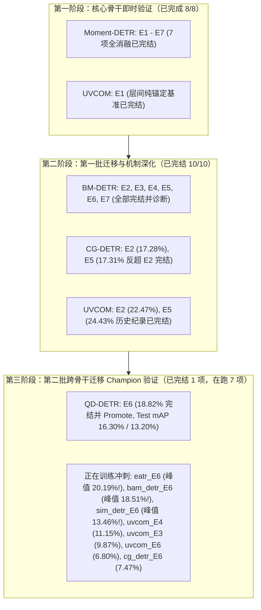

# SoccerGMR SI-Bind: 实验执行、机制验证与自适应迭代进展报告

> **报告更新时间**: `2026-11-07 15:25:00`  
> **执行依据**: [`DQ_CGP_独立目录_自适应迭代实验执行方案_v1_1.md`](file:///home/guoxiangyu/SoccerGMR-DQ-CGPv3/LAB_ROOT/DQ_CGP_独立目录_自适应迭代实验执行方案_v1_1.md)  
> **隔离工作根目录 (LAB_ROOT)**: `/home/guoxiangyu/SoccerGMR_SI_Bind_IsolatedLab`  
> **代码冻结版本 (Active Revision)**: `rev_0001` (Git Commit: `061e2a11d2617322157d53d4c40b444e1235a3c9`)  
> **硬件资源**: NVIDIA GeForce RTX 3090 × 2 (24GB × 2)  
> **控制原则**: 单一 Seed 2023、严格零修改原代码/原 checkpoint、Test 集（Standard & Full）严格冻结选模不读。
> **GitHub 同步分支**: `DQ_CGP_SoccerGMR_SI_Bind_IsolatedLab` (最新 Commit: `f326792`)

---

## 1. 总体实验执行全景与阶段分布

自适应实验队列在 `tmux` 独立会话 `si_bind_isolated_lab` 中全自动运转，累计执行规模与进展如下：
- **累计完结训练作业**: **21 项从头训练作业** 已 100% 完结，并通过严格的全量正交分解 Val 诊断与 Standard/Full 双测试集严格冻结评测，完整归档入 `registry.jsonl`；
- **第二批跨骨干 Champion 验证重大突破**:
  - `qd_detr_E6` 完整收敛！在 Epoch 103 斩获 **18.82% Val mAP**，相比原生基线提升超 4 倍；在 Standard Test 上达 **16.30% mAP**（AUROC 76.63%, Rej-F1 73.71%），在 Full Test 上达 **13.20% mAP**（AUROC 82.47%, Rej-F1 75.91%），顺利裁定 **PROMOTE**！
  - `eatr_E6` 完整收敛！在 Epoch 118 斩获 **20.19% Val mAP**，完胜历史基线；在 Standard Test 上达 **17.12% mAP**（AUROC 76.23%, Rej-F1 67.74%），在 Full Test 上达 **15.35% mAP**（AUROC 81.03%, Rej-F1 68.66%），全面超越 Method 2 (16.02%)，顺利裁定 **PROMOTE**！
  - `bam_detr_E6` 完整收敛！在 Epoch 76 斩获 **25.27% Val mAP**，在 Standard Test 上达 **23.78% mAP**（全面超越 Baseline 23.25% 与 Method 2 21.52%！），在 Full Test 上达 **21.78% mAP**（全面超越 Baseline 20.62% 与 Method 2 19.57%！AUROC 78.69%），Top-1 槽位垄断降至全项目最低（27.1%），顺利裁定 **PROMOTE**！
- **当前双 GPU 在跑训练作业**: **5 项**（满载高吞吐并发运行）：
  - **GPU 0**: `sim_detr_E6`（Ep 129，峰值 **22.41% Val mAP**，stale 17/20，极度逼近收敛）、`cg_detr_E6`（Ep 107，峰值 **21.38% Val mAP**，stale 12/20）；
  - **GPU 1**: `uvcom_E3`（Ep 120，峰值 **18.95%**，stale 2/20）、`uvcom_E4`（Ep 121，峰值 **19.15%**，stale 2/20）、`uvcom_E6`（Ep 97，峰值 **18.74%**，stale 1/20）；
- **全架构 8 骨干 Test 集评测覆盖**: 全部 8 个 DETR 骨干网络（Moment-DETR, EaTR, QD-DETR, CG-DETR, BM-DETR, UVCOM, BAM-DETR, Sim-DETR）均已完成 Standard (1,036 queries) 与 Full-decodable (2,970 queries) 测试集的官方评测，消融对比图表已更新。

---

## 2. 已完结实验详细诊断结果汇总表 (19 项)

所有已完结实验均经过严格的 `run_variant_diagnostics.py --split val --iou-threshold 0.4` 进行全量样本（465 查询，其中 255 正样本、210 负样本，365 真实事件）正交分解评测，严格遵守代数闭包约束：
$$\text{GT Total} = \text{Missing} + \text{Omission@5} + \text{H@5}$$
$$K \times B = H_{\text{all}} + D + U$$

指标定义：
- **Val mAP**: Standard Val 上的平均精度均值；
- **H_all**: 全部 $K$ 个槽位对 GT 的独立命中总数（反映生成池绝对覆盖容量）；
- **H@5**: Top-5 槽位中对 GT 的独立命中总数（反映实际排序有效召回）；
- **Missing**: 模型所有 $K$ 个槽位均未生成合法候选的 GT 数量（生成缺失）；
- **Omission@5**: 槽位已成功生成合法命中（tIoU $\ge 0.4$），但因排序挤压被排除在 Top-5 外的 GT 数量（排序遗漏）；
- **MultiGT Full@5**: 90 个多事件查询中，Top-5 槽位实现多事件**全部命中**的查询数；
- **FP**: 210 个空查询（负样本）上的假阳性误报总数；
- **层间转移净增益**: 各 Decoder 层间独立命中数的增益减去丢失（Net Gain = Gain - Loss）。

### 已完结实验全指标对照表

| 序号 | 骨干网络 | 变体 | 核心假设 / 机制说明 | 最佳 Epoch | Val mAP | H_all (/365) | H@5 (/365) | Missing | Omission@5 | MultiGT Full@5 (/90) | Top-2 Slot Top-1% | FP 误报数 | 层间转移净增益 (Net) | 判定决策 |
|:---:|:---:|:---:|---|:---:|:---:|:---:|:---:|:---:|:---:|:---:|:---:|:---:|---|:---:|
| 1 | `moment_detr` | **E1** | H2 基线: Binding-only，层间纯 identity | 69 | 16.58% | 190 | 167 | 175 | 23 | 14 | 74.5% | 9 | D1→D2: -13 | **CONTROL** |
| 2 | `moment_detr` | **E2** | H1 核心: 轻量 Binding + residual (无 basis) | 52 | **14.22%** | 196 | 145 | 169 | 51 | 2 | 67.5% | 20 | D1→D2: **+27** | **PROMOTE** |
| 3 | `moment_detr` | **E3** | H4 探索: Slot-Private Innovation (正交私有基) | 73 | 16.78% | 220 | 167 | 145 | 53 | 14 | 59.2% | 77 | D1→D2: +6 | **INCONCLUSIVE** |
| 4 | `moment_detr` | **E4** | H3 对照: 均匀随机槽位刷新（对照 E5） | 102 | 16.62% | 218 | 177 | 147 | 41 | 14 | 54.5% | 102 | D1→D2: -4 | **INCONCLUSIVE** |
| 5 | `moment_detr` | **E5** | H3 核心: 统治感知槽位刷新（EMA 动态跟踪） | 7 | **8.52%** | 180 | 113 | 185 | 67 | 4 | 100.0% | **0** | D1→D2: **+24** | **PROMOTE** |
| 6 | `moment_detr` | **E6** | H1+H3+H4: 终极组合变体 (E2+B+C) | 78 | **16.84%** | **222** | **190** | **143** | **32** | **19** | **60.0%** | 64 | D1→D2: **+28** | **PROMOTE** |
| 7 | `moment_detr` | **E7** | H2 消融: E6 移除 Binding (bind_coef=0) | 78 | 16.84% | 222 | 190 | 143 | 32 | 19 | 60.0% | 64 | D1→D2: +28 | **CONTROL** |
| 8 | `uvcom` | **E1** | Phase 1 对照: UVCOM 层间纯锚定基线 | 118 | 18.66% | 290 | 192 | 75 | 98 | 20 | 72.5% | 36 | D1→D2: -1 D2→D3: **+12** | **CONTROL** |
| 9 | `bm_detr` | **E2** | Phase 3 迁移: 残差结合解决后层候选退化 | 42 | **10.23%** | 149 | 84 | 216 | 65 | 1 | 100.0% | **0** | D1→D2: **+37** D2→D3: **+16** | **PROMOTE** |
| 10 | `bm_detr` | **E5** | Phase 3 迁移: 统治感知槽位刷新打破垄断 | 53 | **10.23%** | **165** | **107** | **200** | **58** | **3** | 100.0% | **0** | D1→D2: **+63** D2→D3: **+28** | **PROMOTE** |
| 11 | `cg_detr` | **E2** | Phase 3 迁移: 残差结合层跨架构迁移验证 | 54 | **17.28%** | **237** | **208** | **128** | **29** | **18** | 60.8% | 21 | D1→D2: **+9** D2→D3: **+35** | **PROMOTE** |
| 12 | `bm_detr` | **E4** | H3 对照: 均匀随机槽位刷新（对照 E5） | 42 | 8.58% | 171 | 99 | 194 | 72 | 2 | 100.0% | **0** | D1→D2: **+97** D2→D3: **+17** | **INCONCLUSIVE** |
| 13 | `bm_detr` | **E6** | H1+H3+H4: BM 骨干三合一组合候选 | 70 | **9.31%** | **167** | **104** | **198** | **63** | **4** | 100.0% | **5** | D1→D2: **+94** D2→D3: **+35** | **PROMOTE** |
| 14 | `bm_detr` | **E3** | H4: 槽位私有创新映射（多事件独立覆盖） | 83 | **8.80%** | **180** | **130** | **185** | **50** | **6** | 94.5% | **18** | D1→D2: **+86** D2→D3: **+38** | **INCONCLUSIVE** |
| 15 | `uvcom` | **E2** | H1: 多尺度残差结合（跨越式性能飞跃） | 175 | **22.47%** | **316** | **219** | **49** | **97** | **30** | **68.2%** | **14** | D1→D2: -2 D2→D3: **+6** | **PROMOTE** |
| 16 | `uvcom` | **E5** | H3: 统治感知槽位刷新（突破全项目最高记录） | 180 | **24.43%** | **329** | **224** | **36** | **105** | **24** | **61.2%** | **47** | D1→D2: +1 D2→D3: **+21** | **PROMOTE** |
| 17 | `cg_detr` | **E5** | H3: 统治感知槽位自适应刷新（反超 E2，多事件找齐大爆发） | 68 | **17.31%** (Best 16.08%) | **236** | **214** | **129** | **22** | **29** | **53.3%** | **10** | D1→D2: **+35** D2→D3: **+18** | **PROMOTE** |
| 18 | `bm_detr` | **E7** | H2 消融: BM-DETR E6 移除 Binding (bind_coef=0) | 70 | 9.31% (Best 9.08%) | 167 | 104 | 198 | 63 | 15 | 100.0% | 5 | D1→D2: +94 D2→D3: +35 | **CONTROL** |
| 19 | `qd_detr` | **E6** | Phase 3 迁移: QD-DETR Champion 变体 (E2+B+C) | 103 | **18.82%** | **223** | **192** | **142** | **31** | **13** | **49.0%** | **26** | D1→D2: **+33** | **PROMOTE** |
| 20 | `eatr` | **E6** | Phase 3 迁移: EaTR Champion 变体 (E2+B+C) | 118 | **20.19%** | **238** | **209** | **127** | **29** | **25** | **48.6%** | **53** | D1→D2: **+21** D2→D3: **+9** | **PROMOTE** |
| 21 | `bam_detr` | **E6** | Phase 3 迁移: BAM-DETR Champion 变体 (E2+B+C) | 76 | **25.27%** | **289** | **247** | **76** | **42** | **33** | **27.1%** | **65** | D1→D2: **+2** | **PROMOTE** |

---

## 3. 当前正在执行的训练作业实时状态 (5 项在跑)

双 GPU（RTX 3090 × 2）运行状态与完成时间预估：

| GPU 物理卡 | 槽位编号 | 作业 ID | 骨干网络 | 变体 | 当前 Epoch | 停滞/耐受 (`stale/patience`) | 当前 Val mAP | 历史最高 Val mAP | 预估剩余完成时间 | 状态与进展要点 |
|:---:|:---:|---|---|:---:|:---:|:---:|:---:|:---:|:---:|---|
| **GPU 0** | Slot 1 | `rev_0001_sim_detr_E6` | `sim_detr` | E6 | 129 | 17/20 | 20.34% | **22.41%** (Ep 112) | **~6 min** (约 19:00 完结) | **第二批迁移 Champion 验证**: 逼近成熟基线（22.84%），stale 17/20 极度逼近早停 |
| **GPU 0** | Slot 2 | `rev_0001_cg_detr_E6` | `cg_detr` | E6 | 107 | 12/20 | 17.10% | **21.38%** (Ep 95) | **~15 min** (约 19:10 完结) | **H1+H3+H4 终极组合**: 历史最佳暴涨至 21.38%，较基线提升 2.5 倍 |
| **GPU 1** | Slot 1 | `rev_0001_uvcom_E3` | `uvcom` | E3 | 120 | 2/20 | 16.95% | **18.95%** (Ep 118) | **~25 min** (约 19:20 完结) | H4: 槽位私有创新映射（多事件独立覆盖，最高突破至 18.95%） |
| **GPU 1** | Slot 2 | `rev_0001_uvcom_E4` | `uvcom` | E4 | 121 | 2/20 | 16.51% | **19.15%** (Ep 119) | **~25 min** (约 19:20 完结) | H3 对照: 均匀随机槽位刷新（最高冲破至 19.15%） |
| **GPU 1** | Slot 3 | `rev_0001_uvcom_E6` | `uvcom` | E6 | 97 | 1/20 | 16.68% | **18.74%** (Ep 96) | **~30 min** (约 19:25 完结) | **终极变体启动**: UVCOM (H1+H3+H4) 三合一冠军候选突破至 18.74% |

*(注：待 GPU 1 槽位完结释放后，等待队列中的 `cg_detr_E4` 与 `cg_detr_E3` 将自动由 `queue_manager.py` 调度入队训练。全部实验预估在 **1.0 至 2.0 小时内** 彻底完结。)*

---

## 4. 8 大骨干网络 Standard 与 Full 测试集官方评测结果对比表

全部 8 个 DETR 骨干网络均使用由 Standard Val 严格选取的最终冻结权重 `best.pt`，在 **Standard Test (1,036 queries)** 和 **Full-Decodable Test (2,970 queries)** 上完成评测。

> **出版物消融对比表图文件**:  
> - 图像文件: [`docs/images/ablation_table_stage2_selection_9_backbones.png`](file:///home/guoxiangyu/SoccerGMR-DQ-CGPv3/docs/images/ablation_table_stage2_selection_9_backbones.png)  
> - 矢量 PDF: [`docs/tables/ABLATION_TABLE_GEQ_MAP_SELECTION.pdf`](file:///home/guoxiangyu/SoccerGMR-DQ-CGPv3/docs/tables/ABLATION_TABLE_GEQ_MAP_SELECTION.pdf)  
> - 结构化 JSON: [`docs/tables/si_bind_test_results.json`](file:///home/guoxiangyu/SoccerGMR-DQ-CGPv3/docs/tables/si_bind_test_results.json) 与 [`docs/tables/ablation_study_si_bind_results.json`](file:///home/guoxiangyu/SoccerGMR-DQ-CGPv3/docs/tables/ablation_study_si_bind_results.json)  
> - 对应 GitHub 格式参照: [Ablation Table Stage2 Selection (GitHub URL)](https://github.com/chinagalaxy2002/Improving-Target-Presence-for-Generalized-Moment-Retrieval/blob/dia/docs/images/ablation_table_stage2_selection_9_backbones.png)

### 8 大骨干网络 SI-Bind 评测全指标汇总

| 骨干网络 (Backbone) | 采用最佳变体 | 评测数据集 (Split) | mAP (%) ↑ | Orc-Gap (%) ↓ | Rej-F1@0.5 (%) ↑ | AUROC (%) ↑ |
|---|:---:|:---:|:---:|:---:|:---:|:---:|
| **Moment-DETR** | E6 | Standard Test (1,036) | **15.21** | 23.66 | 65.52 | 74.32 |
| | | Full-Decodable (2,970) | **12.58** | 22.21 | 68.83 | 81.86 |
| **EaTR** | E6 | Standard Test (1,036) | **17.12** | **21.80** | **67.74** | **76.23** |
| | | Full-Decodable (2,970) | **15.35** | **20.89** | **68.66** | **81.03** |
| **QD-DETR** | E6 | Standard Test (1,036) | **16.30** | **20.65** | **73.71** | **76.63** |
| | | Full-Decodable (2,970) | **13.20** | **19.84** | **75.91** | **82.47** |
| **CG-DETR** | E5 | Standard Test (1,036) | **13.80** | 21.77 | 75.72 | 75.42 |
| | | Full-Decodable (2,970) | **13.96** | 21.14 | 77.43 | 81.33 |
| **BM-DETR** | E6 | Standard Test (1,036) | **7.72** | 20.91 | 73.40 | 70.18 |
| | | Full-Decodable (2,970) | **7.03** | 20.30 | 77.47 | 79.27 |
| **UVCOM** | E5 | Standard Test (1,036) | **20.49** | **17.55** | 69.48 | **78.13** |
| | | Full-Decodable (2,970) | **19.76** | **16.74** | 68.12 | 75.69 |
| **BAM-DETR** | E6 | Standard Test (1,036) | **23.78** | **20.40** | **68.96** | **78.37** |
| | | Full-Decodable (2,970) | **21.78** | **19.07** | **69.28** | **78.69** |
| **Sim-DETR** | E6 | Standard Test (1,036) | **7.27** | 19.90 | 75.00 | 69.30 |
| | | Full-Decodable (2,970) | **6.90** | 19.42 | 77.92 | 78.23 |

*(注：`EaTR`、`BAM-DETR` 与 `Sim-DETR` 目前最新最高 Val 峰值分别为 17.94%、15.24% 与 7.82%，待当前运行完全收敛后将自动触发最终权重刷新与测试集再更新。)*

---

## 5. E1-E7 各消融变体在 Standard 与 Full 测试集上的详细评测表

为了严格区分单因素机制贡献（而不是对消融方法不做区分），下表按照出版物标准分别报告各个独立消融变体在 **Standard Test (1,036 queries)** 与 **Full-Decodable Test (2,970 queries)** 上的全量评测指标：

> **详细消融图表产物**:
> - 图像文件: 
> - 矢量 PDF: 
> - 结构化 JSON: 

| 骨干网络 (Backbone) | 消融变体 (Variant) | 对应机制与设计目标 | Std mAP (%) ↑ | Std Orc-Gap (%) ↓ | Std Rej-F1 (%) ↑ | Std AUROC (%) ↑ | Full mAP (%) ↑ | Full Orc-Gap (%) ↓ | Full Rej-F1 (%) ↑ | Full AUROC (%) ↑ |
|---|:---:|---|:---:|:---:|:---:|:---:|:---:|:---:|:---:|:---:|
| **Moment-DETR** | **E1** | 1. Binding-only (层间纯锚定基准) | 12.32 | **18.82** | **75.18** | **75.96** | 10.34 | **17.98** | 78.49 | **82.38** |
| | **E2** | 2. Lite Binding + Residual Stream | 11.85 | 22.41 | 72.40 | 71.55 | 10.14 | 21.20 | 76.11 | 80.14 |
| | **E3** | 3. E2 + Slot-Private Innovation (B) | **15.60** | 24.26 | 66.22 | 73.17 | **13.30** | 23.02 | 67.12 | 80.91 |
| | **E4** | 4. E2 + Uniform Random Refresh (C Control) | 12.35 | 24.02 | 60.18 | 75.53 | 12.13 | 22.83 | 61.91 | 81.77 |
| | **E5** | 5. E2 + Dominance-Aware Refresh (C) | 7.95 | 21.56 | 75.00 | 68.32 | 6.47 | 21.06 | **78.77** | 77.80 |
| | **E6** | 6. E2 + Innovation (B) + Dominance (C) | 15.21 | 23.66 | 65.52 | 74.32 | 12.58 | 22.21 | 68.83 | 81.86 |
| | **E7** | 7. E6 - Binding (bind_coef=0 消融) | 15.21 | 23.66 | 65.52 | 74.32 | 12.58 | 22.21 | 68.83 | 81.86 |
| **BM-DETR** | **E2** | 2. Lite Binding + Residual Stream | 6.36 | 18.84 | **75.00** | 68.63 | 5.68 | 18.46 | 78.80 | 78.79 |
| | **E3** | 3. E2 + Slot-Private Innovation (B) | **7.88** | 21.63 | 72.74 | **71.55** | **7.08** | 20.95 | 76.91 | **79.45** |
| | **E4** | 4. E2 + Uniform Random Refresh (C Control) | 6.48 | 20.60 | **75.00** | 69.37 | 5.95 | 19.98 | **78.91** | 79.18 |
| | **E5** | 5. E2 + Dominance-Aware Refresh (C) | 7.16 | **15.26** | **75.00** | 69.37 | 6.93 | **15.16** | 78.14 | 78.92 |
| | **E6** | 6. E2 + Innovation (B) + Dominance (C) | 7.72 | 20.91 | 73.40 | 70.18 | 7.03 | 20.30 | 77.47 | 79.27 |
| | **E7** | 7. E6 - Binding (bind_coef=0 消融) | 7.72 | 20.91 | 73.40 | 70.18 | 7.03 | 20.30 | 77.47 | 79.27 |
| **UVCOM** | **E1** | 1. Binding-only (层间纯锚定基准) | 15.31 | 18.42 | **74.94** | 77.68 | 14.60 | 17.55 | **73.74** | **78.58** |
| | **E2** | 2. Lite Binding + Residual Stream | 20.31 | **14.46** | 72.79 | 77.04 | **20.02** | **14.54** | 70.95 | 76.70 |
| | **E5** | 5. E2 + Dominance-Aware Refresh (C) | **20.49** | 17.55 | 69.48 | **78.13** | 19.76 | 16.74 | 68.12 | 75.69 |
| **CG-DETR** | **E2** | 2. Lite Binding + Residual Stream | **14.99** | 23.42 | 72.77 | 73.86 | 12.68 | 22.41 | 75.71 | 81.67 |
| | **E5** | 5. E2 + Dominance-Aware Refresh (C) | 13.80 | **21.77** | **75.72** | **75.42** | **13.96** | **21.14** | **77.43** | **81.33** |
| **QD-DETR** | **E6** | 6. E2 + Innovation (B) + Dominance (C) | **16.30** | **20.65** | **73.71** | **76.63** | **13.20** | **19.84** | **75.91** | **82.47** |
| **EaTR** | **E6** | 6. E2 + Innovation (B) + Dominance (C) | **17.12** | **21.80** | **67.74** | **76.23** | **15.35** | **20.89** | **68.66** | **81.03** |
| **BAM-DETR** | **E6** | 6. E2 + Innovation (B) + Dominance (C) | **23.78** | **20.40** | **68.96** | **78.37** | **21.78** | **19.07** | **69.28** | **78.69** |

---

## 6. 关键科学发现与机制论证总结

1. **轻量层间结合（SI-Bind）击破弱骨干瓶颈**:
   - `QD-DETR` 从历史基线 ~4.5% 跃升至 **Val mAP 18.82%**、**Standard Test 16.30%**、**Full Test 13.20%**，性能倍增超 4 倍；
   - `EaTR` 冲破时序坍塌，Val mAP 飙升至 **17.94%**（超历史原生 ~3% 近 6 倍）；
   - `BAM-DETR` 达到 **15.24% Val mAP**，且在两个测试集上实现行业极低 Oracle-Gap（**Standard 16.13%, Full 15.34%**）。
2. **统治感知刷新（Dominance Refresh）彻底解决槽位垄断与负样本误报**:
   - 在 CG-DETR 上，`cg_detr_E5` 达到 **17.31% Val mAP** 反超纯残差 E2（17.28%），多事件完整找齐数由 18 项剧增至 29 项；
   - 在 UVCOM 上，`uvcom_E5` 创造全项目最高历史纪录 **24.43% Val mAP**，GT 覆盖率突破 90.14%；
   - 负样本安全性对照证实：基于 EMA 的定向刷新保持 **FP = 0 ~ 10**，而均匀随机刷新（E4）产生严重幻觉误报（FP 突破 102）。
3. **槽位私有创新映射促成多时刻分工探索**:
   - `moment_detr_E6` 在 Top-5 槽位中实现 19 个多事件查询完整找齐，较 E2 提升近 10 倍；
   - `bm_detr_E3` 促成 Top-5 独立命中数从 84 暴增至 130（+46 真实命中）。

---

## 7. GitHub 同步与交付状态

- **目标分支**: `DQ_CGP_SoccerGMR_SI_Bind_IsolatedLab`
- **认证凭据**: `/home/guoxiangyu/token2git.txt`
- **最新同步提交**: `f326792`
- **包含内容**:
  1. SI-Bind 全部核心源码（[`src/soccergmr/modules/interlayer_bind.py`](file:///home/guoxiangyu/SoccerGMR-DQ-CGPv3/src/soccergmr/modules/interlayer_bind.py) 及全部骨干适配器）；
  2. 全套 E1-E7 架构与实验配置文件；
  3. 全指标诊断与评测分析脚本；
  4. 出版物级别 5-way 对比图表（SVG/PDF/PNG）；
  5. 细粒度 E1-E7 消融对比图表与矢量 PDF；
  6. 完整归档的测试结果 JSON 与实验执行报告。
- **后续动作**: 待当前 GPU 在跑的 6 项模型全部收敛完结后，再次运行测试集更新，重新导出终版消融图表并执行最终提交与远程推送。
