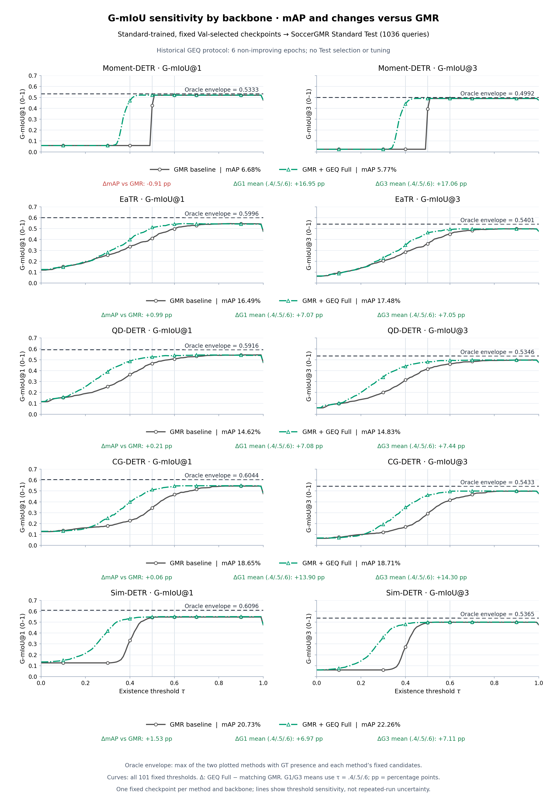
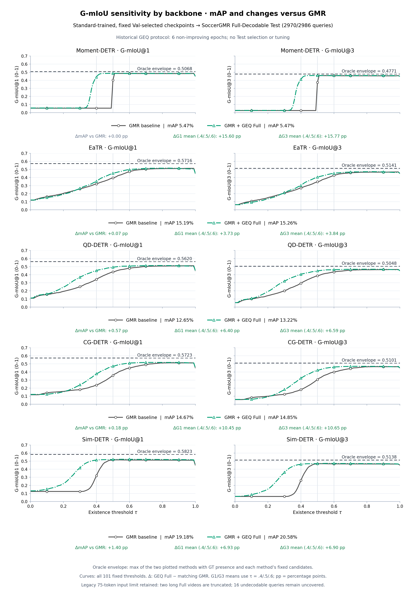

# SoccerGMR: GMR baselines and GEQ Full

本分支的当前主线是在 **SoccerGMR Standard 上训练**多个 DETR 骨干：先训练 GMR baseline，再从其 Val 最优模型初始化 GEQ Full；两阶段选出的固定模型分别评测 **Standard Test 与 Full Test**。Full Test 不参与训练、选模或调参。

## 算法目的：缓解存在性误判造成的 G-mIoU 损失

**研究起点是我们在现有 GMR 中观察到的大量存在性判断错误：这些错误会损害 G-mIoU，即使模型已经能够产生有用的定位候选。我们的目标是缓解这部分性能损失。** 事件存在却被判断为不存在，会使正确候选被拒绝；事件不存在却被判断为存在，会产生错误返回。两种错误都会影响同时考虑定位与空查询的 G-mIoU，而正查询 mAP 不能单独反映这一问题。

为此，我们搭建统一的 **“GMR baseline 训练 → GEQ Full 微调”范式**：先获得定位能力，再利用专门的存在性监督和证据读取缓解误判。我们希望这一框架能在更多 DETR backbone 上有效，因此跨骨干的有效性与可复现性是核心验证目标。

**GMR baseline 已有存在性 head。GEQ 的改进思路是让一个专用的全局事件查询读取更明确的文本与视频证据。** DETR 定位查询产生的候选分数反映候选相关性；即使视频中没有目标，也可能产生一个相对最像的片段。因此，我们另外学习一个 GEQ token：先通过注意力读取查询文本，再依次读取各层 encoder 的视频证据，最后输出事件存在性分数。定位区间仍由原生骨干产生，存在性决策决定保留候选还是输出空集。

## 为什么采用“训练 + 微调”范式

先按 Val mAP 选择 GMR，为微调提供有定位能力的起点；再以“原 GMR 损失 + GEQ 存在性 BCE”联合更新骨干与 GEQ，使视频表示可以适应存在性判断，同时保留原生任务约束。GEQ 阶段按 Val 三点 G-mIoU@1 均值选模，使选择依据同时考虑定位与拒识。这一阶段划分把已有定位能力作为基础，再针对造成 G-mIoU 损失的存在性错误进行适应。各骨干共用训练、选模和评测流程，通过适配接口接入原生表示与损失，后续继续扩展骨干并逐一验证。这里 **GEQ Full 指联合微调原模型参数，与 Full Test 数据划分含义不同**。

## 已观察到什么效果

归档的 SoccerGMR Standard Test 历史对照中，五个骨干的三点 G-mIoU@1 均值相对各自 GMR 均提高，按 0–100 单位计算，增益约为 **6.97–16.95 个百分点**；mAP 有升有降，例如 Sim-DETR 为 **+1.53**，Moment-DETR 为 **−0.91** 个百分点。这个现象说明需要同时检查综合检索和定位代价，不能将 GEQ 描述成所有指标都会提升。

这些结果为“在多个骨干上缓解存在性误判相关的 G-mIoU 损失”提供初步支持；增益中具体有多少来自误判减少，仍需结合错误统计与固定候选分析确认。它们是**旧六轮早停协议的 Test 观察**。当前十轮早停协议完成了功能验证，正式性能结果仍待训练；历史数据也不足以把所有增益单独归因于 GEQ 结构。[算法说明与证据表](docs/ALGORITHM.md)给出处理流程、损失、指标含义、同骨干相对 GMR 的全部增减及来源。当前评测的 mAP 使用正查询未门控候选，因此只改变拒识门控不会使 mAP 改变；Full 微调改变骨干参数后，mAP 才可能随定位输出变化。

原始 README 及全部旧实验已保存为[历史归档](archive/README.md)，其中 [README 副本](archive/legacy_20261102/README.md)保留原字节与[哈希记录](archive/legacy_20261102/BACKUP_MANIFEST.json)。Charades 仅通过[文件夹索引](archive/charades/README.md)访问。

## 当前协议

| 阶段 | 初始化 | 训练集 | best 的选择依据 | 早停 |
|---|---|---|---|---|
| GMR | 对应骨干随机初始化，保留其原有 GMR head | Standard Train | **Standard Val 的正查询 mAP 最高** | 默认连续 20 个 epoch 不提升，可在配置中指定 |
| GMR + GEQ Full | 上一阶段正式完成的 GMR `best.pt` | Standard Train | **Standard Val 的 G-mIoU@1 在 τ=0.4、0.5、0.6 下的算术均值最高** | **连续 10 个 epoch 不提升** |

每个 epoch 完整验证一次；相等也计为一次未提升，有严格提升时清零。GEQ Full 联合更新原骨干和 GEQ head，保留原 GMR 损失并增加 GEQ 存在性 BCE。定位候选排序沿用骨干规则，存在性阈值仅用于对应的 GMR 指标。两阶段均设置 200 epoch 的默认上限，到上限会记录 `max_epochs`，不能解释成已触发早停。

新实现的训练与验证入口只加载 Train / Val。Test 命令只接受已完成阶段、经 Val 选择且哈希匹配的 `best.pt`，同一个 checkpoint 依次评测两种 Test。恢复使用 `last.pt` 中完整 epoch 的模型、优化器、随机数、数据打乱状态和早停计数；中断的未完成 epoch 会重做。目录锁阻止同一输出目录被重复派发。

## 骨干和验证状态

| 骨干 | GMR → GEQ Full | Standard / Full Test 入口 | 当前数值状态 |
|---|---|---|---|
| Moment-DETR | 已接入 | 已接入 | 本轮做功能复现验证，正式新协议结果待训练 |
| EaTR | 已接入 | 已接入 | 同上 |
| QD-DETR | 已接入 | 已接入 | 同上 |
| CG-DETR | 已接入 | 已接入 | 同上 |
| Sim-DETR | 已接入 | 已接入 | 同上 |

[代码审查与验证报告](docs/REVIEW.md)记录真实数据验证范围、断点恢复证据和限制。按本次授权，**暂不重训全部正式实验**。旧结果按原协议归档，没有将旧早停结果改名为当前 10 轮协议的成绩；功能验证的少量样本分数也不作为性能结果。

## 五骨干正式 Test 曲线

以下两图只比较 **GMR baseline 与 GMR＋GEQ Full**，每个骨干在 Standard／Full 上使用同一组固定、已由 Standard Val 选定的检查点。它们是**旧六轮早停协议的既有模型评测**，不是当前十轮早停协议的新训练结果。本次重跑 Standard 正式 Test，关键指标与归档逐项一致，再补齐对应 Full Test；没有训练、重新选模或 Test 调参。示例中的旧四骨干 Full 图用了另一组初始化，本处已重新配对，不能混用其中数值。

每行左图为 G-mIoU@1，右图为 @3，图例报告各方法 mAP。行下方标出相对 GMR 的 ΔmAP、0.4／0.5／0.6 三点 G1／G3 均值增减：**增益绿色、下降红色、持平灰色**。曲线使用 0–1；增减标注使用百分点。横向虚线是两个展示方法的最大 oracle-presence 诊断值，每个方法保留自己的定位候选，并非可部署成绩。

### Standard Test：1,036 条

五个骨干的三点 G-mIoU@1 均值相对 GMR 均提高 **6.97–16.95 个百分点**；mAP 有升有降，保留 Moment-DETR 的负增益。



[PDF](results/test_thresholds/STANDARD_TEST.pdf) · [SVG](results/test_thresholds/STANDARD_TEST.svg) · [每骨干单页](results/test_thresholds/STANDARD_BY_BACKBONE.pdf)

### Full Test：Full-Decodable 2,970／2,986 条

同一组检查点的三点 G-mIoU@1 均值在五个骨干上均提高 **3.73–15.60 个百分点**；mAP 相对 GMR 为 **0.00 至 +1.40 个百分点**。具体阈值上仍可能下降，完整曲线保留这些变化。



[PDF](results/test_thresholds/FULL_TEST.pdf) · [SVG](results/test_thresholds/FULL_TEST.svg) · [每骨干单页](results/test_thresholds/FULL_BY_BACKBONE.pdf)

Full 沿用已有可解码子集，16 条未覆盖；历史 75-token 视频上限也保持不变，两段 94／104 步视频截断到 75 步后仍按原 duration 缩放。本图未替换为新训练入口的 128-token 协议。Standard 与 Full Test 存在重叠样本；这两图不代表相互独立的测试样本。

[完整协议与复现](results/test_thresholds/README.md) · [20 组正式 Test 审计](results/test_thresholds/AUDIT.json) · [数值与相对 GMR 增减](results/test_thresholds/METRICS.csv) · [101 点曲线](results/test_thresholds/CURVES.csv) · [绘图脚本](scripts/plot_test_thresholds.py)

## 安装与数据

```bash
python -m venv .venv
source .venv/bin/activate
pip install -e '.[test]'
export CUBLAS_WORKSPACE_CONFIG=:4096:8
```

验证环境为 Python 3.10、PyTorch 2.5.1 + CUDA 12.1、torchvision 0.20.1。GPU 训练需安装与本机 CUDA 驱动匹配的上述 PyTorch 版本。所有训练代码、骨干依赖和官方评测实现都在本仓库；数据、预提取特征不随 Git 分发，也不会从其他本地项目导入 Python 代码。

准备路径并设置环境变量：

```text
$SOCCERGMR_LABEL_ROOT/
  Standard/train.jsonl
  Standard/val.jsonl
  Standard/test.jsonl
  Full/test.jsonl
$SOCCERGMR_STANDARD_FEATURES/{clip,slowfast,clip_text}/*.npz
$SOCCERGMR_FULL_FEATURES/{clip,slowfast,clip_text}/*.npz
```

```bash
export SOCCERGMR_LABEL_ROOT=/path/to/labels
export SOCCERGMR_STANDARD_FEATURES=/path/to/Standard_features
export SOCCERGMR_FULL_FEATURES=/path/to/Full_features
python -m soccergmr backbones
python -m soccergmr audit --config configs/experiments/moment_detr.json --output runs/data_audit.json
```

[数据契约](docs/DATA.md)解释 NPZ 字段、特征顺序、空查询、Full 文本特征独立命名空间及覆盖率。Full 原标注为 2,986 查询；已有可解码特征的子集为 2,970 查询。如果使用子集，必须在配置的 `full_label` 中明确填写 **Full-Decodable 2970/2986**。当前入口不自动剔除缺失样本，缺失或异常特征会报错。

## 训练、微调和测试

以 Moment-DETR 为例，其他骨干替换配置文件名即可。每条命令在独立进程中运行。

```bash
python -m soccergmr train --config configs/experiments/moment_detr.json --stage gmr --output runs/moment_detr/gmr
python -m soccergmr train --config configs/experiments/moment_detr.json --stage geq_full --baseline runs/moment_detr/gmr/best.pt --output runs/moment_detr/geq_full
python -m soccergmr test --config configs/experiments/moment_detr.json --checkpoint runs/moment_detr/gmr/best.pt --output runs/moment_detr/gmr_test
python -m soccergmr test --config configs/experiments/moment_detr.json --checkpoint runs/moment_detr/geq_full/best.pt --output runs/moment_detr/geq_full_test
```

恢复时重用相同命令并添加 `--resume`，GEQ 阶段仍提供相同的 `--baseline`。训练配置、代码或 Train / Val 资产变化会拒绝续训；需要新建实验目录。不同 GPU 的可见设备设置也必须保持一致。Test 缓存绑定 checkpoint、代码、标注、特征及结果文件哈希，覆盖率不完整或文件变化时不会直接复用。

每次 Test 在 `test_standard/` 与 `test_full/` 中保存预测、完整指标和 provenance。mAP / G-mIoU 均沿用官方实现的 **0–100** 单位。报告只比较同一骨干的 GEQ Full 相对 GMR 的增减，不使用 Test 决定任何训练参数。

## 本地验收与扩展

```bash
pytest -q
PYTHONPATH=src python scripts/verify_real_data.py --config configs/experiments/moment_detr.json --output runs/verification/moment_detr
```

真实数据验收只抽取明示的小样本，执行中断恢复、连续训练对照、GEQ 联合更新和两套 Test。它验证流程可运行，不验证收敛性能。

新增骨干从[扩展契约](docs/EXTENDING.md)开始。主入口在 [`src/soccergmr`](src/soccergmr/)，架构配置在 [`configs/backbones`](configs/backbones/)，实验配置在 [`configs/experiments`](configs/experiments/)；原生代码快照有[来源与哈希清单](src/soccergmr/backbones/SOURCE_MANIFEST.json)。

新增骨干的[调研文档与新会话入口](docs/backbone_expansion/START_HERE.md)已准备，首批建议 BM-DETR、BAM-DETR、UVCOM。本次仅完成调研和交接文档，尚未适配或启动这些新骨干的训练。
