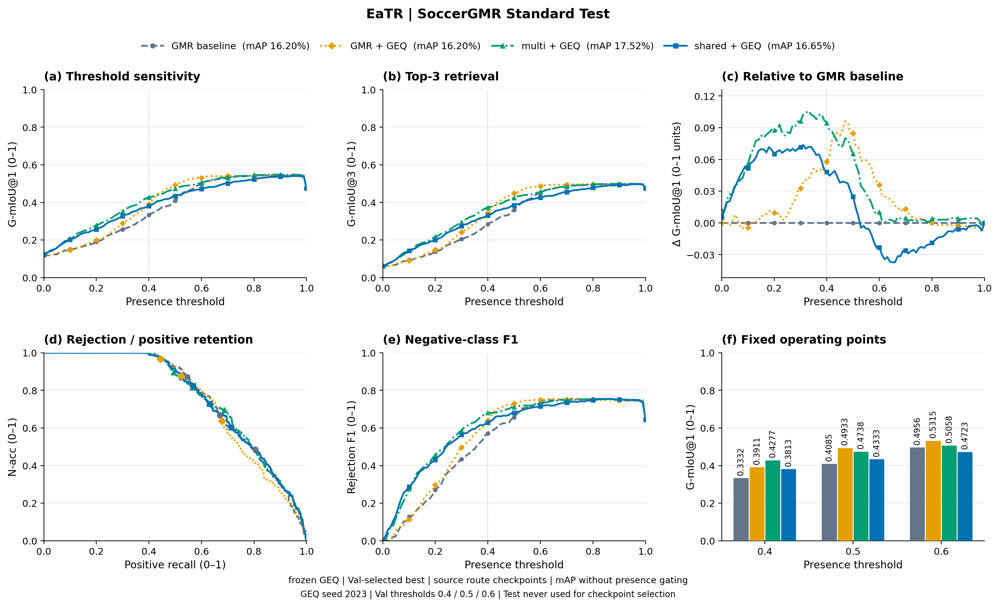
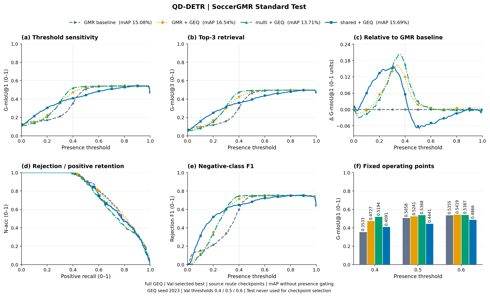
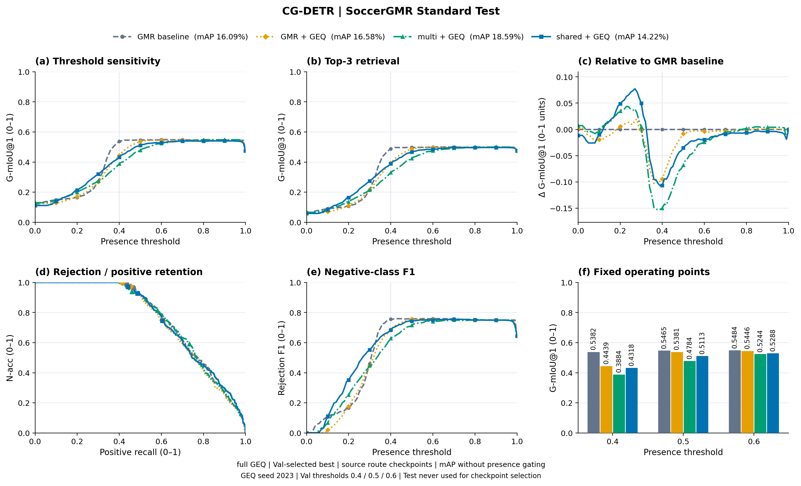
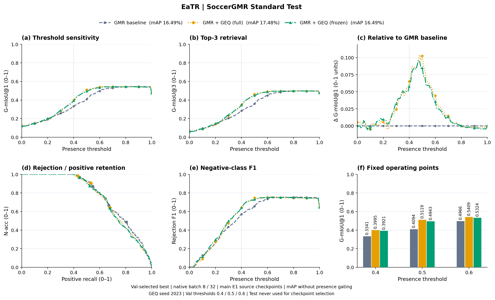

# GMR × Mr. DETR 多骨干实验

四骨干的Temporal O2M、独立FFN、Instruction路线，以及Global Event Query存在性预测。

## 最新：统一验证集选模协议

更新时间：2026-10-31T23:49:51+08:00。Multi / Shared全量与冻结 **16/16** 组完成Test；同源Baseline控制 **8/8** 组。

所有新微调均使用seed2023；按完整Val的G-mIoU@1在0.4/0.5/0.6三点均值选best，连续超过5轮（6轮）不提升早停，上限20轮。Test只评估选定best。两种方案并行排队，每卡最多两个CUDA任务，包含已有作业。

full保留原路线GMR/O2M损失并加GEQ BCE；frozen冻结原模型，仅训练GEQ。原GMR与Multi/Shared既有训练预算仍有差异，完整方法比较不能完全归因于单一模块。

[全部24组状态、选模和最新Test](results/geq_val_selection/README.md) · [复现代码](shared/geq_protocol/README.md)

### moment_detr

**full：GMR / GMR+GEQ / Multi+GEQ / Shared+GEQ**


**frozen：GMR / GMR+GEQ / Multi+GEQ / Shared+GEQ**


### eatr

**full：GMR / GMR+GEQ / Multi+GEQ / Shared+GEQ**


**frozen：GMR / GMR+GEQ / Multi+GEQ / Shared+GEQ**



### qd_detr

**full：GMR / GMR+GEQ / Multi+GEQ / Shared+GEQ**



**frozen：GMR / GMR+GEQ / Multi+GEQ / Shared+GEQ**


### cg_detr

**full：GMR / GMR+GEQ / Multi+GEQ / Shared+GEQ**



**frozen：GMR / GMR+GEQ / Multi+GEQ / Shared+GEQ**


## 已完成：main E1同源初始化的八组GEQ对照

这组使用main E1的历史GMR检查点，与上面的当前多路线起点不同，因此单列。八组均已完成完整Val/Test；下图直接展示G-mIoU@1、@3的101点阈值曲线、拒绝/保留关系、Rej-F1与固定工作点，图例报告mAP。

| Backbone | GMR mAP (%) | full + GEQ | frozen + GEQ |
|---|---:|---:|---:|
| moment_detr | 6.68 | 5.77 | 6.68 |
| eatr | 16.49 | 17.48 | 16.49 |
| qd_detr | 14.62 | 14.83 | 14.62 |
| cg_detr | 18.65 | 18.71 | 18.65 |

[完整指标、Val曲线、PDF/SVG和CSV](results/geq_epoch_study/README.md)

### moment_detr · main E1对照


### eatr · main E1对照



### qd_detr · main E1对照


### cg_detr · main E1对照


## 历史结果

- [固定四轮GEQ的12组结果与四曲线](results/geq_finetune/README.md)：旧协议，保留供追溯。
- [原六路线24组汇总快照](results/README.md)：按原Val mAP选模，与本次GEQ选模分开。
- G-mIoU及存在性图使用0–1；mAP、AUROC使用百分数。所有图表按骨干分文件夹。

## 从哪里开始

- **实验交接与后续微调**：[HANDOFF.md](HANDOFF.md)
- **全部 24 组检查点、服务器绝对路径和复现命令**：[检查点索引](docs/CHECKPOINTS_AND_REPRODUCTION.md#10-全部检查点与实验目录)
- **当前 Batch、复用与重启配置**：[execution_plan.json](shared/execution_plan.json)
- **历史完整 Baseline 来源与 SHA256**：[来源清单](docs/baseline_sources/manifest.json)

## 目录

```text
.
├── README.md
├── HANDOFF.md
├── results/              # 完整结果 README、24 行 CSV 和四骨干图表
├── backbones/
│   ├── moment_detr/      # source/、训练/测试入口、experiment/ 完整六路线结果包
│   ├── eatr/             # source/、run.py、smoke.sh、train.sh、test.sh
│   ├── qd_detr/          # 同上
│   └── cg_detr/          # 同上
├── shared/               # 一份公共多路线模型、匹配、训练、评估和队列实现
│   └── geq_finetune/     # 新增 GEQ-only 冻结微调、八任务队列与对照绘图
└── docs/                 # 检查点交接、来源和实验记录
```

`backbones/<骨干>/source/` 保存该骨干原生代码与来源记录，使用该骨干顶层的训练/
测试入口运行本实验。Moment-DETR 的原六路线工具包只有一份，位于
`backbones/moment_detr/experiment/gmr_multiroute_kit/`。

## 四个骨干的入口

| Backbone | 说明与代码 | 训练 | 测试 |
|---|---|---|---|
| Moment-DETR-GMR | [moment_detr/](backbones/moment_detr/) | `bash backbones/moment_detr/train.sh sepffn` | `bash backbones/moment_detr/test.sh sepffn` |
| EaTR-GMR | [eatr/](backbones/eatr/) | `bash backbones/eatr/train.sh sepffn` | `bash backbones/eatr/test.sh sepffn` |
| QD-DETR-GMR | [qd_detr/](backbones/qd_detr/) | `bash backbones/qd_detr/train.sh sepffn` | `bash backbones/qd_detr/test.sh sepffn` |
| CG-DETR-GMR | [cg_detr/](backbones/cg_detr/) | `bash backbones/cg_detr/train.sh sepffn` | `bash backbones/cg_detr/test.sh sepffn` |

每个骨干还有 `smoke.sh <方法>`。`sepffn` 可以替换为下表任意方法。

## 六种方法

| 参数 | 训练方式 |
|---|---|
| `baseline` | 原始 GMR O2O 主路线，无 O2M 辅助路线 |
| `shared` | 一条固定 K=2 O2M 路线，Decoder 参数全共享 |
| `sepffn` | O2M 路线共享注意力，辅助 FFN 与 norm3 独立 |
| `instruction` | O2M 路线加入 4 个 Self-Attention 指令 Token |
| `multi` | Separate FFN 与 Instruction 双路线，各损失权重 0.15 |
| `adaptive` | 双路线，第二个正样本要求 tIoU≥0.25 |

主 Queries=10，辅助 Queries=24，辅助总损失权重=0.3。辅助路线仅训练执行，
推理使用主路线与原存在性适配器。完整方法解释见 [实验说明](docs/CHECKPOINTS_AND_REPRODUCTION.md#1-核心设计)。

## 原六路线训练配置

新路线使用 seed2023、AdamW、LR5e-5。已运行任务及 EaTR 原队列使用 microbatch2、
累积4；待启动 QD/CG 的 instruction、multi、adaptive 从头使用 batch32、累积1。
仅 EaTR Baseline 复用已完成的 seed2026、batch32、LR3e-5 模型，Test mAP 为 16.20。
因此 EaTR Baseline 与其他路线属于跨协议参考比较。

每5 epoch 验证，以 Val mAP 选 best；三种迁移骨干20 epoch 无提升早停，训练后
测试冻结 best。两张 GPU 每卡最多两个任务。G-mIoU 数值报告为0–1；其余官方指标
使用百分数。Moment-DETR 原六路线的实际停止过程在其结果包中单独记录。

## 在服务器上使用新布局

GitHub 的代码布局已整理，服务器上正在训练的旧目录仍保持原位。
**检查点索引中的 `/home/guoxiangyu/...` 是服务器路径，不是 GitHub 文件夹。**
权重、预提取特征和视频没有上传 GitHub。

EaTR/QD/CG 默认把运行产物写到本 checkout 的 `shared/runs/<骨干>/<方法>/`。
如需从这个新布局读取服务器已有权重，在空闲 GPU 槽位运行测试前设置：

```bash
export GMR_RUNTIME_ROOT=/home/guoxiangyu/Improving-Target-Presence-for-Generalized-Moment-Retrieval/backbonefolder/multiroute_gmr
CUDA_VISIBLE_DEVICES=0 bash backbones/eatr/test.sh baseline
```

Moment-DETR 使用自己的原项目根目录：

```bash
export GMR_PROJECT_ROOT=/home/guoxiangyu/ImprovingGeneralizedMomentRetrieval
CUDA_VISIBLE_DEVICES=0 bash backbones/moment_detr/test.sh sepffn
```

换机前按 [交接文档](HANDOFF.md) 配置数据、特征、上游依赖与权重。
无需移动服务器现有文件，也无需重启当前训练队列。

## 离线重绘结果

```bash
python -m pip install numpy matplotlib
python shared/build_results_report.py --snapshot results/snapshot.json --output results
```

此命令使用发布的数据快照生成同一份 README、表格、综合图和各骨干图，不需要
GPU、权重或数据集。服务器每次完成 Test 后刷新本地报告；GitHub 为提交时快照。
