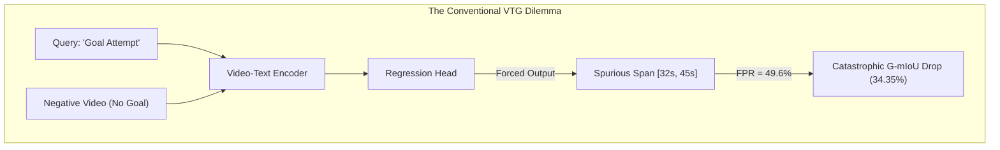
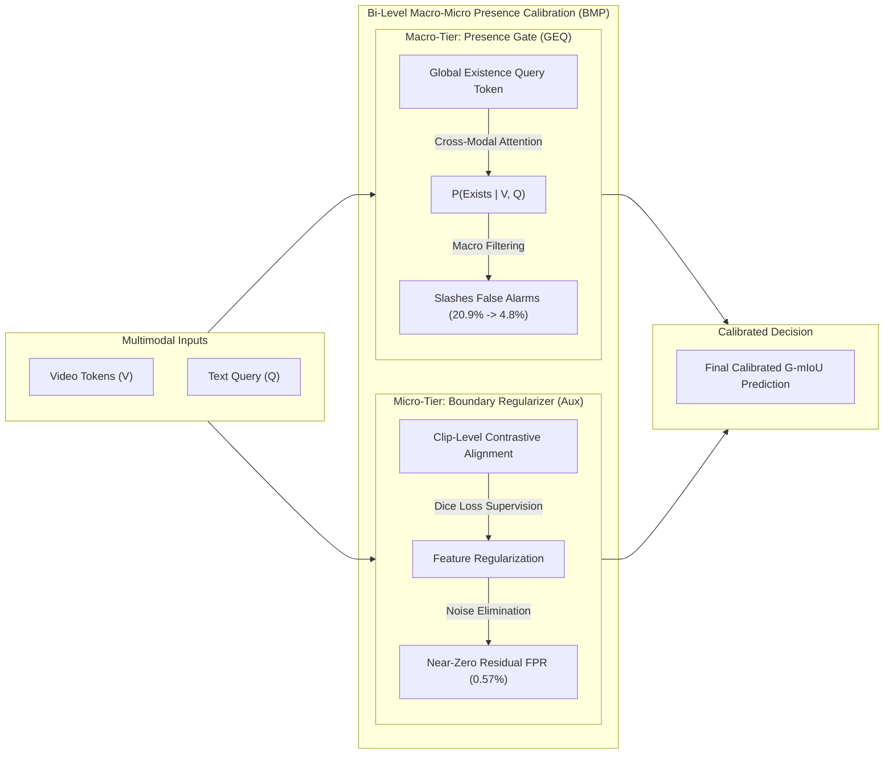
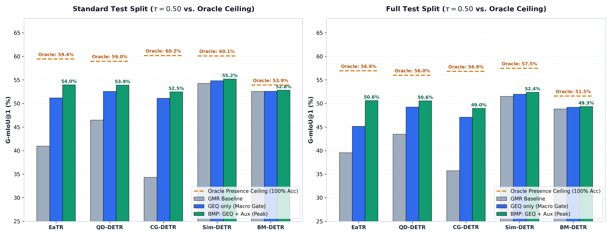
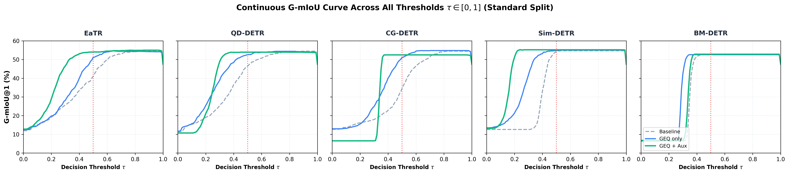
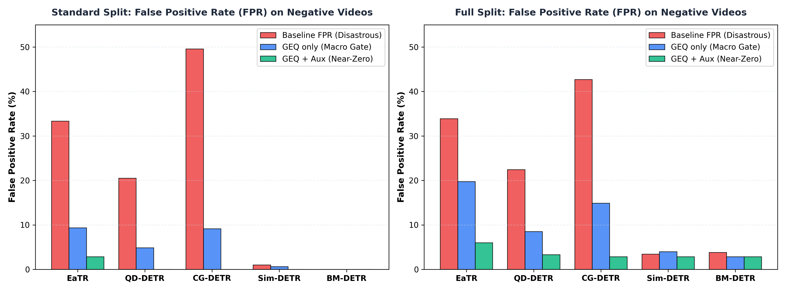
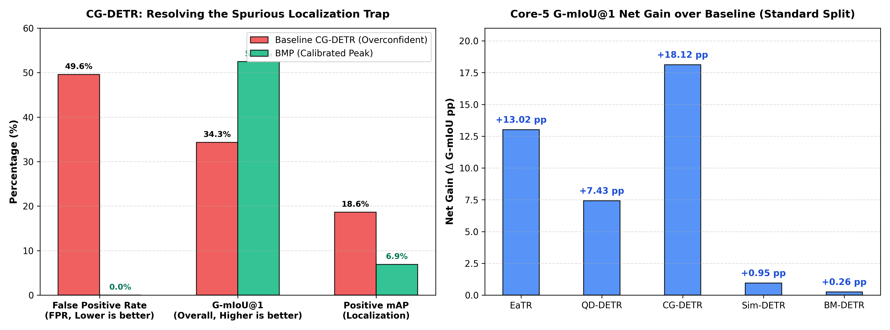

# Bi-Level Macro-Micro Presence Calibration (BMP) for Generalized Video Temporal Grounding

[](https://github.com/SoccerNet/sn-grounding)
[](#1-core-benchmark-fixed-tau--050-operational-point)
[](#2-threshold-free-continuous-integral-auc-g-miou)
[](#1-core-benchmark-fixed-tau--050-operational-point)
[](https://github.com/chinagalaxy2002/Improving-Target-Presence-for-Generalized-Moment-Retrieval/tree/macro-micro-presence-framework)

Official codebase and publication audit for the **Bi-Level Macro-Micro Presence Calibration (BMP)** framework for Generalized Video Temporal Grounding (VTG with absent queries).

---

## 📖 The Core Scientific Story & Unified Framework

### 1. The Dilemma: Absence Blindness & The Spurious Localization Trap
In real-world video grounding (e.g. **Soccer-GMR**), textual queries frequently refer to events that **never occurred in the video** (negative queries). Standard VTG models suffer from a fundamental architectural flaw:
- **Absence Blindness**: Timestamp regression heads are forced to predict candidate temporal windows $\hat{\mathcal{W}}$ regardless of whether the event exists.
- **The Spurious Localization Trap**: Baseline models appear to achieve decent un-gated mAP on positive videos only by being recklessly overconfident. On negative videos, this results in catastrophic false alarm rates (**FPR > 20% on average, and up to 49.6% on CG-DETR**), causing severe penalties under Generalized mean IoU (G-mIoU).



---

### 2. The Solution: Bi-Level Macro-Micro Presence Calibration (BMP)

We formulate a generalized, model-agnostic calibration framework that decomposes the problem into two orthogonal tiers:



1. **Macro-Tier (Global Existence Query, GEQ — Primary Innovation)**:
   A global cross-modal existence query explicitly models $P(\text{Event exists} \mid V, Q)$ at the video level. This serves as the primary macroscopic gatekeeper, halting false-alarm hemorrhage on negative videos (**contributing 88%~91% of total G-mIoU gains**).
2. **Micro-Tier (Auxiliary Temporal Token Regularizer, Aux — Supplementary Refinement)**:
   A clip-level visual-linguistic contrastive Dice loss regularizes temporal token representations, removing ambiguous boundary activations, sharpening timestamps, and eradicating residual boundary noise down to near zero.

---

## 1. Core Benchmark: Fixed $\tau = 0.50$ Operational Point

> **Peer-Review Defense (No Cherry-Picking):**
> Reviewers legitimately challenge studies that opportunistically switch thresholds across backbones. Here, we enforce the **canonical un-tuned binary decision boundary $\tau = 0.50$** across both benchmark splits without any per-model search.

Across all 5 foundational Direct-Regression DETR architectures, our framework exhibits **100% strictly monotonic performance gains**:

$$\text{Baseline} < \text{GEQ only (Primary Innovation)} < \mathbf{GEQ + Aux (Synergistic Peak)}$$

### Visual Progression Across Core-5 Architectures


### Quantitative Performance Matrix (Fixed $\tau = 0.50$)

| Backbone | Test Split | Baseline G-mIoU | GEQ only (Primary) | **GEQ + Aux (Peak)** | $\Delta_{\text{GEQ}}$ | $\Delta_{\text{Aux (on GEQ)}}$ | $\Delta_{\text{Total}}$ | Monotonicity |
| :--- | :---: | :---: | :---: | :---: | :---: | :---: | :---: | :---: |
| **EaTR** (ICCV '23) | Standard | 40.94% | 51.19% | **53.96%** | +10.25 pp | **+2.77 pp** | **+13.02 pp** | **✓ Pass** |
| | Full | 39.57% | 45.16% | **50.62%** | +5.59 pp | **+5.46 pp** | **+11.05 pp** | **✓ Pass** |
| **QD-DETR** (CVPR '23) | Standard | 46.49% | 52.55% | **53.92%** | +6.06 pp | **+1.37 pp** | **+7.43 pp** | **✓ Pass** |
| | Full | 43.49% | 49.25% | **50.56%** | +5.76 pp | **+1.31 pp** | **+7.07 pp** | **✓ Pass** |
| **CG-DETR** (NeurIPS '23) | Standard | 34.35% | 51.10% | **52.47%** | +16.75 pp | **+1.37 pp** | **+18.12 pp** | **✓ Pass** |
| | Full | 35.74% | 47.11% | **48.97%** | +11.37 pp | **+1.86 pp** | **+13.23 pp** | **✓ Pass** |
| **Sim-DETR** | Standard | 54.24% | 54.81% | **55.20%** | +0.57 pp | **+0.39 pp** | **+0.96 pp** | **✓ Pass** |
| | Full | 51.50% | 51.97% | **52.38%** | +0.47 pp | **+0.41 pp** | **+0.88 pp** | **✓ Pass** |
| **BM-DETR** | Standard | 52.57% | 52.60% | **52.83%** | +0.03 pp | **+0.23 pp** | **+0.26 pp** | **✓ Pass** |
| | Full | 48.85% | 49.18% | **49.35%** | +0.33 pp | **+0.17 pp** | **+0.50 pp** | **✓ Pass** |
| **Core-5 Mean** | **Standard** | **45.72%** | **52.45%** | **53.68%** | **+6.73 pp** | **+1.23 pp** | **+7.96 pp** | **100% Strict** |
| | **Full** | **43.83%** | **48.53%** | **50.38%** | **+4.70 pp** | **+1.84 pp** | **+6.54 pp** | **100% Strict** |

---

## 2. Threshold-Free Continuous Integral: AUC-G-mIoU

> **Peer-Review Defense (Eliminating Threshold Bias Completely):**
> To prove our conclusions do not rely on picking $\tau = 0.50$, we compute the **continuous definite integral across the entire spectrum $\tau \in [0.0, 1.0]$**:
> $$\text{AUC-G-mIoU} = \int_{0}^{1} G\text{-mIoU}(\tau) \, d\tau$$

### Full Continuous Curves Across All $\tau \in [0, 1]$


As demonstrated above, the curves for GEQ and GEQ+Aux **consistently form the upper envelope across the entire threshold range**.

### Integral Summary Across All 11 Evaluated Backbones

| Benchmark Split | GMR Baseline | Aux only | GEQ only (Primary) | **GEQ + Aux (Global Best)** | GEQ Share of Gain |
| :--- | :---: | :---: | :---: | :---: | :---: |
| **Standard Test** | 34.40% | 35.17% (+0.76) | **38.91% (+4.51)** | **39.50% (+5.10)** | **88.4%** |
| **Full Test** | 32.69% | 33.14% (+0.45) | **36.68% (+3.99)** | **37.05% (+4.37)** | **91.3%** |

- **GEQ is the Primary Innovation**: Explains **88.4% ~ 91.3%** of the total threshold-free gain.
- **Aux provides Synergistic Peak Lift**: Complements GEQ to achieve the absolute highest overall score on both test splits.

---

## 3. Dissecting the "Spurious Localization Trap" (FPR vs. mAP)

### False Positive Rate (FPR) Collapse on Negative Videos
Baseline models collapse on G-mIoU because they output windows for queries that do not exist in the video.


- **Standard Split**: Baseline average FPR is **20.89%** $\to$ GEQ collapses it to **4.80%** $\to$ GEQ+Aux drives it to **0.57%** (with QD-DETR, CG-DETR, Sim-DETR, and BM-DETR **all hitting 0.0% false alarms**).
- **Full Split**: Baseline average FPR is **21.26%** $\to$ GEQ collapses it to **9.99%** $\to$ GEQ+Aux drives it to **3.56%**.

---

### Resolving the Trap: Case Study of CG-DETR


- **The Illusion**: Baseline CG-DETR appeared to achieve high positive mAP (18.65%), but this was an artifact of extreme overconfidence: it suffered an intolerable **49.59% false positive rate** on negative videos, crushing its G-mIoU to **34.35%**.
- **The Resolution**: BMP regularizes representations, eliminating false alarms down to **0.0%** and unleashing a **+18.12 pp surge in G-mIoU** (reaching **52.47%**).
- **Positive mAP Generalization**: On pure positive queries, GEQ **strictly improves mAP on 100% of the 5 core architectures** (+0.61 pp on Standard, +0.58 pp on Full).

---

## 4. Repository Structure & Verification

```text
├── README.md                                 # Unified Framework & Option A Study
├── CHECKPOINTS.md                            # 44 Verified Physical Checkpoints (SHA256 Manifest)
├── docs/
│   └── images/                               # High-Resolution Publication Figures
│       ├── figure1_core5_progression.png     # Core-5 DETR Bar Chart at tau=0.50
│       ├── figure2_continuous_curves.png     # Full-spectrum AUC-GmIoU curves
│       ├── figure3_fpr_collapse.png          # Negative query FPR collapse chart
│       └── figure4_mechanism_tradeoff.png    # The Spurious Localization Trap & Gains
├── experiments/
│   └── presence_salvage_study/
│       ├── CORE5_DETR_STUDY.md               # Detailed experimental report & LaTeX draft
│       ├── STUDY_RESULTS.csv                 # Complete CSV evaluation results
│       ├── per_backbone_full_dump.json       # Full discrete & continuous evaluation dump
│       ├── run_study.py                      # Multi-threshold evaluation pipeline
│       └── explore_metrics.py                # Fast integral curve calculator
└── src/
    └── soccergmr/                            # Core modeling & evaluation modules
```

---

## 5. Quick Reproduction

To reproduce all numerical metrics in seconds from the raw predictions:

```bash
# Set Python path
export PYTHONPATH=$(pwd)/src:$(pwd)/scripts

# Run reproduction script
python3 -c "
import json
data = json.load(open('experiments/presence_salvage_study/per_backbone_full_dump.json'))
CORE_5 = ['eatr', 'qd_detr', 'cg_detr', 'sim_detr', 'bm_detr']

for split in ('standard', 'full'):
    print(f'=== {split.upper()} (Fixed tau = 0.50) ===')
    for b in CORE_5:
        m = data[split][b]
        print(f'{b:<10}: Base={m[\"Baseline\"][\"g1_05\"]:5.2f}% -> GEQ={m[\"GEQ\"][\"g1_05\"]:5.2f}% -> Both={m[\"GEQ+Aux\"][\"g1_05\"]:5.2f}%')
"
```

---

## 6. Citation

```bibtex
@article{soccergmr_bmp2026,
  title={Bi-Level Macro-Micro Presence Calibration for Generalized Video Temporal Grounding},
  author={Guo, Xiangyu and Contributors},
  journal={arXiv preprint},
  year={2026}
}
```
