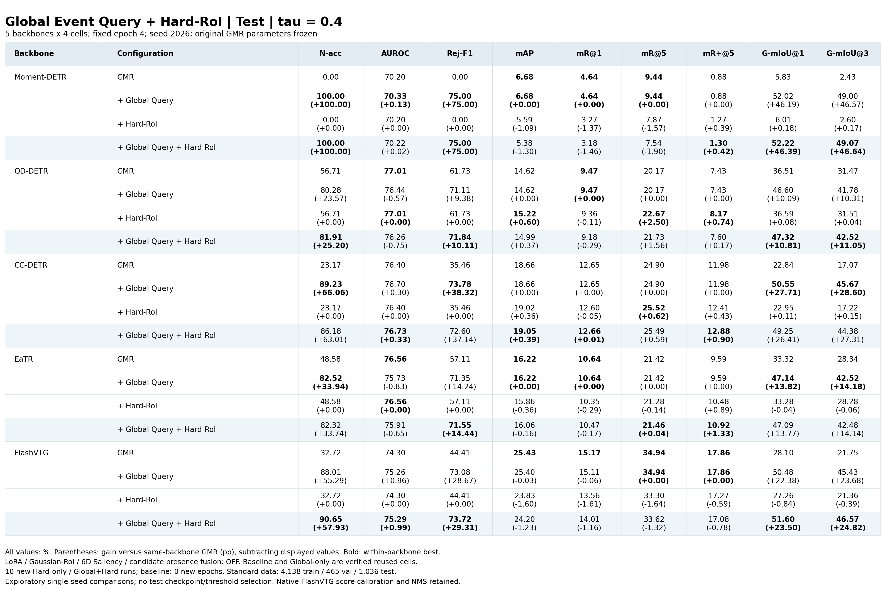
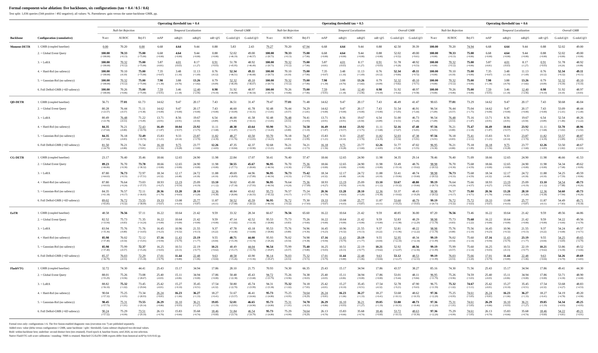
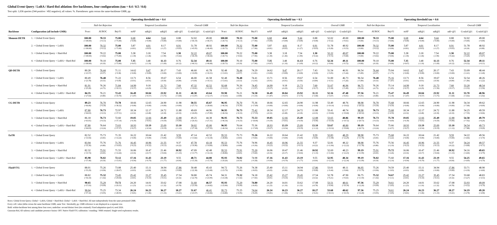
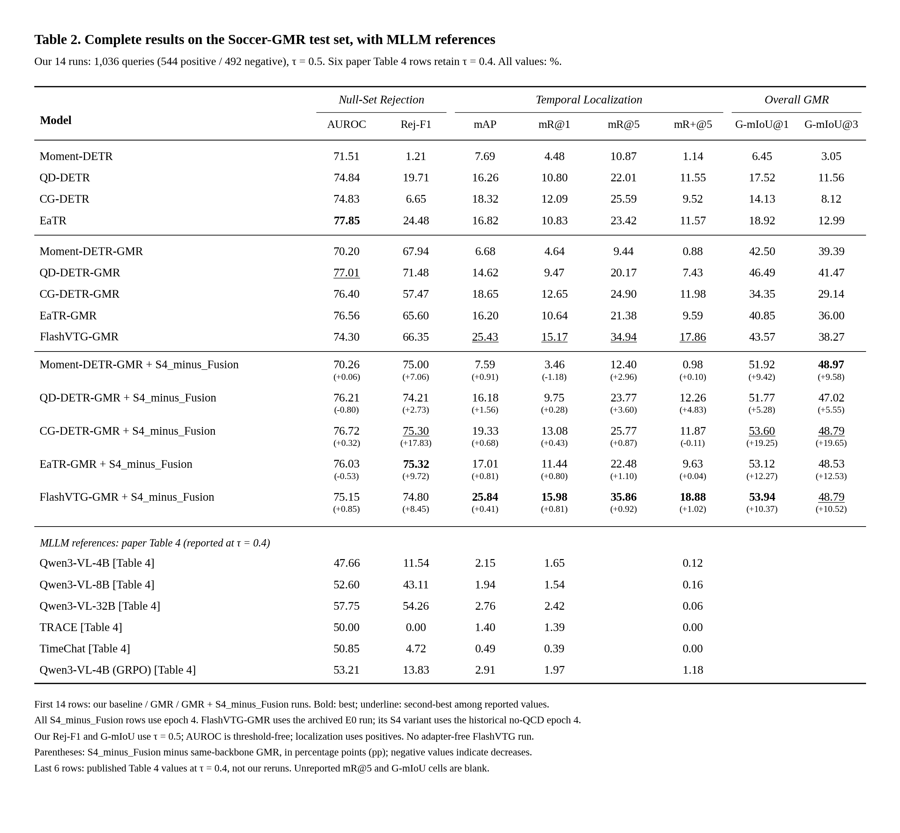
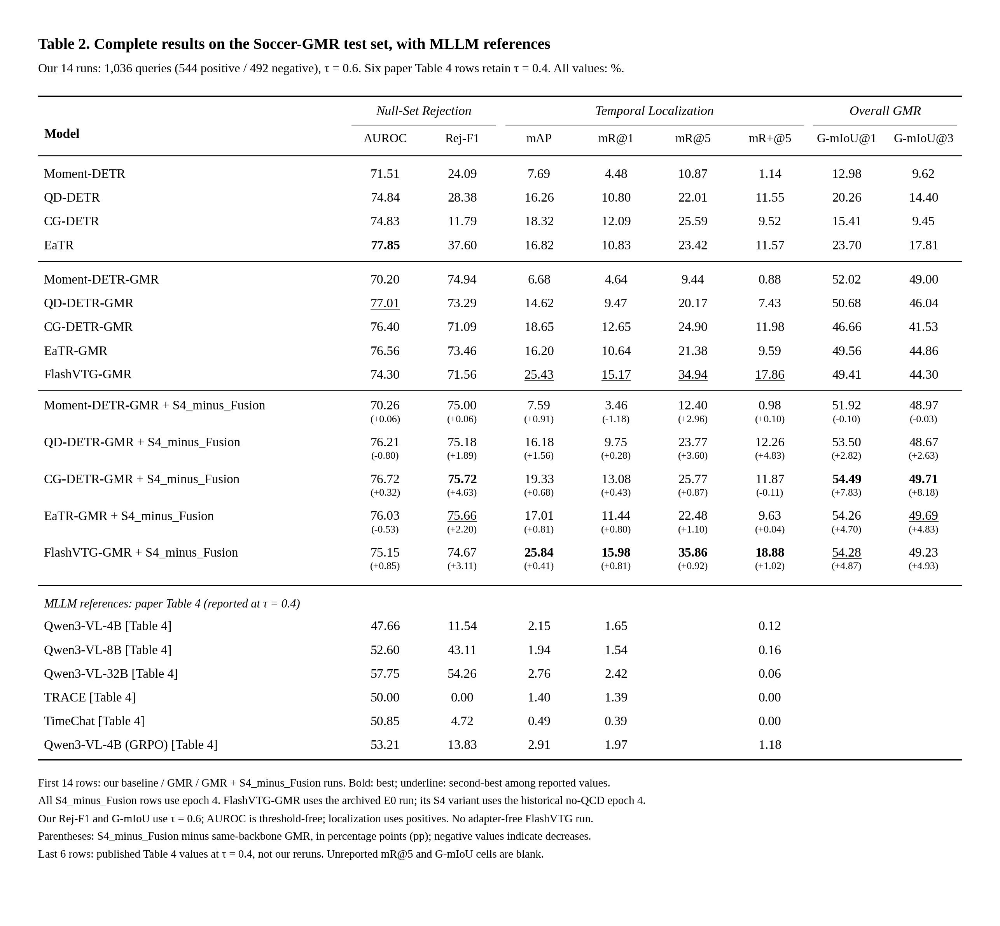
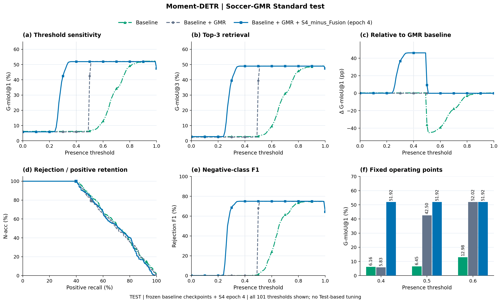
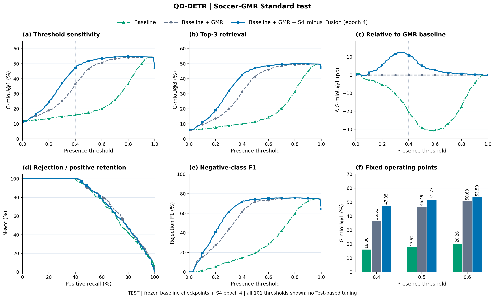
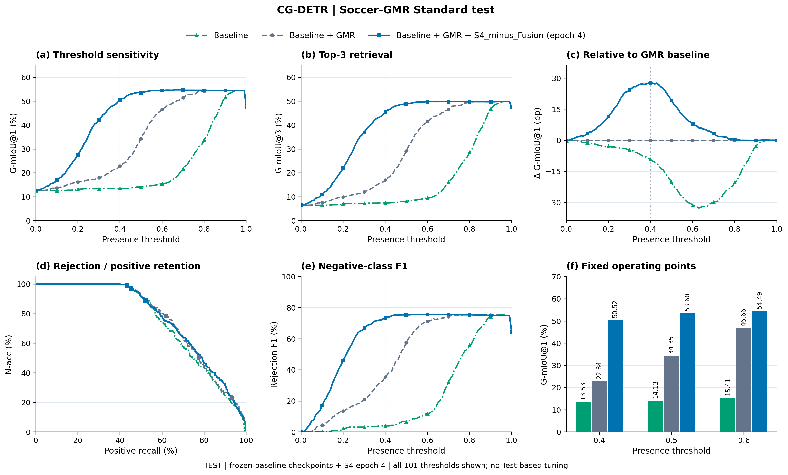
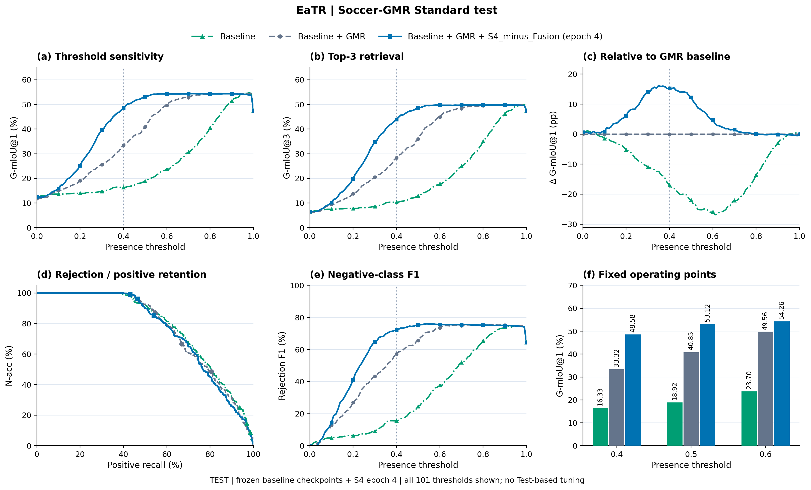
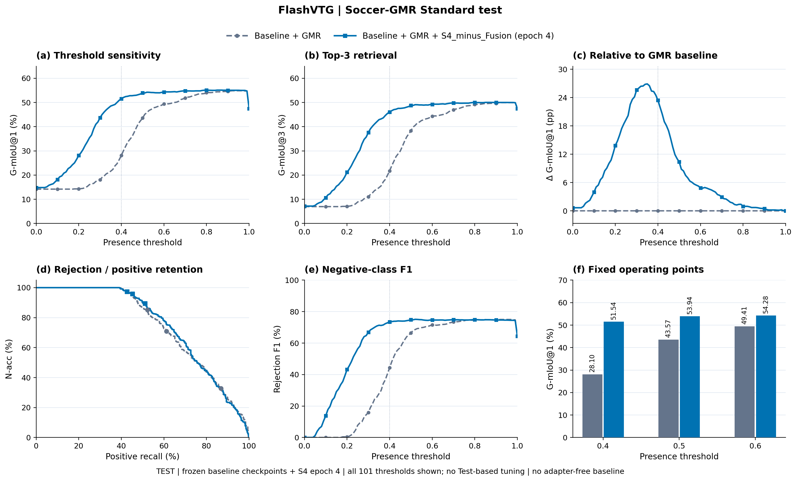

# Improving Target Presence for Generalized Moment Retrieval

## 最新：仅 Global Event Query + Hard-RoI（固定 epoch 4）

精简方案关闭 **LoRA、Gaussian-RoI、6D Saliency 与候选存在性融合**。在同一预训练 GMR 上冻结原参数，仅微调开启的新增模块，采用 **GMR / +Global / +Hard / +Global+Hard** 的完整 2×2 对照，五个 backbone 共 **20 个单元**：10 组新训练、10 组核验复用；全部微调固定第 4 个 epoch、seed 2026。下降项完整保留，结果为单种子探索性比较。

[实验设计与复现](ablations/global_hard_roi_20261023/README.md) · [完整 Val/Test 结果](ablations/global_hard_roi_20261023/reports/RESULTS.md) · [九指标 CSV](ablations/global_hard_roi_20261023/reports/all_metrics.csv) · [相对 GMR 增益](ablations/global_hard_roi_20261023/reports/gains_vs_gmr_pp.csv) · [独立数值复核](ablations/global_hard_roi_20261023/reports/METRIC_VERIFICATION.json)



[τ=0.4 PDF](ablations/global_hard_roi_20261023/tables/ABLATION_TEST_tau_0.4.pdf) · [τ=0.5 PDF](ablations/global_hard_roi_20261023/tables/ABLATION_TEST_tau_0.5.pdf) · [τ=0.6 PDF](ablations/global_hard_roi_20261023/tables/ABLATION_TEST_tau_0.6.pdf) · [四个条件效应及交互](ablations/global_hard_roi_20261023/reports/factorial_effects_pp.csv)

[研究文档总览](docs/README.md) · [数据](docs/DATA.md) · [算法](docs/ALGORITHM.md) · [实验](docs/EXPERIMENTS.md) · [复现](docs/REPRODUCIBILITY.md) · [论文段落](docs/PAPER_NOTES.md)

Soccer-GMR 上五个主干的 **Baseline → GMR → GMR + S4_minus_Fusion** 实验代码、冻结预测和结果汇总。主干包括 **Moment-DETR、QD-DETR、CG-DETR、EaTR、FlashVTG**。

本仓库提供阈值 **0.4、0.5、0.6** 的三张完整结果表及图片，采用参考论文 Table 2 的指标分组与排版。每张表包含 **14 行本地实验 + 6 行论文 Table 4 的 MLLM 参考结果**。S4 行括号内标注相对**同一主干、同一阈值 GMR** 的变化值，单位为百分点（pp），负值表示下降。

## 新增：正式组件消融（5主干 × 6配置 = 30组）

新增完整组件阶梯：**GMR → +Global Event Query → +LoRA → +Hard-RoI → +Gaussian-RoI（无saliency）→ Full（含6D saliency）**。每一新增配置均标注相对**同主干、同split、同阈值GMR**的增益，单位 pp，按显示两位小数相减。**第七配置的5组融合实验仅为额外诊断，不进入正式消融表或30组计数。**

与下方历史14行主结果对比表分开，本次新增正式消融采用同初始化、固定四轮、seed 2026；GMR基线冻结。[协议、全部Val表格与复现说明](ablations/component_ablation_20261023/README.md)。

### 三阈值合并大表（Test，正式30组）

[PDF](ablations/component_ablation_20261023/tables/ABLATION_TEST_ALL_THRESHOLDS.pdf) · [高清PNG](ablations/component_ablation_20261023/tables/ABLATION_TEST_ALL_THRESHOLDS.png) · [Markdown](ablations/component_ablation_20261023/tables/ABLATION_TEST_ALL_THRESHOLDS.md) · [数值CSV](ablations/component_ablation_20261023/tables/ABLATION_TEST_ALL_THRESHOLDS.csv) · [增益CSV](ablations/component_ablation_20261023/tables/ABLATION_TEST_ALL_THRESHOLDS_GAINS.csv) · [可编辑HTML](ablations/component_ablation_20261023/tables/ABLATION_TEST_ALL_THRESHOLDS.html) · [LaTeX](ablations/component_ablation_20261023/tables/ABLATION_TEST_ALL_THRESHOLDS.tex)



### Global Event Query、LoRA 与 Hard-RoI 四配置消融（Test，三阈值）

在五个主干上对照以下四组，按 **τ=0.4、0.5、0.6** 合并为一张 **20行 × 27指标列** 大表。各组独立从同一主干的GMR初始化，统一seed 2026、第4个微调epoch；本次仅整理已有结果。表结构、指标分组、相对同主干GMR的增益（pp）、最优加粗与次优下划线均沿用上方正式30组大表。

1. **GMR → +Global Event Query**
2. **GMR → +Global Event Query → +LoRA**
3. **GMR → +Global Event Query + Hard-RoI**
4. **GMR → +Global Event Query → +LoRA → +Hard-RoI**

[PDF](ablations/component_ablation_20261023/tables/ABLATION_GLOBAL_LORA_HARD_TEST_ALL_THRESHOLDS.pdf) · [高清PNG](ablations/component_ablation_20261023/tables/ABLATION_GLOBAL_LORA_HARD_TEST_ALL_THRESHOLDS.png) · [Markdown](ablations/component_ablation_20261023/tables/ABLATION_GLOBAL_LORA_HARD_TEST_ALL_THRESHOLDS.md) · [数值CSV](ablations/component_ablation_20261023/tables/ABLATION_GLOBAL_LORA_HARD_TEST_ALL_THRESHOLDS.csv) · [增益CSV](ablations/component_ablation_20261023/tables/ABLATION_GLOBAL_LORA_HARD_TEST_ALL_THRESHOLDS_GAINS.csv) · [可编辑HTML](ablations/component_ablation_20261023/tables/ABLATION_GLOBAL_LORA_HARD_TEST_ALL_THRESHOLDS.html) · [LaTeX](ablations/component_ablation_20261023/tables/ABLATION_GLOBAL_LORA_HARD_TEST_ALL_THRESHOLDS.tex) · [数值核验](ablations/component_ablation_20261023/tables/ABLATION_GLOBAL_LORA_HARD_TEST_ALL_THRESHOLDS_VERIFICATION.json)



四组配置均关闭Gaussian-RoI、6D Saliency与候选存在性融合。各阈值使用同一份Test冻结预测；本表作为组件对照补充，不改变上方正式30组的计数。复现：`python tools/reproduce_lora_hard_ablation.py`。

### 三个阈值的完整消融分表

| 阈值 | Test PDF | Test PNG | Test Markdown | 数值CSV | 增益CSV | LaTeX | Val表格 |
|---|---|---|---|---|---|---|---|
| **0.4** | [PDF](ablations/component_ablation_20261023/tables/ABLATION_TEST_tau_0.4.pdf) | [PNG](ablations/component_ablation_20261023/tables/ABLATION_TEST_tau_0.4.png) | [Markdown](ablations/component_ablation_20261023/tables/ABLATION_TEST_tau_0.4.md) | [CSV](ablations/component_ablation_20261023/tables/ABLATION_TEST_tau_0.4.csv) | [Δ pp](ablations/component_ablation_20261023/tables/ABLATION_TEST_tau_0.4_GAINS.csv) | [TeX](ablations/component_ablation_20261023/tables/ABLATION_TEST_tau_0.4.tex) | [Val PDF](ablations/component_ablation_20261023/tables/ABLATION_VAL_tau_0.4.pdf) |
| **0.5** | [PDF](ablations/component_ablation_20261023/tables/ABLATION_TEST_tau_0.5.pdf) | [PNG](ablations/component_ablation_20261023/tables/ABLATION_TEST_tau_0.5.png) | [Markdown](ablations/component_ablation_20261023/tables/ABLATION_TEST_tau_0.5.md) | [CSV](ablations/component_ablation_20261023/tables/ABLATION_TEST_tau_0.5.csv) | [Δ pp](ablations/component_ablation_20261023/tables/ABLATION_TEST_tau_0.5_GAINS.csv) | [TeX](ablations/component_ablation_20261023/tables/ABLATION_TEST_tau_0.5.tex) | [Val PDF](ablations/component_ablation_20261023/tables/ABLATION_VAL_tau_0.5.pdf) |
| **0.6** | [PDF](ablations/component_ablation_20261023/tables/ABLATION_TEST_tau_0.6.pdf) | [PNG](ablations/component_ablation_20261023/tables/ABLATION_TEST_tau_0.6.png) | [Markdown](ablations/component_ablation_20261023/tables/ABLATION_TEST_tau_0.6.md) | [CSV](ablations/component_ablation_20261023/tables/ABLATION_TEST_tau_0.6.csv) | [Δ pp](ablations/component_ablation_20261023/tables/ABLATION_TEST_tau_0.6_GAINS.csv) | [TeX](ablations/component_ablation_20261023/tables/ABLATION_TEST_tau_0.6.tex) | [Val PDF](ablations/component_ablation_20261023/tables/ABLATION_VAL_tau_0.6.pdf) |

指标分组沿用原表并增加 N-acc：**N-acc / AUROC / Rej-F1；mAP / mR@1 / mR@5 / mR+@5；G-mIoU@1 / G-mIoU@3**。每个主干内部最优加粗、次优下划线。CG/EaTR匹配GMR重导出mAP为18.66/16.22，历史表为18.65/16.20；新表增益以本次匹配基线为准。FlashVTG保留原生置信度校准与NMS。下降项完整保留。

[额外融合诊断（单列5组）](ablations/component_ablation_20261023/extra_diagnostics/README.md) · [CPU数值复核](ablations/component_ablation_20261023/PUBLICATION_VERIFICATION.json) · [表格与增益核验](ablations/component_ablation_20261023/TABLE_VERIFICATION.json)

```bash
python tools/reproduce_ablation_tables.py
python tools/reproduce_ablation_tables.py --recompute-metrics
```

以下三个完整表保留原来的历史主结果及MLLM参考行，不与本次正式30组组件消融混合统计。

## 1. 三个阈值的完整表格

| 本地实验阈值 | PDF | PNG 图片 | Markdown | 原始数值 CSV | 增益 CSV | 可编辑 LaTeX |
|---|---|---|---|---|---|---|
| **0.4** | [PDF](backbonefolder/TABLE2_COMPLETE_RESULTS.pdf) | [PNG](backbonefolder/TABLE2_COMPLETE_RESULTS.png) | [Markdown](backbonefolder/TABLE2_OUR_RESULTS.md) | [CSV](backbonefolder/TABLE2_COMPLETE_RESULTS.csv) | [Δ pp](backbonefolder/TABLE2_COMPLETE_RESULTS_GAINS.csv) | [TeX](backbonefolder/TABLE2_COMPLETE_RESULTS.tex) |
| **0.5** | [PDF](backbonefolder/TABLE2_COMPLETE_RESULTS_tau_0.5.pdf) | [PNG](backbonefolder/TABLE2_COMPLETE_RESULTS_tau_0.5.png) | [Markdown](backbonefolder/TABLE2_OUR_RESULTS_tau_0.5.md) | [CSV](backbonefolder/TABLE2_COMPLETE_RESULTS_tau_0.5.csv) | [Δ pp](backbonefolder/TABLE2_COMPLETE_RESULTS_tau_0.5_GAINS.csv) | [TeX](backbonefolder/TABLE2_COMPLETE_RESULTS_tau_0.5.tex) |
| **0.6** | [PDF](backbonefolder/TABLE2_COMPLETE_RESULTS_tau_0.6.pdf) | [PNG](backbonefolder/TABLE2_COMPLETE_RESULTS_tau_0.6.png) | [Markdown](backbonefolder/TABLE2_OUR_RESULTS_tau_0.6.md) | [CSV](backbonefolder/TABLE2_COMPLETE_RESULTS_tau_0.6.csv) | [Δ pp](backbonefolder/TABLE2_COMPLETE_RESULTS_tau_0.6_GAINS.csv) | [TeX](backbonefolder/TABLE2_COMPLETE_RESULTS_tau_0.6.tex) |

同名 `.svg`、`.html` 提供矢量图和可编辑网页表格；同名 `.json` 保存来源与增益定义。

### τ = 0.4


### τ = 0.5



### τ = 0.6



### 论文 MLLM 参考行的口径

末尾的 Qwen3-VL-4B/8B/32B、TRACE、TimeChat 和 Qwen3-VL-4B (GRPO) 直接摘录自 [2605.02623v1，Table 4](https://arxiv.org/pdf/2605.02623v1)，**不是本仓库重跑的 MLLM 实验**。原表仅报告阈值 **0.4** 的 Rej-F1：这六行在三个表中均保留该原始阈值，不能将其当作 0.5 或 0.6 的结果。论文未报告的 **mR@5、G-mIoU@1、G-mIoU@3 均留空**。转录数值、论文 SHA256 和来源见 [PAPER_TABLE4_RESULTS.json](backbonefolder/figures/complete_comparison/PAPER_TABLE4_RESULTS.json)。

## 2. 实验与指标说明

| 项目 | 本仓库采用的口径 |
|---|---|
| 数据 | 原始 Standard Train / Val / Test；Train 4,138，Val 465，Test 1,036 |
| Test 构成 | 544 条正查询、492 条无目标查询；各实验使用相同测试标签 |
| 四个 DETR 主干 | 每个包含 Baseline、GMR、GMR + S4_minus_Fusion，共 12 行 |
| FlashVTG | 仅包含已验证的 E0/GMR 与 GMR + S4_minus_Fusion，共 2 行；没有补造无 GMR 的结果 |
| S4 检查点 | Moment/QD/CG/EaTR 固定 epoch 4；FlashVTG 为历史无 QCD 实验的真实 epoch 4 |
| 存在性门控 | 存在分数 **严格大于 τ** 才保留预测；否则输出空集合 |
| 阈值相关指标 | Rej-F1、G-mIoU@1、G-mIoU@3 |
| 阈值无关指标 | AUROC；正查询上的 mAP、mR@1、mR@5、mR+@5 不使用存在性硬门控 |
| 增益 | S4 指标 − 同主干 GMR 指标；按表中保留两位小数的结果计算，单位 pp |
| 排版 | 列内最优加粗、次优加下划线；缺失数据留空 |
| 方法范围 | 三种方法对比；表格中不混入 QCD、MoPE 或其他 S4 轮次 |

三张表使用相同的模型与预测，只改变存在性阈值；阈值扫描是冻结模型的敏感性分析。S4 epoch 4 固定后汇总，不按 Test 事后挑选最优轮次。四个新主干训练过程中曾保存 epoch 3–6 的 Test 诊断，因此本结果作为固定轮次的探索性实验报告；它们不构成额外独立测试集上的确认性结论。QD-DETR-GMR 和 CG-DETR-GMR 是本地扩展，参考论文 Table 2 没有这两项可直接对应的数值。

S4_minus_Fusion 使用独立全局事件查询产生存在性分数，保留候选提取、边界精修及 LoRA；删除候选存在性融合。详见 [共同配置](Phase2(addbackbone_with_S4_minusFusion)/shared/config.json) 和各主干模型代码。

## 3. 五个主干的曲线图

每张图均按六面板样式展示：阈值与 G-mIoU@1、阈值与 G-mIoU@3、相对同阈值 GMR 的 G-mIoU@1 差值、Positive recall 与 N-acc、阈值与 Rej-F1，以及固定 0.4/0.5/0.6 工作点。前四个主干有三条方法曲线；FlashVTG 有两条。

### Moment-DETR



[PDF 下载](backbonefolder/figures/complete_comparison/moment_detr_fig7_test_threshold_sweep.pdf) · [SVG 下载](backbonefolder/figures/complete_comparison/moment_detr_fig7_test_threshold_sweep.svg)

### QD-DETR



[PDF 下载](backbonefolder/figures/complete_comparison/qd_detr_fig7_test_threshold_sweep.pdf) · [SVG 下载](backbonefolder/figures/complete_comparison/qd_detr_fig7_test_threshold_sweep.svg)

### CG-DETR



[PDF 下载](backbonefolder/figures/complete_comparison/cg_detr_fig7_test_threshold_sweep.pdf) · [SVG 下载](backbonefolder/figures/complete_comparison/cg_detr_fig7_test_threshold_sweep.svg)

### EaTR



[PDF 下载](backbonefolder/figures/complete_comparison/eatr_fig7_test_threshold_sweep.pdf) · [SVG 下载](backbonefolder/figures/complete_comparison/eatr_fig7_test_threshold_sweep.svg)

### FlashVTG



[PDF 下载](backbonefolder/figures/complete_comparison/flashvtg_fig7_test_threshold_sweep.pdf) · [SVG 下载](backbonefolder/figures/complete_comparison/flashvtg_fig7_test_threshold_sweep.svg)

## 4. 目录与代码入口

```text
.
├── README.md
├── tools/reproduce_results.py          # CPU 重算指标 / 重绘三表和五主干图
├── requirements-cpu.txt               # 图表与官方数值评测依赖
├── docs/CODE_MAP.md                   # 各主干训练、配置和来源入口
├── backbonefolder/
│   ├── TABLE2_*                       # 三组完整表格：PDF/PNG/SVG/MD/CSV/TeX
│   ├── figures/complete_comparison/   # 六面板图、阈值数据及论文转录
│   ├── {moment_detr,qd_detr,cg_detr,eatr}/
│   │   ├── ...                        # 原生模型代码和训练入口
│   │   └── {original,gmr}/            # 冻结选择、配置、预测、测试指标
│   └── flashvtg/gmr/                  # FlashVTG E0 的预测和来源
├── Phase2(addbackbone_with_S4_minusFusion)/
│   ├── shared/                       # 共同训练器、官方评测、Standard 标签
│   ├── {moment_detr,qd_detr,cg_detr,eatr,flashvtg}/
│   │   ├── source/ 或 baseline_source/ # 模型源码；各主干独立组织
│   │   ├── configuration/            # 实际训练、初始化、参数记录
│   │   └── epoch_004/test_results/    # S4 冻结预测和测试指标
│   └── ...                           # 原始运行日志与来源记录
├── provenance/                       # 来源复制清单、发布适配和外部权重 SHA256
├── PUBLICATION_SCOPE.json             # GitHub 发布范围
└── PUBLICATION_MANIFEST.json          # 本次实际上传文件的 SHA256
```

代码按五个主干存放，详细映射见 **[docs/CODE_MAP.md](docs/CODE_MAP.md)**。原生/GMR 与 S4 的训练入口、模型实现、有效配置、初始化记录、选模规则均有保留。历史源码中的绝对路径属于来源信息；重新训练前需配置本机数据和检查点路径。

## 5. 复现三表和曲线：仅需 CPU

```bash
git clone https://github.com/chinagalaxy2002/Improving-Target-Presence-for-Generalized-Moment-Retrieval.git
cd Improving-Target-Presence-for-Generalized-Moment-Retrieval
python -m pip install -r requirements-cpu.txt

# 从已封存、核对过的阈值数据生成 0.4 / 0.5 / 0.6 三张表
python tools/reproduce_results.py

# 同时重绘五个主干的六面板图
python tools/reproduce_results.py --figures

# 可选：从 14 组完整预测重新进行官方数值评测，再重建三表
python tools/reproduce_results.py --recompute-metrics

# 仅重建一个阈值
python tools/reproduce_results.py --thresholds 0.5
```

以上命令不训练、不使用 GPU，也不需要视频、预提取特征或检查点。预测 SHA256 会与记录核对；`--recompute-metrics` 的逐实验报告另存到 `reproduced/metrics/`。表格仍写入 `backbonefolder/`，所有 Markdown 表格文件只包含一张表。

默认图表使用 Liberation Serif 字体；系统未安装时退回可用 serif 字体，数值不受影响。HTML、SVG、LaTeX 可继续编辑。

## 6. 重新训练与模型推理

本发布包含实验代码、配置、Standard 标签、冻结预测与图表；**不包含 `.ckpt/.pt/.pth` 二进制权重、原视频和视觉/文本特征**。外部权重的原位置、文件大小和 SHA256 见 [EXTERNAL_CHECKPOINTS.json](provenance/EXTERNAL_CHECKPOINTS.json)。这些资产不是 CPU 重算表格的依赖。

重新训练需要原始 Soccer-GMR 的 SlowFast、CLIP、CLIP 文本特征及 PyTorch 环境。视觉输入顺序是 SlowFast2304 → CLIP512 → TEF2，文本维度 512。实际环境记录见 [requirements_frozen.txt](Phase2(addbackbone_with_S4_minusFusion)/requirements_frozen.txt)；它是历史环境记录，不要求 CPU 绘图安装 CUDA 依赖。

先按 [代码映射](docs/CODE_MAP.md) 定位本主干入口和有效配置，再配置原生/GMR 输出目录、S4 初始化权重与数据路径。S4 必须从对应主干的真实 GMR 检查点初始化，保持新的 optimizer/scheduler。历史脚本使用的默认路径和本机输出路径不要直接照搬。发布整理未启动新训练。

## 7. 来源和完整性

- [SOURCE_COPY_MANIFEST.json](provenance/SOURCE_COPY_MANIFEST.json)：从本地实验复制的文件及原始哈希。
- [PUBLICATION_ADAPTATIONS.json](provenance/PUBLICATION_ADAPTATIONS.json)：发布适配记录，包括 CPU 评测导入、缓存预测路径改为仓库相对路径；历史训练源码未改写。
- [PUBLICATION_SCOPE.json](PUBLICATION_SCOPE.json)：14 组本地实验、6 组论文参考结果和三个阈值的范围。
- [PUBLICATION_MANIFEST.json](PUBLICATION_MANIFEST.json)：本次发布实际包含文件的哈希；这是本 GitHub 子集的完整性入口。
- Phase2 中旧 `MANIFEST.json`、`SHA256SUMS`、`ARCHIVE_SCOPE.json` 描述原始含权重的本地完整归档，作为历史来源保留；GitHub 是移除权重和其他数据集标签后的代码/结果子集，不用旧清单核验发布子集。
- FlashVTG 历史训练辅助脚本的版本差异已记录于 [FLASHVTG_SOURCE_AUDIT.json](Phase2(addbackbone_with_S4_minusFusion)/reports/FLASHVTG_SOURCE_AUDIT.json)。

数值评测沿用参考项目的官方 evaluator，原始实现提交身份见 [evaluator_manifest.json](Phase2(addbackbone_with_S4_minusFusion)/shared/evaluator_manifest.json)。本仓库保留上游许可证和来源文件；模型源码、基准标签及论文参考结果的归属沿用其原始来源。
