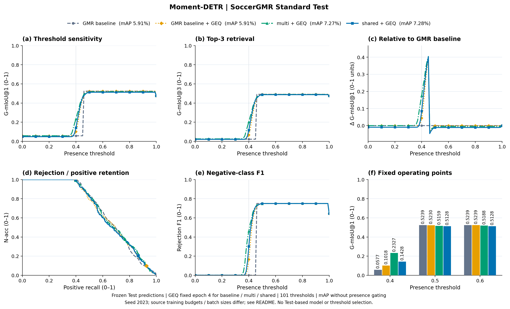
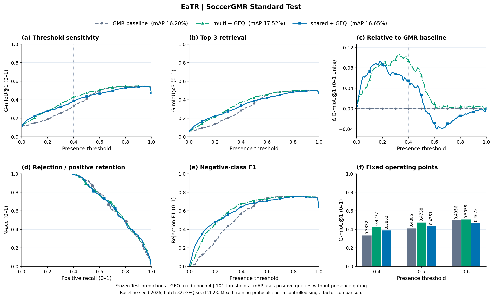
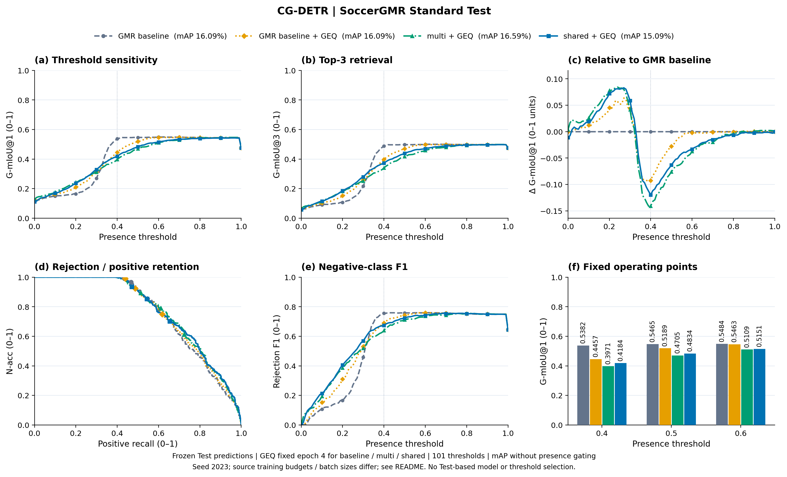
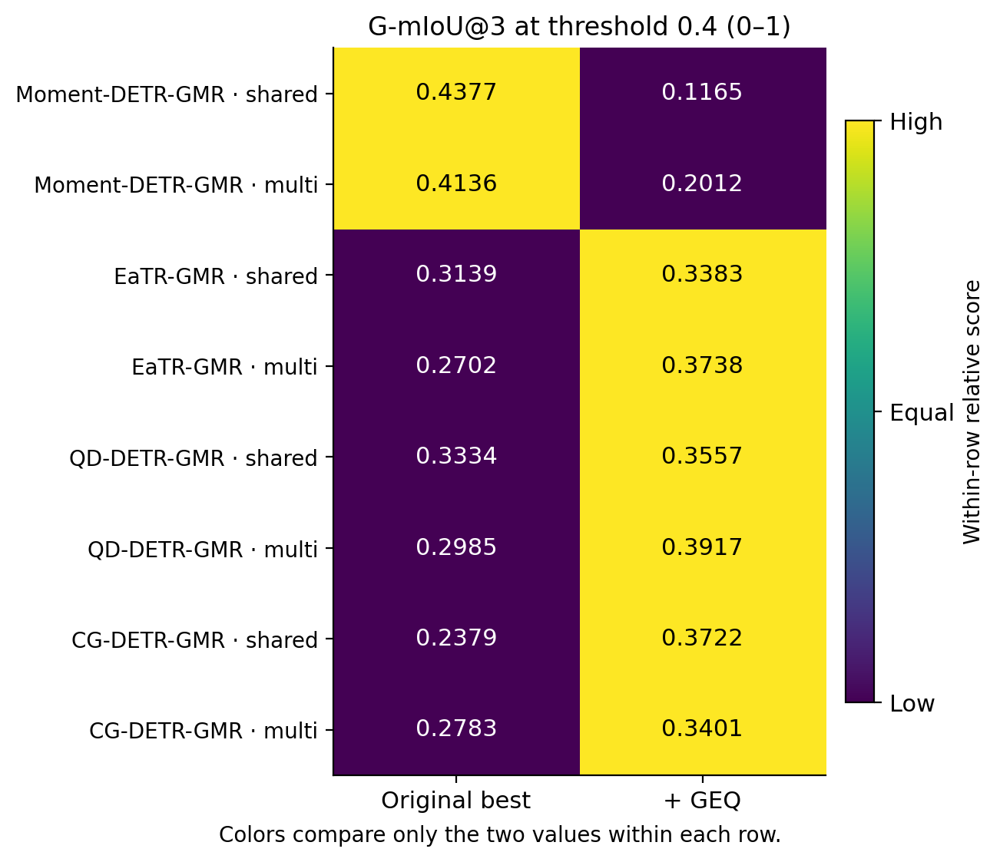
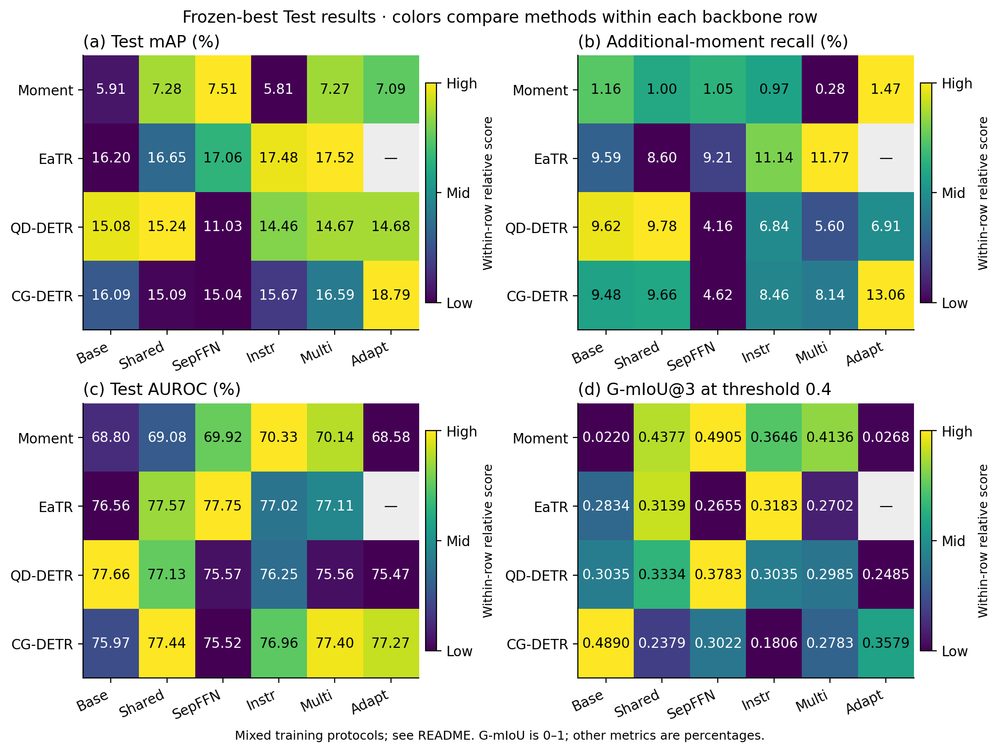

# GMR × Mr. DETR 多骨干实验

将 Mr. DETR 的训练期一对多监督迁移到 Generalized Moment Retrieval，在保留
GMR-Adapter 空集拒绝能力的同时研究多片段定位。四个骨干使用统一的目录组织。

## 最新完整结果

**四曲线对照：GMR baseline / GMR baseline + GEQ / multi + GEQ / shared + GEQ**

四个骨干各一张六面板图与一张 G-mIoU@1 / @3 双面板图，完整扫描存在性阈值 0–1。
G-mIoU 使用 0–1；下表 mAP 为官方正查询定位百分数，不作存在性硬门控。

| Backbone | GMR baseline mAP (%) | GMR baseline + GEQ mAP (%) | multi + GEQ mAP (%) | shared + GEQ mAP (%) |
|---|---:|---:|---:|---:|
| Moment-DETR | 5.91 | 5.91 | 7.27 | 7.28 |
| EaTR | 16.20 | 16.20 | 17.52 | 16.65 |
| QD-DETR | 15.08 | 15.08 | 14.67 | 15.24 |
| CG-DETR | 16.09 | 16.09 | 16.59 | 15.09 |

EaTR baseline 复用历史 seed 2026，GEQ 为 seed 2023；完整来源与协议差异见结果页。
新增的橙色 GMR baseline + GEQ 曲线严格来自同一个已完成 baseline 的四轮 GEQ-only 微调，
全部原参数冻结；四组新增控制均已完成训练和完整 Val/Test，12 组 GEQ 审计全部通过。
EaTR 继续使用已有的 mAP 16.20 baseline，本次未采用未完成的重训快照。
四曲线比较完整方法，GEQ 的独立影响使用各方法与其 +GEQ 的配对比较。

以下直接展示四个骨干的六面板图。每张图均包含 G-mIoU@1、G-mIoU@3 的阈值曲线、
相对 GMR baseline 的变化、拒绝与正查询保留关系、Rej-F1，以及固定阈值工作点。
图例同时标注四种方法的 Test mAP。

### Moment-DETR



### EaTR



### QD-DETR


### CG-DETR



[完整数据、协议与矢量图下载](results/geq_finetune/README.md)

## GEQ 微调前后配对结果

**[新增：Shared / Multi + Global Event Query 的八组微调与 Test 对照](results/geq_finetune/README.md)**

2026-10-31 完成四骨干 × 两方法的 GEQ-only 微调。冻结原 best，固定微调 4 epoch、
seed 2023。阈值 0.4 下，EaTR/QD/CG 六组 G-mIoU@3 提升，Moment-DETR 两组下降；
8 组 AUROC 均略降。定位候选和 mAP/mR/mR+ 完全不变。每个骨干独立保存全域曲线、
行内配色对照和数据；[代码与复现](shared/geq_finetune/README.md)。



**[四个骨干 × 六种方法：24 组完整表格、训练状态和图表](results/README.md)**

原六路线快照更新于 2026-10-31 18:57（Asia/Shanghai）：23 组完成 Test、1 组训练中。
未完成 Test 的指标留空；表内 G-mIoU 使用 0–1 数值，训练协议逐项标注。
综合热力图按 Backbone 逐行归一化着色，颜色只比较同一行内的方法；格内数字保留真实指标。

[下载总表 CSV](results/results.csv) · [数据快照与来源哈希](results/snapshot.json) ·
[离线绘图脚本](shared/build_results_report.py) · [图表检查](results/FIGURE_AUDIT.md)



## 从哪里开始

- **实验交接与后续微调**：[HANDOFF.md](HANDOFF.md)
- **全部 24 组检查点、服务器绝对路径和复现命令**：[检查点索引](docs/CHECKPOINTS_AND_REPRODUCTION.md#10-全部检查点与实验目录)
- **当前 Batch、复用与重启配置**：[execution_plan.json](shared/execution_plan.json)
- **历史完整 Baseline 来源与 SHA256**：[来源清单](docs/baseline_sources/manifest.json)

## 目录

```text
.
├── README.md
├── HANDOFF.md
├── results/              # 完整结果 README、24 行 CSV 和四骨干图表
├── backbones/
│   ├── moment_detr/      # source/、训练/测试入口、experiment/ 完整六路线结果包
│   ├── eatr/             # source/、run.py、smoke.sh、train.sh、test.sh
│   ├── qd_detr/          # 同上
│   └── cg_detr/          # 同上
├── shared/               # 一份公共多路线模型、匹配、训练、评估和队列实现
│   └── geq_finetune/     # 新增 GEQ-only 冻结微调、八任务队列与对照绘图
└── docs/                 # 检查点交接、来源和实验记录
```

`backbones/<骨干>/source/` 保存该骨干原生代码与来源记录，使用该骨干顶层的训练/
测试入口运行本实验。Moment-DETR 的原六路线工具包只有一份，位于
`backbones/moment_detr/experiment/gmr_multiroute_kit/`。

## 四个骨干的入口

| Backbone | 说明与代码 | 训练 | 测试 |
|---|---|---|---|
| Moment-DETR-GMR | [moment_detr/](backbones/moment_detr/) | `bash backbones/moment_detr/train.sh sepffn` | `bash backbones/moment_detr/test.sh sepffn` |
| EaTR-GMR | [eatr/](backbones/eatr/) | `bash backbones/eatr/train.sh sepffn` | `bash backbones/eatr/test.sh sepffn` |
| QD-DETR-GMR | [qd_detr/](backbones/qd_detr/) | `bash backbones/qd_detr/train.sh sepffn` | `bash backbones/qd_detr/test.sh sepffn` |
| CG-DETR-GMR | [cg_detr/](backbones/cg_detr/) | `bash backbones/cg_detr/train.sh sepffn` | `bash backbones/cg_detr/test.sh sepffn` |

每个骨干还有 `smoke.sh <方法>`。`sepffn` 可以替换为下表任意方法。

## 六种方法

| 参数 | 训练方式 |
|---|---|
| `baseline` | 原始 GMR O2O 主路线，无 O2M 辅助路线 |
| `shared` | 一条固定 K=2 O2M 路线，Decoder 参数全共享 |
| `sepffn` | O2M 路线共享注意力，辅助 FFN 与 norm3 独立 |
| `instruction` | O2M 路线加入 4 个 Self-Attention 指令 Token |
| `multi` | Separate FFN 与 Instruction 双路线，各损失权重 0.15 |
| `adaptive` | 双路线，第二个正样本要求 tIoU≥0.25 |

主 Queries=10，辅助 Queries=24，辅助总损失权重=0.3。辅助路线仅训练执行，
推理使用主路线与原存在性适配器。完整方法解释见 [实验说明](docs/CHECKPOINTS_AND_REPRODUCTION.md#1-核心设计)。

## 当前训练配置

新路线使用 seed2023、AdamW、LR5e-5。已运行任务及 EaTR 原队列使用 microbatch2、
累积4；待启动 QD/CG 的 instruction、multi、adaptive 从头使用 batch32、累积1。
仅 EaTR Baseline 复用已完成的 seed2026、batch32、LR3e-5 模型，Test mAP 为 16.20。
因此 EaTR Baseline 与其他路线属于跨协议参考比较。

每5 epoch 验证，以 Val mAP 选 best；三种迁移骨干20 epoch 无提升早停，训练后
测试冻结 best。两张 GPU 每卡最多两个任务。G-mIoU 数值报告为0–1；其余官方指标
使用百分数。Moment-DETR 原六路线的实际停止过程在其结果包中单独记录。

## 在服务器上使用新布局

GitHub 的代码布局已整理，服务器上正在训练的旧目录仍保持原位。
**检查点索引中的 `/home/guoxiangyu/...` 是服务器路径，不是 GitHub 文件夹。**
权重、预提取特征和视频没有上传 GitHub。

EaTR/QD/CG 默认把运行产物写到本 checkout 的 `shared/runs/<骨干>/<方法>/`。
如需从这个新布局读取服务器已有权重，在空闲 GPU 槽位运行测试前设置：

```bash
export GMR_RUNTIME_ROOT=/home/guoxiangyu/Improving-Target-Presence-for-Generalized-Moment-Retrieval/backbonefolder/multiroute_gmr
CUDA_VISIBLE_DEVICES=0 bash backbones/eatr/test.sh baseline
```

Moment-DETR 使用自己的原项目根目录：

```bash
export GMR_PROJECT_ROOT=/home/guoxiangyu/ImprovingGeneralizedMomentRetrieval
CUDA_VISIBLE_DEVICES=0 bash backbones/moment_detr/test.sh sepffn
```

换机前按 [交接文档](HANDOFF.md) 配置数据、特征、上游依赖与权重。
无需移动服务器现有文件，也无需重启当前训练队列。

## 离线重绘结果

```bash
python -m pip install numpy matplotlib
python shared/build_results_report.py --snapshot results/snapshot.json --output results
```

此命令使用发布的数据快照生成同一份 README、表格、综合图和各骨干图，不需要
GPU、权重或数据集。服务器每次完成 Test 后刷新本地报告；GitHub 为提交时快照。
