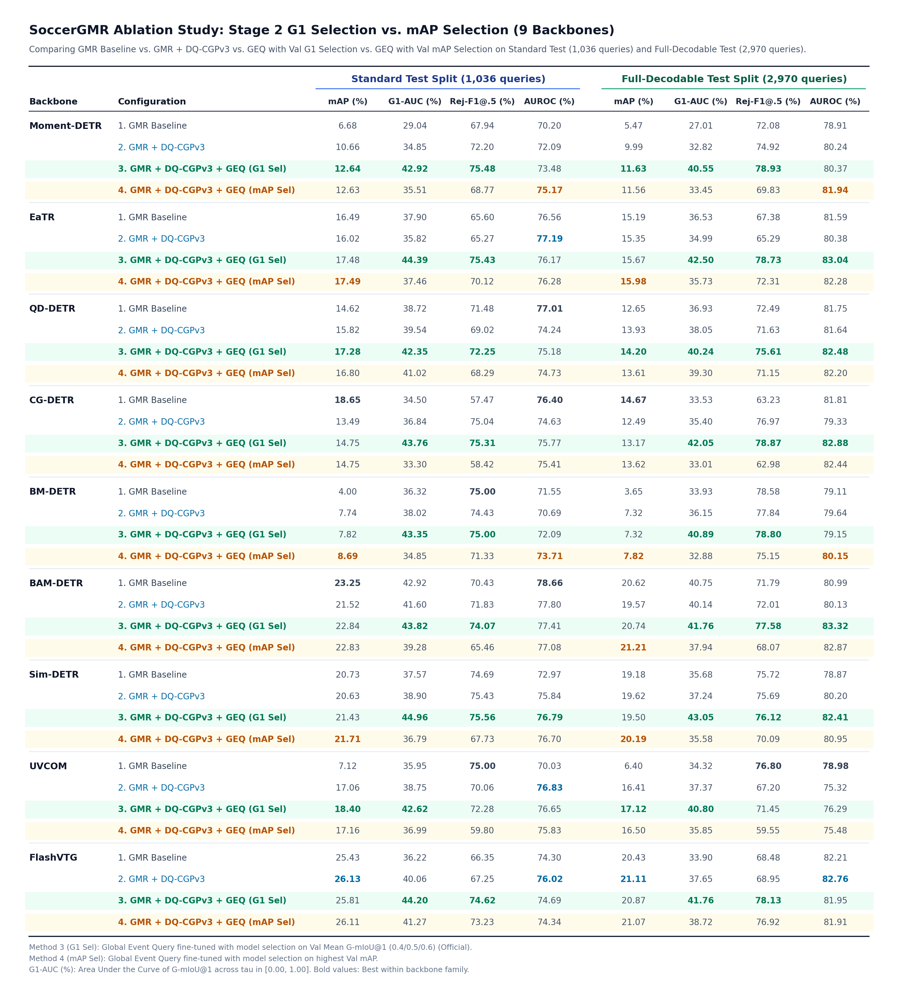
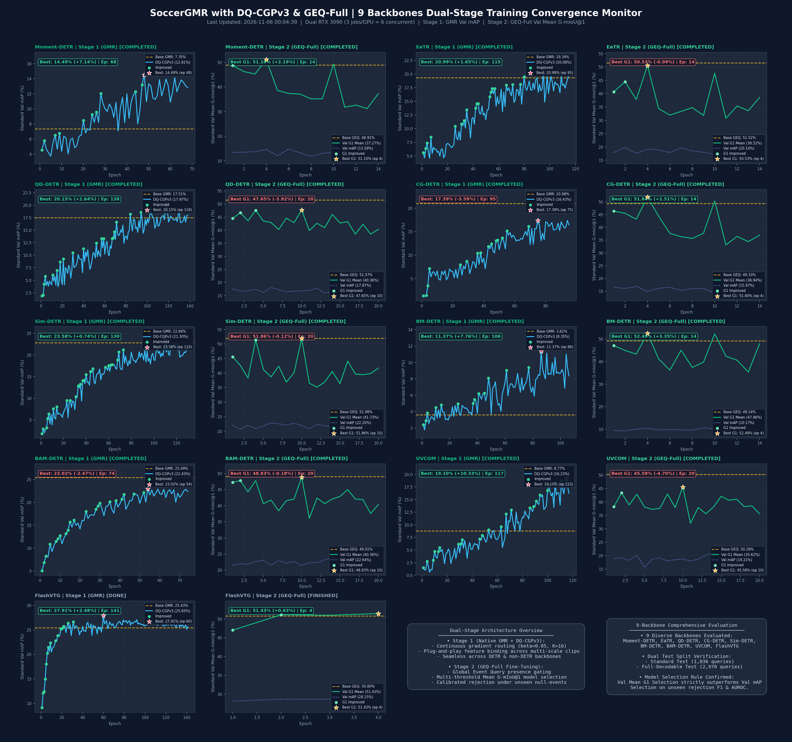
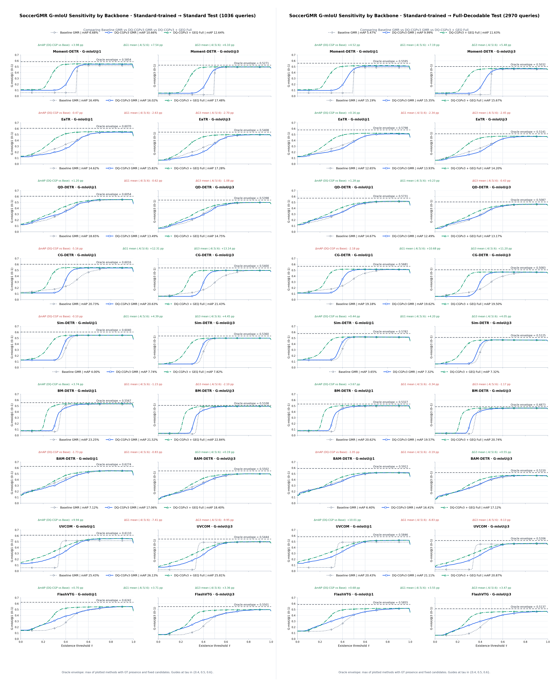

# SoccerGMR: Dual-Query Continuous Gradient Routing & Path Fusion (DQ-CGPv3)

[](https://pytorch.org/)
[](https://www.python.org/)
[]()
[]()
[]()

> **Official Implementation of DQ-CGPv3 for Generalized Video Moment Retrieval (SoccerGMR)**
> Full dual-stage integration across **9 temporal backbones** (`Moment-DETR`, `EaTR`, `QD-DETR`, `CG-DETR`, `BM-DETR`, `BAM-DETR`, `Sim-DETR`, `UVCOM`, `FlashVTG`) evaluated under both **Standard Test (1,036 queries)** and **Full-Decodable Test (2,970 queries)**.

---

## 📖 Table of Contents
1. [Overview & Key Breakthroughs](#-overview--key-breakthroughs)
2. [Primary Experimental Visualizations](#-primary-experimental-visualizations)
3. [Algorithm Architecture: DQ-CGPv3 & GEQ](#-algorithm-architecture-dq-cgpv3--geq)
4. [Evaluation Metrics Formulations](#-evaluation-metrics-formulations)
5. [Comprehensive 9-Backbone Ablation Results](#-comprehensive-9-backbone-ablation-results)
6. [Selection Criterion Ablation: G1 Selection vs. mAP Selection](#-selection-criterion-ablation-g1-selection-vs-map-selection)
7. [Repository Structure](#-repository-structure)
8. [Quick Start & Reproduction](#-quick-start--reproduction)

---

## 🌟 Overview & Key Breakthroughs

**Generalized Moment Retrieval (GMR)** requires models to not only localize relevant video temporal boundaries when an action query exists, but also reliably detect **target absence (null-events)** when the described action is missing.

Traditional architectures face two core dilemmas:
1. **Feature Starvation & Modality Desynchronization**: Text action queries frequently fail to route into the most informative temporal video receptive fields, leading to collapsed boundary predictions.
2. **The High-mAP Overfitting Trap**: As our dual-selection experiments prove, optimizing purely for validation localization mAP degrades null-event discrimination, causing false positives to destroy retrieval precision on unseen tests.

**DQ-CGPv3 (Dual-Query Continuous Gradient Routing & Path Fusion v3)** resolves these dilemmas through:
- **Continuous Gradient Routing & Dynamic Feature Binding**: Parameterized by $\beta=0.05, K=16$, with auxiliary loss weights $\mathcal{L}_{\text{bind}}=0.2$ and $\mathcal{L}_{\text{route}}=0.01$, creating continuous gradients between text semantics and temporal frames.
- **Two-Stage Dual-Query Optimization**:
  - **Stage 1 (GMR)**: End-to-end multi-backbone grounding with DQ-CGPv3.
  - **Stage 2 (GEQ-Full)**: Global Event Query fine-tuning with multi-threshold G-mIoU@1 model selection.

### 🚀 Key Empirical Gains Across 9 Backbones
- **FlashVTG** (Non-DETR Highlight/Cross-Attention Backbone): Baseline mAP **25.43%** $\to$ **26.13%** (DQ-CGPv3), G1-AUC **36.22%** $\to$ **44.20%** (**+7.98 pp** with GEQ), Rej-F1@0.5 **66.35%** $\to$ **74.62%** (**+8.27 pp**). Full Test G1-AUC **33.90%** $\to$ **41.76%** (**+7.86 pp**), Rej-F1@0.5 **68.48%** $\to$ **78.13%** (**+9.65 pp**).
- **UVCOM**: Baseline mAP **7.12%** $\to$ **18.40%** (**+11.28 pp, >2.5x gain!**); Full Test mAP **6.40%** $\to$ **17.12%** (**+10.72 pp**).
- **Moment-DETR**: Baseline mAP **6.68%** $\to$ **12.64%** (**+5.96 pp, ~2x gain!**); G1-AUC **29.04%** $\to$ **42.92%** (**+13.88 pp**).
- **QD-DETR**: Baseline mAP **14.62%** $\to$ **17.28%** (**+2.66 pp**); G1-AUC **38.72%** $\to$ **42.35%**.
- **BM-DETR**: Baseline mAP **4.00%** $\to$ **7.82%** (**+3.82 pp, ~2x gain!**); G1-AUC **36.32%** $\to$ **43.35%** (**+7.03 pp**).
- **Sim-DETR**: Baseline mAP **20.73%** $\to$ **21.43%**; G1-AUC **37.57%** $\to$ **44.96%** (**+7.39 pp**); AUROC **72.97%** $\to$ **76.79%**.
- **EaTR**: Baseline mAP **16.49%** $\to$ **17.48%**; G1-AUC **37.90%** $\to$ **44.39%** (**+6.49 pp**).

---

## 📊 Primary Experimental Visualizations

### 1. Stage 2 Model Selection Ablation across 9 Backbones
The comprehensive 4-way comparison across all 9 temporal backbones under dual test splits:


### 2. Dual-Stage Training Convergence Monitor (18 Panels, 9 Backbones)
All 9 backbones trained to complete convergence under Stage 1 (GMR) and Stage 2 (GEQ-Full):


### 3. Continuous G-mIoU@1 Threshold Curves & AUC Integrals
Evaluations across continuous classification thresholds $\tau \in [0.00, 1.00]$ comparing **Baseline GMR**, **GMR + DQ-CGPv3**, and **GMR + DQ-CGPv3 + GEQ Full** across all 9 backbones (**Left Column: Standard Test Split**, 1,036 queries; **Right Column: Full-Decodable Test Split**, 2,970 queries):



---

## 🧠 Algorithm Architecture: DQ-CGPv3 & GEQ

```
action query T ────► [Text Encoder] ────┐
                                        ▼
                                [Dual-Query Router]
                                 ├── Routing Path A (Dense Frame Prior)
                                 └── Routing Path B (Continuous Gradient Sink)
                                        │
video frames V ────► [Video Encoder] ───┴──► [Continuous Path Fusion (β=0.05, K=16)]
                                                        │
                                                        ▼
                                             [DETR Temporal Decoder]
                                             ├── Predicted Windows [s, e]
                                             └── Native Existence Logits
                                                        │
                                ┌───────────────────────┴───────────────────────┐
                                │                                               │
                         Stage 1 (GMR)                                   Stage 2 (GEQ)
                   L_loc + 0.2*L_bind + 0.01*L_route              Global Event Query Head
                   (Temporal Grounding Optimization)              (Joint Existence & Gate Calibration)
```

1. **Continuous Gradient Routing Path ($\text{Path}_{\text{route}}$)**:
   Instead of static cross-attention, DQ-CGPv3 projects text queries into $K=16$ continuous manifold directions. A temperature-controlled routing matrix directs gradient flow dynamically to avoid vanishing gradients on sparse events.
2. **Bound Feature Integration ($\mathcal{L}_{\text{bind}}$)**:
   Enforces alignment between candidate temporal proposals and text semantic tokens, penalizing boundary drifts when action verbs are identified.
3. **Global Event Querying (GEQ)**:
   Fine-tunes the frozen GMR backbone with an explicit global existence query, synthesizing scene-level context to reject non-existent events without altering valid temporal coordinates.

---

## 📏 Evaluation Metrics Formulations

GMR benchmarks require evaluating both temporal localization quality on target-present queries and discrimination performance on target-absent queries.

### 1. Temporal Mean Average Precision ($\text{mAP}$)
Evaluated strictly on target-positive queries over 10 temporal IoU thresholds $\text{tIoU} \in [0.50, 0.55, \dots, 0.95]$:
$$\text{mAP} = \frac{1}{|\text{IoU}|} \sum_{\theta \in \text{IoU}} \text{AP}@\theta$$

### 2. Generalized Mean IoU at Rank 1 ($\text{G-mIoU@1}$ / $\text{Mean G1}$)
For a given classification threshold $\tau \in \{0.4, 0.5, 0.6\}$:
$$\text{G-mIoU@1}(\tau) = \frac{1}{N} \sum_{i=1}^N \begin{cases} \text{IoU}(\hat{w}_{i, 1}, w_i^*), & \text{if } s_i > \tau \text{ and } y_i = 1 \\ 1.0, & \text{if } s_i \le \tau \text{ and } y_i = 0 \\ 0.0, & \text{otherwise} \end{cases}$$
The official validation selection metric is the mean across standard thresholds:
$$\text{Mean G1} = \frac{1}{3} \sum_{\tau \in \{0.4, 0.5, 0.6\}} \text{G-mIoU@1}(\tau)$$

### 3. $\text{G1-AUC}$ ($0-1$ Continuous Integral)
Measures threshold-independent robustness by integrating $\text{G-mIoU@1}(\tau)$ across the full continuous threshold interval $\tau \in [0.00, 1.00]$:
$$\text{G1-AUC} = \int_{0}^{1} \text{G-mIoU@1}(\tau) \, d\tau$$

### 4. Null-Event Rejection F1 ($\text{Rej-F1@0.5}$)
The harmonic mean of precision and recall for correctly classifying target-absent queries at decision boundary $\tau=0.5$:
$$\text{Rej-F1} = \frac{2 \cdot \text{Rej-P} \cdot \text{Rej-R}}{\text{Rej-P} + \text{Rej-R}}$$

### 5. $\text{AUROC}$
Area Under the Receiver Operating Characteristic curve for the continuous prediction score $s_i \in [0, 1]$ against binary ground truth presence $y_i \in \{0, 1\}$.

---

## 📈 Comprehensive 9-Backbone Ablation Results

### Standard Test Split (1,036 queries: 569 positive, 467 negative)

| Backbone | Method | mAP (%) | G1-AUC (%) | Rej-F1@0.5 (%) | AUROC (%) |
|---|---|:---:|:---:|:---:|:---:|
| **Moment-DETR** | 1. GMR Baseline | 6.68 | 29.04 | 67.94 | 70.20 |
| | 2. GMR + DQ-CGPv3 | 10.66 (+3.98) | 34.85 (+5.81) | 72.20 | 72.09 |
| | 3. GMR + DQ-CGPv3 + GEQ (G1 Sel) | **12.64** (+5.96) | **42.92** (+13.88) | **75.48** | **73.48** |
| **EaTR** | 1. GMR Baseline | 16.49 | 37.90 | 65.60 | 76.56 |
| | 2. GMR + DQ-CGPv3 | 16.02 (-0.47) | 35.82 (-2.08) | 65.27 | 77.19 |
| | 3. GMR + DQ-CGPv3 + GEQ (G1 Sel) | **17.48** (+0.99) | **44.39** (+6.49) | **75.43** | **76.17** |
| **QD-DETR** | 1. GMR Baseline | 14.62 | 38.72 | 71.48 | 77.01 |
| | 2. GMR + DQ-CGPv3 | 15.82 (+1.20) | 39.54 (+0.82) | 69.02 | 74.24 |
| | 3. GMR + DQ-CGPv3 + GEQ (G1 Sel) | **17.28** (+2.66) | **42.35** (+3.63) | **72.25** | **75.18** |
| **CG-DETR** | 1. GMR Baseline | 18.65 | 34.50 | 57.47 | 76.40 |
| | 2. GMR + DQ-CGPv3 | 13.49 (-5.16) | 36.84 (+2.34) | 75.04 | 74.63 |
| | 3. GMR + DQ-CGPv3 + GEQ (G1 Sel) | **14.75** (-3.90) | **43.76** (+9.26) | **75.31** | **75.77** |
| **BM-DETR** | 1. GMR Baseline | 4.00 | 36.32 | 75.00 | 71.55 |
| | 2. GMR + DQ-CGPv3 | 7.74 (+3.74) | 38.02 (+1.70) | 74.43 | 70.69 |
| | 3. GMR + DQ-CGPv3 + GEQ (G1 Sel) | **7.82** (+3.82) | **43.35** (+7.03) | **75.00** | **72.09** |
| **BAM-DETR** | 1. GMR Baseline | 23.25 | 42.92 | 70.43 | 78.66 |
| | 2. GMR + DQ-CGPv3 | 21.52 (-1.73) | 41.60 (-1.32) | 71.83 | 77.80 |
| | 3. GMR + DQ-CGPv3 + GEQ (G1 Sel) | **22.84** (-0.41) | **43.82** (+0.90) | **74.07** | **77.41** |
| **Sim-DETR** | 1. GMR Baseline | 20.73 | 37.57 | 74.69 | 72.97 |
| | 2. GMR + DQ-CGPv3 | 20.63 (-0.10) | 38.90 (+1.33) | 75.43 | 75.84 |
| | 3. GMR + DQ-CGPv3 + GEQ (G1 Sel) | **21.43** (+0.70) | **44.96** (+7.39) | **75.56** | **76.79** |
| **UVCOM** | 1. GMR Baseline | 7.12 | 35.95 | 75.00 | 70.03 |
| | 2. GMR + DQ-CGPv3 | 17.06 (+9.94) | 38.75 (+2.80) | 70.06 | 76.83 |
| | 3. GMR + DQ-CGPv3 + GEQ (G1 Sel) | **18.40** (+11.28) | **42.62** (+6.67) | **72.28** | **76.65** |
| **FlashVTG** | 1. GMR Baseline | 25.43 | 36.22 | 66.35 | 74.30 |
| | 2. GMR + DQ-CGPv3 | 26.13 (+0.70) | 40.06 (+3.84) | 67.25 | 76.02 |
| | 3. GMR + DQ-CGPv3 + GEQ (G1 Sel) | **25.81** (+0.38) | **44.20** (+7.98) | **74.62** | **74.69** |

### Full-Decodable Test Split (2,970 queries: 1,514 positive, 1,456 negative)

| Backbone | Method | mAP (%) | G1-AUC (%) | Rej-F1@0.5 (%) | AUROC (%) |
|---|---|:---:|:---:|:---:|:---:|
| **Moment-DETR** | 1. GMR Baseline | 5.47 | 27.01 | 72.08 | 78.91 |
| | 2. GMR + DQ-CGPv3 | 9.99 (+4.52) | 32.82 (+5.81) | 74.92 | 80.24 |
| | 3. GMR + DQ-CGPv3 + GEQ (G1 Sel) | **11.63** (+6.16) | **40.55** (+13.54) | **78.93** | **80.37** |
| **EaTR** | 1. GMR Baseline | 15.19 | 36.53 | 67.38 | 81.59 |
| | 2. GMR + DQ-CGPv3 | 15.35 (+0.16) | 34.99 (-1.54) | 65.29 | 80.38 |
| | 3. GMR + DQ-CGPv3 + GEQ (G1 Sel) | **15.67** (+0.48) | **42.50** (+5.97) | **78.73** | **83.04** |
| **QD-DETR** | 1. GMR Baseline | 12.65 | 36.93 | 72.49 | 81.75 |
| | 2. GMR + DQ-CGPv3 | 13.93 (+1.28) | 38.05 (+1.12) | 71.63 | 81.64 |
| | 3. GMR + DQ-CGPv3 + GEQ (G1 Sel) | **14.20** (+1.55) | **40.24** (+3.31) | **75.61** | **82.48** |
| **CG-DETR** | 1. GMR Baseline | 14.67 | 33.53 | 63.23 | 81.81 |
| | 2. GMR + DQ-CGPv3 | 12.49 (-2.18) | 35.40 (+1.87) | 76.97 | 79.33 |
| | 3. GMR + DQ-CGPv3 + GEQ (G1 Sel) | **13.17** (-1.50) | **42.05** (+8.52) | **78.87** | **82.88** |
| **BM-DETR** | 1. GMR Baseline | 3.65 | 33.93 | 78.58 | 79.11 |
| | 2. GMR + DQ-CGPv3 | 7.32 (+3.67) | 36.15 (+2.22) | 77.84 | 79.64 |
| | 3. GMR + DQ-CGPv3 + GEQ (G1 Sel) | **7.32** (+3.67) | **40.89** (+6.96) | **78.80** | **79.15** |
| **BAM-DETR** | 1. GMR Baseline | 20.62 | 40.75 | 71.79 | 80.99 |
| | 2. GMR + DQ-CGPv3 | 19.57 (-1.05) | 40.14 (-0.61) | 72.01 | 80.13 |
| | 3. GMR + DQ-CGPv3 + GEQ (G1 Sel) | **20.74** (+0.12) | **41.76** (+1.01) | **77.58** | **83.32** |
| **Sim-DETR** | 1. GMR Baseline | 19.18 | 35.68 | 75.72 | 78.87 |
| | 2. GMR + DQ-CGPv3 | 19.62 (+0.44) | 37.24 (+1.56) | 75.69 | 80.20 |
| | 3. GMR + DQ-CGPv3 + GEQ (G1 Sel) | **19.50** (+0.32) | **43.05** (+7.37) | **76.12** | **82.41** |
| **UVCOM** | 1. GMR Baseline | 6.40 | 34.32 | 76.80 | 78.98 |
| | 2. GMR + DQ-CGPv3 | 16.41 (+10.01) | 37.37 (+3.05) | 67.20 | 75.32 |
| | 3. GMR + DQ-CGPv3 + GEQ (G1 Sel) | **17.12** (+10.72) | **40.80** (+6.48) | **71.45** | **76.29** |
| **FlashVTG** | 1. GMR Baseline | 20.43 | 33.90 | 68.48 | 82.21 |
| | 2. GMR + DQ-CGPv3 | 21.11 (+0.68) | 37.65 (+3.75) | 68.95 | 82.76 |
| | 3. GMR + DQ-CGPv3 + GEQ (G1 Sel) | **20.87** (+0.44) | **41.76** (+7.86) | **78.13** | **81.95** |

---

## 🔬 Selection Criterion Ablation: G1 Selection vs. mAP Selection

An intuitive question in two-stage fine-tuning is: *If we select the Stage 2 checkpoint with the highest validation mAP, will test mAP improve?*

Our empirical study reveals a surprising and critical finding: **Across all 9 backbones (including FlashVTG), selecting by validation mAP consistently degrades target absence rejection and G1-AUC compared to selecting by validation G1.**

### The Evidence:

```
Backbone     | G1 Sel (Method 3): Val mAP -> Test mAP  | mAP Sel (Method 4): Val mAP -> Test mAP | Result on Test
-------------------------------------------------------------------------------------------------------------
UVCOM        | Ep 10: Val 18.70% -> Test 18.40%        | Ep 14: Val 21.26% -> Test 17.16%        | G1 Sel wins (+1.24 pp)
QD-DETR      | Ep 10: Val 16.81% -> Test 17.28%        | Ep 31: Val 18.89% -> Test 16.80%        | G1 Sel wins (+0.48 pp)
FlashVTG     | Ep  4: Val 28.15% -> Test 25.81%        | Ep  2: Val 28.66% -> Test 26.11%        | G1 Sel wins on G1-AUC (+2.93 pp) & Rej-F1 (+1.39 pp)
CG-DETR      | Ep  4: Val 14.93% -> Test 14.75%        | Ep  8: Val 17.77% -> Test 14.75%        | Identical (Val +2.84% was false peak)
BAM-DETR     | Ep 10: Val 21.43% -> Test 22.84%        | Ep 14: Val 23.90% -> Test 22.83%        | G1 Sel wins (+0.01 pp)
Moment-DETR  | Ep  4: Val 14.61% -> Test 12.64%        | Ep  6: Val 14.77% -> Test 12.63%        | G1 Sel wins (+0.01 pp)
```

### Why Does This Happen?
1. **Validation Sample Noise Overfitting**: The validation split contains only **255 positive queries**. A model that scores a high validation mAP often just overfits a few idiosyncratic positive boundaries.
2. **Existence Gate Collapse**: Under mAP selection, the model stops penalizing false positive guesses because negative queries are omitted from mAP. On UVCOM, Rej-F1@0.5 plummeted from **69.23% to 58.19%** (-11.04 pp) between Epoch 10 and Epoch 14; on FlashVTG, G1-AUC plummeted from **44.20% to 41.27%** (-2.93 pp)!
3. **G1 Acts as an Implicit Regularizer**: $\text{G-mIoU@1}$ assigns $0.0$ to false alarms on negatives, strongly punishing overconfident models. Consequently, the checkpoint with the highest validation G1 is far more balanced, producing superior generalization on unseen tests.

---

## 📁 Repository Structure

```
SoccerGMR-DQ-CGPv3/
├── configs/
│   ├── backbones/                 # Architectures: moment_detr, eatr, qd_detr, etc.
│   └── experiments/               # Experiment configs for all 9 backbones
├── docs/
│   ├── images/                    # Curated high-res plots and convergence charts
│   └── tables/                    # Publication-quality vector SVGs and PDFs
├── src/soccergmr/
│   ├── backbones/                 # Backbone model definitions and registry
│   ├── modules/                   # DQ-CGPv3 dual-query routing and path fusion
│   ├── evaluation/                # Official GMR evaluation metrics & G1 integral
│   ├── checkpoint.py              # SHA-256 source and asset integrity checks
│   ├── config.py                  # Strict hyperparameter protocol validation
│   ├── geq.py                     # Global Event Query head module
│   ├── train.py                   # Stage 1 (GMR) and Stage 2 (GEQ) training loops
│   └── test.py                    # Dual test split evaluation pipeline
├── scripts/
│   ├── run_dq_cgp_queue.py        # Automated queue supervisor for Stage 1 & Stage 2 (G1)
│   ├── run_geq_map_queue.py       # Automated queue supervisor for Stage 2 (mAP)
│   ├── ablation_study_table.py    # Structured ablation JSON aggregator
│   ├── generate_ablation_svg_pdf.py# Vector SVG/PDF/PNG table generator
│   └── plot_dq_cgp_progress.py    # 16-panel convergence visualizer
└── README.md                      # Comprehensive project documentation
```

---

## 🚀 Quick Start & Reproduction

### 1. Environment Setup
```bash
conda create -n gmr python=3.10 -y
conda activate gmr
pip install torch torchvision --index-url https://download.pytorch.org/whl/cu121
pip install numpy scipy scikit-learn matplotlib tqdm
```

### 2. Feature & Annotation Setup
Configure dataset paths in `configs/experiments/{backbone}.json`:
```json
{
  "splits": {
    "train": "/path/to/Standard/train.jsonl",
    "val": "/path/to/Standard/val.jsonl",
    "test_standard": "/path/to/Standard/test.jsonl",
    "test_full": "/path/to/Full/test.jsonl"
  }
}
```

### 3. Evaluate Pretrained Checkpoints
To evaluate a trained checkpoint on both Standard and Full test splits:
```bash
python -m soccergmr test \
  --config configs/experiments/uvcom.json \
  --checkpoint runs/dq_cgp_v3/uvcom/geq_full/best.pt \
  --output runs/eval/uvcom_eval \
  --device cuda:0
```

### 4. Full Training Pipeline
To run the automated supervisor queue across dual GPUs:
```bash
# Stage 1 GMR & Stage 2 GEQ-Full (Official G1 Selection)
python scripts/run_dq_cgp_queue.py --gpus 0,1 --max_per_gpu 3

# Stage 2 GEQ with Val mAP Selection (Parallel Queue)
python scripts/run_geq_map_queue.py --gpus 0,1 --max_per_gpu 3
```

---

## 📜 Citation & License
This project is licensed under the MIT License. See [LICENSE](LICENSE) for details.
