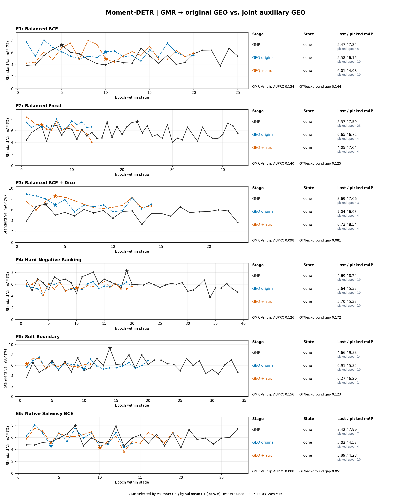
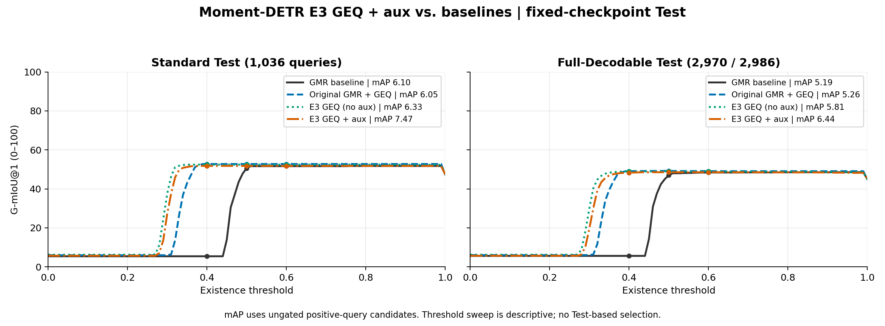
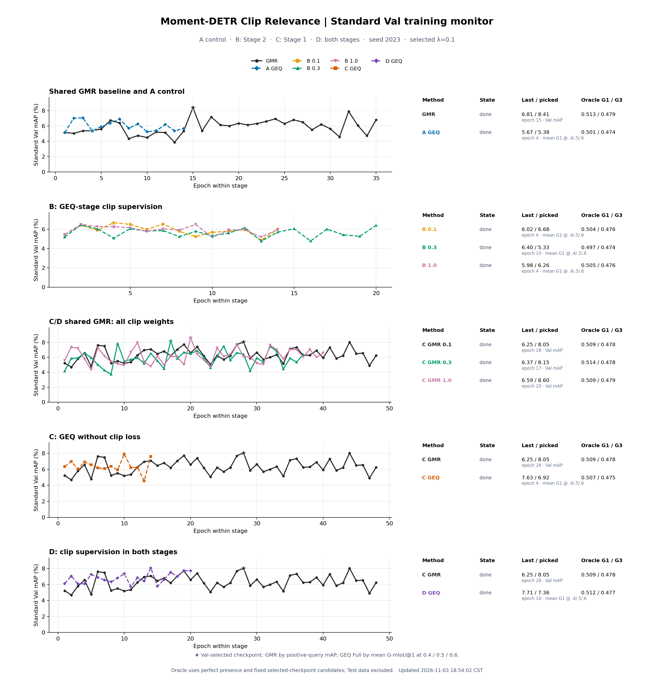
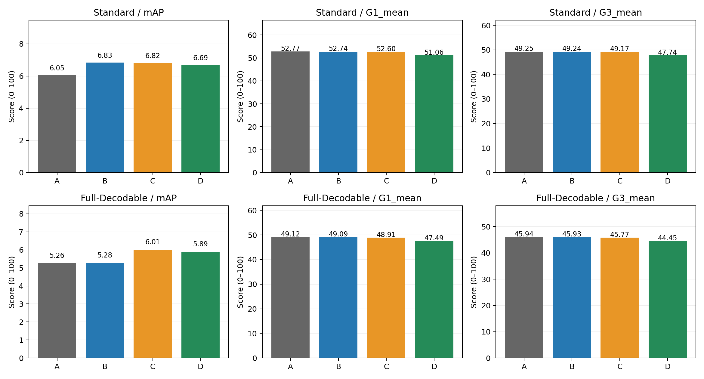

# 11骨干 GMR baseline → GEQ+aux：训练与固定 Test 结果

本轮11个骨干的两阶段训练和 Standard / Full Test 评测已完成。**Moment-DETR 复用已完成实验，其余10个骨干完成20个训练阶段与40次 Test；总计44份 Test 评测。** 本次发布补齐结果、图表、11骨干实现和可复算证据，不重新训练已有实验。

**命名说明：** 图表按用户要求标注 **GMR baseline**，指本轮带辅助监督的 Stage 1；它不是历史无辅助 GMR。Stage 2 为 **GEQ+aux**，继承并继续更新辅助头。旧版无辅助基线与 A/B/C/D、E1–E6 对照保留在文末历史记录，不混为同一训练协议。

- [完整结果与诊断](results/e3_eleven/REPORT.md) · [逐项指标 CSV](results/e3_eleven/METRICS.csv) · [101点阈值曲线 CSV](results/e3_eleven/CURVES.csv) · [44份评测审计](results/e3_eleven/AUDIT.json)
- [高事件保留率：六骨干新评测](results/e3_high_retention/README.md) · [阈值与保留率](results/e3_high_retention/DECISIONS.csv) · [复算脚本](scripts/report_e3_high_retention.py)
- [训练协议](E3_ELEVEN_PROTOCOL.md) · [实现与来源提交](https://github.com/chinagalaxy2002/Improving-Target-Presence-for-Generalized-Moment-Retrieval/commit/d22986a671076e700b7c420b259009215ce5cead) · [训练/复用/选模证据](results/e3_eleven/provenance/)

## Standard / Full Test 汇总

各单元格为 **GMR baseline → GEQ+aux**，单位0–100；G1为存在性阈值0.4/0.5/0.6的 G-mIoU@1 均值。mAP是未门控正查询定位指标。

| 骨干 | Standard mAP | Standard G1 | Full mAP | Full G1 |
|---|---:|---:|---:|---:|
| Moment-DETR（复用） | 5.49 → 7.47 | 33.51 → 51.80 | 5.33 → 6.44 | 30.62 → 48.46 |
| EaTR | 16.37 → 17.16 | 39.12 → 53.83 | 13.77 → 14.68 | 37.35 → 50.44 |
| QD-DETR | 11.56 → 13.05 | 45.58 → 53.89 | 10.50 → 11.22 | 41.76 → 50.47 |
| CG-DETR | 6.37 → 6.91 | 22.62 → 52.47 | 5.82 → 6.19 | 21.77 → 48.69 |
| Sim-DETR | 20.29 → 21.00 | 55.19 → 55.20 | 19.60 → 19.46 | 51.64 → 52.36 |
| BM-DETR | 4.11 → 4.20 | 52.34 → 52.83 | 3.87 → 3.81 | 48.86 → 49.36 |
| BAM-DETR | 22.97 → 23.64 | 50.65 → 49.85 | 20.33 → 20.59 | 48.31 → 46.38 |
| UVCOM | 22.21 → 21.66 | 44.70 → 45.26 | 18.46 → 19.21 | 42.49 → 43.77 |
| TR-DETR | 2.58 → 2.81 | 48.45 → 48.48 | 2.85 → 2.84 | 45.30 → 45.15 |
| TaskWeave | 3.79 → 3.40 | 49.82 → 48.61 | 3.70 → 3.31 | 46.17 → 45.03 |
| LD-DETR | 6.32 → 6.52 | 34.56 → 49.66 | 6.06 → 6.31 | 32.79 → 46.40 |

Standard / Full 上 mAP 提高的骨干分别为9/11、7/11，G1提高分别为9/11、8/11。保留全部下降结果，不能概括为所有骨干或所有指标全面改善。Full采用2970/2986条可解码样本，Standard为1036条；两套 Test 有重叠，单 seed=2023。

## 固定 Test 阈值曲线

横轴为**存在性阈值**0–1、步长0.01，并非 tIoU 阈值；左列 G-mIoU@1、右列 G-mIoU@3，图例给出各模型 mAP。checkpoint 按 Val 选定，曲线仅描述固定模型的阈值响应，不用于 Test 选参。各 tIoU 的 AP 见 [DETAILS.json](results/e3_eleven/DETAILS.json) 内的 `mAP_detail`。

### Standard Test


[矢量 PDF](results/e3_eleven/STANDARD_TEST.pdf) · [SVG](results/e3_eleven/STANDARD_TEST.svg) · [每骨干单页 PDF](results/e3_eleven/STANDARD_TEST_BY_BACKBONE.pdf)

### Full-Decodable Test


[矢量 PDF](results/e3_eleven/FULL_TEST.pdf) · [SVG](results/e3_eleven/FULL_TEST.svg) · [每骨干单页 PDF](results/e3_eleven/FULL_TEST_BY_BACKBONE.pdf) · [两套 Test 合集](results/e3_eleven/BOTH_TESTS.pdf)

## 高事件保留率场景：六骨干新评测

沿用 [原分支六骨干分析](https://github.com/chinagalaxy2002/Improving-Target-Presence-for-Generalized-Moment-Retrieval/tree/682db34ab0511ce0ebfd69e9b966150cac6473a5/results/high_retention) 的骨干集合和阈值规则，改用本轮 GMR baseline / GEQ+aux 的固定预测。每种方法各自在 **Standard Val 选择正查询保留率≥95%的最大候选阈值**，原样用于两套 Test。主分析使用0.01网格，复核使用完整 Val 分数断点；严格 `score > threshold`，Test 不参与选择。


| 阈值搜索 | Test | GMR平均 G1 | GEQ+aux平均 G1 | Δ百分点 | 相对增益 | 提高骨干数 |
|---|---|---:|---:|---:|---:|---:|
| 0.01网格 | standard | 9.271 | 10.838 | +1.567 | +16.90% | 5/6 |
| 0.01网格 | full | 9.179 | 10.398 | +1.220 | +13.29% | 5/6 |
| 完整Val断点 | standard | 11.488 | 12.384 | +0.896 | +7.80% | 5/6 |
| 完整Val断点 | full | 10.781 | 11.457 | +0.676 | +6.27% | 5/6 |

本轮不是原图的“6/6均提高”：LD-DETR 在 Standard / Full 的主分析下降0.05 / 0.24个百分点，完整断点复核下降2.43 / 2.69个百分点。六骨干范围沿用历史探索性子集，没有按本次结果重新筛选；不能据此声称所有11骨干均有效。95%只约束 Val，Test实际保留率及空查询误返回率另行报告，高保留率不等于低误返回。


[主图 PDF](results/e3_high_retention/PRIMARY.pdf) · [复核图 PDF](results/e3_high_retention/EXACT_THRESHOLDS.pdf) · [完整报告和逐骨干表](results/e3_high_retention/README.md) · [mAP/G1/G3 CSV](results/e3_high_retention/METRICS.csv) · [96项官方指标核验](results/e3_high_retention/AUDIT.json)

## 本轮训练记录与复现

<details>
<summary>展开11骨干两阶段训练曲线</summary>


[PDF](results/e3_eleven/training_val_panel.pdf) · [SVG](results/e3_eleven/training_val_panel.svg)

</details>

辅助目标为 `L_aux = L_balanced_BCE + 0.2 × L_Dice`，外部权重0.1；两阶段保留各骨干原生损失。GMR按 Val mAP选模（patience20），GEQ按 Val三阈值G1均值选模（patience10）。GEQ主干/GEQ/辅助头学习率为1e-5/3e-5/3e-5，头不冻结，推理不使用辅助头门控或改写候选。方法来源详见文末“GEQ＋aux的方法溯源”。

10个新骨干训练源码固定于 `d22986a`，源码哈希 `7d69e39b16dc91339b3c82f3d25e4b581896397f00283ef0dbd5f025fa6cb062`；Moment-DETR保留其原始来源与checkpoint哈希。当前发布带入同一份11骨干源码，并保留旧实验档案。配置内数据/架构路径是训练机器的原始绝对路径，迁移机器时需显式修改；已有 checkpoint 仍须遵守源码/配置/资产身份校验。发布提交没有伪装成原训练提交。

本结果包包含压缩预测、GT快照、指标、曲线和哈希，不包含权重与视频特征。高保留率图可完全从本分支复算，无需GPU：

```bash
PYTHONPATH=src python scripts/report_e3_high_retention.py --verify-only
PYTHONPATH=src python scripts/report_e3_high_retention.py
python scripts/plot_e3_test_results.py
PYTHONPATH=src python scripts/verify_e3_publication.py
```

[数据与图表文件清单](PUBLICATION_MANIFEST.json) · [发布核验](PUBLICATION_CHECKS.json)

---

# 历史记录：Moment-DETR E1–E6 与 GEQ＋aux 微调

**以下为上一轮暂停时的六组实验快照。** 六组新 GEQ＋aux 训练已完成，全部 checkpoint 留在本机；本分支上传代码、Val 结果、训练图及已经完成的固定 Test 结果，不上传模型权重或特征。

- [当前结果快照与暂停说明](results/clip_joint_snapshot/README.md)
- [E3 GEQ＋aux 与 baseline 的 Standard / Full Test 对比](results/E3_baseline_comparison/README.md)
- [E3 对比指标 CSV](results/E3_baseline_comparison/METRICS.csv) · [0–1、步长0.01的 G-mIoU@1 曲线 CSV](results/E3_baseline_comparison/CURVES.csv)
- [上一轮 E1–E6（GMR-only 辅助监督）的完整结果与审计](results/clip_v2/REPORT.md)
- [新微调方案](EXPERIMENT_JOINT.md) · [父 GMR 兼容迁移及训练验收](scripts/verify_joint.py)





E3 GEQ＋aux 的 Standard / Full mAP 为 **7.47 / 6.44**，原始 GMR baseline 为 **6.10 / 5.19**；三阈值 G1 均值为 **51.80 / 48.46**，原始 GMR baseline 为 **35.89 / 33.69**。同时保留原始 GMR→GEQ 控制（mAP **6.05 / 5.26**，G1 **52.77 / 49.12**）和同一 E3 GMR 起点的无辅助 GEQ（mAP **6.33 / 5.81**，G1 **52.45 / 48.95**）。因此，aux 的 mAP 提高，但对比 GEQ 控制时 G1 略降，不应宣称整体指标全面提升。

mAP 使用未门控正查询候选；G1 三点均值对应固定存在性阈值0.4/0.5/0.6。曲线阈值扫描只用于展示，不用于 Test 选参。Standard1036条；Full-Decodable2970/2986条。两个 Test 集存在重叠；单 seed=2023，实际早停时长不同。旧 A/B/C/D、上一轮 E1–E6 和新轮 GEQ＋aux 的训练源码身份分别保留，未重训已有 GMR 或关闭身份检查。

本次复现：六种辅助损失只用于 GMR 的训练提交为 `d6cc259`；保留可训练辅助头并在 GEQ 中加入0.1辅助损失的提交为 `d782d85`。后续发布提交仅补充结果、脚本和文档，不修改以上已经训练的源文件。自动队列已关闭；恢复须由用户另行明确启动，使用原配置、原父模型及完整 last.pt，不从 best.pt 冒充续训。

## GEQ＋aux 的方法溯源（本文 E3 版本）

这里的 **GEQ＋aux 是本仓库的训练组合名称，不是某篇论文中同名完整算法的复现**。组成与演进如下：

1. **原生 GMR 主干及定位/显著性损失**：沿用各 DETR 骨干在本仓库的 GMR 适配，不用新损失替换原生任务。
2. **GEQ**：来自本项目 `soccergmr-standard-geq-full` 分支的 Global Event Query。GEQ token 先读取投影文本，再逐层读取视频 encoder 表示，用 BCE 学习事件存在性；定位候选仍由原生骨干输出。[原始项目算法说明](https://github.com/chinagalaxy2002/Improving-Target-Presence-for-Generalized-Moment-Retrieval/blob/soccergmr-standard-geq-full/docs/ALGORITHM.md)。
3. **Query-aware Clip Head**：本项目 ClipSeg 设计及 A/B/C/D 实验新增的辅助头。对有效文本 token 掩码池化，以 `LayerNorm(Wv·h + Wq·q + (Wv·h)⊙(Wq·q))` 融合文本和视频，MLP 输出逐 clip logit。[最初设计](docs/CLIP_RELEVANCE_ORIGINAL_DESIGN.md)。它借鉴密集时序相关性监督思想，并非照搬一个外部完整模型。
4. **本次 E3 辅助目标**：按每个视频分别平均正/负区域 BCE；非空的两组各占一半，空查询只计算有效负区域 BCE，无背景区域时只平均正区域。另加仅对有事件查询计算的 masked soft Dice。`L_aux = L_balanced_BCE + 0.2 × L_Dice`，外部权重 **0.1**。这是本轮 E3 的具体配置，不应将其他 E1/E2/E4/E5/E6 也统称为同一个损失。
5. **训练路径**：先从头训练 `L_native_GMR + 0.1 × L_aux`，按 Standard Val mAP 选 GMR best；再从该 best 继承主干及辅助头，以 `L_native_GMR + L_GEQ_BCE + 0.1 × L_aux` 联合微调，辅助头不冻结、单独学习率3e-5，主干1e-5，GEQ3e-5。GEQ 仍按 Val 三阈值 G1 均值选模。该联合阶段是在用户后续要求保留、允许更新辅助头后新增，**不同于上一轮“GEQ 完全不加辅助损失”的控制实验**。
6. **推理和证据边界**：Clip Head 的分数不参与门控、候选排序或边界修改；存在性来自 GEQ，定位来自主干。本轮单 seed 结果改善了 mAP，但相对同起点无 aux GEQ 的 G1 略降；不能将结果写成全面提升，也不能由当前证据把收益单独归因于 Dice、平衡 BCE 或 Head 结构。

代码与实验溯源：ClipSeg 初版发布 `0d853c9` → 六组 GMR-only 损失 `d6cc259` → 保留可训练 Head 的 GEQ 联合微调 `d782d85` → 固定 E3 Test 曲线及暂停快照 `5eecd26`。旧 GMR 没有重训，跨版本复用经过逐张量一致的显式迁移审计。当前 E3 结果及后续11骨干扩展均采用上述 E3 配方，而不是再搜索六种损失。

---

# Moment-DETR + Query-conditioned Clip Supervision

本节记录早期 **逐 clip 辅助监督**的 Moment-DETR 实现和 A/B/C/D 实验；当前版本已扩展为上文11骨干。它研究：训练时逐段判断“这个视频片段是否属于文字查询描述的事件”，能否改善最终时间定位。

**本轮结果：mAP 有提升，G-mIoU 未改善；Clip Head 低召回，不能据此宣称整体性能提升。**

| 组别 | Stage 1 GMR 加 Clip Loss | Stage 2 GEQ 加 Clip Loss | Standard mAP | Full mAP | Standard G1 均值 | Full G1 均值 |
|---|---|---|---:|---:|---:|---:|
| A 对照 | 否 | 否 | 6.05 | 5.26 | **52.77** | **49.12** |
| B | 否 | 是 | **6.83** | 5.28 | 52.74 | 49.09 |
| C | 是 | 否 | 6.82 | **6.01** | 52.60 | 48.91 |
| D | 是 | 是 | 6.69 | 5.89 | 51.06 | 47.49 |

指标为 0–100；G1 均值为存在性阈值 0.4/0.5/0.6 下 G-mIoU@1 的均值。Standard Test 为 1036 条，Full-Decodable Test 为 2970/2986 条。权重 λ=0.1 由 **Standard Val** 选择，未用 Test 调参。单 seed=2023，各组实际早停轮次不同；两个 Test 集有样本重叠。

[方法与完整结果](docs/METHOD_AND_RESULTS.md) · [详细结果](results/clipseg/RESULTS_ZH.md) · [CSV](results/clipseg/METRICS.csv) · [各 tIoU / 短事件 / 多区间结果](results/clipseg/DETAILS.json)



[训练图 PDF](results/clipseg/training_val_panel.pdf) · [SVG](results/clipseg/training_val_panel.svg)



## 实现

- [`clip.py`](src/soccergmr/clip.py)：文本掩码池化、视频/文本显式融合、逐 clip logits、masked BCE、GMR wrapper。
- [`geq.py`](src/soccergmr/geq.py)：原有 GEQ 存在性判断与辅助 Clip Head。
- [`train.py`](src/soccergmr/train.py)：阶段损失、头部优化器参数组、严格父 checkpoint 继承、断点恢复和 Val 选模。
- [`data.py`](src/soccergmr/data.py)：真实 duration 到 clip 标签的映射、多区间并集、空查询全零标签。

Clip Head **仅参与训练监督**；不修改推理边界、候选排序或 GEQ 门控。C/D 共用有 Clip Loss 的 GMR best；C 在 GEQ 阶段保留并冻结 Clip Head，D 继续更新它。A/B 共用无 Clip Loss 的 GMR best。

## 安装和数据

```bash
python -m venv .venv
source .venv/bin/activate
pip install -e '.[test,report]'
export SOCCERGMR_LABEL_ROOT=/path/to/labels
export SOCCERGMR_STANDARD_FEATURES=/path/to/standard_features
export SOCCERGMR_FULL_FEATURES=/path/to/full_features
export CUBLAS_WORKSPACE_CONFIG=:4096:8
```

数据目录见 [DATA.md](docs/DATA.md)。标签/特征/模型权重不随分支发布。归档预测已压缩保存，提供原始标签后可重算所报告的指标。

## 从头复现

```bash
CUDA_VISIBLE_DEVICES=1 OMP_NUM_THREADS=2 PYTHONPATH=src \
python scripts/run_experiments.py --output runs/reproduction --all-gmr-candidates
```

该入口从头训练 A 的 GMR，完成 A GEQ 与 B 的 λ=0.1/0.3/1.0；根据 B 的 Val 三阈值 G1 均值选 λ（并列选较小 λ），随后完成 C/D。`--all-gmr-candidates` 还训练其余两个 GMR 权重候选，对应历史中提前并行进行的三个父模型。所有已选模型固定评测两套 Test，B/C/D 额外生成 Val Clip 诊断与 query 热力图。断点重跑同一命令会从合法 `last.pt` 恢复；完整结果写入输出目录 `summary.json`。

单阶段也可运行：

```bash
PYTHONPATH=src python -m soccergmr train --config configs/experiments/A.json \
  --stage gmr --output runs/A/gmr
PYTHONPATH=src python -m soccergmr train --config configs/experiments/B_01.json \
  --stage geq_full --baseline runs/A/gmr/best.pt --output runs/B_01/geq_full
```

训练身份包含源码、配置及 Train/Val 资产；Stage 1 只忽略未来 Stage 2 的 Clip 权重，以允许 A/B 或 C/D 共享严格匹配的父模型。禁止跳过身份检查。

## 验证与绘图

```bash
PYTHONPATH=src pytest -q
OMP_NUM_THREADS=2 PYTHONPATH=src python scripts/verify_pipeline.py --output runs/verification
PYTHONPATH=src python scripts/verify_results.py
PYTHONPATH=src python scripts/plot_training.py --output runs/plots
```

`verify_pipeline.py` 生成微型合成数据，验证完整 A/B/C/D 训练→权重继承→双 Test 以及 C 头冻结/D 头更新；合成分数不是性能结果。`verify_results.py` 验证归档预测的哈希、覆盖率、选 λ 规则和表格；额外传入 `--label-root /path/to/labels` 可重算 12 组正式 Test 指标。`plot_training.py` 不依赖原数据或 checkpoint，直接从归档历史重绘训练图。

## 历史结果与公开版的关系

归档结果来自本轮原始源码快照，原哈希与执行记录保存在 [`results/clipseg/provenance`](results/clipseg/provenance)。公开版去掉了无关骨干和本机调度脚本，因而源码身份不同；结果不是由精简后的源码重新训练得到的。请在本分支源码下从头训练，不应直接绕过校验加载历史 checkpoint。

原实验按用户后续指令使用双 GPU、每卡最多三个任务；C_10 的 GMR 在完整 epoch checkpoint 上从 GPU0 恢复到 GPU1。C/D 微调共享同一个 λ=0.1 的父模型。原 GPU1-only 审计失败记录与双 GPU 重审通过的结论在来源说明中如实区分。

只发布与此思路有关的代码、配置、归档历史/预测、图和审计；不包含其他骨干实验、数据集、特征、权重或服务器服务配置。
