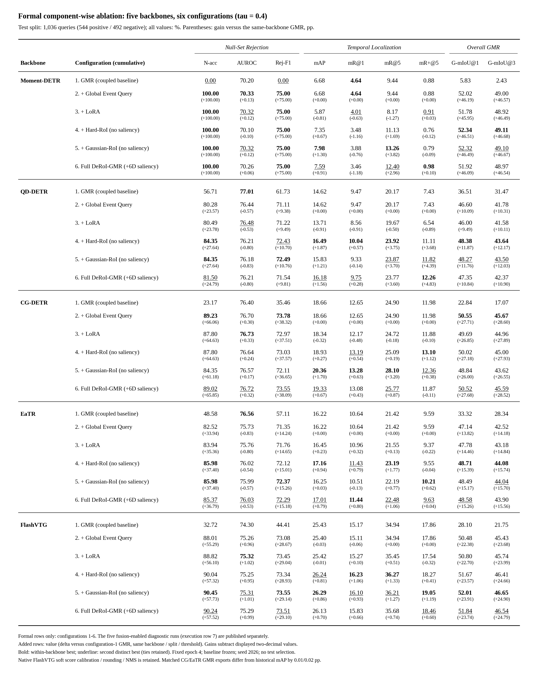
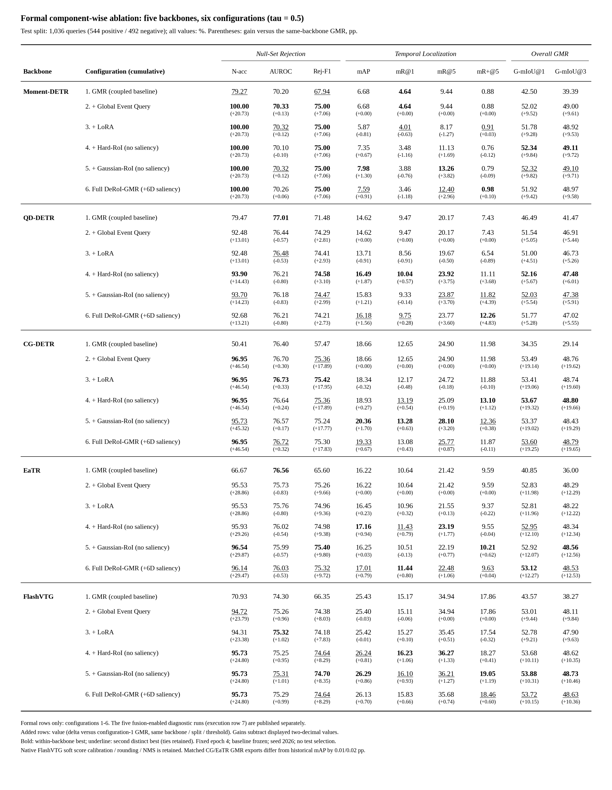
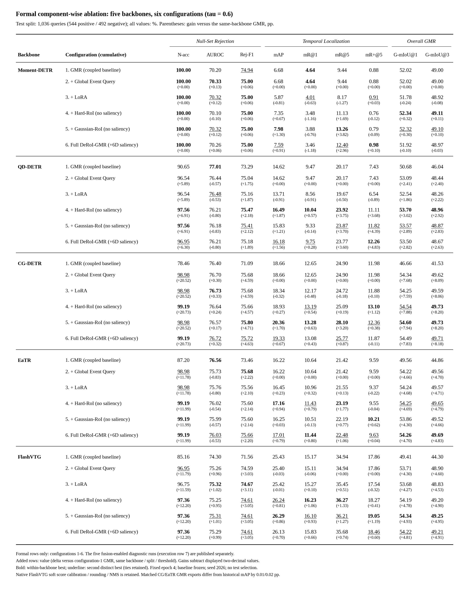

# 正式组件消融：5 个主干 × 6 种配置 = 30 组

本目录发布 2026-10-23 完成的 **30 组正式组件消融**，包括 Moment-DETR、QD-DETR、CG-DETR、EaTR、FlashVTG 的六种配置。**第七配置的 5 组融合实验仅属额外诊断**，位于 [extra_diagnostics](extra_diagnostics/README.md)，不进入正式消融表、正式增益汇总或 30 组计数。

沿用仓库 README 原结果表的指标分组、字体、数值下方括号增益格式，并增加原消融要求中的 N-acc。提供一张合并 **τ=0.4 / 0.5 / 0.6** 的大表及三张独立阈值表；Test 和 Val 分开，不把两个 split 计为两个实验。

## 三阈值合并大表

| Split | PDF | PNG | Markdown | 数值 CSV | 增益 CSV | LaTeX | HTML | SVG |
|---|---|---|---|---|---|---|---|---|
| **Test** | [PDF](tables/ABLATION_TEST_ALL_THRESHOLDS.pdf) | [PNG](tables/ABLATION_TEST_ALL_THRESHOLDS.png) | [Markdown](tables/ABLATION_TEST_ALL_THRESHOLDS.md) | [数值 CSV](tables/ABLATION_TEST_ALL_THRESHOLDS.csv) | [增益 CSV](tables/ABLATION_TEST_ALL_THRESHOLDS_GAINS.csv) | [LaTeX](tables/ABLATION_TEST_ALL_THRESHOLDS.tex) | [HTML](tables/ABLATION_TEST_ALL_THRESHOLDS.html) | [SVG](tables/ABLATION_TEST_ALL_THRESHOLDS.svg) |
| **Val** | [PDF](tables/ABLATION_VAL_ALL_THRESHOLDS.pdf) | [PNG](tables/ABLATION_VAL_ALL_THRESHOLDS.png) | [Markdown](tables/ABLATION_VAL_ALL_THRESHOLDS.md) | [数值 CSV](tables/ABLATION_VAL_ALL_THRESHOLDS.csv) | [增益 CSV](tables/ABLATION_VAL_ALL_THRESHOLDS_GAINS.csv) | [LaTeX](tables/ABLATION_VAL_ALL_THRESHOLDS.tex) | [HTML](tables/ABLATION_VAL_ALL_THRESHOLDS.html) | [SVG](tables/ABLATION_VAL_ALL_THRESHOLDS.svg) |


合并图较宽，完整分辨率请点开 PNG/PDF；分阈值图更适合正文阅读。

## 按阈值拆分的完整表格

| Split / 阈值 | PDF | PNG | Markdown | 数值 CSV | 增益 CSV | LaTeX | HTML | SVG |
|---|---|---|---|---|---|---|---|---|
| **TEST / 0.4** | [PDF](tables/ABLATION_TEST_tau_0.4.pdf) | [PNG](tables/ABLATION_TEST_tau_0.4.png) | [Markdown](tables/ABLATION_TEST_tau_0.4.md) | [数值 CSV](tables/ABLATION_TEST_tau_0.4.csv) | [增益 CSV](tables/ABLATION_TEST_tau_0.4_GAINS.csv) | [LaTeX](tables/ABLATION_TEST_tau_0.4.tex) | [HTML](tables/ABLATION_TEST_tau_0.4.html) | [SVG](tables/ABLATION_TEST_tau_0.4.svg) |
| **TEST / 0.5** | [PDF](tables/ABLATION_TEST_tau_0.5.pdf) | [PNG](tables/ABLATION_TEST_tau_0.5.png) | [Markdown](tables/ABLATION_TEST_tau_0.5.md) | [数值 CSV](tables/ABLATION_TEST_tau_0.5.csv) | [增益 CSV](tables/ABLATION_TEST_tau_0.5_GAINS.csv) | [LaTeX](tables/ABLATION_TEST_tau_0.5.tex) | [HTML](tables/ABLATION_TEST_tau_0.5.html) | [SVG](tables/ABLATION_TEST_tau_0.5.svg) |
| **TEST / 0.6** | [PDF](tables/ABLATION_TEST_tau_0.6.pdf) | [PNG](tables/ABLATION_TEST_tau_0.6.png) | [Markdown](tables/ABLATION_TEST_tau_0.6.md) | [数值 CSV](tables/ABLATION_TEST_tau_0.6.csv) | [增益 CSV](tables/ABLATION_TEST_tau_0.6_GAINS.csv) | [LaTeX](tables/ABLATION_TEST_tau_0.6.tex) | [HTML](tables/ABLATION_TEST_tau_0.6.html) | [SVG](tables/ABLATION_TEST_tau_0.6.svg) |
| **VAL / 0.4** | [PDF](tables/ABLATION_VAL_tau_0.4.pdf) | [PNG](tables/ABLATION_VAL_tau_0.4.png) | [Markdown](tables/ABLATION_VAL_tau_0.4.md) | [数值 CSV](tables/ABLATION_VAL_tau_0.4.csv) | [增益 CSV](tables/ABLATION_VAL_tau_0.4_GAINS.csv) | [LaTeX](tables/ABLATION_VAL_tau_0.4.tex) | [HTML](tables/ABLATION_VAL_tau_0.4.html) | [SVG](tables/ABLATION_VAL_tau_0.4.svg) |
| **VAL / 0.5** | [PDF](tables/ABLATION_VAL_tau_0.5.pdf) | [PNG](tables/ABLATION_VAL_tau_0.5.png) | [Markdown](tables/ABLATION_VAL_tau_0.5.md) | [数值 CSV](tables/ABLATION_VAL_tau_0.5.csv) | [增益 CSV](tables/ABLATION_VAL_tau_0.5_GAINS.csv) | [LaTeX](tables/ABLATION_VAL_tau_0.5.tex) | [HTML](tables/ABLATION_VAL_tau_0.5.html) | [SVG](tables/ABLATION_VAL_tau_0.5.svg) |
| **VAL / 0.6** | [PDF](tables/ABLATION_VAL_tau_0.6.pdf) | [PNG](tables/ABLATION_VAL_tau_0.6.png) | [Markdown](tables/ABLATION_VAL_tau_0.6.md) | [数值 CSV](tables/ABLATION_VAL_tau_0.6.csv) | [增益 CSV](tables/ABLATION_VAL_tau_0.6_GAINS.csv) | [LaTeX](tables/ABLATION_VAL_tau_0.6.tex) | [HTML](tables/ABLATION_VAL_tau_0.6.html) | [SVG](tables/ABLATION_VAL_tau_0.6.svg) |

<details><summary>展开三个阈值的 Test 表格图片</summary>

### τ = 0.4



### τ = 0.5



### τ = 0.6



</details>

## 六种正式配置与增益基准

| ID | 正式配置 | Global query | LoRA | RoI | 6D saliency |
|---:|---|---|---|---|---|
| 1 | Coupled GMR Adapter（冻结基线） | — | — | — | — |
| 2 | + Decoupled Global Event Query | ✓ | — | — | — |
| 3 | + LoRA | ✓ | ✓ | — | — |
| 4 | + Hard-RoI Refiner | ✓ | ✓ | Hard rectangular | — |
| 5 | + Gaussian-RoI Refiner（无 6D saliency） | ✓ | ✓ | Gaussian | — |
| 6 | Full DeRoI-GMR（含 6D saliency） | ✓ | ✓ | Gaussian | ✓ |

配置 2–6 的每项指标均显示为 **数值（相对同主干 GMR 的 Δ pp）**。参考行固定为本次正式消融的配置 1，且 **backbone、split、τ 必须相同**；不是相对上一行，也不是相对其他主干。增益按照显示到两位小数的数值相减，与仓库原表的增益口径一致。负值和零增益均保留。

最优值在各个主干内部、各阈值和各指标列内加粗；次优的不同数值加下划线，并列均保留。合并表重复列出阈值无关的指标，以维持完整的三组表头。

**本次 matched GMR 基线与历史 README 的重导出差异：** CG-DETR mAP 为 18.66（历史 18.65），EaTR 为 16.22（历史 16.20）。本表据此计算 Full 行增益为 +0.67 / +0.79 pp，不把历史基线混入新消融。[差异证据](reports/HISTORICAL_BASELINE_COMPARISON.json)。本次 FlashVTG Full 也是新的固定四轮训练，与历史主结果中的旧 checkpoint 分开报告。

## 训练、指标与结论边界

- Standard Train / Val / Test：4,138 / 465 / 1,036；无数据增强、QCD 或合成负例。
- 正式 30 组中，5 组配置 1 只重推理冻结基线；其余 25 组分别从同主干 GMR 独立初始化，使用新 optimizer/scheduler，seed 2026，固定 4 epochs。不是从上一行继续训练。
- 仅对冻结权重评估 τ=0.4/0.5/0.6；Test 不选择 checkpoint 或阈值。这些是已有 benchmark 上的单 seed 探索性结果。
- Null-Set Rejection：N-acc、AUROC、Rej-F1；Temporal Localization：mAP、mR@1、mR@5、mR+@5；Overall GMR：G-mIoU@1、G-mIoU@3。所有指标单位为 %。
- N-acc = 无目标查询拒识 recall；存在概率严格大于 τ 时保留，否则拒绝。AUROC 与定位指标不随外部 τ 改变；定位指标只使用正查询，不进行存在性硬门控。
- 保留 FlashVTG 原生 soft presence confidence calibration、三位小数取整和 NMS。因此更换存在性头时，原始定位候选完全不变，但最终置信度与 mAP 可能有微小变化。原生零宽候选按官方各指标的规则处理，未为了发布而改写预测。[核验说明](VERIFICATION_NOTES.md)。
- LoRA、Gaussian 相对 Hard、6D saliency 的收益并非在所有主干一致；表格完整保留下降项，不声称普遍单调改善。

## CPU 复现与验证

从仓库根目录运行：

```bash
python -m pip install -r requirements-cpu.txt
python tools/reproduce_ablation_tables.py

# 从全部冻结预测重新核算 9 项指标，再重建表格
python tools/reproduce_ablation_tables.py --recompute-metrics

# 仅核对已生成表格的数值、30组范围和增益
python tools/reproduce_ablation_tables.py --verify-only
```

这些命令不训练、不使用 GPU，也不需要视频、特征或 checkpoint。全部 Val/Test 预测以确定性 gzip 保存，公开复核先验证解压后 SHA256，再调用本目录的原官方 evaluator；正式与额外诊断分别计数。

[公开发布包 CPU 数值复核](PUBLICATION_VERIFICATION.json) · [表格及增益核对](TABLE_VERIFICATION.json) · [30组范围定义](EXPERIMENT_SCOPE.json) · [原始复制清单](provenance/SOURCE_COPY_MANIFEST.json) · [外部权重哈希](provenance/EXTERNAL_CHECKPOINTS.json)

## 文件与原始训练代码

```text
tables/                       # 8张表：Test/Val × 三个阈值及合并表；每张含多种格式
results/formal/<backbone>/row_01..06/  # 正式30组配置、预测、指标、训练记录
extra_diagnostics/results/<backbone>/row_07/ # 额外5组，独立于正式表
run.py, variants.py, flash_backend.py  # 原训练入口、组件开关与Flash接口
backends/, baseline_source/, code/    # 原生模型、初始化、组件及数据接口
data/                         # 原Standard标签
official_eval/                # 本次实际使用的官方指标实现
table4/                       # 历史FlashVTG Table 4补齐及固定权重推理阶段诊断
reports/                      # 原始审计、参数/功能检查及单独额外诊断
analysis_snapshot/             # 本地完整实验的历史核验脚本快照
provenance/                    # 来源、哈希、发布适配说明
```

**未上传模型二进制权重、视频、预提取特征或编译器可执行文件。** 这与原仓库发布范围一致；训练需要这些外部资产和 `ENVIRONMENT.json` 中的 PyTorch 环境。原训练快照中的绝对路径需映射到使用者本机的 checkpoint 与特征路径，再启动 `run.py`。不要直接执行 `analysis_snapshot/` 中依赖本地原目录结构的脚本作为公开 CPU 复现入口。

原 `reports/AUDIT.json` 与 `DELIVERABLE_AUDIT.json` 记录本地完整实验，包含本地权重及论文路径；公开子集完整性以本目录 `PUBLICATION_MANIFEST.json`、`PUBLICATION_VERIFICATION.json` 和 `TABLE_VERIFICATION.json` 为准。
