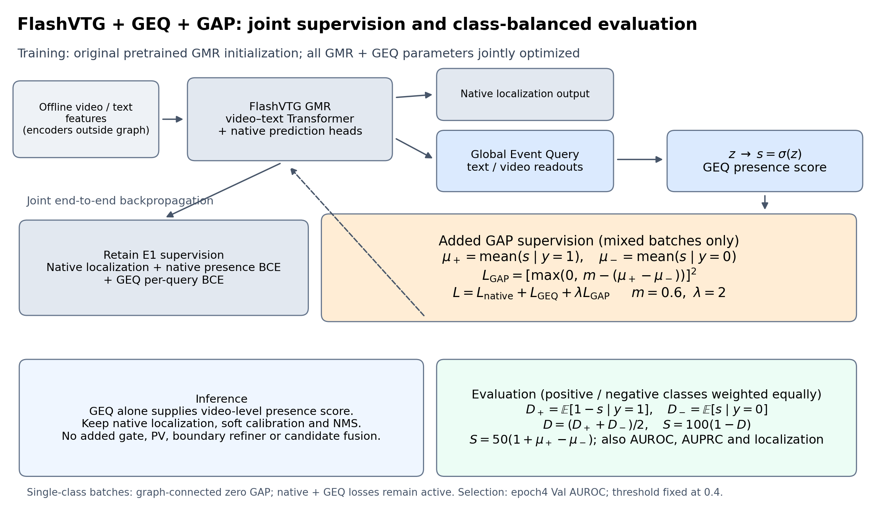
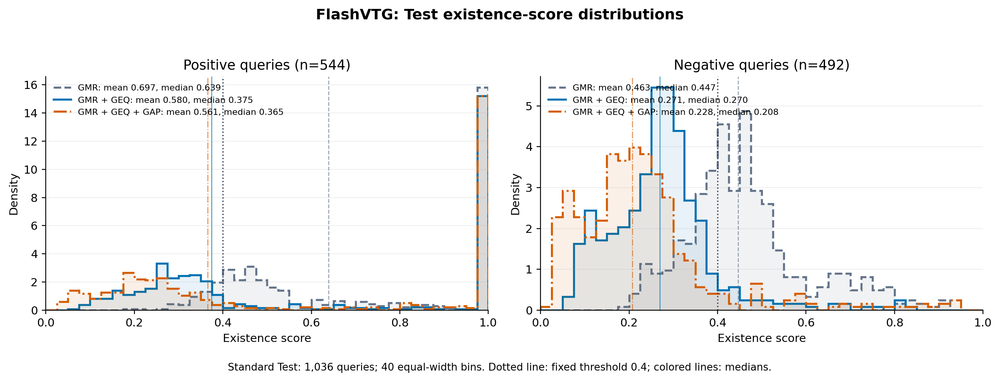
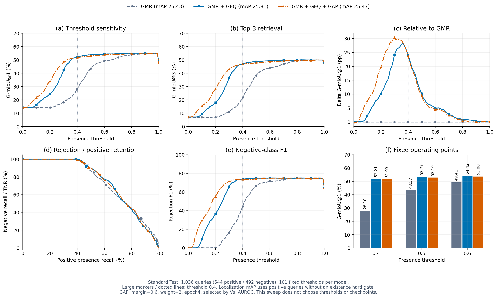

# FlashVTG：GEQ 均分间隔监督（GAP）与存在性评估

本报告比较 **GMR（E0）**、**GMR＋GEQ（E1）** 和 **GMR＋GEQ＋GAP**。发布模型固定为六组搜索中按 **Val AUROC** 选择的 `margin=0.6、λ=2、第4轮`，没有根据 Test 更换配置或 checkpoint。这里的“best”指该验证选择规则下的最优模型，不代表所有 Test 指标最优。

## 一张图与一段话



**方法与评估概述：** 从原始预训练 FlashVTG GMR checkpoint 初始化，在保留原生定位、候选分类及原生存在性 BCE 的基础上，接入随机初始化的 GEQ，并全量联合微调 GMR 与 GEQ。GEQ 产生存在性概率 (s=\sigma(z))；对同时包含正负查询的 batch，分别计算正均分 (\mu_+\) 与负均分 (\mu_-\)，加入 (L_{GAP}=[\max(0,m-(\mu_+-\mu_-))]^2\)，使总损失为 (L=L_{native}+L_{GEQ}+\lambda L_{GAP}\)。本发布模型使用 (m=0.6,\lambda=2\)；单类 batch 的 GAP 项为可反传的零，原生损失与 GEQ BCE 继续训练。推理仍只采用 GEQ 作为存在性预测器，并保留 FlashVTG 原生定位输出、soft calibration 和 NMS。评估中对正负类别等权，报告 (D_+=\mathbb E[1-s\mid y=1]\)、(D_-=\mathbb E[s\mid y=0]\)、(D=(D_++D_-)/2\) 与 (S=100(1-D)=50(1+\mu_+-\mu_-)\)，同时报告 AUROC、AUPRC、正负召回及独立于存在性 hard gating 的定位指标；S 仅反映端点距离/均分间隔，不能替代全局排序、完整分布重叠或概率校准的评价。

[可编辑 SVG](figures/gap_supervision_and_evaluation.svg) · [矢量 PDF](figures/gap_supervision_and_evaluation.pdf)

## 三组方法的 Test 结果

Standard Train/Val/Test=4,138/465/1,036；Test=544正、492负。E1/GAP 均为 seed=2026、4轮、batch=8 的全量微调；GMR lr=1e-5，GEQ lr=3e-5，AdamW、wd=1e-4、clip=0.1、constant scheduler、无 AMP。外部 CLIP/SlowFast/文本特征离线预提取，不训练特征提取器。E0 复用原始训练模型。分类主阈值固定为0.4。

| Method | 正均分 | 负均分 | 均分差距 | S ↑ | AUROC | AUPRC | Pos-Recall | TNR | mAP | mR+@5 | G-mIoU@1 |
|---|---:|---:|---:|---:|---:|---:|---:|---:|---:|---:|---:|
| GMR | 0.6972 | 0.4632 | 0.2340 | 61.70 | 74.30 | 81.17 | 86.76 | 32.72 | 25.43 | 17.86 | 28.10 |
| GMR＋GEQ | 0.5796 | 0.2707 | 0.3088 | 65.44 | 74.69 | 81.87 | 47.24 | 92.07 | 25.81 | 17.39 | 52.21 |
| GMR＋GEQ＋GAP | 0.5605 | 0.2282 | 0.3323 | 66.62 | 74.70 | 81.77 | 48.35 | 91.26 | 25.47 | 19.14 | 51.93 |

除均分外单位%。相对 GEQ，GAP 的均分间隔增加0.0235，S增加1.17个百分点，多时刻 mR+@5 增加1.75个百分点；AUROC几乎不变，AUPRC下降0.10个百分点，mAP下降0.34个百分点。均分分离主要来自负样本分数进一步下降，正均分也下降，不应宣称同时增强了正负两端。G-mIoU受到拒识影响，不能等同于纯定位精度；mR+@5也不等同于正查询存在性召回。单seed探索，不声称统计显著性或跨seed稳定性。

[精确指标 CSV](tables/three_methods_test.csv) · [全部六组 Val 搜索](tables/search_val.csv) · [后续补测的全部六组 Test](tables/search_all_test.csv)

## 正负查询的存在性分数分布



GAP 进一步降低负查询分数，同时也降低正查询均分。图中正负查询分列，三组方法叠加；40个等宽区间、类内独立密度归一化，彩色竖线为中位数，灰色点线为固定阈值0.4。布局参照用户给定 `full_standard_bn45_test_existence_score_distributions.pdf`，但本次使用 **Standard Test 1,036条**，不是参考图 Full BN45 的2,970条，也没有虚构另外四个backbone的 GAP 结果。

[PDF](figures/three_methods_test_existence_score_distributions.pdf) · [SVG](figures/three_methods_test_existence_score_distributions.svg) · [直方图原始数据](tables/existence_histogram.csv)

## 三种方法的同图阈值扫描



GEQ/GAP 相对 GMR 的 G-mIoU 增益随阈值变化；GAP没有在所有阈值和指标上支配 GEQ。六面板沿用参考 `fig7_threshold_sweep.pdf` 的口径：(a) G-mIoU@1；(b) G-mIoU@3；(c) 相对 GMR 的 G-mIoU@1 差值；(d) 正例存在性召回与负例召回；(e) 负类 Rejection-F1；(f) 固定0.4/0.5/0.6的 G-mIoU@1。三种方法各扫描0到1的101个固定阈值，严格采用 `score > threshold`。每个点均和原官方 G-mIoU 计算交叉核验（共303组）。不根据这些 Test 曲线重新选择阈值、模型或epoch；不加入未请求的 oracle 曲线。

[PDF](figures/three_methods_fig7_threshold_sweep.pdf) · [SVG](figures/three_methods_fig7_threshold_sweep.svg) · [303行阈值数据 CSV](tables/threshold_sweep_101.csv) · [核验记录](FIGURE_AUDIT.json)

## Checkpoint 与复现

- [GitHub Release：模型与初始化权重](https://github.com/chinagalaxy2002/Improving-Target-Presence-for-Generalized-Moment-Retrieval/releases/tag/geq-gap-flashvtg-20261026)
- [完整第4轮训练 checkpoint](https://github.com/chinagalaxy2002/Improving-Target-Presence-for-Generalized-Moment-Retrieval/releases/download/geq-gap-flashvtg-20261026/flashvtg_geq_gap_m060_w200_epoch004_full.ckpt)：包含模型、optimizer、scheduler。
- [精简推理权重](https://github.com/chinagalaxy2002/Improving-Target-Presence-for-Generalized-Moment-Retrieval/releases/download/geq-gap-flashvtg-20261026/flashvtg_geq_gap_m060_w200_epoch004_weights.pt)：仅保留模型及配置元信息，所有 state_dict 张量与完整 checkpoint 逐一相等。
- [原始 GMR 初始化 checkpoint](https://github.com/chinagalaxy2002/Improving-Target-Presence-for-Generalized-Moment-Retrieval/releases/download/geq-gap-flashvtg-20261026/flashvtg_gmr_original_initialization.ckpt)：用于独立重新微调，SHA256与E0/E1初始化记录一致。
- [SHA256与来源清单](CHECKPOINT_MANIFEST.json) · [Val选择记录](tables/SELECTION.json) · [固定配置](selected_config.json)

在仓库根目录执行（CPU足以重画全部图）：

```bash
python ablations/geq_gap_publication_20261026/reproduce_figures.py
```

依赖 numpy、scikit-learn、matplotlib。压缩的 GT、三组 Val/Test 预测及官方指标已收录于 evidence/；official_eval/为未改动的官方评估快照，可独立复算图表而不访问本机绝对路径。复现训练另需 PyTorch/native依赖、离线特征；见 [REPRODUCE.md](REPRODUCE.md)。发布包不含视频/特征文件。
