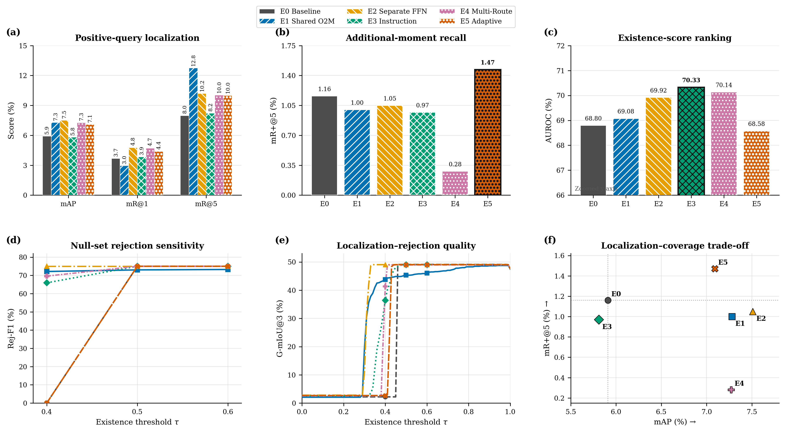

# GMR × Mr. DETR：六路线时序一对多训练实验

> 四个骨干的当前训练与测试入口已按骨干拆分到
> [`backbones/`](../../../backbones/)。
> EaTR、QD-DETR、CG-DETR 共用经过实际队列验证的核心实现；Moment-DETR-GMR
> 在自己的目录中保留完整原始实验工具包。

本目录记录 2026-10-30 在 SoccerGMR Standard 上完成的 Moment-DETR-GMR 六路线消融实验。研究目标是把 Mr. DETR 的密集一对多监督迁移到 Generalized Moment Retrieval，在保留 GMR-Adapter 空集拒绝能力的同时，提高多个不同相关片段的召回。

本次结果是单个固定随机种子 `2023` 的探索性实验。训练按用户指令在不同 epoch 停止，然后统一使用停止时已经保存的验证集最佳检查点执行一次完整 Test 评估。它不是六个配置均训练至 400 epoch 的最终收敛结果，也不提供跨 seed 方差。

```bash
git clone --branch gmr-mr-detr-multiroute-20261030 \
  https://github.com/chinagalaxy2002/Improving-Target-Presence-for-Generalized-Moment-Retrieval.git
cd Improving-Target-Presence-for-Generalized-Moment-Retrieval/backbones/moment_detr/experiment
```



[PDF 矢量图](newidea/figure/gmr_mr_detr_test_20261030/gmr_mr_detr_test_evaluation.pdf) · [SVG 可编辑图](newidea/figure/gmr_mr_detr_test_20261030/gmr_mr_detr_test_evaluation.svg) · [完整 0–1 G-mIoU 扫描](newidea/figure/gmr_mr_detr_test_20261030/gmiou_threshold_sweep.csv)

## 1. 实验问题

GMR 允许每条文本查询对应零个、一个或多个真实片段。原始 Moment-DETR-GMR 使用 Hungarian 一对一匹配；每个 GT 每层只能监督一个 Object Query。这里增加训练专用辅助路线，让每个 GT 最多匹配两个辅助预测：

1. 主路线保持 10 个 Queries 和 Hungarian O2O，负责推理输出。
2. 辅助路线使用 24 个训练专用 Queries 和 Temporal O2M。
3. Separate FFN 路线共享 Self-Attention 和 Cross-Attention，但使用独立 FFN。
4. Instruction 路线在 Self-Attention 中加入 4 个可学习指令 Token。
5. GMR-Adapter 始终从主路线特征预测存在性，辅助路线仅在训练期间执行。

## 2. 六组配置

| ID | 名称 | Temporal O2M | 独立 FFN | Instruction Tokens | 动态匹配 |
|---|---|---:|---:|---:|---:|
| E0 | `baseline` | 否 | 否 | 否 | 否 |
| E1 | `shared` | 是 | 否 | 否 | 否 |
| E2 | `sepffn` | 是 | 是 | 否 | 否 |
| E3 | `instruction` | 是 | 否 | 是 | 否 |
| E4 | `multi` | 是 | 是 | 是 | 否 |
| E5 | `adaptive` | 是 | 是 | 是 | 是 |

固定 O2M 使用每 GT 两个匹配。Adaptive 路线至少分配一个匹配，仅当第二候选与 GT 的 Temporal IoU 不低于 0.25 时增加第二个匹配。单辅助路线的总 O2M 权重为 0.30；双辅助路线各为 0.15，因此 E1–E5 的辅助损失总权重一致。

## 3. 数据与训练协议

| 项目 | 设置 |
|---|---|
| 数据集 | SoccerGMR Standard |
| Train / Val / Test | 4,138 / 465 / 1,036 |
| Test 正 / 空集 | 544 / 492 |
| Test 多片段查询 | 160 |
| 上游代码 | `dymm9977/generalized-moment-retrieval` |
| 上游 Commit | `ac78df9129a1153e74d4f75ad437a34fd770487b` |
| Seed | 2023，单 seed |
| 优化器 / 学习率 | AdamW / `5e-5` |
| 主 / 辅助 Queries | 10 / 24 |
| Microbatch / 累积 | 2 / 4，有效 batch 8 |
| AMP | 关闭 |
| 验证间隔 | 每 5 epochs |
| 选模 | 验证集正样本定位 mAP 最大 |
| GPU | 2 × RTX 3090；每卡 3 个独立进程 |

特征输入沿用官方 Moment-DETR-GMR：CLIP 视频特征、SlowFast 视频特征和 CLIP 文本特征。正式训练前的数据预检确认所有标注均不超过 `max_windows=8`。

## 4. 实际停止状态

以下是停止训练时各任务最后完整写入日志的 epoch，以及已经保存的最佳验证检查点。E0/E1 被进程级 20-epoch 无提升监视器停止；其余任务随后按用户指令停止。因此比较共享相同数据、seed 和优化协议，但训练预算不同。

| 实验 | 最后完成 Epoch | 当前 Best Epoch |
|---|---:|---:|
| E0 Baseline | 25 | 5 |
| E1 Shared O2M | 25 | 5 |
| E2 Separate FFN | 31 | 20 |
| E3 Instruction | 30 | 30 |
| E4 Multi-Route | 24 | 15 |
| E5 Adaptive | 23 | 5 |

训练日志保存在 `mr_experiments/<variant>/{train.log,val.log}`，监视器事件保存在 `mr_experiments/logs/early_stop_watch.log`。检查点因体积和发布范围未上传。

## 5. Test 结果

所有结果来自 1,036 条完整 Test 查询，包括空集样本。mAP、mR 和 mR+ 在正查询上计算；AUROC、Rej-F1 和 G-mIoU 包含空集查询。存在性分数严格大于阈值时保留预测集合。

| 实验 | Best Epoch | mAP | mR@1 | mR@5 | mR+@5 | AUROC | Rej-F1@0.4 | G-mIoU@3 τ=0.4 |
|---|---:|---:|---:|---:|---:|---:|---:|---:|
| E0 Baseline | 5 | 5.91 | 3.68 | 7.98 | 1.16 | 68.80 | 0.00 | 2.20 |
| E1 Shared O2M | 5 | 7.28 | 2.95 | **12.75** | 1.00 | 69.08 | 72.14 | 43.77 |
| E2 Separate FFN | 20 | **7.51** | **4.76** | 10.20 | 1.05 | 69.92 | **75.00** | **49.05** |
| E3 Instruction | 30 | 5.81 | 3.85 | 8.21 | 0.97 | **70.33** | 65.93 | 36.46 |
| E4 Multi-Route | 15 | 7.27 | 4.71 | 10.04 | 0.28 | 70.14 | 69.60 | 41.36 |
| E5 Adaptive | 5 | 7.09 | 4.38 | 10.00 | **1.47** | 68.58 | 0.00 | 2.68 |

三档工作点的完整表见 [`mr_experiments/test_summary/results.md`](mr_experiments/test_summary/results.md)，机器可读结果见 [`results.json`](mr_experiments/test_summary/results.json)。每个配置的冻结 Test 预测、评估清单及详细指标位于 `mr_experiments/<variant>/test/`。

### 主要观察

- E2 Separate FFN 的 mAP 最高，相对 E0 提高 1.60 个百分点；这支持任务特定 FFN 有助于隔离 O2O 与 O2M 监督。
- E1 Shared O2M 的 mR@5 最高，但 mR+@5 没有提高。更多前五候选召回不等于覆盖更多不同 GT。
- E5 Adaptive 的 mR+@5 最高，为 1.47；这是本轮唯一明显提高额外片段召回的配置。
- E3 Instruction 的 AUROC 最高，但定位 mAP 低于 Baseline，当前结果不支持 Instruction 单独改善定位。
- E4 Multi-Route 的 mR+@5 降至 0.28，未观察到 Separate FFN 与 Instruction 的直接互补。
- G-mIoU 对存在性阈值高度敏感。完整曲线使用 `0.00, 0.01, ..., 1.00` 共 101 个阈值，不能只依据 0.4、0.5 或 0.6 的单点作结论。

这些结果只能检验当前单 seed、提前停止快照下的趋势。由于六组实际停止 epoch 不一致，架构效应和训练预算效应尚未完全分离。

## 6. 目录结构

```text
backbones/moment_detr/experiment/
├── README.md
├── EXPERIMENT_MANIFEST.json
├── requirements-reproduction.txt
├── patches/
│   └── numpy2-trapezoid.patch
├── gmr_multiroute_kit/
│   ├── multiroute.py
│   ├── preflight.py
│   ├── smoke_test_real.py
│   ├── run_train.py
│   ├── run_eval.py
│   ├── launch6.sh
│   ├── evaluate6.sh
│   ├── early_stop_watch.py
│   ├── recompute_frozen_results.py
│   └── collect_results.py
├── mr_experiments/
│   ├── test_ground_truth.jsonl
│   ├── test_summary/
│   └── <variant>/
│       ├── train.log
│       ├── val.log
│       └── test/
│           ├── submission.jsonl
│           └── metrics_gmiou_*.json
└── newidea/figure/gmr_mr_detr_test_20261030/
    ├── render.py
    ├── build_gmiou_sweep.py
    ├── gmiou_threshold_sweep.csv
    └── gmr_mr_detr_test_evaluation.{pdf,svg,png}
```

## 7. 从头训练

以下命令在本目录中执行。默认目录约定与实际实验一致：上游仓库位于 `generalized-moment-retrieval/`，数据位于 `soccergmr_standard/`。

```bash
git clone https://github.com/dymm9977/generalized-moment-retrieval.git
git -C generalized-moment-retrieval checkout ac78df9129a1153e74d4f75ad437a34fd770487b
git -C generalized-moment-retrieval apply ../patches/numpy2-trapezoid.patch

python -m pip install -r generalized-moment-retrieval/requirements.txt
python -m pip install -r requirements-reproduction.txt

# 把本地 SoccerGMR Standard 数据链接到约定路径。
ln -s /path/to/soccergmr_standard soccergmr_standard

python gmr_multiroute_kit/preflight.py \
  --data-root soccergmr_standard \
  --repo generalized-moment-retrieval \
  --out mr_experiments/resolved_paths.json

# TAR 特征解压到训练器使用的位置。
mkdir -p mr_experiments/features
tar -xf soccergmr_standard/d_gmr_two_stage/dataset/Soccergmr/standard/clip.tar -C mr_experiments/features
tar -xf soccergmr_standard/d_gmr_two_stage/dataset/Soccergmr/standard/slowfast.tar -C mr_experiments/features
tar -xf soccergmr_standard/d_gmr_two_stage/dataset/Soccergmr/standard/clip_text.tar -C mr_experiments/features

CUDA_VISIBLE_DEVICES=0 python gmr_multiroute_kit/smoke_test_real.py
GPU0=0 GPU1=1 bash gmr_multiroute_kit/launch6.sh
```

`launch6.sh` 将 E0/E2/E4 分配到 GPU 0，将 E1/E3/E5 分配到 GPU 1。六个进程相互独立，不使用 DDP，也不共享梯度。运行前应先确认每卡同时容纳三个任务。

## 8. 当前 Best 的评估与结果重算

拥有本地 `best.ckpt` 时：

```bash
SPLIT=test GPU0=0 GPU1=1 bash gmr_multiroute_kit/evaluate6.sh
python gmr_multiroute_kit/collect_results.py
```

本发布包含冻结 Test 预测，因此不需要 GPU 或检查点即可重新计算官方指标、完整 G-mIoU 阈值扫描和测评图：

```bash
python gmr_multiroute_kit/recompute_frozen_results.py
```

该命令依次执行官方 GMR evaluator、汇总三档工作点、计算 0–1 全域 101 点 G-mIoU@3 曲线，并重新生成 PDF/SVG/PNG 图。

## 9. 发布边界

本目录包含实际使用的实验脚本、冻结预测、指标、训练/验证日志和图表源文件。不包含：

- `best.ckpt` 或优化器状态；
- CLIP、SlowFast、CLIP-text `.npz` 特征；
- 原始视频；
- GitHub Token 或本机认证文件。

冻结预测和上传文件的 SHA256 记录在 `provenance/`。上游 GMR 代码遵循其原始许可证和引用要求。
