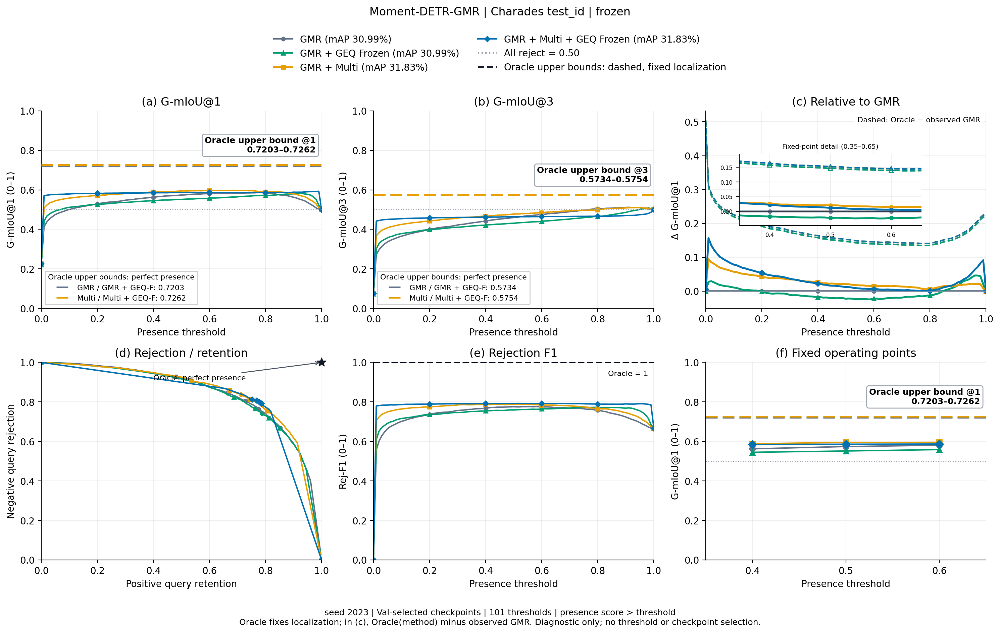
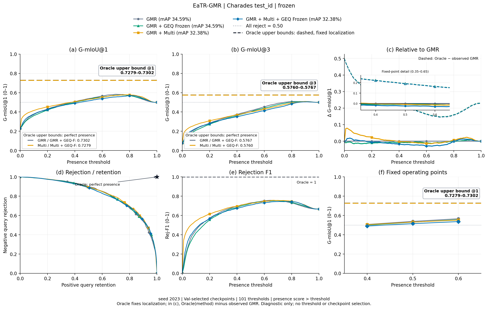
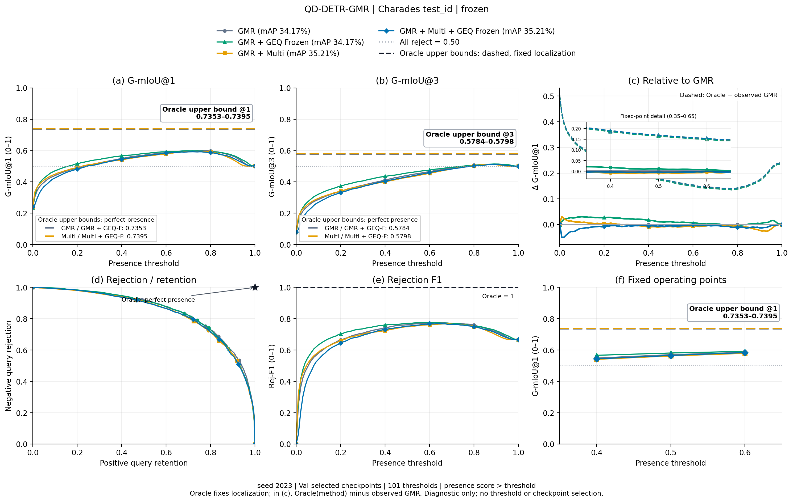
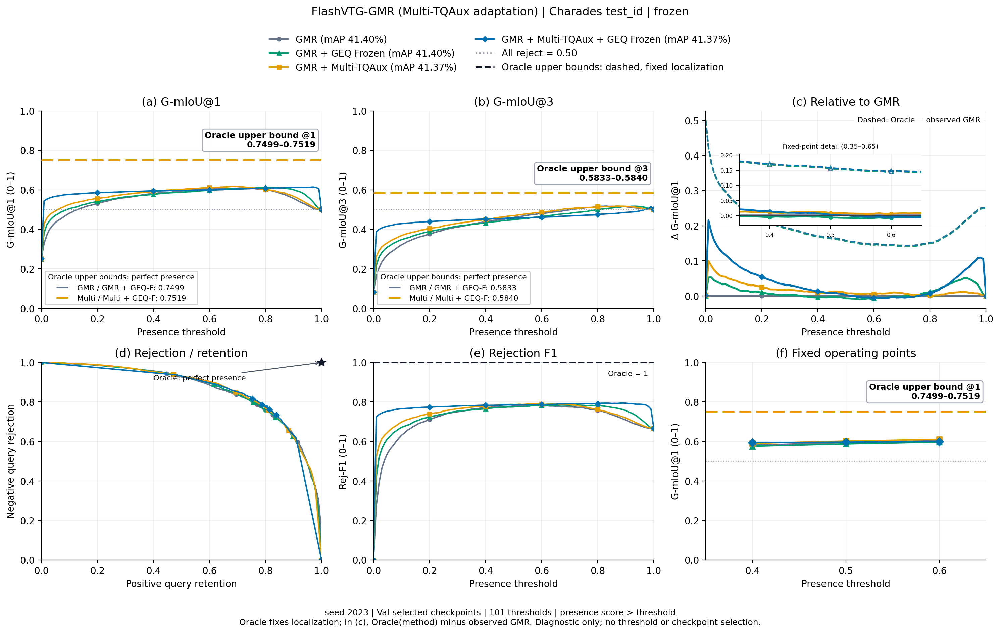

# Charades GMR + Multi + GEQ (seed 2023)

**Actual completion: 24/24 training tasks; 48/48 formal test evaluations.** Training and formal evaluation are complete; final acceptance is documented in the audit.

Test-ID is the primary result. Test-OOD is supplementary and keeps all 7,440 rows, including 2,170 duplicate extra records. Tests never select checkpoints or thresholds. All local positive examples have one GT: mR+ and multi-GT coverage are N/A. Flash Multi uses the **Multi-TQAux structural adaptation**, not the same native query decoder as the other backbones.

[Reproduction instructions](../../shared/charades_multi_geq/README.md) · [Protocol](protocol.json) · [Completion audit](audit/completion_audit.json) · [All metrics CSV](all_metrics.csv) · [Summary heatmaps](summary/README.md) · [Existence-score distributions](score_distributions/README.md)

Stage A selects ungated positive-Val mAP. Stage B selects the Val G-mIoU@1 mean at presence thresholds0.4/0.5/0.6. Stage A validation cadence was prospectively changed to every5 epochs by the user; historical validations are retained. Moment Multi was ended early by user instruction; original EaTR Multi received an explicitly authorized continuation. These exceptions and their checkpoint/history hashes are recorded in run_metadata.

## test_id — fixed Val-selected checkpoints

G1/G3 are the three-threshold means on a0–1 scale; mAP and AUROC are percentages. ΔG1 uses the same-backbone GMR at the same fixed thresholds. Every row is retained, including decreases. Full metrics, timing and memory are in the CSV.

| Backbone | Method | mAP % | G1 mean | G3 mean | AUROC % | ΔG1 vs GMR |
|---|---|---:|---:|---:|---:|---:|
| moment_detr | GMR | 30.99 | 0.5723 | 0.4590 | 84.84 | +0.0000 |
| moment_detr | GMR + Multi | 31.83 | 0.5928 | 0.4763 | 85.80 | +0.0205 |
| moment_detr | GMR + GEQ Frozen | 30.99 | 0.5516 | 0.4312 | 84.50 | -0.0207 |
| moment_detr | GMR + GEQ Full | 31.12 | 0.5503 | 0.4265 | 85.63 | -0.0220 |
| moment_detr | GMR + Multi + GEQ Frozen | 31.83 | 0.5858 | 0.4633 | 85.83 | +0.0134 |
| moment_detr | GMR + Multi + GEQ Full | 31.65 | 0.5713 | 0.4463 | 86.51 | -0.0010 |
| eatr | GMR | 34.59 | 0.5373 | 0.4139 | 82.30 | +0.0000 |
| eatr | GMR + Multi | 32.38 | 0.5293 | 0.3992 | 82.76 | -0.0080 |
| eatr | GMR + GEQ Frozen | 34.59 | 0.5286 | 0.4018 | 82.44 | -0.0087 |
| eatr | GMR + GEQ Full | 34.44 | 0.5109 | 0.3791 | 82.03 | -0.0264 |
| eatr | GMR + Multi + GEQ Frozen | 32.38 | 0.5141 | 0.3823 | 82.12 | -0.0233 |
| eatr | GMR + Multi + GEQ Full | 31.25 | 0.4989 | 0.3667 | 82.01 | -0.0384 |
| qd_detr | GMR | 34.17 | 0.5682 | 0.4393 | 84.72 | +0.0000 |
| qd_detr | GMR + Multi | 35.21 | 0.5607 | 0.4279 | 83.77 | -0.0074 |
| qd_detr | GMR + GEQ Frozen | 34.17 | 0.5798 | 0.4559 | 84.59 | +0.0116 |
| qd_detr | GMR + GEQ Full | 34.38 | 0.5619 | 0.4282 | 85.17 | -0.0063 |
| qd_detr | GMR + Multi + GEQ Frozen | 35.21 | 0.5644 | 0.4322 | 83.84 | -0.0038 |
| qd_detr | GMR + Multi + GEQ Full | 35.57 | 0.5507 | 0.4151 | 84.02 | -0.0175 |
| flashvtg | GMR | 41.40 | 0.5930 | 0.4598 | 86.14 | +0.0000 |
| flashvtg | GMR + Multi-TQAux | 41.37 | 0.6008 | 0.4685 | 86.47 | +0.0077 |
| flashvtg | GMR + GEQ Frozen | 41.40 | 0.5865 | 0.4484 | 86.06 | -0.0065 |
| flashvtg | GMR + GEQ Full | 41.70 | 0.5795 | 0.4330 | 86.47 | -0.0135 |
| flashvtg | GMR + Multi-TQAux + GEQ Frozen | 41.37 | 0.5965 | 0.4568 | 86.57 | +0.0035 |
| flashvtg | GMR + Multi-TQAux + GEQ Full | 41.40 | 0.5949 | 0.4469 | 87.47 | +0.0019 |

## test_ood — fixed Val-selected checkpoints

G1/G3 are the three-threshold means on a0–1 scale; mAP and AUROC are percentages. ΔG1 uses the same-backbone GMR at the same fixed thresholds. Every row is retained, including decreases. Full metrics, timing and memory are in the CSV.

| Backbone | Method | mAP % | G1 mean | G3 mean | AUROC % | ΔG1 vs GMR |
|---|---|---:|---:|---:|---:|---:|
| moment_detr | GMR | 30.99 | 0.6700 | 0.5567 | 99.99 | +0.0000 |
| moment_detr | GMR + Multi | 31.83 | 0.6748 | 0.5583 | 100.00 | +0.0048 |
| moment_detr | GMR + GEQ Frozen | 30.99 | 0.6806 | 0.5602 | 99.88 | +0.0105 |
| moment_detr | GMR + GEQ Full | 31.12 | 0.6858 | 0.5619 | 100.00 | +0.0157 |
| moment_detr | GMR + Multi + GEQ Frozen | 31.83 | 0.6837 | 0.5612 | 99.96 | +0.0136 |
| moment_detr | GMR + Multi + GEQ Full | 31.65 | 0.6876 | 0.5625 | 100.00 | +0.0176 |
| eatr | GMR | 34.59 | 0.6851 | 0.5617 | 100.00 | +0.0000 |
| eatr | GMR + Multi | 32.38 | 0.6952 | 0.5651 | 100.00 | +0.0100 |
| eatr | GMR + GEQ Frozen | 34.59 | 0.6903 | 0.5634 | 100.00 | +0.0052 |
| eatr | GMR + GEQ Full | 34.44 | 0.6978 | 0.5659 | 100.00 | +0.0126 |
| eatr | GMR + Multi + GEQ Frozen | 32.38 | 0.6977 | 0.5659 | 99.99 | +0.0125 |
| eatr | GMR + Multi + GEQ Full | 31.25 | 0.6984 | 0.5661 | 99.99 | +0.0133 |
| qd_detr | GMR | 34.17 | 0.6934 | 0.5645 | 100.00 | +0.0000 |
| qd_detr | GMR + Multi | 35.21 | 0.6993 | 0.5664 | 100.00 | +0.0060 |
| qd_detr | GMR + GEQ Frozen | 34.17 | 0.6859 | 0.5620 | 99.91 | -0.0075 |
| qd_detr | GMR + GEQ Full | 34.38 | 0.7005 | 0.5668 | 99.99 | +0.0071 |
| qd_detr | GMR + Multi + GEQ Frozen | 35.21 | 0.6983 | 0.5661 | 100.00 | +0.0050 |
| qd_detr | GMR + Multi + GEQ Full | 35.57 | 0.7034 | 0.5678 | 100.00 | +0.0100 |
| flashvtg | GMR | 41.40 | 0.6998 | 0.5666 | 100.00 | +0.0000 |
| flashvtg | GMR + Multi-TQAux | 41.37 | 0.6984 | 0.5661 | 100.00 | -0.0014 |
| flashvtg | GMR + GEQ Frozen | 41.40 | 0.7071 | 0.5690 | 99.99 | +0.0073 |
| flashvtg | GMR + GEQ Full | 41.70 | 0.7197 | 0.5732 | 99.99 | +0.0199 |
| flashvtg | GMR + Multi-TQAux + GEQ Frozen | 41.37 | 0.7095 | 0.5698 | 100.00 | +0.0097 |
| flashvtg | GMR + Multi-TQAux + GEQ Full | 41.40 | 0.7220 | 0.5740 | 100.00 | +0.0222 |

## Val-selected checkpoints

G-mIoU@1 is the mean at presence thresholds0.4/0.5/0.6, on a0–1 scale. mAP is ungated positive-query localization mAP in percent.

| Backbone | Method | Status | Val mAP % | Val G-mIoU@1 mean |
|---|---|---|---:|---:|
| moment_detr | GMR | Val selection finished | 30.96 | 0.6042 |
| moment_detr | GMR + Multi | Val selection finished | 32.63 | 0.6121 |
| moment_detr | GMR + GEQ Frozen | Val selection finished | 30.96 | 0.6206 |
| moment_detr | GMR + GEQ Full | Val selection finished | 30.42 | 0.6268 |
| moment_detr | GMR + Multi + GEQ Frozen | Val selection finished | 32.63 | 0.6233 |
| moment_detr | GMR + Multi + GEQ Full | Val selection finished | 33.48 | 0.6340 |
| eatr | GMR | Val selection finished | 35.78 | 0.6364 |
| eatr | GMR + Multi | Val selection finished | 32.43 | 0.6332 |
| eatr | GMR + GEQ Frozen | Val selection finished | 35.78 | 0.6364 |
| eatr | GMR + GEQ Full | Val selection finished | 35.59 | 0.6390 |
| eatr | GMR + Multi + GEQ Frozen | Val selection finished | 32.43 | 0.6309 |
| eatr | GMR + Multi + GEQ Full | Val selection finished | 31.54 | 0.6316 |
| qd_detr | GMR | Val selection finished | 35.72 | 0.6465 |
| qd_detr | GMR + Multi | Val selection finished | 36.78 | 0.6429 |
| qd_detr | GMR + GEQ Frozen | Val selection finished | 35.72 | 0.6399 |
| qd_detr | GMR + GEQ Full | Val selection finished | 35.49 | 0.6563 |
| qd_detr | GMR + Multi + GEQ Frozen | Val selection finished | 36.78 | 0.6405 |
| qd_detr | GMR + Multi + GEQ Full | Val selection finished | 36.21 | 0.6456 |
| flashvtg | GMR | Val selection finished | 42.73 | 0.6471 |
| flashvtg | GMR + Multi-TQAux | Val selection finished | 41.85 | 0.6515 |
| flashvtg | GMR + GEQ Frozen | Val selection finished | 42.73 | 0.6577 |
| flashvtg | GMR + GEQ Full | Val selection finished | 42.31 | 0.6598 |
| flashvtg | GMR + Multi-TQAux + GEQ Frozen | Val selection finished | 41.85 | 0.6609 |
| flashvtg | GMR + Multi-TQAux + GEQ Full | Val selection finished | 41.83 | 0.6623 |

## Additional EaTR positive-only ablation

This independently resumed Stage A run is additional to the main24 training tasks and48 formal Test evaluations. It has separate checkpoints and Val history. Its training must finish before final acceptance.

Val-selected mAP: 35.43%; training finished.

## moment_detr

[All figures, CSV files and offline snapshots](moment_detr/README.md)

## eatr

[All figures, CSV files and offline snapshots](eatr/README.md)

## qd_detr

[All figures, CSV files and offline snapshots](qd_detr/README.md)

## flashvtg

[All figures, CSV files and offline snapshots](flashvtg/README.md)

