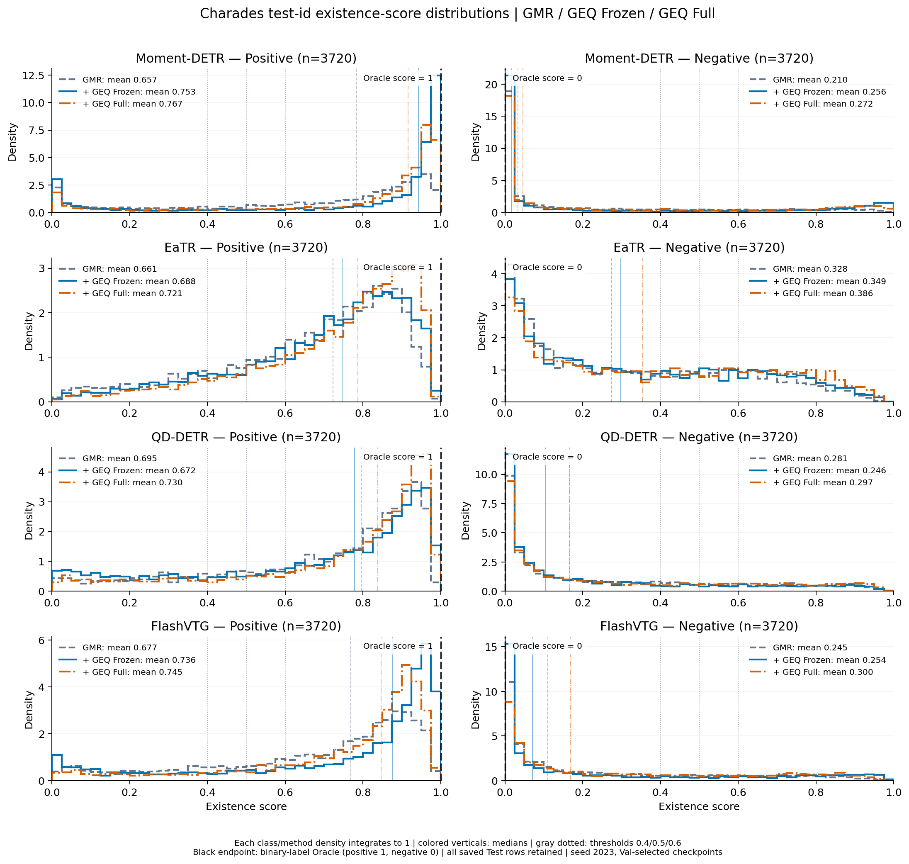
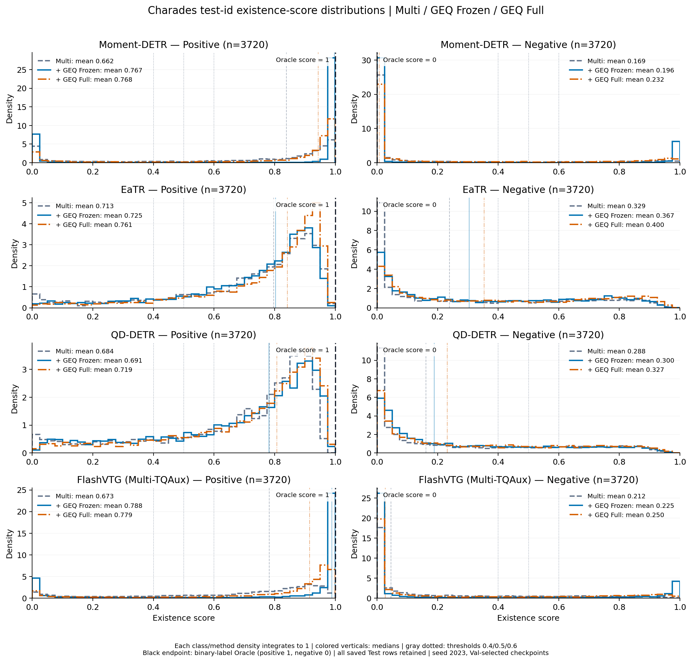
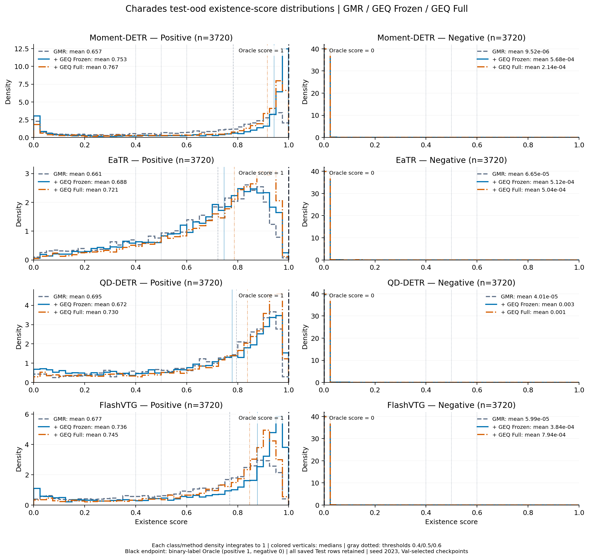
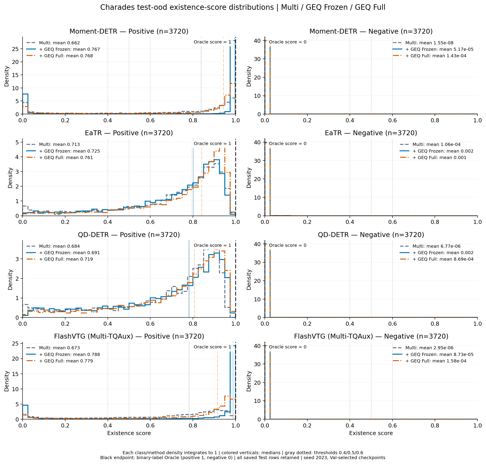

# Charades existence-score distributions

Reference layout: one backbone per row, positives left and negatives right. Full score range0–1, 40 bins, independent class-conditional densities. Curves and mean scores use only immutable formal Test prediction exports; pending branches are labelled. No training or Test rerun.

## test_id: gmr

[PDF](test_id_gmr_existence_score_distributions.pdf) · [SVG](test_id_gmr_existence_score_distributions.svg) · [Histogram CSV](test_id_gmr_existence_score_distributions.csv) · [Class statistics](test_id_gmr_existence_score_distributions.stats.csv)

## test_id: multi

[PDF](test_id_multi_existence_score_distributions.pdf) · [SVG](test_id_multi_existence_score_distributions.svg) · [Histogram CSV](test_id_multi_existence_score_distributions.csv) · [Class statistics](test_id_multi_existence_score_distributions.stats.csv)

## test_ood: gmr

[PDF](test_ood_gmr_existence_score_distributions.pdf) · [SVG](test_ood_gmr_existence_score_distributions.svg) · [Histogram CSV](test_ood_gmr_existence_score_distributions.csv) · [Class statistics](test_ood_gmr_existence_score_distributions.stats.csv)

## test_ood: multi

[PDF](test_ood_multi_existence_score_distributions.pdf) · [SVG](test_ood_multi_existence_score_distributions.svg) · [Histogram CSV](test_ood_multi_existence_score_distributions.csv) · [Class statistics](test_ood_multi_existence_score_distributions.stats.csv)

