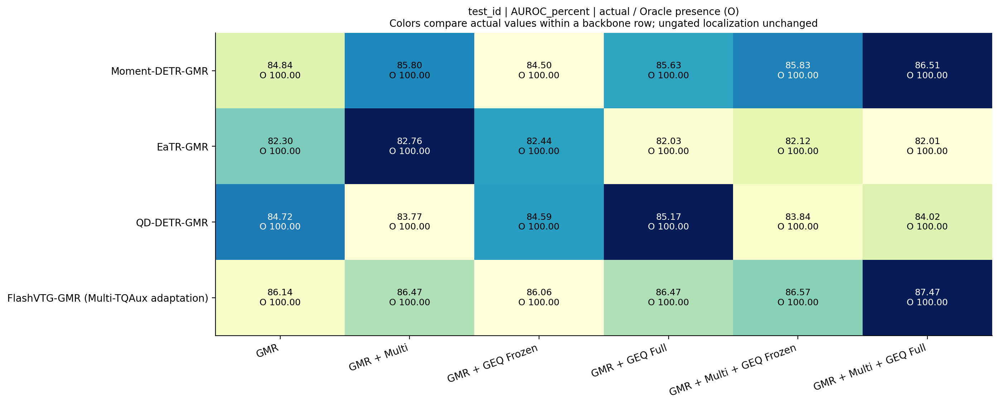
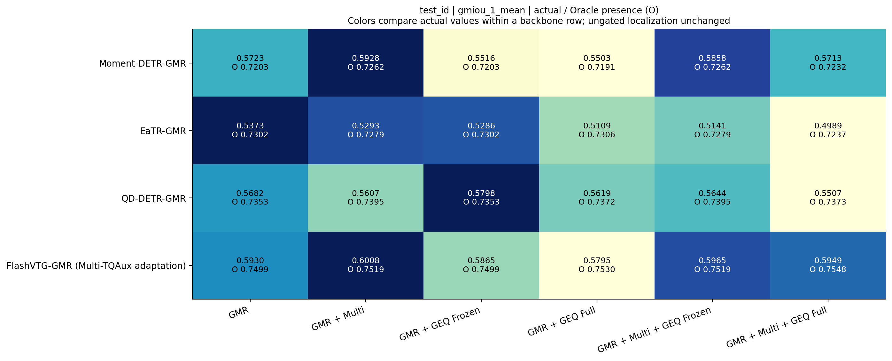
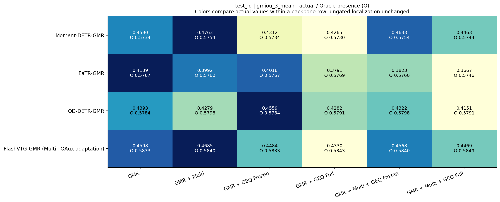
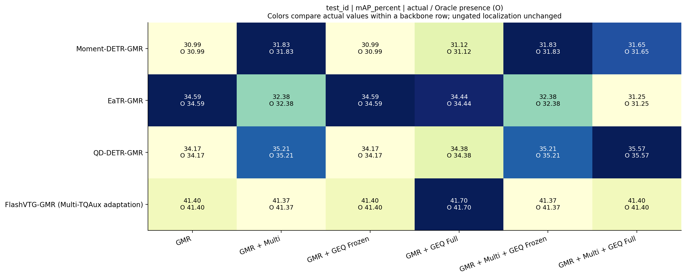
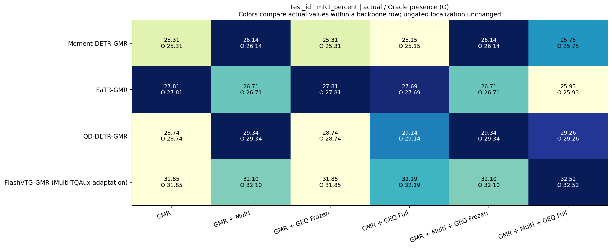
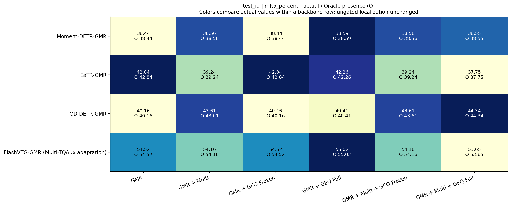
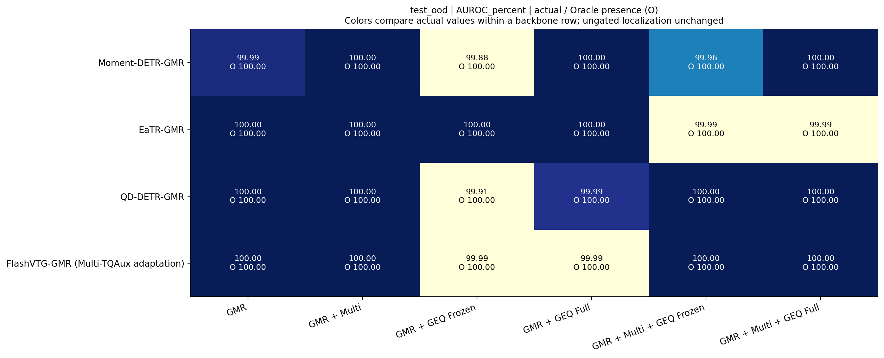
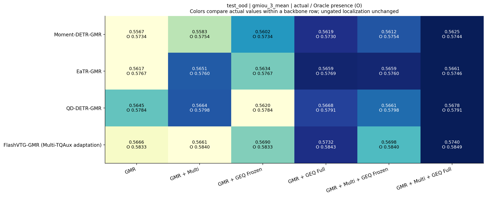

# Charades summary heatmaps

Colors compare actual values within a backbone row only. O denotes the fixed-candidate perfect-presence reference; it does not select a checkpoint or threshold.

## heatmap_test_id_AUROC_percent

[PDF](heatmap_test_id_AUROC_percent.pdf) · [SVG](heatmap_test_id_AUROC_percent.svg) · [CSV](heatmap_test_id_AUROC_percent.csv) · [Offline snapshot](heatmap_test_id_AUROC_percent.snapshot.json)

## heatmap_test_id_gmiou_1_mean

[PDF](heatmap_test_id_gmiou_1_mean.pdf) · [SVG](heatmap_test_id_gmiou_1_mean.svg) · [CSV](heatmap_test_id_gmiou_1_mean.csv) · [Offline snapshot](heatmap_test_id_gmiou_1_mean.snapshot.json)

## heatmap_test_id_gmiou_3_mean

[PDF](heatmap_test_id_gmiou_3_mean.pdf) · [SVG](heatmap_test_id_gmiou_3_mean.svg) · [CSV](heatmap_test_id_gmiou_3_mean.csv) · [Offline snapshot](heatmap_test_id_gmiou_3_mean.snapshot.json)

## heatmap_test_id_mAP_percent

[PDF](heatmap_test_id_mAP_percent.pdf) · [SVG](heatmap_test_id_mAP_percent.svg) · [CSV](heatmap_test_id_mAP_percent.csv) · [Offline snapshot](heatmap_test_id_mAP_percent.snapshot.json)

## heatmap_test_id_mR1_percent

[PDF](heatmap_test_id_mR1_percent.pdf) · [SVG](heatmap_test_id_mR1_percent.svg) · [CSV](heatmap_test_id_mR1_percent.csv) · [Offline snapshot](heatmap_test_id_mR1_percent.snapshot.json)

## heatmap_test_id_mR5_percent

[PDF](heatmap_test_id_mR5_percent.pdf) · [SVG](heatmap_test_id_mR5_percent.svg) · [CSV](heatmap_test_id_mR5_percent.csv) · [Offline snapshot](heatmap_test_id_mR5_percent.snapshot.json)

## heatmap_test_ood_AUROC_percent

[PDF](heatmap_test_ood_AUROC_percent.pdf) · [SVG](heatmap_test_ood_AUROC_percent.svg) · [CSV](heatmap_test_ood_AUROC_percent.csv) · [Offline snapshot](heatmap_test_ood_AUROC_percent.snapshot.json)

## heatmap_test_ood_gmiou_1_mean

[PDF](heatmap_test_ood_gmiou_1_mean.pdf) · [SVG](heatmap_test_ood_gmiou_1_mean.svg) · [CSV](heatmap_test_ood_gmiou_1_mean.csv) · [Offline snapshot](heatmap_test_ood_gmiou_1_mean.snapshot.json)

## heatmap_test_ood_gmiou_3_mean

[PDF](heatmap_test_ood_gmiou_3_mean.pdf) · [SVG](heatmap_test_ood_gmiou_3_mean.svg) · [CSV](heatmap_test_ood_gmiou_3_mean.csv) · [Offline snapshot](heatmap_test_ood_gmiou_3_mean.snapshot.json)

## heatmap_test_ood_mAP_percent

[PDF](heatmap_test_ood_mAP_percent.pdf) · [SVG](heatmap_test_ood_mAP_percent.svg) · [CSV](heatmap_test_ood_mAP_percent.csv) · [Offline snapshot](heatmap_test_ood_mAP_percent.snapshot.json)

## heatmap_test_ood_mR1_percent

[PDF](heatmap_test_ood_mR1_percent.pdf) · [SVG](heatmap_test_ood_mR1_percent.svg) · [CSV](heatmap_test_ood_mR1_percent.csv) · [Offline snapshot](heatmap_test_ood_mR1_percent.snapshot.json)

## heatmap_test_ood_mR5_percent

[PDF](heatmap_test_ood_mR5_percent.pdf) · [SVG](heatmap_test_ood_mR5_percent.svg) · [CSV](heatmap_test_ood_mR5_percent.csv) · [Offline snapshot](heatmap_test_ood_mR5_percent.snapshot.json)

