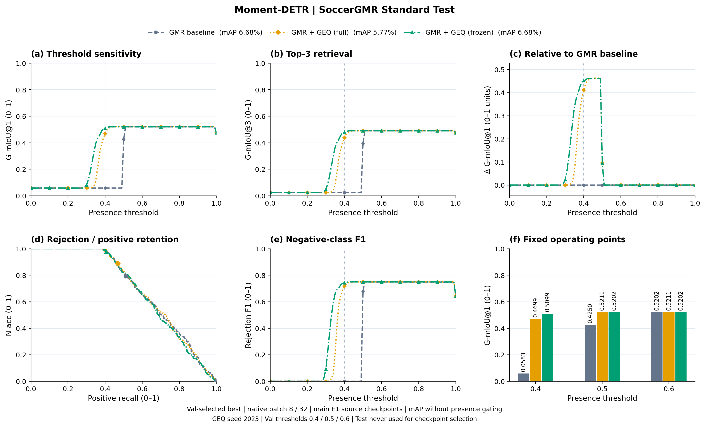
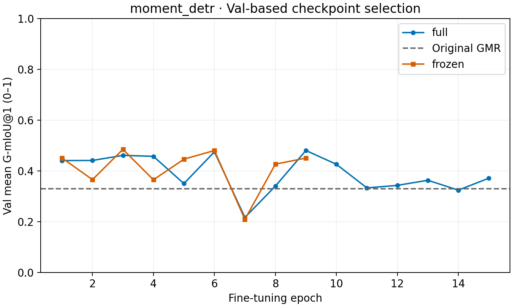
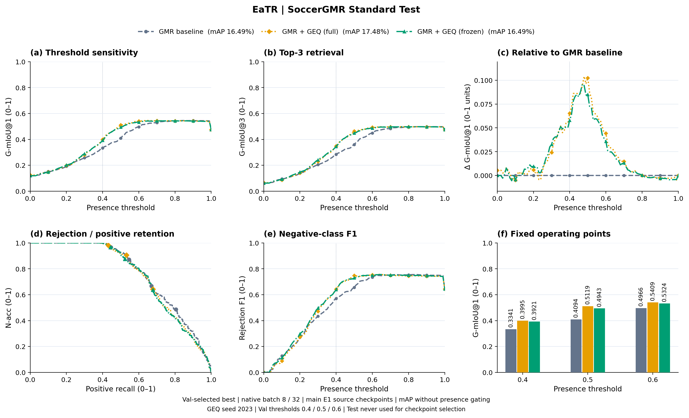
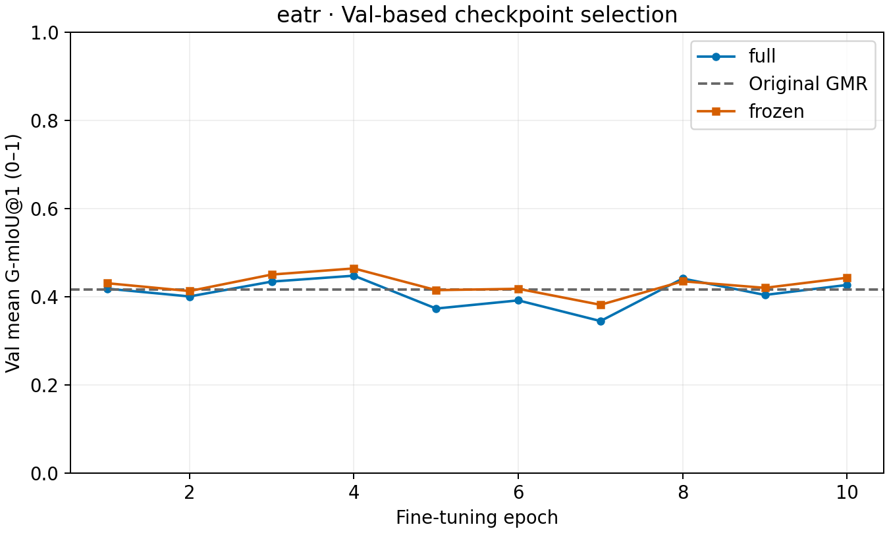
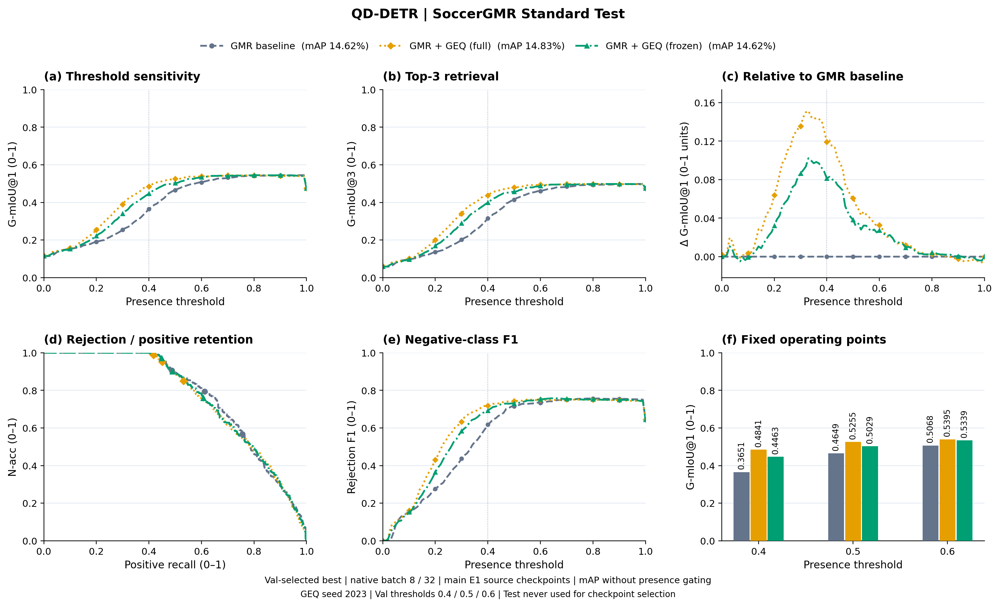
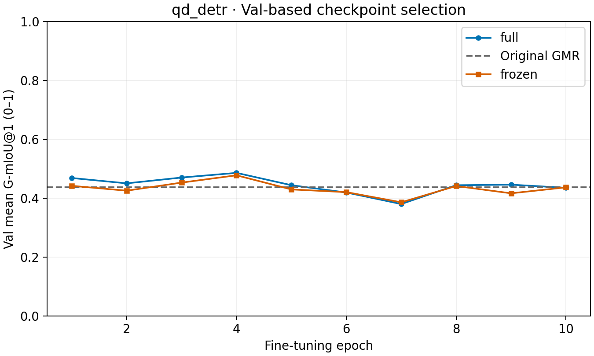
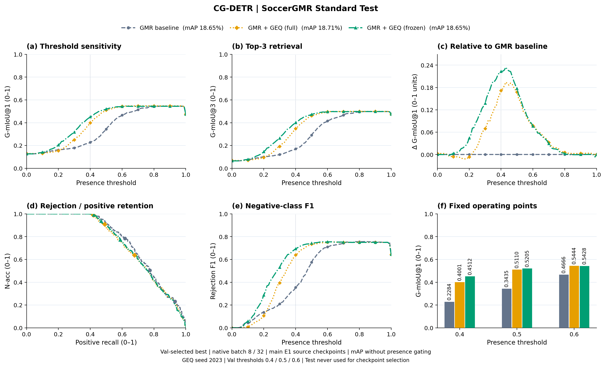
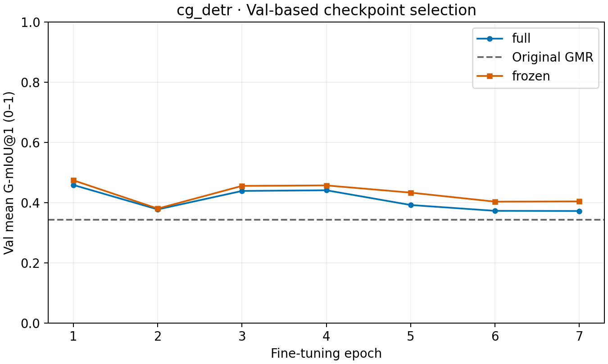
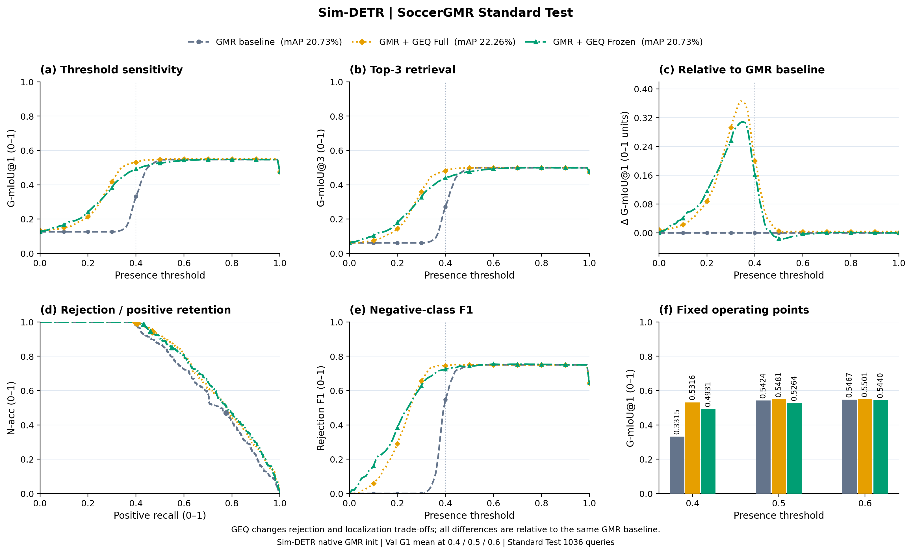

# main E1 同源初始化：全量与冻结 GEQ 对照

四骨干八组均完成训练与完整 Test。Val G-mIoU@1 在0.4/0.5/0.6的均值选 best；连续超过5轮（6轮）无提升早停，上限20轮。Test不参与选模。

本组使用 main E1 的历史原始 GMR 检查点；GEQ seed 2023。Moment-DETR按检查点恢复CLIP→SlowFast顺序。与当前多路线实验的初始化不同，分别展示，不能混作同一受控消融。

| Backbone | 方法 | Best Epoch | mAP (%) | G1@0.4 | G1@0.5 | G1@0.6 | G1 三点均值 | G3 三点均值 | AUROC (%) |
|---|---|---:|---:|---:|---:|---:|---:|---:|---:|
| Moment-DETR | GMR baseline | — | 6.68 | 0.0583 | 0.4250 | 0.5202 | 0.3345 | 0.3027 | 70.20 |
| Moment-DETR | GMR + GEQ (full) | 9 | 5.77 | 0.4699 | 0.5211 | 0.5211 | 0.5040 | 0.4734 | 70.21 |
| Moment-DETR | GMR + GEQ (frozen) | 3 | 6.68 | 0.5099 | 0.5202 | 0.5202 | 0.5168 | 0.4865 | 69.36 |
| EaTR | GMR baseline | — | 16.49 | 0.3341 | 0.4094 | 0.4966 | 0.4134 | 0.3643 | 76.56 |
| EaTR | GMR + GEQ (full) | 4 | 17.48 | 0.3995 | 0.5119 | 0.5409 | 0.4841 | 0.4349 | 75.26 |
| EaTR | GMR + GEQ (frozen) | 4 | 16.49 | 0.3921 | 0.4943 | 0.5324 | 0.4729 | 0.4269 | 75.17 |
| QD-DETR | GMR baseline | — | 14.62 | 0.3651 | 0.4649 | 0.5068 | 0.4456 | 0.3966 | 77.01 |
| QD-DETR | GMR + GEQ (full) | 4 | 14.83 | 0.4841 | 0.5255 | 0.5395 | 0.5164 | 0.4710 | 75.98 |
| QD-DETR | GMR + GEQ (frozen) | 4 | 14.62 | 0.4463 | 0.5029 | 0.5339 | 0.4944 | 0.4479 | 76.32 |
| CG-DETR | GMR baseline | — | 18.65 | 0.2284 | 0.3435 | 0.4666 | 0.3462 | 0.2925 | 76.40 |
| CG-DETR | GMR + GEQ (full) | 1 | 18.71 | 0.4001 | 0.5110 | 0.5444 | 0.4852 | 0.4354 | 74.51 |
| CG-DETR | GMR + GEQ (frozen) | 1 | 18.65 | 0.4512 | 0.5205 | 0.5428 | 0.5048 | 0.4569 | 74.78 |

全量EaTR/QD的Test三点均值优于冻结；Moment/CG冻结更高。全量Moment的mAP下降，AUROC多数略降，不能将固定阈值的G-mIoU提升解释为所有能力均提升。

## Moment-DETR

## EaTR

## QD-DETR

## CG-DETR

<!-- SIMDETR_SOCCERGMR_GEQ_BEGIN -->
## Sim-DETR：同类方法扩展，SoccerGMR Standard

原四骨干八组结果保持不变；新增Sim自己的GMR起点及GEQ Full/Frozen，单列扩展。

| 方法 | mAP (%) | ΔmAP vs GMR (pp) | AUROC (%) | G1@0.4 | G1@0.5 | G1@0.6 | G1均值 | ΔG1均值 vs GMR |
|---|---:|---:|---:|---:|---:|---:|---:|---:|
| GMR baseline | 20.73 | +0.00 | 72.97 | 0.3315 | 0.5424 | 0.5467 | 0.4735 | +0.0000 |
| GMR + GEQ Full | 22.26 | +1.53 | 76.23 | 0.5316 | 0.5481 | 0.5501 | 0.5433 | +0.0697 |
| GMR + GEQ Frozen | 20.73 | +0.00 | 76.43 | 0.4931 | 0.5264 | 0.5440 | 0.5212 | +0.0476 |

[完整指标、代码接入与来源](sim_detr/README.md)
<!-- SIMDETR_SOCCERGMR_GEQ_END -->
