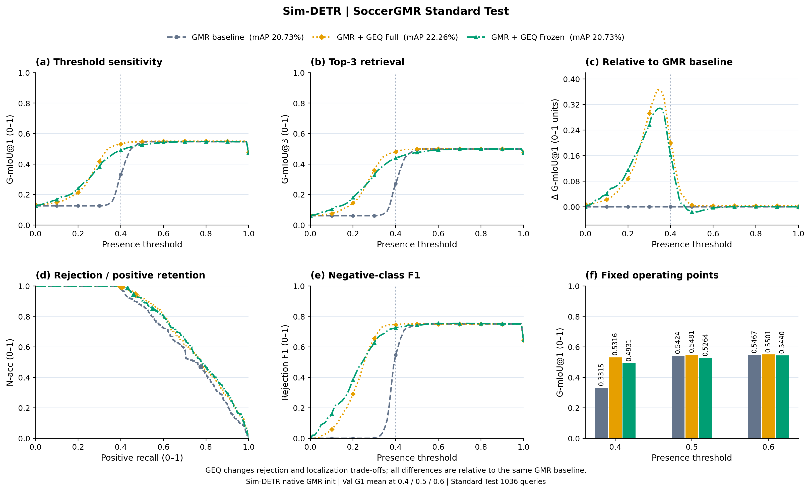
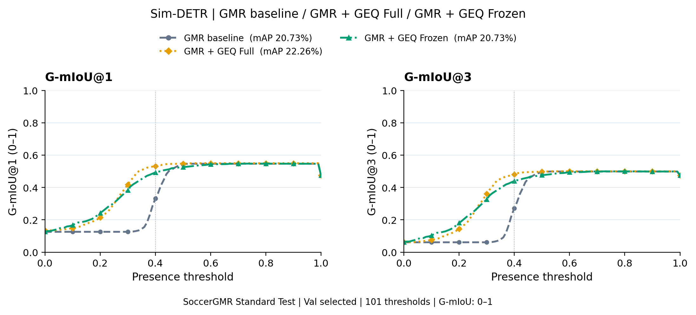
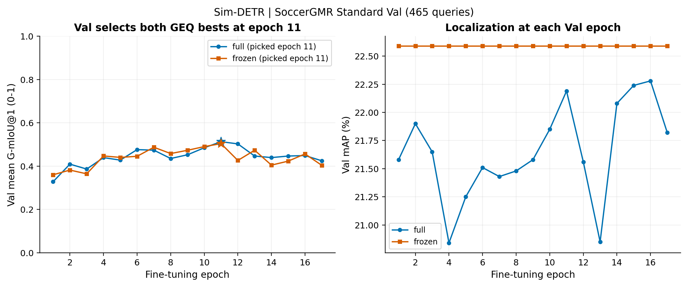

# Sim-DETR：SoccerGMR Standard GMR + GEQ 扩展

**数据集仅为 SoccerGMR Standard Test：1036条，544正例、492负例；本次没有评测或适配 Charades，也没有新增 Full 数据集结果。**

GEQ Full较相同GMR baseline提高1.53个百分点mAP、0.0697三点G-mIoU@1均值；Frozen保持mAP不变并提高0.0476三点均值。改进依赖存在性阈值，部分阈值上Frozen G-mIoU低于GMR，因此保留完整0–1扫描和负增益。

## 与 main E1 八组对照是否是同一方法

核心方法一致：GEQ依次读取文本及原生encoder视频证据；Full损失为原生GMR loss + GEQ BCE，原模型/GEQ学习率1e-5/3e-5，GEQ seed2023，按Standard Val G1在0.4/0.5/0.6均值选best、连续6轮无提升早停、上限20轮。Frozen冻结原模型、只训练GEQ BCE。

本次已将Sim适配器接入仓库，直接使用共享`GlobalEventQueryHead`；共享头与原Sim头严格加载且合成输入前向逐位相同，E1的`EvidenceRead.forward`与共享实现AST相同，见[METHOD_EQUIVALENCE.json](METHOD_EQUIVALENCE.json)。Sim有两层encoder且HD2MR会重复调用，当前适配保留首次encoder两层证据。初始化来自Sim自己的GMR best，不属于原四骨干main E1检查点；原生loss、batch与后处理随骨干保留。因此这是同一GEQ方法的Sim骨干扩展，不混入原八组的计数或同初始化消融。

## Standard Test 结果

G-mIoU和差值为0–1；mAP/AUROC为百分数，ΔmAP为百分点。所有增减均相对本骨干GMR。τ是存在性阈值，不是定位IoU阈值。

| 方法 | mAP (%) | ΔmAP vs GMR (pp) | AUROC (%) | G1@0.4 | G1@0.5 | G1@0.6 | G1均值 | ΔG1均值 vs GMR |
|---|---:|---:|---:|---:|---:|---:|---:|---:|
| GMR baseline | 20.73 | +0.00 | 72.97 | 0.3315 | 0.5424 | 0.5467 | 0.4735 | +0.0000 |
| GMR + GEQ Full | 22.26 | +1.53 | 76.23 | 0.5316 | 0.5481 | 0.5501 | 0.5433 | +0.0697 |
| GMR + GEQ Frozen | 20.73 | +0.00 | 76.43 | 0.4931 | 0.5264 | 0.5440 | 0.5212 | +0.0476 |

## 与既有README相同的图



[六面板PDF](full_frozen_comparison.pdf) · [SVG](full_frozen_comparison.svg) · [101点CSV及相对GMR差值](full_frozen_comparison_sweep.csv) · [离线绘图快照](full_frozen_comparison_snapshot.json)



[G1/G3 PDF](full_frozen_comparison_gmiou_1_3.pdf) · [SVG](full_frozen_comparison_gmiou_1_3.svg)

## Val选模



两种GEQ在历史Val上的最高三点均值均选中epoch11。Frozen在所选epoch的Val mAP为22.59，Full为22.19。原迁移报告将前者写成21.10，本处已按真实历史纠正。图中没有复用原训练脚本硬编码的baseline Val G1线。

## 推理与来源验收

本次未重训或调参，严格加载已有GMR/Full/Frozen best，重新在完整1036条Standard Test导出预测。三个检查点前后SHA256不变；0.4/0.5/0.6固定工作点的mAP、mR、AUROC、G1/G3与原Sim迁移指标逐项复现一致。Frozen的300个原生张量与GMR完全相同，正式导出复用GMR候选边界、顺序、分数，仅替换存在性分数，mAP/mR完全相同。

[正式预测、官方指标与完成标记](run_metadata/) · [评测完成记录](EVALUATION_COMPLETE.json) · [审计](AUDIT.json) · [视觉与图表设计检查](FIGURE_REVIEW.md) · [汇总CSV](standard_test_summary.csv)

所有方法保留原Sim Standard输入/原生后处理，未根据Test表现修正长视频处理或选择阈值。本次结果只验证这个seed、这些Val选定模型上的方法扩展，不证明GEQ结构对定位增益的单因素因果，也不包含等预算无GEQ续训控制。

## 已接入代码与复现

[Sim适配器与原生源码](../../../backbones/sim_detr/README.md) · [共享GEQ头](../../../shared/geq_protocol/geq_model.py) · [评测入口](../../../shared/geq_epoch_study/sim_detr_extension.py) · [报告入口](../../../shared/geq_epoch_study/sim_detr_report.py) · [共享绘图器](../../../shared/geq_protocol/plotting.py)

在仓库根目录执行：

```bash
CUDA_VISIBLE_DEVICES=0 /home/guoxiangyu/miniconda3/envs/sim_detr/bin/python \
  shared/geq_epoch_study/sim_detr_extension.py --action evaluate
python shared/geq_epoch_study/sim_detr_extension.py --action plot
python shared/geq_epoch_study/sim_detr_report.py
```

推理与绘图分开使用已有环境：Sim环境提供Torch2.5.1/CUDA12.4，CPU绘图环境提供NumPy/Matplotlib。合法完成结果按哈希复用；离线快照重绘无需原环境、检查点或GPU。权重、视频、特征未包含在发布文件中。
