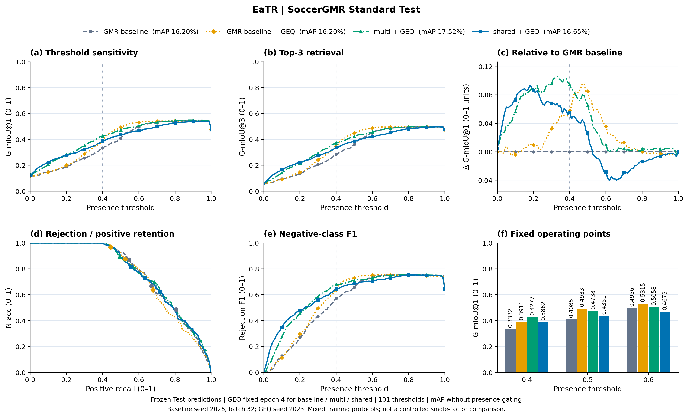
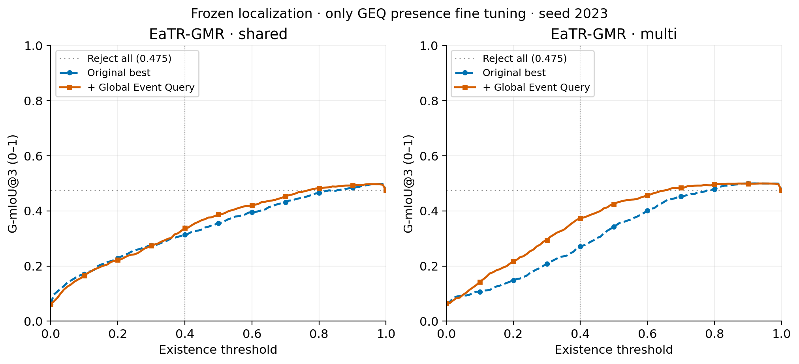

# EaTR-GMR：GEQ 微调对照

<!-- THREE_WAY_COMPARISON_START -->
## GMR baseline / GMR baseline + GEQ / multi + GEQ / shared + GEQ

固定阈值 0.4 下，相对 GMR baseline 的 G-mIoU@1 变化：multi + GEQ **+0.0945**、shared + GEQ **+0.0550**（0–1 单位）。完整曲线展示这些差异随阈值的变化。

[PDF](gmr_multi_shared_geq_complete_comparison.pdf) · [SVG](gmr_multi_shared_geq_complete_comparison.svg) · [@1 / @3 双面板 PDF](gmr_multi_shared_geq_gmiou_1_3.pdf) · [101 点数据](four_way_threshold_sweep.csv)

Test mAP：GMR baseline **16.20%**；GMR baseline + GEQ **16.20%**；multi + GEQ **17.52%**；shared + GEQ **16.65%**。

G-mIoU、N-acc、Positive recall、Rej-F1 均使用 0–1；差值允许为负。mAP 按官方正查询定位口径计算，不按存在性阈值门控。原始配对图保留在下方。

EaTR baseline 复用历史 seed 2026、batch 32；GEQ 为 seed 2023，存在训练协议差异。
<!-- THREE_WAY_COMPARISON_END -->

[完整协议与八组结果](../README.md)

[PDF](gmiou_before_after.pdf) · [SVG](gmiou_before_after.svg)
