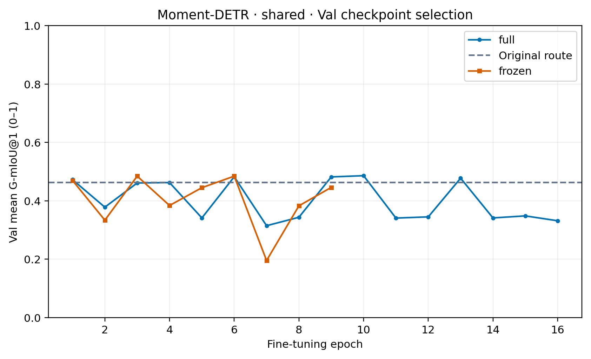
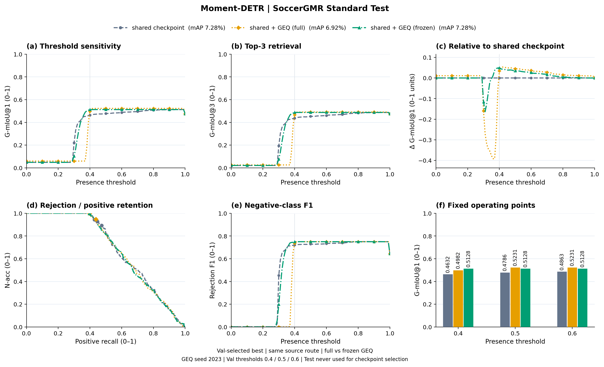
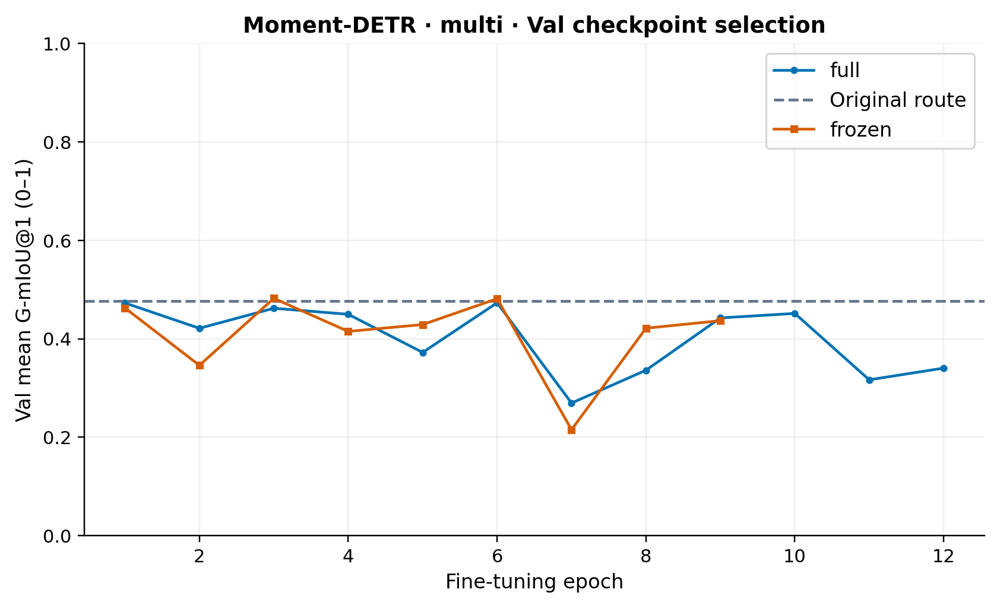
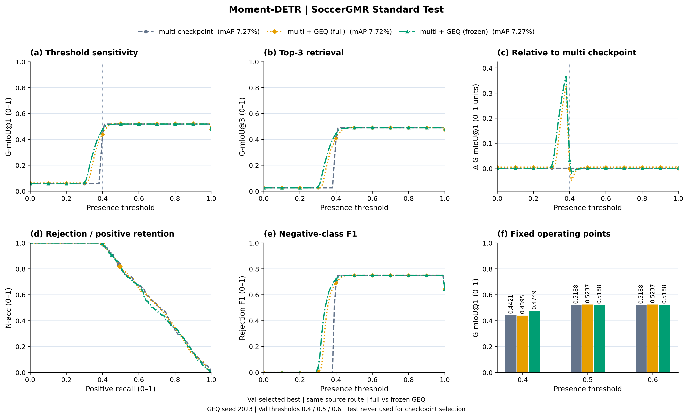
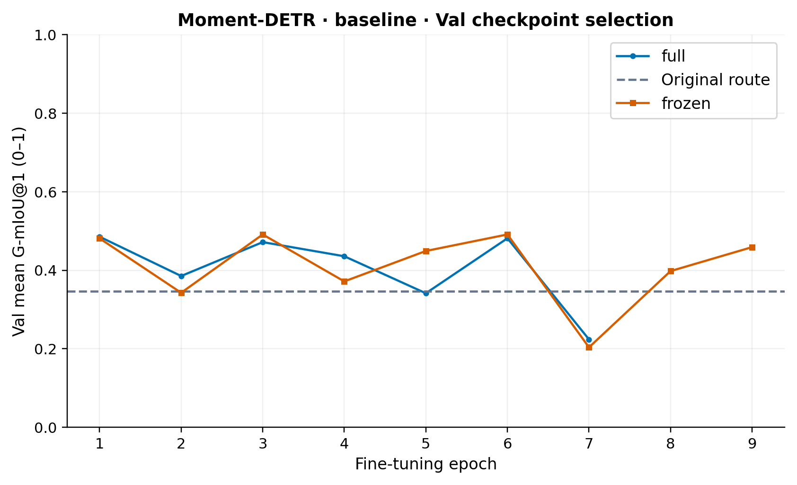
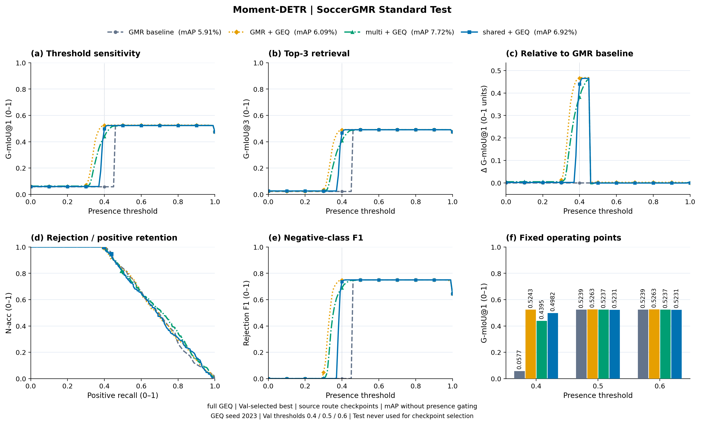
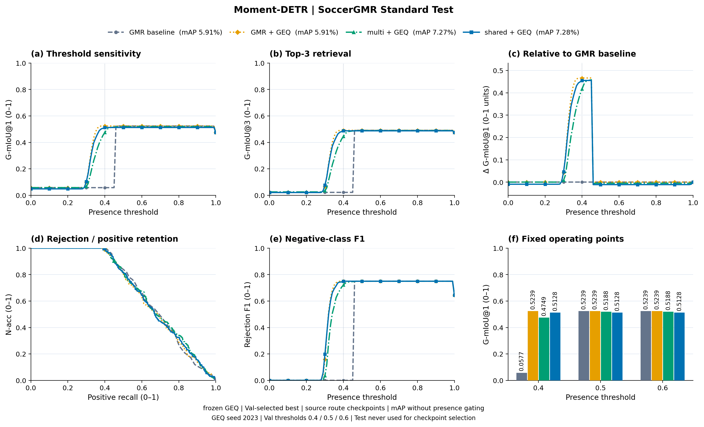

# Moment-DETR：统一 Val 选模

## shared：Val 选模曲线

## Moment-DETR · shared · full / frozen

## multi：Val 选模曲线

## Moment-DETR · multi · full / frozen

## baseline：Val 选模曲线

## Moment-DETR · full

## Moment-DETR · frozen

