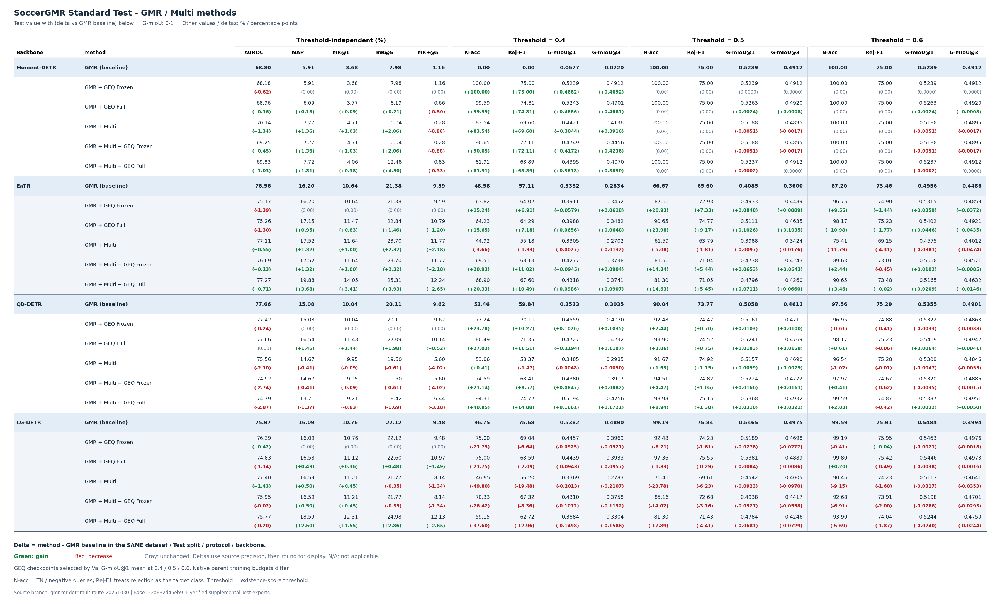
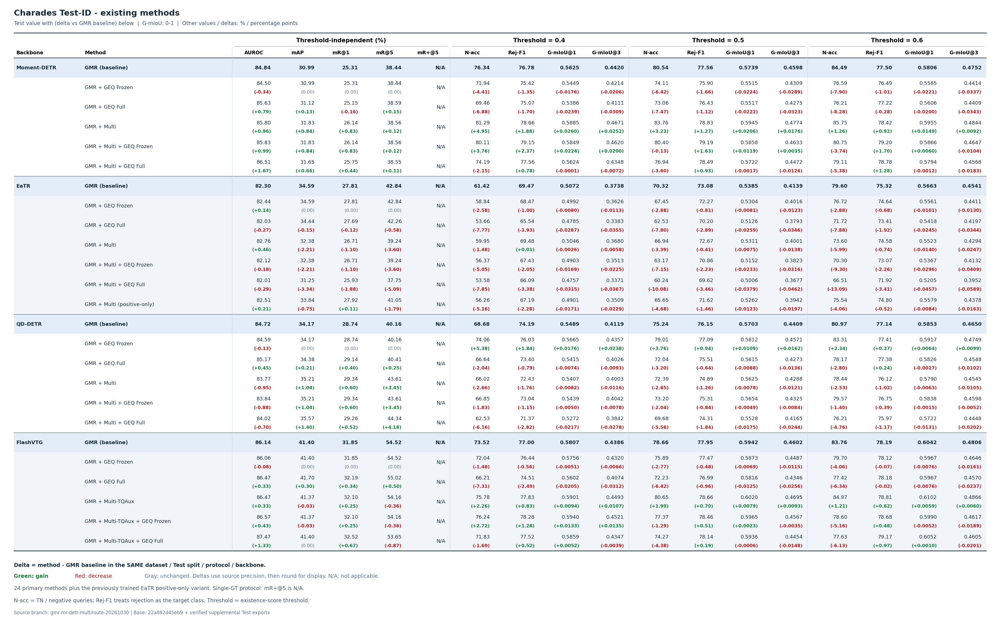
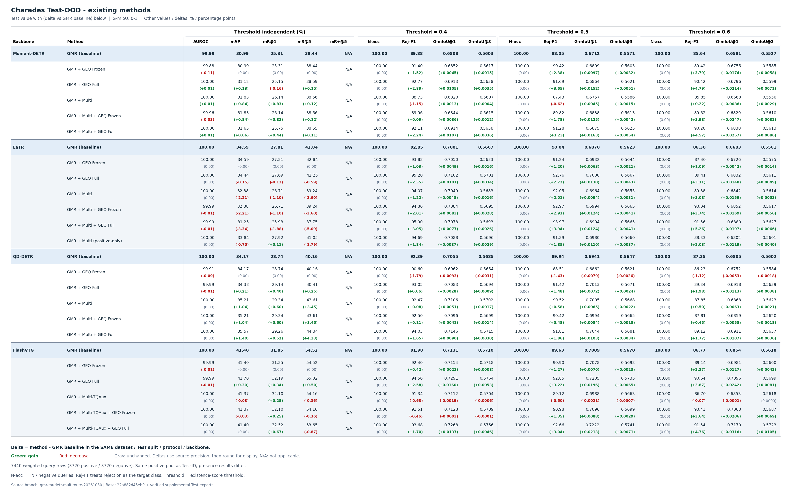
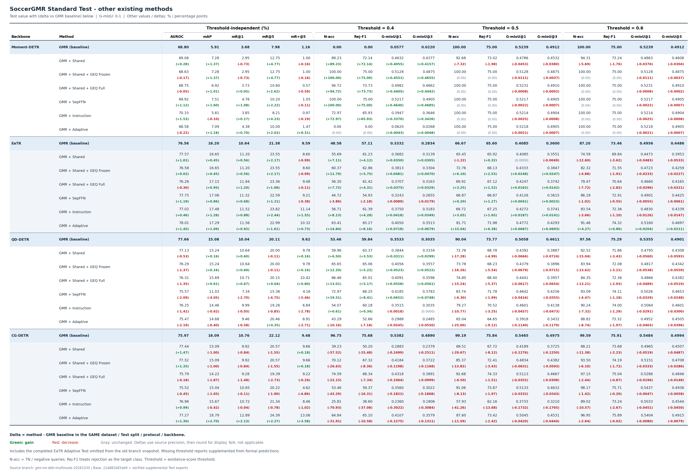

# 两数据集已有方法：正式 Test 指标汇总

仅包含 **Test** 指标。当前实验共 **98 条正式 Test 记录**：SoccerGMR Standard Test 48 条，Charades Test-ID/OOD 各 25 条；另附 28 条历史协议记录。这里的记录数按“方法 × 骨干 × 测试集 × 协议”计数，不代表 126 次独立训练。不包含参考文件中的组件消融。

按用户要求，AUROC、mAP、mR@1、mR@5、mR⁺@5 每行只写一次；N-acc、Rej-F1、G-mIoU@1/@3 分别报告 **τ=0.4、0.5、0.6**。τ 是存在性判定阈值，不是定位 IoU 阈值。**G-mIoU 为 0–1，其他数值指标为百分数，mAP 增减为百分点。** N-acc 是负例拒绝率 TN/N，不是整体分类准确率。

**全部增减统一相对 GMR baseline：Δ = 方法 Test 指标 − 同数据集、同 Test 划分、同协议、同骨干的 GMR Test 指标。** 图表单元格上方是 Test 原值，下方括号内为 Δ；**正增益绿色、下降红色、持平灰色**。浅蓝加粗行明确标出 GMR baseline。G-mIoU 的差值仍用 0–1 标度，其余差值为百分点；使用原始精度作差后再四舍五入。N/A 不计算差值。

**下载：** [全部表格 PDF（6页）](TEST_ALL_THRESHOLDS.pdf) · [全部 LaTeX](TEST_ALL_THRESHOLDS.tex) · [完整宽表 CSV](TEST_ALL_THRESHOLDS.csv) · [按阈值展开 CSV](TEST_ALL_THRESHOLDS_LONG.csv) · [相对 GMR 的全部指标增减 CSV](TEST_DELTAS_VS_GMR.csv) · [相对 GMR 的 mAP 增减 CSV](MAP_DELTAS.csv) · [数据 JSON](TEST_ALL_THRESHOLDS.json) · [来源与哈希](PROVENANCE.json) · [核验记录](AUDIT.json)

## 主方法表

六种主方法均完整保留：GMR、GMR + GEQ Frozen/Full、GMR + Multi、GMR + Multi + GEQ Frozen/Full。FlashVTG 的 Multi 标为 Multi-TQAux。

### SoccerGMR Standard Test

[PDF](SOCCERGMR_TEST.pdf) · [LaTeX](SOCCERGMR_TEST.tex)

### Charades Test-ID

[PDF](CHARADES_TEST_ID.pdf) · [LaTeX](CHARADES_TEST_ID.tex)

### Charades Test-OOD

[PDF](CHARADES_TEST_OOD.pdf) · [LaTeX](CHARADES_TEST_OOD.tex)

Charades 两个测试集各 7,440 条，正负各 3,720 条。共享正例池；本批正式导出的 mAP 逐项相同，mR 仍按各自实际导出保留，个别项有微小差异。负例池不同，AUROC、N-acc、Rej-F1、G-mIoU 必须分别报告。单 GT 协议下 mR⁺@5 不适用，标为 N/A，不把评估器的空集合占位 0 当作有效结果。

## Test mAP 相对 GMR baseline 的提升与降低

下表括号内全部是相对同一行 GMR baseline 的增减，单位为百分点。两个 Charades 测试集的 mAP 相同，合并写一次。Frozen/Full 都使用相同的 GMR 比较基准。

| 数据集 / Test | 骨干 | GMR baseline | GMR + GEQ Frozen | GMR + GEQ Full | Multi | Multi + GEQ Frozen | Multi + GEQ Full |
|---|---|---:|---:|---:|---:|---:|---:|
| SoccerGMR | Moment-DETR | **5.91** | 5.91 (0.00) | 6.09 (+0.18) | 7.27 (+1.36) | 7.27 (+1.36) | 7.72 (+1.81) |
| SoccerGMR | EaTR | **16.20** | 16.20 (0.00) | 17.15 (+0.95) | 17.52 (+1.32) | 17.52 (+1.32) | 19.88 (+3.68) |
| SoccerGMR | QD-DETR | **15.08** | 15.08 (0.00) | 16.54 (+1.46) | 14.67 (−0.41) | 14.67 (−0.41) | 13.71 (−1.37) |
| SoccerGMR | CG-DETR | **16.09** | 16.09 (0.00) | 16.58 (+0.49) | 16.59 (+0.50) | 16.59 (+0.50) | 18.59 (+2.50) |
| Charades ID / OOD | Moment-DETR | **30.99** | 30.99 (0.00) | 31.12 (+0.13) | 31.83 (+0.84) | 31.83 (+0.84) | 31.65 (+0.66) |
| Charades ID / OOD | EaTR | **34.59** | 34.59 (0.00) | 34.44 (−0.15) | 32.38 (−2.21) | 32.38 (−2.21) | 31.25 (−3.34) |
| Charades ID / OOD | QD-DETR | **34.17** | 34.17 (0.00) | 34.38 (+0.21) | 35.21 (+1.04) | 35.21 (+1.04) | 35.57 (+1.40) |
| Charades ID / OOD | FlashVTG | **41.40** | 41.40 (0.00) | 41.70 (+0.30) | 41.37 (−0.03) | 41.37 (−0.03) | 41.40 (0.00) |

相对 GMR，SoccerGMR 的 Multi+GEQ Full 在 EaTR、CG-DETR 上分别 **+3.68、+2.50**，QD-DETR 为 **−1.37**。Charades 的同项变化在 QD-DETR 为 **+1.40**，EaTR 为 **−3.34**。全部方法、指标和附表都按此基准计算，所有下降项均保留。原路线的训练预算、部分历史 baseline 的 seed 存在差异，这些是已有完整方法的实测比较。

## 其他已有方法

SoccerGMR 的 Shared、Shared+GEQ Frozen/Full、SepFFN、Instruction、Adaptive 全部列入附表，不省略已有方法。其指标同样全部来自正式 Test。附表按骨干补列对应 GMR baseline 参考行，便于直接比较；参考行不新增实验计数。

[其他方法 PDF](SOCCERGMR_OTHER_METHODS_TEST.pdf) · [LaTeX](SOCCERGMR_OTHER_METHODS_TEST.tex)

## 本次补齐的正式 Test

- **EaTR Adaptive / SoccerGMR：** 旧分支快照仍显示 training，但本地已完成正式 Test。核验 Val-best epoch 75、Val mAP 20.46、检查点 SHA256 与 frozen selection 相同后复用原正式导出，不重复推理。Test mAP **17.29**，相对同骨干 GMR 的 16.20 为 **+1.09**。Val 数值仅用于说明选模来源，不进入 Test 表格。[选模证据](supplemental/soccergmr/eatr/adaptive/selection.json) · [正式 Test 指标](supplemental/soccergmr/eatr/adaptive/formal_test_metrics.json) · [正式预测 gzip](supplemental/soccergmr/eatr/adaptive/formal_test_predictions.jsonl.gz)
- **EaTR Multi positive-only / Charades：** 此已有训练原来只有 Val。使用原 Val mAP 选出的 epoch 65 best，独立补齐完整 Test-ID/OOD，各 7,440 条。两者 Test mAP 均 **33.84**，相对 GMR baseline 的 34.59 为 **−0.75**。它是原有独立训练版本，未新增 GEQ 微调，也未改变主六方法的含义。[选模与补测证据](supplemental/charades/eatr/multi_positive_only/selection.json) · [Test-ID](supplemental/charades/eatr/multi_positive_only/test_id/metrics.json) · [Test-OOD](supplemental/charades/eatr/multi_positive_only/test_ood/metrics.json)
- **12 个旧 SepFFN / Instruction / Adaptive 实验：** 用原正式 Test 预测补齐三个阈值的拒绝与 G-mIoU 指标；官方评估器重算的 mAP、mR、AUROC 和原有 0.4 指标逐项一致。原分支已存档的 G-mIoU@3 阈值值也逐项一致。没有重新运行模型。[补齐数据及原 Test 指标](supplemental/soccergmr/)

本次仅对确实缺失的两个 Charades Test 执行 GPU 推理。没有重新训练、修改权重、按 Test 选模型或调阈值。原 24/48 主实验的正式指标、预测、完成标记均通过前后 SHA256 不变核验；另独立核对其 144 个正式文件与已发布基础快照一致，新补测的六个阈值点也与官方 G-mIoU 计算一致，见 [完整性证据](supplemental/INTEGRITY.json)。补测是本次新增授权的报告工作，原监控定时器保持停用。

## 历史协议，单独保留

这些历史结果也是 Test；由于起点或选模方式不同，不替换当前主表中的同名方法。

| 协议 | 记录数 | 表格 |
|---|---:|---|
| main E1 历史 GMR 起点及 GEQ Frozen/Full | 12 | [PDF](SOCCERGMR_HISTORICAL_E1_TEST.pdf) · [LaTeX](SOCCERGMR_HISTORICAL_E1_TEST.tex) |
| 旧固定四轮 Frozen GEQ | 16 | [PDF](SOCCERGMR_HISTORICAL_FIXED4_TEST.pdf) · [LaTeX](SOCCERGMR_HISTORICAL_FIXED4_TEST.tex) |

当前 GEQ 的 best 按完整 Val 的 G-mIoU@1 在 0.4/0.5/0.6 三点均值选取，Test 只报告该模型；GMR/Multi 等原路线仍沿用其既有 Val mAP 选模。mAP 在 τ 分组中不重复，因为定位指标使用原协议的 ungated 正例定位候选，存在性阈值只影响拒绝与 G-mIoU。

## 来源与复现

基础快照为分支 `gmr-mr-detr-multiroute-20261030` 的提交 `22a882d45eb9cdc15f343923b41d876c5f069092`，加上本目录已核验的正式补测导出。每行 CSV/JSON 均注明源文件；[PROVENANCE.json](PROVENANCE.json) 保存输入 SHA256。

[参考 LaTeX](https://github.com/chinagalaxy2002/Improving-Target-Presence-for-Generalized-Moment-Retrieval/blob/main/ablations/component_ablation_20261023/tables/ABLATION_TEST_ALL_THRESHOLDS.tex) 仅用于参考指标命名和阈值分组，没有复制其消融配置或数值。PDF/PNG 与 LaTeX 使用同一份核验后数据；PDF/PNG 由 Matplotlib 渲染，LaTeX 源可独立编译。

从仓库根目录运行 `python results/test_all_thresholds/build_tables.py` 可离线重建所有表格，无需模型、GPU 或外部运行目录。`supplement_tests.py` 保留本次正式补测及官方阈值补齐过程；仅在原运行环境中使用，已有合法完成导出时复用，受到任务锁保护。
