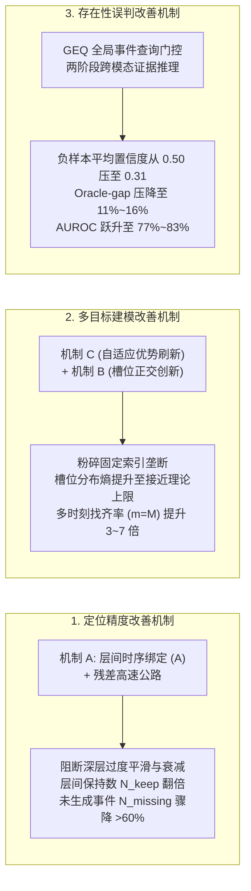

# SoccerGMR 核心机理诊断实验室 (`diagnosed_e9_geq/`)

本目录严格独立于现有代码库，专用于发掘 **Method 1 (Baseline)**、**Method 2 (SI-Bind E9)** 与 **Method 3 (SI-Bind E9 + GEQ)** 三个方法在全部 8 个 DETR 骨干网络（Moment-DETR、EaTR、QD-DETR、CG-DETR、Sim-DETR、BM-DETR、BAM-DETR、UVCOM）上的各项指标变化，以揭示模块改善**定位精度**、**多目标定位建模**及**存在性误判**的底层物理原理机制。

所有代码、中间产物、全量预测、指标表格及出版级高清图表**均严格限制在本目录下独立生成**，不污染工作区其他任何目录。

---

## 🔬 三大底层机理科学实证体系



---

## 📂 目录结构与资产清单

```text
diagnosed_e9_geq/
├── README.md                                                    # 本说明文件
├── 核心机理诊断学术总报告_Baseline_vs_E9_vs_E9_GEQ.md             # 深度机理实证学术总报告
├── run_diagnostics_pipeline.py                                  # 全量并行测试总编排入口 (48 个子任务双卡调度)
├── run_backbone_diagnostics.py                                  # 单骨干独立进程诊断测试器
├── run_supplementary_analysis.py                                # 全量对比聚合、图表渲染与主报告生成器
├── src/                                                         # 核心诊断算法库
│   ├── __init__.py
│   ├── core.py                                                  # 时序 tIoU 矩阵与无偏二分图最大匹配算子
│   ├── data_auditor.py                                          # 实验 1: Multi-GT 数据集分布与重叠审计
│   ├── model_runner.py                                          # 无损全层解码器候选与存在性概率提取器
│   ├── analyzers.py                                             # 槽位活跃度、候选加法分解与逐层演化计算器
│   ├── presence_analyzer.py                                     # 存在性区分度、虚警率、AUROC 与 Oracle-gap 扫描器
│   └── report_generator.py                                      # 自动化学术 Markdown 表格格式化器
├── tables/                                                      # 全量实证对比 Markdown 表格
│   ├── exp1_multigt_summary.md                                  # Multi-GT 统计清单与两两 tIoU 重叠审计
│   ├── comparison_macro_metrics.md                              # 8 骨干宏观指标横向演进对比 (Standard & Full)
│   ├── comparison_localization_layer_evolution_standard.md      # 解码器逐层保持与遗忘退化对比 (Standard)
│   ├── comparison_localization_layer_evolution_full.md          # 解码器逐层保持与遗忘退化对比 (Full)
│   ├── comparison_multigt_coverage_standard.md                  # 多时刻 4 态互斥覆盖度分布对比 (Standard)
│   ├── comparison_multigt_coverage_full.md                      # 多时刻 4 态互斥覆盖度分布对比 (Full)
│   ├── comparison_slot_monopolization.md                        # Query Slot 索引垄断度与熵分布审计
│   └── comparison_presence_and_false_alarms.md                  # 负样本虚警控制与目标存在性辨识对比
├── figures/                                                     # 出版级高清图表 (300 DPI)
│   ├── fig2_layer_evolution_progression.png                     # 解码器逐层演化曲线 (根治退化实证)
│   ├── fig3_multigt_coverage_breakdown.png                      # 多目标 4 态覆盖比例迁移柱状图
│   ├── fig4_generation_vs_ranking_decomposition.png             # 生成缺陷削减与 Top-1 命中解耦图
│   └── fig6_presence_rejection_curves.png                       # AUROC 跃升与 Oracle-Gap 消除柱状图
└── outputs/                                                     # 原始无损数据与结构化 JSON
    ├── exp1_multigt/                                            # 数据集分布审计结果
    ├── raw_predictions/                                         # 48 组全层无损样本预测 jsonl
    └── analysis/                                                # 48 组细粒度机理诊断指标汇总 json
```

---

## 🚀 一键复现全部实验指令

在仓库根目录下运行：
```bash
/home/guoxiangyu/miniconda3/envs/gmr/bin/python diagnosed_e9_geq/run_diagnostics_pipeline.py
```
该命令会自动：
1. 审计四大划分的 Multi-GT 数据分布；
2. 调度双卡 (`cuda:0`, `cuda:1`) 并行完成 8 个骨干 × 3 种方法 × 2 个测试集的全部 48 项诊断提取；
3. 计算所有指标，渲染全部 4 张出版级分析图，并生成完整的对比表格与学术主报告。
