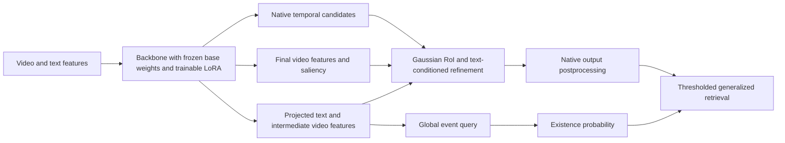

# Algorithm specification

## Identity and task

**DeRoI-GMR** is the paper name used here for the active `presence_source=global_refine` configuration archived as S4-Fusion, S4_noFusion and S4_minus_Fusion. Despite “Fusion” in one API spelling, this configuration returns the global existence logit before the template's local-presence and residual-fusion branches. Read executed code and configuration rather than historical MCEV docstrings, which describe a larger family of experiments.

Given video features $X$, text features $T$, and ground-truth interval set $\mathcal G$, generalized retrieval produces either a ranked temporal set or the empty set. The implementation consists of a global existence reader and a proposal-conditioned localization refiner. Both share backbone features and trainable LoRA updates. Their forward readouts are separated; their optimization is not independent.



The FlashVTG export additionally retains a legacy uniform candidate-score multiplier described below. The figure depicts model readouts, not an assertion that every export stage is numerically identical across backbones.

## Global event query

An event token $e\in\mathbb R^{1\times256}$ first reads projected text and then each captured video encoder layer:

$$
q_0=\operatorname{Read}_{T}(e,T),\qquad
q_d=\operatorname{Read}_{d}(q_{d-1},V^{d}),\quad d=1,\ldots,D,
$$
$$
g=w_g^\top q_D+b_g,\qquad p=\sigma(g).
$$

Each `EvidenceRead` uses eight-head cross-attention, residual addition, LayerNorm, a two-layer ReLU feed-forward network with intermediate width 512, and a second residual/LayerNorm. Dropout is 0.1. Padding is masked. Depth follows the chosen backbone encoder, rather than being universally three.

Neither proposal coordinates/scores nor RoI tokens are inputs to $g$. In the FlashVTG wrapper the verifier can execute during the base forward and is recomputed after candidates are collected; the returned final logit still follows the global-only readout in the active configuration. Proposal extraction/refinement remains necessary for localization. “Proposal-independent existence prediction” describes the readout's dependency graph, not a claim that the entire system performs no proposal computation.

The root template materializes a plurality head for checkpoint compatibility, but `multi_weight=0` freezes it and removes plurality supervision. Its emitted diagnostic logits do not represent a trained plurality classifier. The Phase 2 heads omit that unused component. There is no active counting objective.

## Gaussian temporal RoI

The localizer produces candidates $(s_k,e_k,c_k)$. During FlashVTG training, select up to the top eight candidates by confidence; at evaluation, use the leading eight of the already ordered native candidate list. DETR adapters explicitly gather the top eight of their native slots. Unselected candidates remain in the final list.

Let clip-center time $t_i=2i+1$ seconds, $\mu_k=(s_k+e_k)/2$, and $\sigma_k=\max(e_k-s_k,2)/2$. With validity mask $m_i$, the code computes

$$
a_{ki}=m_i\exp\!\left[-\frac{(t_i-\mu_k)^2}{2\sigma_k^2+10^{-5}}\right],\qquad
\bar a_{ki}=\frac{a_{ki}}{\max(\sum_j a_{kj},10^{-5})},
$$
$$
r_k=\sum_i\bar a_{ki}V_i^{\mathrm{final}},\qquad
u_k=[s_k/150,e_k/150,(e_k-s_k)/150,c_k],
$$
$$
M_k=\operatorname{LN}\big(r_k+\operatorname{GeomMLP}(u_k)\big).
$$

The geometry MLP maps 4→64→256 and includes ReLU and LayerNorm. Endpoints and confidence are clamped as in `CandidateMomentExtractor`. The Gaussian is soft over all valid clips, not restricted to a hard interval. Its center/scale are determined by the proposal; text conditioning enters through backbone representations and the subsequent attention, rather than a separately learned Gaussian bandwidth. Selection indices are discrete top-k operations.

## Text-conditioned residual refinement

Each moment token attends to projected text:

$$
h_k=\operatorname{LN}(M_k+\operatorname{MHA}(M_k,T,T))
      +W_u\tilde u_k+W_a\phi(a,s_k,e_k),
$$

where $\tilde u_k$ is the refiner's clamped normalized geometry and $\phi$ contains **six** saliency cues: start/end differences over one-clip neighborhoods, midpoint saliency, start/end differences over two-clip neighborhoods, and midpoint/background contrast. Historical helper comments saying three cues are stale. The saliency terms are used when scores are available. Candidate self-attention is disabled by the supplied configuration.

The 256→128→64→3 GELU MLP yields $\delta=\tanh(f(h_k))$, with dropout 0.1 in its first hidden stage. The active residual bounds are

$$
\Delta s_k=1.5\delta_{k1},\quad
\Delta e_k=1.5\delta_{k2},\quad
\Delta c_k=0.3\delta_{k3}.
$$

Updated confidence is clamped to [0,1]. The helper clamps initial updated endpoints to [0,150], then enforces `end >= start + 1`. Because this ordering can produce an end above 150, do not describe the helper alone as guaranteeing valid per-video bounds. The DETR wrappers explicitly reclip/reorder using each actual duration; FlashVTG applies its existing export timestamp postprocessing. Some clips are shorter than 150 seconds. Inspect exported intervals rather than assuming the normalization scale equals the duration.

The final residual layer is zero-initialized, so initial residuals are zero, apart from any validity corrections applied outside the MLP. Geometry and saliency projections are also zero-initialized. Selected candidates are replaced, then native ranking/postprocessing is applied. This path refines candidate confidence as well as boundaries.

## Low-rank adaptation and trainable parameters

Each video encoder FFN's `linear1` and `linear2` is replaced with

$$
W_0x+b+\frac{\alpha}{r}BAx,
\quad r=8,\quad\alpha=16.
$$

Base weights $W_0$ remain frozen; $A$ uses Kaiming initialization and $B$ starts at zero. Attention projections, native localization heads and feature extractors are not generally made trainable by this configuration. Global reader, RoI encoder and refiner parameters are trainable. Gradients remain attached to captured features, so shared LoRA updates receive both objectives and can change native candidates despite frozen localization-head weights. This is the repository's use of [LoRA](https://arxiv.org/abs/2106.09685); the original language-model paper's efficiency magnitudes are not transferred to this system.

| Backbone | Trainable parameters | LoRA parameters | Archived batch size |
| --- | ---: | ---: | ---: |
| Moment-DETR | 1,948,868 | 40,960 | 8 |
| QD-DETR | 1,948,868 | 40,960 | 32 |
| CG-DETR | 2,496,452 | 61,440 | 32 |
| EaTR | 2,496,452 | 61,440 | 32 |
| FlashVTG | 2,496,452 | 61,440 | 8 |

FlashVTG E0 trains 10,600,985 parameters; adaptation trains approximately 76.45% fewer parameters. This comparison excludes the cost of obtaining E0 and does not establish reduced total parameters, latency, FLOPs or peak memory. Counts come from archived configurations and initialization records.

## Active loss

The active adaptation objective is

$$
\mathcal L=\mathcal L_{\mathrm{exist}}+0.5\mathcal L_{\mathrm{refine}},\qquad
\mathcal L_{\mathrm{exist}}=\operatorname{BCEWithLogits}(g,\mathbf 1[|\mathcal G|>0]).
$$

For each positive query, match each GT interval to its maximum-tIoU candidate among the refined top-k set. This is **not** Hungarian one-to-one matching: a candidate can supervise multiple GT intervals. The active boundary loss is

$$
\ell_{\mathrm{refine}}=
2\big(\operatorname{SmoothL1}_{.01}(s'/150,s^{gt}/150)
+\operatorname{SmoothL1}_{.01}(e'/150,e^{gt}/150)\big)
+(1-\operatorname{GIoU})
+0.5\operatorname{BCE}(c',\operatorname{stopgrad}(\max_j\operatorname{tIoU}(C',G_j))).
$$

Boundary and GIoU terms average over matched GT intervals. Confidence loss uses all selected candidates with their maximum GT overlap. Average these per-query losses over positive queries only. Negative queries incur existence loss but no refinement loss; an all-negative batch has zero refinement loss.

The adaptation loop does not add the native VMR criterion to this objective. E0 uses its own native weighted criterion plus configured existence training. Focal loss, hard negatives, margin calibration, evidence alignment, safeguards, local existence matching and candidate-to-existence fusion are disabled in the documented adaptation. Their definitions in the template are not evidence that they were used.

## Output and the meaning of decoupling

The generalized retrieval decision accepts a query when **`p > tau`** and returns the postprocessed ranked intervals; otherwise it returns `[]`. The official evaluator treats equality as rejection. Root historical utility paths use `>=`; the documentation audit verifies there are no exact ties at .4/.5/.6 for the archived root predictions. Preserve the strict official rule for new reports.

The root FlashVTG inference exporter retains a legacy step: below its internal threshold .5 it multiplies every candidate confidence for a query by $p$, otherwise by one. It does **not** feed proposal evidence back into $g$. This uniform per-query scaling is separate from the removed local-presence fusion module. It generally preserves within-query ordering, but score formatting, ties and export behavior should be retained when reproducing results. Therefore, “no existence-related score processing anywhere in the pipeline” is unsupported. The precise claim is that **candidate-level evidence is not fused into the existence logit**.

For root FlashVTG, `pred_relevant_windows_pre_exist` is captured after S4's model-level refinement but before that export scaling/NMS. Its “raw mAP” is not a pre-refinement ablation. The Phase 2 DETR interfaces separately preserve native candidates before refinement. Do not compare these two uses of “raw” without qualifying their stage.

## Backbone integration contract

An adapter must expose projected text, valid text/video masks, intermediate video encoder layers, final per-clip features, candidate endpoints in seconds, confidence, saliency and actual duration. Moment-DETR/EaTR use video slices from their native encoder outputs; QD-DETR and CG-DETR remove the prepended saliency token before the global reader. Native center/width outputs are converted to seconds, and selected refined candidates are scattered into the full candidate set. These are concrete adapters, not a proof that arbitrary unseen backbones can be integrated unchanged.

| Component | Source |
| --- | --- |
| FlashVTG core components and loss | [code/model.py](<../Phase2(addbackbone_with_S4_minusFusion)/flashvtg/code/model.py>) |
| Active parameter selection and Val score | [code/runtime.py](<../Phase2(addbackbone_with_S4_minusFusion)/flashvtg/code/runtime.py>) |
| E0 tensor mapping | [code/initialization.py](<../Phase2(addbackbone_with_S4_minusFusion)/flashvtg/code/initialization.py>) |
| Portable two-model API | [code/api.py](<../Phase2(addbackbone_with_S4_minusFusion)/flashvtg/code/api.py>) |
| Moment-DETR adapter | [Phase 2 model](<../Phase2(addbackbone_with_S4_minusFusion)/moment_detr/model.py>) |
| QD-DETR adapter | [Phase 2 model](<../Phase2(addbackbone_with_S4_minusFusion)/qd_detr/model.py>) |
| CG-DETR adapter | [Phase 2 model](<../Phase2(addbackbone_with_S4_minusFusion)/cg_detr/model.py>) |
| EaTR adapter | [Phase 2 model](<../Phase2(addbackbone_with_S4_minusFusion)/eatr/model.py>) |

## Inference pseudocode

```text
project text; capture all required video encoder memories
run native localizer and preserve its complete ranked candidate set
q = text_reader(event_token, projected_text, text_valid)
for reader, video_memory in encoder_order:
    q = reader(q, video_memory, video_valid)
p = sigmoid(global_linear(q))
select up to eight native candidates
pool final video features with proposal-centered Gaussian weights
add geometry; attend each moment token to text
predict bounded start/end/confidence residuals using saliency cues
replace selected candidates; apply backbone-specific validity/ranking/export
return exported temporal set if p > tau, else empty set
```
