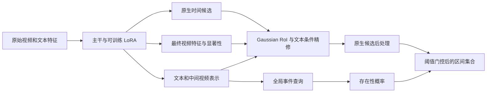

# S4_minus_Fusion 算法说明

## 活跃计算路径

仓库使用的实验名为 **GMR + S4_minus_Fusion**。共同配置固定 `presence_source=global_refine`：全局事件查询产生存在性分数，候选区间经过独立的定位精修路径。配置依据见 [shared/config.json](<../Phase2(addbackbone_with_S4_minusFusion)/shared/config.json>)。

这种分离指存在性 logit 不直接读取候选坐标、候选分数或 RoI token。两条路径仍共享主干表示和 LoRA 参数，不能描述为梯度隔离或完全独立训练。

## 全局存在性读取

设可学习事件 token 为 $e$，投影文本为 $T$，各编码层的视频表示为 $V^d$，则

$$
q_0=\operatorname{Read}_{T}(e,T),\qquad
q_d=\operatorname{Read}_d(q_{d-1},V^d),\qquad
p=\sigma(w^\top q_D+b).
$$

每个 `EvidenceRead` 使用八头交叉注意力、残差与 LayerNorm，以及中间宽度 512 的前馈更新；隐藏宽度为 256，dropout 为 0.1。视频读取次数跟随主干编码层数。padding 通过有效位掩码排除。

`global_refine` 在保留候选精修后直接返回全局 logit，不执行模板中的局部存在性匹配和残差融合。共同配置的 `multi_weight=0`，因此没有活跃的 plurality 分类监督；模板中保留的未训练头不能作为计数能力的证据。

## Gaussian temporal RoI

从原生候选中选择最多八个高置信度区间 $(s_k,e_k,c_k)$。对于中心时刻 $t_i=2i+1$ 秒的 clip，定义

$$
\mu_k=(s_k+e_k)/2,\qquad \sigma_k=\max(e_k-s_k,2)/2,
$$
$$
a_{ki}=m_i\exp\left[-\frac{(t_i-\mu_k)^2}{2\sigma_k^2+10^{-5}}\right],\qquad
\bar a_{ki}=a_{ki}/\max(\sum_j a_{kj},10^{-5}),
$$
$$
M_k=\operatorname{LN}\left(\sum_i\bar a_{ki}V_i^{\mathrm{final}}
+\operatorname{MLP}([s_k/150,e_k/150,(e_k-s_k)/150,c_k])\right).
$$

其中 $m_i$ 表示有效 clip。Gaussian 是覆盖有效时间网格的软权重，而非只在候选内部非零的硬窗口；其中心和尺度由候选确定。几何 MLP 为 4→64→256。查询条件来自主干跨模态表示及后续文本注意力，不是额外学习的 Gaussian 带宽。

## 边界与置信度精修

Moment token 通过交叉注意力读取文本，结合归一化几何和六维显著性信息，经 256→128→64→3 的 MLP 预测残差。显著性信息包含起止点邻域差分、中心响应、较宽邻域差分和中心对比。

$$
(\delta_s,\delta_e,\delta_c)=\tanh(f(M_k,T,\mathrm{geometry},\mathrm{saliency})),
$$
$$
\Delta s=1.5\delta_s,\qquad \Delta e=1.5\delta_e,\qquad \Delta c=0.3\delta_c.
$$

最后一层零初始化，使训练开始时的网络残差为零。替换选中的候选后，保留其余候选，并执行各主干原有排序和时间戳处理。辅助 refiner 先截断到 150 再约束最小宽度，单独调用时不保证符合实际视频时长；需要保留主干适配器的边界校正和后处理。

## LoRA 和损失

编码器 FFN 的 `linear1`、`linear2` 使用

$$
W_0x+b+(16/8)BAx.
$$

原始主干权重冻结；rank-8 LoRA、全局读取器、RoI 编码器和精修器可训练。LoRA 的 $A$ 使用 Kaiming 初始化，$B$ 零初始化。中间特征保留梯度，两种损失均可更新共享 LoRA。

活跃的适配目标为

$$
\mathcal L=\operatorname{BCEWithLogits}(g,\mathbf 1[|\mathcal G|>0])
+0.5\mathcal L_{\mathrm{refine}}.
$$

每个 GT 区间选择 tIoU 最大的精修候选。这个匹配不是一对一 Hungarian 匹配，同一候选可以被多个 GT 选中。正查询精修损失由归一化端点 Smooth L1（beta=.01）、$1-\mathrm{GIoU}$ 和以最大 GT tIoU 为软目标的置信度 BCE 构成，内部权重分别为端点项 2、GIoU 项 1、置信度项 .5。负查询只有存在性损失；全负 batch 的精修损失为零。

S4 适配循环不额外叠加原生 VMR criterion。Baseline、GMR 与 S4 的训练目标和预算不同，不能把完整系统比较解释成单组件消融。

## 输出及主干接口

官方 GMR 评估严格使用 `existence_score > tau`；否则返回空集合。FlashVTG 原生导出还保留低存在性查询的统一候选分数缩放。它不把候选信息反馈到存在性 logit，因此应区分“移除候选到存在性的融合”和“所有后处理均不使用存在性分数”。

四个 DETR 适配器将原生 center/width 转换为实际秒单位区间，再把精修结果放回完整候选集合。QD-DETR、CG-DETR 的全局读取会移除前置显著性 token；各主干的视频切片不能直接互换。

| 主干 | 实现 | 可训练参数 | LoRA 参数 | Batch |
| --- | --- | ---: | ---: | ---: |
| Moment-DETR | [model.py](<../Phase2(addbackbone_with_S4_minusFusion)/moment_detr/model.py>) | 1,948,868 | 40,960 | 8 |
| QD-DETR | [model.py](<../Phase2(addbackbone_with_S4_minusFusion)/qd_detr/model.py>) | 1,948,868 | 40,960 | 32 |
| CG-DETR | [model.py](<../Phase2(addbackbone_with_S4_minusFusion)/cg_detr/model.py>) | 2,496,452 | 61,440 | 32 |
| EaTR | [model.py](<../Phase2(addbackbone_with_S4_minusFusion)/eatr/model.py>) | 2,496,452 | 61,440 | 32 |
| FlashVTG | [model.py](<../Phase2(addbackbone_with_S4_minusFusion)/flashvtg/code/model.py>) | 2,496,452 | 61,440 | 8 |

参数量来自各主干归档配置。它们不是运行时间、峰值显存或 FLOPs 的测量结果。
