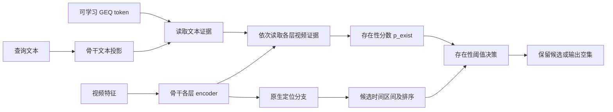

# 算法目的、动机与已有证据

本分支研究一个面向更多 DETR backbone 的 **“GMR baseline 训练 → GEQ Full 微调”范式**。我们的出发点是：现有 GMR 存在大量事件存在性误判，这些错误会造成 G-mIoU 性能损失。我们希望在已有定位能力之上，用专门的存在性证据读取和微调来缓解这部分损失，并验证这一框架在不同骨干上能否有效。

GEQ（Global Event Query，全局事件查询）是第二阶段采用的统一模块。所有模型在 SoccerGMR Standard 上训练，使用 Standard Val 选模，最后在 Standard Test 和 Full Test 上评测。当前已接入五个骨干，进一步覆盖更多骨干是框架的扩展方向；接入可运行和性能改善分别验收。

## 1. 研究起点：存在性误判为何造成 G-mIoU 损失

输入是一段视频和一条文本查询，输出应是相关事件的时间区间；当事件不存在时，正确输出应为空集。例如，面对“球员完成头球攻门”的查询，模型既要在确实发生该事件的视频中给出对应区间，也要在没有该事件的视频中拒绝返回看似相关的片段。

DETR 的定位查询负责产生、排序时间区间候选。候选之间的相关性分数与“整个视频中是否存在所描述事件”承担不同任务：视频里总可能有一个相对最像的候选，但它未必真的满足查询。SoccerGMR 同时包含有目标的正查询和无目标的空查询，因此只看正查询定位精度不足以描述完整任务。

存在性错误有两种直接后果：正查询被误拒绝后，原本有用的定位候选也无法贡献 G-mIoU；空查询被错误保留后，正确拒识应得到的分数被错误返回损失掉。这解释了为什么一个有定位能力的 GMR 仍可能因存在性判断而受到明显的综合指标损失。当前研究要缓解的正是这部分问题。

**GMR baseline 已经有存在性 head。GEQ 的动机是改善存在性证据的读取方式。** 当前接入的原生 GMR head 使用解码器查询等骨干表示；GEQ 另设一个专门用于事件存在性判断的状态，让它显式读取查询语义和多层视频证据。是否优于原有读出方式，需要通过相同骨干的 GMR 对照验证。

## 2. GEQ 如何工作

GEQ 包含一个可学习的初始 token。对于每个视频—文本输入对，它执行以下步骤：

1. 用交叉注意力读取骨干投影后的文本 token，将初始状态变成与本次查询相关的事件表示。
2. 按 encoder 层序，继续读取各层的有效视频 token，逐步更新这个事件表示。
3. 将最终状态输入线性分类头，经过 sigmoid 得到事件存在性分数 `p_exist`。

每次证据读取包含注意力、残差连接、归一化和前馈网络。有效长度 mask 排除 padding。QD-DETR、CG-DETR 的视频证据跳过全局 token；Sim-DETR 使用首次 encoder 调用的逐层证据。这些差异由骨干适配器声明。



GEQ 通过 hook 读取原生特征，当前实现没有把 GEQ token 插入原生 encoder/decoder 序列。GEQ 也不直接预测时间边界，定位候选仍由骨干产生。代码见 [`geq.py`](../src/soccergmr/geq.py) 与[骨干接口](../src/soccergmr/backbones/registry.py)。

## 3. 为什么分两阶段，为什么使用 Full 微调

这个范式将先建立定位能力、再针对存在性误判适应分成两个阶段。第一阶段训练 GMR，并按 **Standard Val 正查询 mAP** 选择 best，以获得已有定位能力的初始化。第二阶段从这个 best 加入 GEQ，按 **Standard Val 的 G-mIoU@1 在存在性阈值 0.4、0.5、0.6 下的均值**选择模型，并在连续十个 epoch 没有严格提升后早停。三点均值避免仅围绕一个工作点选模，但不能据此保证全部阈值都改善。

GEQ Full 的训练目标为：

```text
y = 1，当标注 relevant_windows 非空；否则 y = 0
L_total = L_native_GMR + BCEWithLogits(z_GEQ, y)
p_exist = sigmoid(z_GEQ)
```

`L_native_GMR` 保留原有 GMR 训练目标，包括原生存在性监督及对应骨干的定位损失；新增加的 GEQ BCE 覆盖所有真实正查询和空查询。推理时采用 GEQ 的存在性分数。当前配置中，原模型和 GEQ head 的微调学习率分别为 `1e-5` 与 `3e-5`。

**Full 表示原骨干与 GEQ 一起更新。** 这样，GEQ 监督可反向影响文本投影和视频 encoder，而原 GMR 损失继续约束定位等原生任务。这是允许表示适应存在性任务的设计选择，并不保证定位精度不会下降。实现见 [`train.py`](../src/soccergmr/train.py) 与[原生损失适配](../src/soccergmr/backbones/loss.py)。

这里的 **GEQ Full** 与 **SoccerGMR Full Test** 是两个不同概念：前者指联合微调的参数范围，后者指评测数据划分。当前方法始终在 Standard 上训练。

## 4. 预期产生什么效果，应该看哪些指标

目标是缓解存在性误判造成的 G-mIoU 性能损失：在保留正查询定位能力的同时，减少空查询误返回，并减少把真实事件误拒绝的情况。评测在 `p_exist > τ` 时保留定位候选，否则将预测置为空集。`τ=0.4/0.5/0.6` 是**存在性阈值**，不是定位 IoU 阈值。

| 指标 | 回答的问题 | 与本方法的关系 |
|---|---|---|
| 正查询 mAP | 已知事件存在时，时间区间定位和排序是否准确？ | 检查联合微调是否改善或损害定位 |
| G-mIoU@1 / @3 | 同时考虑定位、漏检和正确拒识，综合输出是否更好？ | 主要关注相同骨干下相对 GMR 的增减 |
| Rej-F1、存在性准确率 | 固定阈值下，对空查询与正查询的决策如何？ | 分析拒识与保留之间的折中 |
| AUROC | 跨阈值的存在性排序能力如何？ | 不能由少数固定阈值的 G-mIoU 提升直接推出其提升 |

官方 G-mIoU 对正确的“双空集”输出记为 1，一方为空、另一方非空时记为 0；双方非空时计算集合级时间区间匹配分数，再对所有查询求均值。见[官方指标实现](../src/soccergmr/evaluation/official/metrics.py)。本分支当前评测代码将其乘以 100 报告。

**只改变存在性门控不会改变当前定义下的正查询 mAP。** 当前 mAP 在正查询上使用未门控的候选；GEQ Full 的 mAP 可能变化，是因为联合微调改变了原骨干的定位表示、边界或候选分数。不能把 mAP 的变化直接解释为拒识本身的收益。见[预测导出](../src/soccergmr/predict.py)与[评测入口](../src/soccergmr/evaluation/__init__.py)。

## 5. 已有 Test 结果说明了什么

下面仅摘录归档中 **SoccerGMR Standard Test（1,036 条）** 的 GMR 与 GEQ Full 对照。前四个骨干来自 main E1 历史初始化实验，Sim-DETR 来自其自身原生 GMR 初始化扩展；每一行都比较本骨干的对应 GMR。它们采用旧的“连续六轮无提升、最多二十轮”的 GEQ 协议，**不是当前十轮早停协议的训练结果**。

G1 均值指存在性阈值 0.4、0.5、0.6 下 G-mIoU@1 的算术均值，以下统一使用 0–100。所有 Δ 都是 **GEQ Full − 对应 GMR**，由未提前舍入的归档数值计算。

<!-- HISTORICAL_GEQ_FULL_TABLE_BEGIN -->
| 骨干 | GMR mAP | GEQ Full mAP | ΔmAP（百分点） | GMR G1 均值 | GEQ Full G1 均值 | ΔG1（百分点） |
|---|---:|---:|---:|---:|---:|---:|
| Moment-DETR | 6.68 | 5.77 | 🔴 -0.91 | 33.45 | 50.40 | 🟢 +16.95 |
| EaTR | 16.49 | 17.48 | 🟢 +0.99 | 41.34 | 48.41 | 🟢 +7.07 |
| QD-DETR | 14.62 | 14.83 | 🟢 +0.21 | 44.56 | 51.64 | 🟢 +7.08 |
| CG-DETR | 18.65 | 18.71 | 🟢 +0.06 | 34.62 | 48.52 | 🟢 +13.90 |
| Sim-DETR | 20.73 | 22.26 | 🟢 +1.53 | 47.35 | 54.33 | 🟢 +6.97 |
<!-- HISTORICAL_GEQ_FULL_TABLE_END -->

来源：[四骨干正式 Test CSV](../archive/legacy_20261102/results/geq_epoch_study/test_summary.csv)、[四骨干协议说明](../archive/legacy_20261102/results/geq_epoch_study/README.md)、[Sim-DETR 正式 Test CSV](../archive/legacy_20261102/results/geq_epoch_study/sim_detr/standard_test_summary.csv)与[来源审计](../archive/legacy_20261102/results/geq_epoch_study/sim_detr/README.md)。

这些观察支持继续研究 GEQ 对固定工作点下综合检索表现的作用：五个骨干的三点 G1 均值都提高，但定位 mAP 有升有降，AUROC 也未普遍提高。因此，现有证据不足以声称“所有能力都提升”或“所有阈值都改善”。这些历史对照也没有排除额外微调预算等因素，尚不能把全部增益归因于 GEQ 结构本身。

当前重构已验证五个骨干的训练、GEQ 联合更新、断点恢复与两套 Test 入口可运行；**尚未完成新协议下的正式收敛性能验证，也不能据此宣称 Full Test 上已有普遍提升**。后续应固定 Train / Val 协议，完成正式训练后，在两套 Test 上报告同骨干相对 GMR 的增减，保留下降结果。功能验证证据见[审查报告](REVIEW.md)。

## 6. 如何验证这个范式解决了目标问题

跨骨干评测应同时回答两个问题：G-mIoU 是否相对对应 GMR 提高，以及这种变化是否伴随存在性误判减少。后续正式实验应保留以下分析：

- **错误类型统计**：在预先规定的 0.4、0.5、0.6 阈值下，分别记录正查询误拒绝和空查询误保留的数量或比例，并对应报告 G-mIoU、Rej-F1 与 mAP 的变化。
- **固定候选的理想存在性分析**：对同一模型保留原始候选、边界和排序，只用 GT 存在性替换门控决策，计算诊断性的 G-mIoU 上界。它与实际门控结果的差值刻画该模型当前候选下可由理想存在性决策挽回的指标损失。此分析使用 GT，只用于解释，不作为可部署方法或模型选择依据；目前尚未将这项诊断列为已完成结果。
- **同骨干成对比较**：每个骨干分别比较其 GMR 与 GEQ Full，报告增益和下降。Full 微调也会改变定位候选，因此不能把两模型全部 G-mIoU 差值直接当作存在性误判减少的贡献。
- **统一范式，逐个验证**：共用两阶段顺序、Val 选模规则与正式评测接口，在保留原生损失和必要特征适配的基础上扩展更多 DETR 骨干。测试的骨干范围、种子和训练协议决定结论适用范围，不能从当前五个骨干推断所有骨干都有效。

这些分析围绕既定问题评估方法；Test 结果不用于选择阈值、检查点或修改训练参数。当前已完成的内容与后续待验证项目应分别标记。
