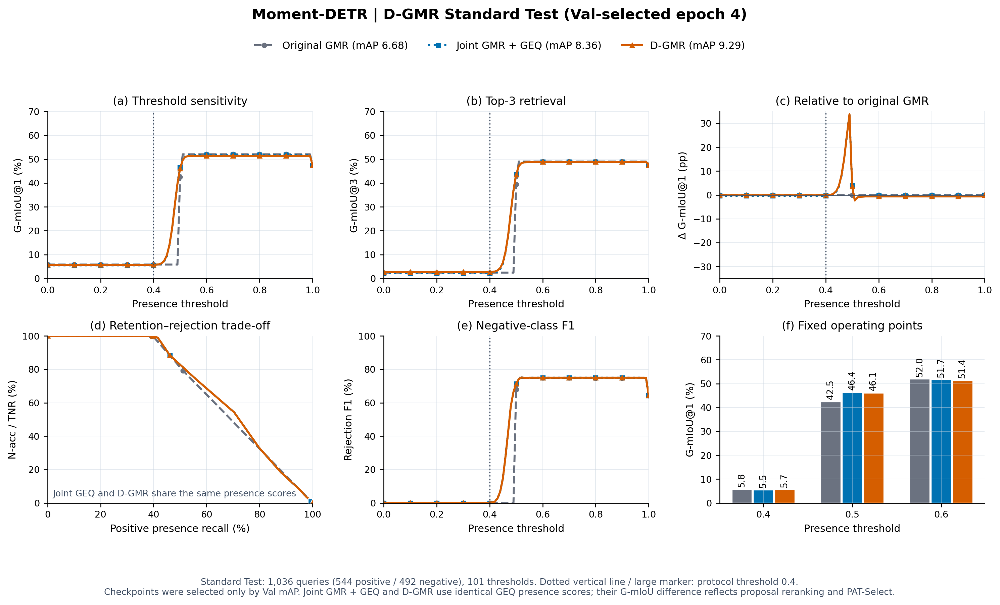
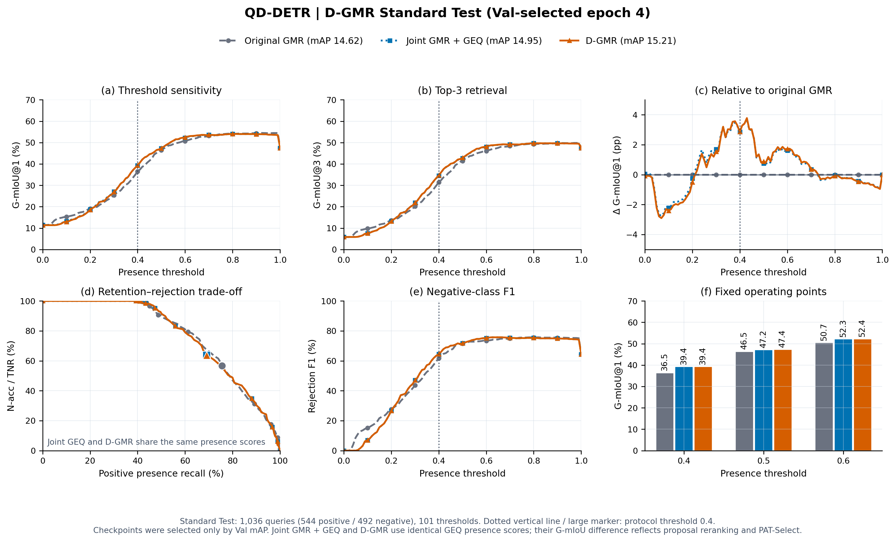
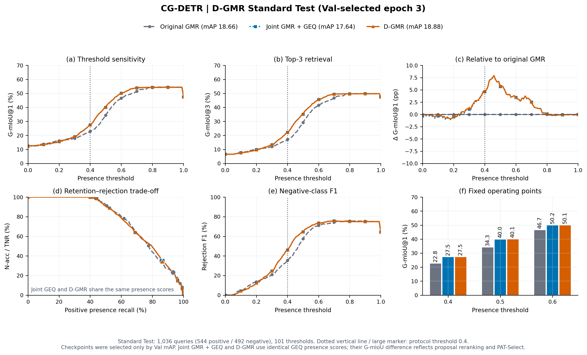
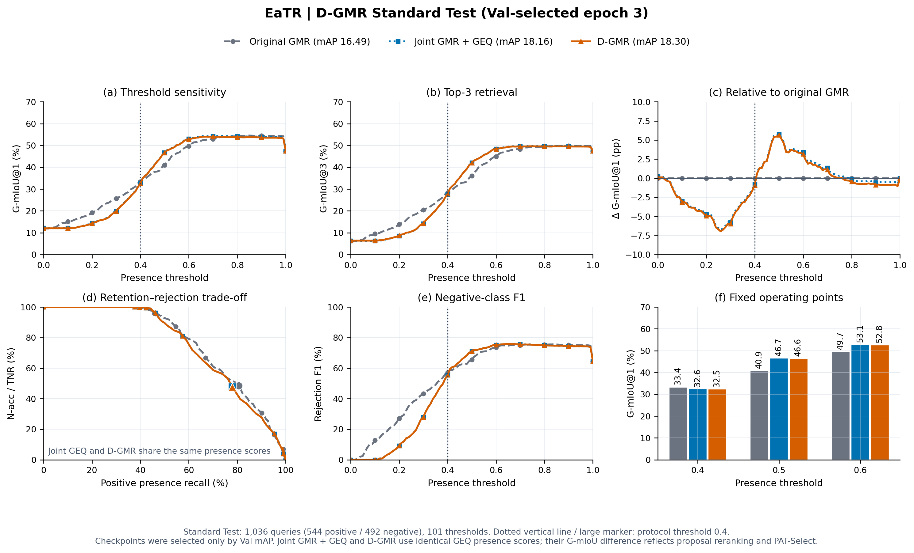
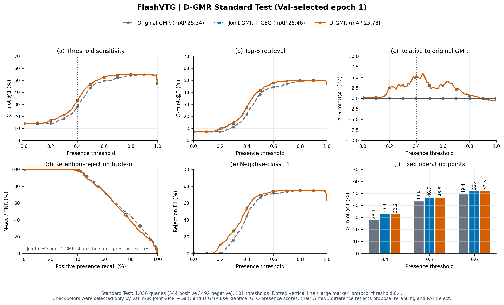

# D-GMR：训练、测试与结果复现

D-GMR 在原生 GMR 上联合训练 GEQ、TEM 与 TECR，使用簇内冗余排序和跨实例正例对背景排序，导出时执行 PAT-Select 高斯重叠分数衰减。五个 Backbone 均严格加载原生 GMR 权重，新增模块使用 seed 2026 随机初始化，训练4轮；原生 GMR、GEQ、TEM/TECR 的学习率分别为 `1e-5`、`3e-5`、`1e-4`。

训练目标为 `native + presence + quality + intra_ranking + 0.5 inter_ranking + 0.5 set + 0.5 evidence`。配置见 [d_gmr.json](code/d_gmr/configs/d_gmr.json)。模型、损失和导出筛选代码分别位于 [model.py](code/d_gmr/model.py)、[losses.py](code/d_gmr/losses.py)、[adapters.py](code/d_gmr/adapters.py)。

## 结果

Standard Test 共1,036条查询（544正、492负）。正查询定位不使用存在性硬门控；拒识与 G-mIoU 使用阈值0.4。指标为百分数，差值为百分点；checkpoint按 Val mAP、Val mR@1、较早epoch依次选出。

| Backbone | Val选中epoch | 原始GMR mAP | D-GMR mAP | ΔmAP | mR@5 | mR+@5 | G-mIoU@1 |
|---|---:|---:|---:|---:|---:|---:|---:|
| Moment-DETR | 4 | 6.68 | 9.29 | +2.61 | 15.40 | 1.42 | 5.71 |
| QD-DETR | 4 | 14.62 | 15.21 | +0.59 | 21.59 | 6.40 | 39.37 |
| CG-DETR | 3 | 18.66 | 18.88 | +0.22 | 26.62 | 14.41 | 27.54 |
| EaTR | 3 | 16.49 | 18.30 | +1.81 | 26.39 | 10.64 | 32.49 |
| FlashVTG | 1 | 25.34 | 25.73 | +0.39 | 35.51 | 20.03 | 33.22 |

[完整九项指标](reports/RESULTS.md) · [全部epoch Val/Test CSV](results/all_metrics.csv) · [复算指标CSV](reports/reproduced_metrics.csv) · [输入清单](MANIFEST.json)

## 复现

从仓库根目录执行：

```bash
pip install -r experiments/d_gmr_20261027/requirements-cpu.txt
```

```bash
# CPU：复算 Val/Test 指标、结果表及五个 Backbone 的 PNG/PDF/SVG 图
python experiments/d_gmr_20261027/reproduce.py

# 训练所需资产路径
export GMR_ASSETS_DIR=/absolute/path/to/Soccergmr
export GMR_PRETRAINED_ROOT=/absolute/path/to/backbonefolder
export DGMR_FLASHVTG_CHECKPOINT=/absolute/path/to/flashvtg_gmr_snapshot.pth

# 五个 Backbone：训练4轮、Val选模、正式Test；输出目录须为新的绝对路径
bash experiments/d_gmr_20261027/train_all.sh /absolute/path/to/new_d_gmr_run cuda:0
```

重新训练需先安装 [训练依赖](requirements-training.txt)，并准备原始特征及GMR权重；原运行环境见 [ENVIRONMENT.json](ENVIRONMENT.json)。发布目录保留标签、冻结预测、配置和指标，二进制权重保留在本地。

单个 Backbone 的入口：

```bash
python experiments/d_gmr_20261027/run.py train --backbone qd_detr --device cuda:0
python experiments/d_gmr_20261027/run.py test --backbone qd_detr \
  --checkpoint /absolute/path/to/epoch_004.pth --split test --threshold 0.4
```

## 五个 Backbone 的 Test 阈值扫描

每图包含 G-mIoU@1、G-mIoU@3、相对原始GMR差值、正例召回与负例拒识率、拒识F1、0.4/0.5/0.6固定点。对比原始GMR、联合GMR＋GEQ和最终D-GMR，扫描101个阈值。后两者使用相同的GEQ存在性分数。

### Moment-DETR



[PDF](figures/moment_detr_d_gmr_test_threshold_sweep.pdf) · [SVG](figures/moment_detr_d_gmr_test_threshold_sweep.svg)

### QD-DETR



[PDF](figures/qd_detr_d_gmr_test_threshold_sweep.pdf) · [SVG](figures/qd_detr_d_gmr_test_threshold_sweep.svg)

### CG-DETR



[PDF](figures/cg_detr_d_gmr_test_threshold_sweep.pdf) · [SVG](figures/cg_detr_d_gmr_test_threshold_sweep.svg)

### EaTR



[PDF](figures/eatr_d_gmr_test_threshold_sweep.pdf) · [SVG](figures/eatr_d_gmr_test_threshold_sweep.svg)

### FlashVTG



[PDF](figures/flashvtg_d_gmr_test_threshold_sweep.pdf) · [SVG](figures/flashvtg_d_gmr_test_threshold_sweep.svg)
