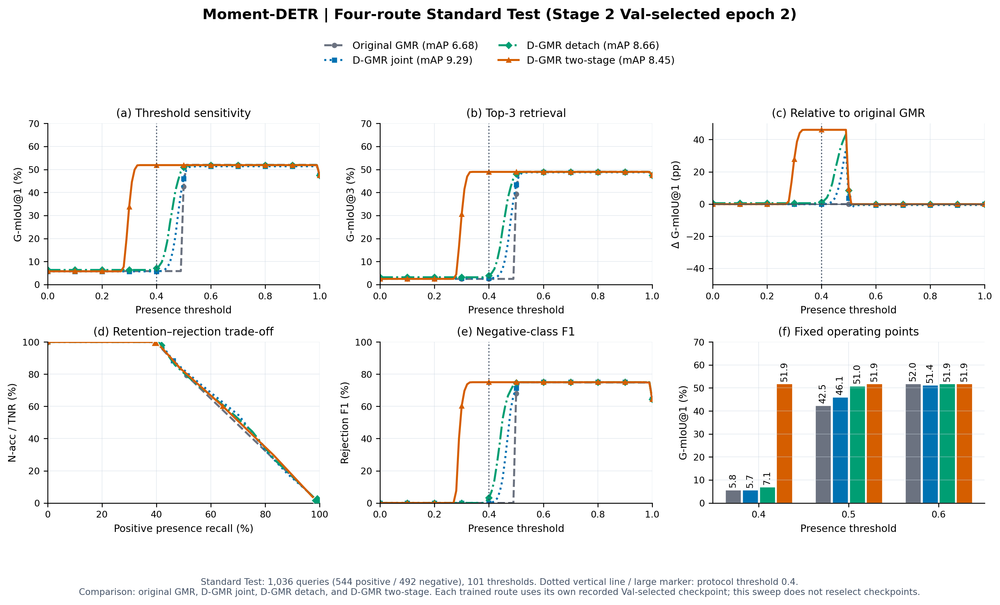
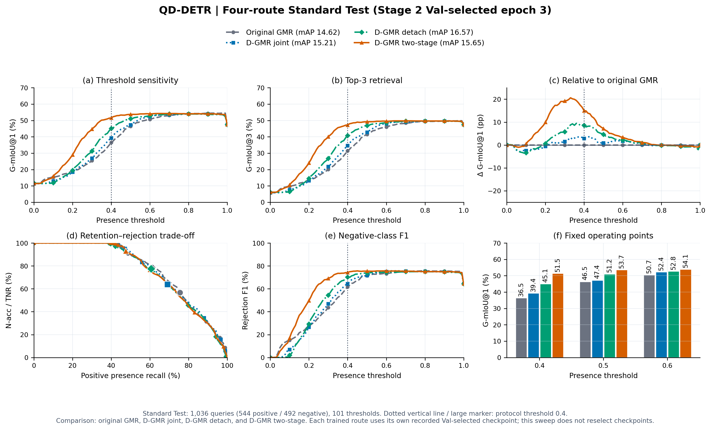
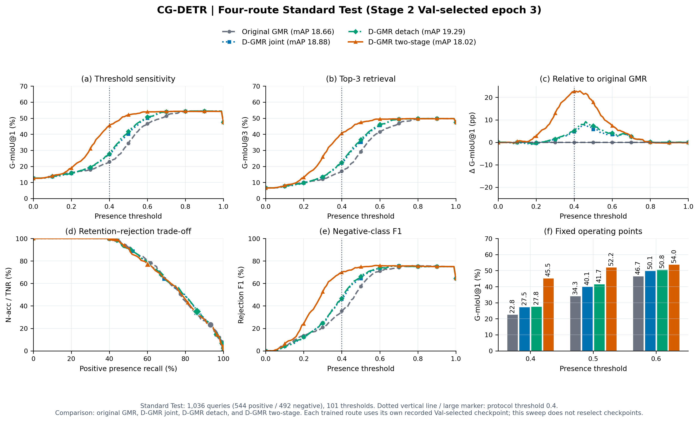
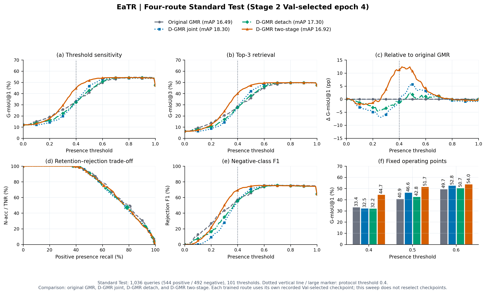
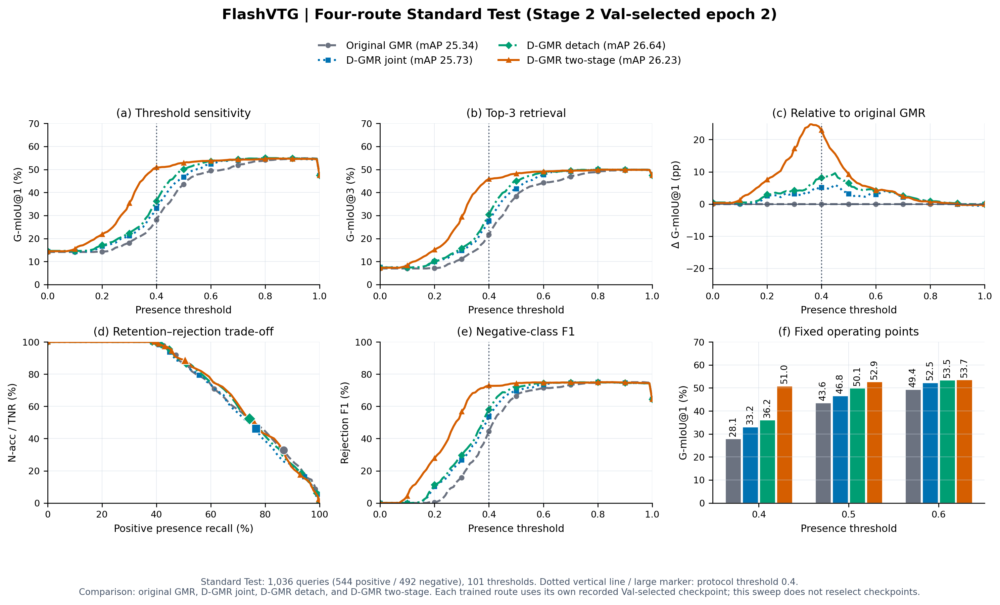

# D-GMR 两阶段：代码、训练测试与结果复现

Stage 1 复用 GMR＋GEQ（E1）固定第4轮的 GEQ 权重。Stage 2 从原始预训练 GMR 初始化主干，加载并冻结 GEQ，随机初始化 TEM/TECR，训练4轮；主干和 TEM/TECR 学习率分别为 `1e-5`、`1e-4`，GEQ不进入优化器，额外存在性BCE权重为0，TEM输入使用 `event.detach()`。冻结的是GEQ参数，读取的主干特征仍会随训练更新。

seed=2026；Stage 2 保持 `max(Val mAP, Val mR@1, -epoch)` 选模。Standard Test 共1,036条查询（544正、492负），存在性阈值0.4，正查询定位不加存在性硬门控。指标为百分数，差值为相对原始GMR的百分点。

## 正式Test结果

| Backbone | Epoch | mAP | ΔmAP | G-mIoU@1 | ΔG-mIoU@1 | N-acc | AUROC | Rej-F1 | mR@1 | mR@5 |
|---|---:|---:|---:|---:|---:|---:|---:|---:|---:|---:|
| Moment-DETR | 2 | 8.45 | +1.77 | 51.91 | +46.08 | 100.00 | 70.24 | 75.00 | 4.49 | 12.92 |
| QD-DETR | 3 | 15.65 | +1.03 | 51.50 | +14.99 | 93.09 | 75.90 | 74.17 | 9.81 | 22.69 |
| CG-DETR | 3 | 18.02 | -0.64 | 45.45 | +22.61 | 77.44 | 76.05 | 69.91 | 11.60 | 25.14 |
| EaTR | 4 | 16.92 | +0.43 | 44.70 | +11.29 | 75.81 | 75.46 | 69.27 | 10.27 | 24.13 |
| FlashVTG | 2 | 26.23 | +0.89 | 50.99 | +22.94 | 88.82 | 74.72 | 72.95 | 16.09 | 36.60 |

[完整指标](reports/RESULTS.md) · [四路线对照](reports/COMPARISON.md) · [四路线CSV](reports/four_route_comparison.csv) · [逐轮指标](reports/all_epoch_metrics.csv) · [配置](code/d_gmr/configs/d_gmr_two_stage.json)

## 四路线对照

每格依次为 **mAP / G-mIoU@1 / N-acc**。各路线保留各自的选模结果，CG-DETR相对原始GMR的mAP下降0.64个百分点。

| Backbone | 原始GMR | D-GMR联合训练 | D-GMR detach | D-GMR两阶段 |
|---|---:|---:|---:|---:|
| Moment-DETR | 6.68 / 5.83 / 0.00 | 9.29 / 5.71 / 0.00 | 8.66 / 7.06 / 1.63 | 8.45 / 51.91 / 100.00 |
| QD-DETR | 14.62 / 36.51 / 56.71 | 15.21 / 39.37 / 63.82 | 16.57 / 45.11 / 77.64 | 15.65 / 51.50 / 93.09 |
| CG-DETR | 18.66 / 22.84 / 23.17 | 18.88 / 27.54 / 34.55 | 19.29 / 27.85 / 35.16 | 18.02 / 45.45 / 77.44 |
| EaTR | 16.49 / 33.41 / 48.58 | 18.30 / 32.49 / 47.76 | 17.30 / 32.23 / 47.36 | 16.92 / 44.70 / 75.81 |
| FlashVTG | 25.34 / 28.05 / 32.72 | 25.73 / 33.22 / 46.14 | 26.64 / 36.23 / 52.44 | 26.23 / 50.99 / 88.82 |

## 复现

从仓库根目录执行：

```bash
# CPU：复算指标、结果表和五个骨干的四路线阈值扫描图
pip install -r experiments/d_gmr_two_stage_20261027/requirements-cpu.txt
python experiments/d_gmr_two_stage_20261027/reproduce.py

# 训练依赖与资产
pip install -r experiments/d_gmr_two_stage_20261027/requirements-training.txt
export GMR_ASSETS_DIR=/absolute/path/to/Soccergmr
export GMR_PRETRAINED_ROOT=/absolute/path/to/backbonefolder
export DGMR_FLASHVTG_CHECKPOINT=/absolute/path/to/flashvtg_gmr_snapshot.pth

# Stage 1：GMR＋GEQ（E1）固定训练4轮
bash experiments/d_gmr_two_stage_20261027/train_stage1.sh cuda:0

# Stage 2：冻结GEQ，训练4轮、Val选模并正式Test；输出目录必须为新的绝对路径
bash experiments/d_gmr_two_stage_20261027/train_stage2.sh /absolute/path/to/new_two_stage_run cuda:0
```

已有Stage 1检查点可直接设置 `DGMR_STAGE1_ROOT=/absolute/path/to/E1/runs`，跳过Stage 1重训；该目录须包含 `<backbone>/E1/epoch_004.ckpt`。

[Stage 1训练入口](stage1/run.py) · [Stage 2训练入口](code/d_gmr/engine/train.py) · [测试入口](code/d_gmr/scripts/evaluate_checkpoint.py) · [模型](code/d_gmr/model.py) · [损失](code/d_gmr/losses.py) · [资产及运行环境](ENVIRONMENT.json)

发布目录保留代码、标签、配置、预测、指标与图表；二进制权重保留本地。

## 五个骨干的四路线阈值扫描

每图比较原始GMR、D-GMR联合训练、detach和两阶段版本，使用101个阈值及六面板布局。竖直点线和大标记表示固定阈值0.4，图例mAP不加存在性门控；冻结预测扫描不重新选择检查点或工作阈值。

### Moment-DETR



[PDF](figures/moment_detr_d_gmr_two_stage_test_threshold_sweep.pdf) · [SVG](figures/moment_detr_d_gmr_two_stage_test_threshold_sweep.svg)

### QD-DETR



[PDF](figures/qd_detr_d_gmr_two_stage_test_threshold_sweep.pdf) · [SVG](figures/qd_detr_d_gmr_two_stage_test_threshold_sweep.svg)

### CG-DETR



[PDF](figures/cg_detr_d_gmr_two_stage_test_threshold_sweep.pdf) · [SVG](figures/cg_detr_d_gmr_two_stage_test_threshold_sweep.svg)

### EaTR



[PDF](figures/eatr_d_gmr_two_stage_test_threshold_sweep.pdf) · [SVG](figures/eatr_d_gmr_two_stage_test_threshold_sweep.svg)

### FlashVTG



[PDF](figures/flashvtg_d_gmr_two_stage_test_threshold_sweep.pdf) · [SVG](figures/flashvtg_d_gmr_two_stage_test_threshold_sweep.svg)
