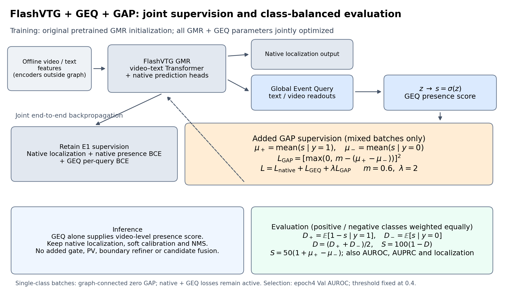
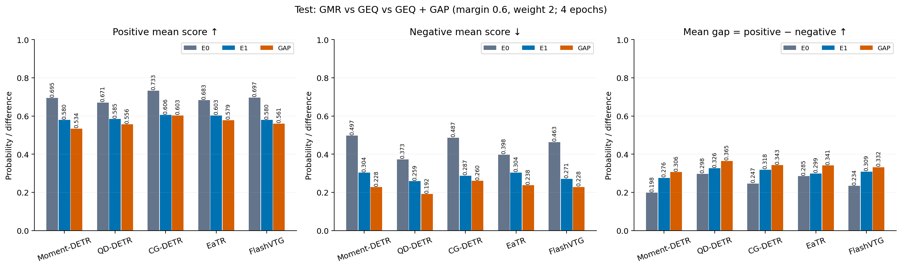
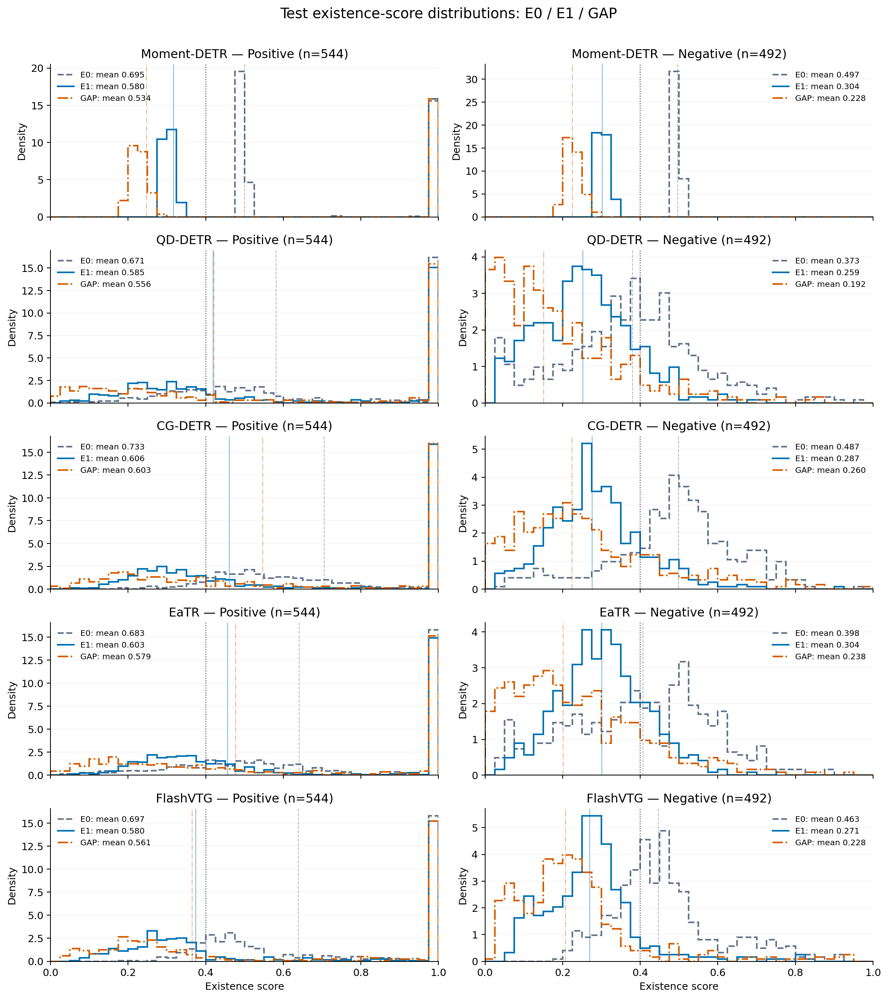

# GAP：正负均分间隔监督与五 Backbone 实验

本节汇总 2026-10-26 的 GAP 实验，与前文历史 S4 / LoRA / Boundary Refiner 实验分别报告。比较三种方法：原始 **GMR（E0）**、全量微调的 **GMR＋GEQ（E1）**，以及增加均分约束的 **GMR＋GEQ＋GAP**。

## 方法与评估

从对应 backbone 的原始预训练 GMR checkpoint 独立初始化，接入随机初始化的 GEQ，保留原生定位、候选分类和原生存在性 BCE，并联合优化 GMR 与 GEQ。对含正负查询的 batch，使用 GEQ 概率 `s = sigmoid(z)` 计算正均分 `μ₊` 和负均分 `μ₋`，加入平方 hinge 损失 `L_GAP = max(0, m − (μ₊ − μ₋))²`，总损失为 `L_native + L_GEQ + λ·L_GAP`。单类 batch 的新增项为可反传的零。推理只使用 GEQ 作为最终视频级存在性预测器，保留各 backbone 原生定位与后处理。全 split 分别计算正负均分，以 `mean_gap = μ₊ − μ₋` 衡量均分分离；同时报告类别等权端点误差 `D = [mean(1−s | positive) + mean(s | negative)]/2` 及 `S = 100(1−D) = 50(1+mean_gap)`，并结合 AUROC、AUPRC、正负召回和定位指标评估。**S 与均分差距是同一信息的不同刻度，不能代替排序、完整分布重叠或概率校准评价。**



[方法图 PDF](ablations/geq_gap_publication_20261026/figures/gap_supervision_and_evaluation.pdf) · [可编辑 SVG](ablations/geq_gap_publication_20261026/figures/gap_supervision_and_evaluation.svg)

## 固定迁移协议

FlashVTG 上搜索 margin∈{0.4,0.6}、λ∈{0.5,1,2}，并纳入已有 GAP（0.5,1）作为参考，按第4轮 **Val AUROC** 选择 **m=0.6、λ=2**。随后将此配置固定迁移至 Moment-DETR、QD-DETR、CG-DETR、EaTR，未重新搜索；FlashVTG复用已完成结果。各组与对应 E1 的原始 GMR 初始化、GEQ 初始张量和数据顺序一致，不从 E1 微调后的 checkpoint 续训。

统一 seed=2026、4 epochs、AdamW、GMR lr=1e-5、GEQ lr=3e-5、weight decay=1e-4、gradient clipping=0.1、constant scheduler；采用各 backbone 的原生 batch size。Train/Val/Test=4,138/465/1,036。外部 CLIP/SlowFast/文本特征离线预提取，编码器不在当前计算图中。无 PV、LoRA、边界 refiner、额外存在性融合或合成数据；不根据 Test 更换配置、epoch或阈值。

## Test 正负均分与差距

Test 共 **1,036 条查询（544正、492负）**。均分由全部原始存在性概率按类别分别计算，不按阈值筛选样本；均分差距越大，表示两类平均分分离越明显。

| Backbone | 方法 | 正样本均分 μ₊ | 负样本均分 μ₋ | 均分差距 ↑ |
|---|---|---:|---:|---:|
| Moment-DETR | GMR | 0.6945 | 0.4969 | 0.1976 |
| Moment-DETR | GMR＋GEQ | 0.5797 | 0.3035 | 0.2762 |
| Moment-DETR | GMR＋GEQ＋GAP | 0.5339 | 0.2277 | 0.3062 |
| QD-DETR | GMR | 0.6710 | 0.3734 | 0.2976 |
| QD-DETR | GMR＋GEQ | 0.5845 | 0.2586 | 0.3259 |
| QD-DETR | GMR＋GEQ＋GAP | 0.5565 | 0.1917 | 0.3648 |
| CG-DETR | GMR | 0.7333 | 0.4865 | 0.2468 |
| CG-DETR | GMR＋GEQ | 0.6057 | 0.2873 | 0.3185 |
| CG-DETR | GMR＋GEQ＋GAP | 0.6032 | 0.2602 | 0.3429 |
| EaTR | GMR | 0.6828 | 0.3976 | 0.2852 |
| EaTR | GMR＋GEQ | 0.6031 | 0.3039 | 0.2993 |
| EaTR | GMR＋GEQ＋GAP | 0.5785 | 0.2375 | 0.3410 |
| FlashVTG | GMR | 0.6972 | 0.4632 | 0.2340 |
| FlashVTG | GMR＋GEQ | 0.5796 | 0.2707 | 0.3088 |
| FlashVTG | GMR＋GEQ＋GAP | 0.5605 | 0.2282 | 0.3323 |



[均分对比图 PDF](ablations/geq_gap_all_backbones_20261026/figures/test_mean_gap_comparison.pdf) · [SVG](ablations/geq_gap_all_backbones_20261026/figures/test_mean_gap_comparison.svg) · [Val/Test 精确均分 CSV](ablations/geq_gap_all_backbones_20261026/reports/existence_score_means.csv)

## 正负存在性分数分布

每行一个 backbone，左列为正查询，右列为负查询；三种方法同图对比。40个等宽区间，分别按类别归一化为密度；彩色竖线为中位数，灰色点线为固定分类阈值0.4。**此图使用 Standard Test 1,036条，与历史 Full BN45 图的数据范围不同。**



[分布图 PDF](ablations/geq_gap_all_backbones_20261026/figures/test_existence_score_distributions.pdf) · [SVG](ablations/geq_gap_all_backbones_20261026/figures/test_existence_score_distributions.svg) · [性能对比图 PDF](ablations/geq_gap_all_backbones_20261026/figures/test_performance_comparison.pdf)

## 结果与解释边界

GAP 相对仅加 GEQ，在五个 backbone 上都扩大了均分差距，增量约 **0.0235–0.0417**；五组正均分均有所下降，但负均分下降更多。因此，这支持“改善均分分离”，不能解释为同时提高正分、降低负分。新增四个 backbone 的 AUROC 相对 E1 均略降，定位收益也不一致：Moment-DETR/QD-DETR 的 mAP 小幅提高，CG-DETR/EaTR/FlashVTG 的 mAP 下降，mR+@5 仅 FlashVTG 提高。**当前结果不支持 GAP 稳定改善全局排序或多时刻定位。**

本实验为单 seed、固定预算的探索性验证，不报告统计显著性或跨 seed 稳定性。G-mIoU 受存在性拒识影响，不等同于纯定位精度；mR+@5 不等同于正查询存在性召回。四个新训练的 preflight、官方 Val/Test 和独立复算均通过。Checkpoint 按用户要求保留本地，不上传二进制权重。

## 完整结果与复现

- [五 Backbone 完整报告（含 AUROC、AUPRC、定位指标和相对 E1 变化）](ablations/geq_gap_all_backbones_20261026/reports/RESULTS.md)
- [完整 Val/Test 与固定0.4/0.5/0.6指标 CSV](ablations/geq_gap_all_backbones_20261026/reports/all_metrics.csv)
- [核验记录](ablations/geq_gap_all_backbones_20261026/reports/AUDIT.json)
- [FlashVTG 方法报告、六组参数搜索及三方法阈值扫描图](ablations/geq_gap_publication_20261026/README.md)
- [训练配置与入口](ablations/geq_gap_all_backbones_20261026/README.md)

从已保存的真实分数与 GT 重画全部五 Backbone 图表，无需 GPU、checkpoint或特征：

```bash
python ablations/geq_gap_all_backbones_20261026/reproduce_figures.py
```
