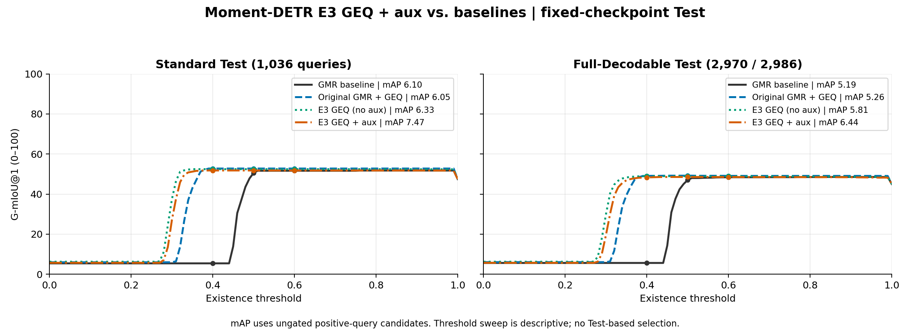

# E3 GEQ＋aux 与 baseline 固定 Test 对比

“baseline”同时提供三个明确口径：原始 GMR baseline、原始 GMR→GEQ 控制，以及 E3 同一 GMR 起点的无辅助损失 GEQ。E3 GEQ＋aux 从已完成的 E3 GMR best 开始，继承并更新辅助头，新增 0.1 × (Balanced BCE + 0.2 × Dice) 辅助监督。

| Split | Method | mAP | G1@0.4 | G1@0.5 | G1@0.6 | G1 三点均值 |
|---|---|---:|---:|---:|---:|---:|
| test_standard | GMR baseline | 6.10 | 5.43 | 50.57 | 51.67 | 35.89 |
| test_standard | Original GMR + GEQ | 6.05 | 52.77 | 52.77 | 52.77 | 52.77 |
| test_standard | E3 GEQ (no aux) | 6.33 | 52.45 | 52.45 | 52.45 | 52.45 |
| test_standard | E3 GEQ + aux | 7.47 | 51.80 | 51.80 | 51.80 | 51.80 |
| test_full | GMR baseline | 5.19 | 5.63 | 47.03 | 48.42 | 33.69 |
| test_full | Original GMR + GEQ | 5.26 | 49.06 | 49.20 | 49.10 | 49.12 |
| test_full | E3 GEQ (no aux) | 5.81 | 48.97 | 48.94 | 48.93 | 48.95 |
| test_full | E3 GEQ + aux | 6.44 | 48.29 | 48.55 | 48.54 | 48.46 |

曲线覆盖0到1、步长0.01，共101个点；保留规则是分数严格大于阈值。mAP 不经存在性门控，因此不随该阈值改变。0.4/0.5/0.6 是预先固定的三点报告，不使用 Test 调整模型或阈值。每种方法在两个 Test 使用同一个已由 Val 选定的 checkpoint。

GMR baseline 与 E3 的 GMR 训练方式不同；E3 no-aux 与 E3 aux 共用完全相同的 GMR 初始化，因而是更直接的微调目标对照。单 seed=2023，实际早停时长不同。Standard 与 Full Test 存在重叠；Full 仅覆盖既有可解码子集2970/2986。

[指标CSV](METRICS.csv) · [全部101点曲线CSV](CURVES.csv) · [PDF](G1_THRESHOLDS.pdf) · [SVG](G1_THRESHOLDS.svg) · [重算及哈希审计](AUDIT.json)
