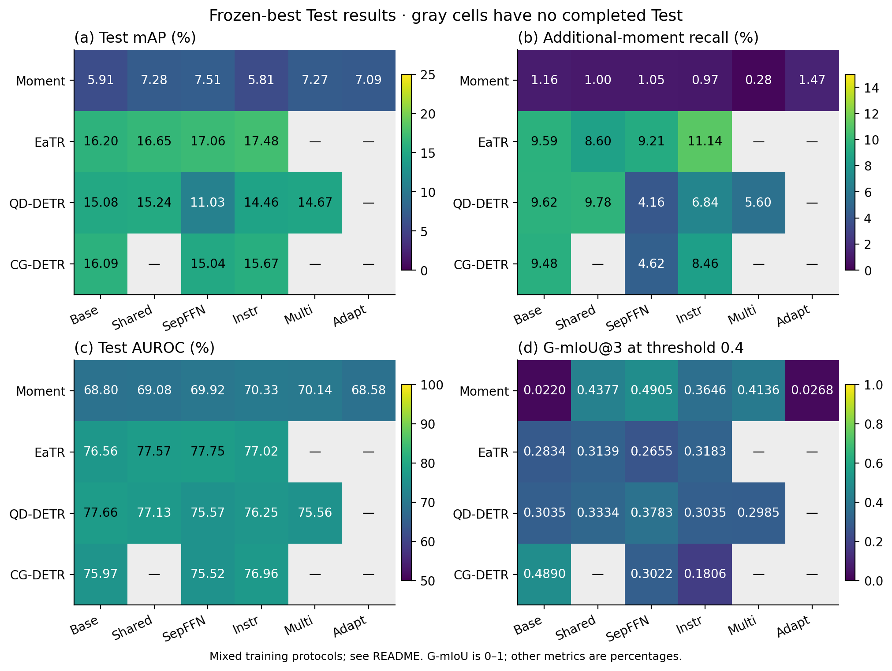
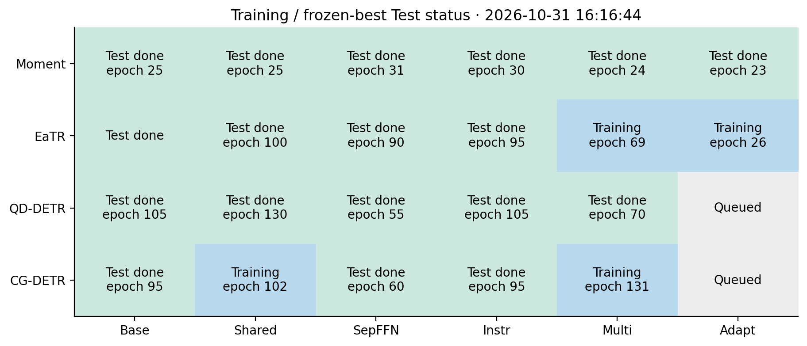

# GMR × Mr. DETR：四骨干完整实验结果

更新时间：**2026-10-31T16:16:44+08:00**。本页是冻结最佳检查点 Test 结果与训练状态的统一快照。

共 **24 组**：**18 组完成 Test**、4 组训练中、2 组排队、0 组待完成 Test、0 组失败。

Test 指标均来自 SoccerGMR Standard Test；mAP、mR、mR+、AUROC、Rej-F1 沿用官方百分数，**G-mIoU@3 转换为 0–1**。Rej-F1 与表中 G-mIoU 固定使用存在性阈值 **0.4**。未完成 Test 的指标留空，验证集结果只列在后面的训练状态表。

[全部 24 行 CSV](results.csv) · [机器可读快照与来源哈希](snapshot.json)

## 完整 Test 表

| Backbone | 方法 | 状态 | Best Epoch | mAP | mR@1 | mR@5 | mR+@5 | AUROC | Rej-F1@0.4 | G-mIoU@3 |
|---|---|---|---:|---:|---:|---:|---:|---:|---:|---:|
| Moment-DETR-GMR | baseline | 已完成 Test | 5 | 5.91 | 3.68 | 7.98 | 1.16 | 68.80 | 0.00 | 0.0220 |
| Moment-DETR-GMR | shared | 已完成 Test | 5 | 7.28 | 2.95 | 12.75 | 1.00 | 69.08 | 72.14 | 0.4377 |
| Moment-DETR-GMR | sepffn | 已完成 Test | 20 | 7.51 | 4.76 | 10.20 | 1.05 | 69.92 | 75.00 | 0.4905 |
| Moment-DETR-GMR | instruction | 已完成 Test | 30 | 5.81 | 3.85 | 8.21 | 0.97 | 70.33 | 65.93 | 0.3646 |
| Moment-DETR-GMR | multi | 已完成 Test | 15 | 7.27 | 4.71 | 10.04 | 0.28 | 70.14 | 69.60 | 0.4136 |
| Moment-DETR-GMR | adaptive | 已完成 Test | 5 | 7.09 | 4.38 | 10.00 | 1.47 | 68.58 | 0.00 | 0.0268 |
| EaTR-GMR | baseline（历史复用） | 已完成 Test | — | 16.20 | 10.64 | 21.38 | 9.59 | 76.56 | 57.11 | 0.2834 |
| EaTR-GMR | shared | 已完成 Test | 80 | 16.65 | 11.20 | 23.55 | 8.60 | 77.57 | 61.23 | 0.3139 |
| EaTR-GMR | sepffn | 已完成 Test | 70 | 17.06 | 11.32 | 22.59 | 9.21 | 77.75 | 54.93 | 0.2655 |
| EaTR-GMR | instruction | 已完成 Test | 75 | 17.48 | 11.52 | 23.82 | 11.14 | 77.02 | 61.39 | 0.3183 |
| EaTR-GMR | multi | 训练中 | 65 | — | — | — | — | — | — | — |
| EaTR-GMR | adaptive | 训练中 | 25 | — | — | — | — | — | — | — |
| QD-DETR-GMR | baseline | 已完成 Test | 85 | 15.08 | 10.04 | 20.11 | 9.62 | 77.66 | 59.84 | 0.3035 |
| QD-DETR-GMR | shared | 已完成 Test | 110 | 15.24 | 10.64 | 20.00 | 9.78 | 77.13 | 63.37 | 0.3334 |
| QD-DETR-GMR | sepffn | 已完成 Test | 35 | 11.03 | 7.34 | 15.36 | 4.16 | 75.57 | 68.25 | 0.3783 |
| QD-DETR-GMR | instruction | 已完成 Test | 85 | 14.46 | 9.99 | 19.26 | 6.84 | 76.25 | 60.18 | 0.3035 |
| QD-DETR-GMR | multi | 已完成 Test | 50 | 14.67 | 9.95 | 19.50 | 5.60 | 75.56 | 58.37 | 0.2985 |
| QD-DETR-GMR | adaptive | 排队 | — | — | — | — | — | — | — | — |
| CG-DETR-GMR | baseline | 已完成 Test | 75 | 16.09 | 10.76 | 22.12 | 9.48 | 75.97 | 75.68 | 0.4890 |
| CG-DETR-GMR | shared | 训练中 | 100 | — | — | — | — | — | — | — |
| CG-DETR-GMR | sepffn | 已完成 Test | 40 | 15.04 | 10.65 | 20.22 | 4.62 | 75.52 | 59.37 | 0.3022 |
| CG-DETR-GMR | instruction | 已完成 Test | 75 | 15.67 | 10.72 | 21.34 | 8.46 | 76.96 | 38.60 | 0.1806 |
| CG-DETR-GMR | multi | 训练中 | 120 | — | — | — | — | — | — | — |
| CG-DETR-GMR | adaptive | 排队 | — | — | — | — | — | — | — | — |

## 综合图



各路线的收益随骨干和指标变化；灰色单元格表示尚无完成的 Test。每格标注精确数值，AUROC 色阶为 50–100，其余色阶从 0 起；这些图不按 Test 重新选择检查点或阈值。

[PDF](cross_backbone_overview/all_backbones_metrics.pdf) · [SVG](cross_backbone_overview/all_backbones_metrics.svg)



[状态图 PDF](cross_backbone_overview/training_status.pdf) · [状态图 SVG](cross_backbone_overview/training_status.svg)

## 训练状态快照

以下为尚未完成 Test 的任务；Val mAP 与上表 Test mAP 属于不同 split。Epoch 是最后完整写入记录的轮次。

| Backbone | 方法 | 状态 | GPU | 已完成 Epoch | Best Epoch | Best Val mAP |
|---|---|---|---|---:|---:|---:|
| EaTR-GMR | multi | 训练中 | 0 | 69 | 65 | 21.41 |
| EaTR-GMR | adaptive | 训练中 | 1 | 26 | 25 | 11.59 |
| QD-DETR-GMR | adaptive | 排队 | — | — | — | — |
| CG-DETR-GMR | shared | 训练中 | 1 | 102 | 100 | 19.65 |
| CG-DETR-GMR | multi | 训练中 | 0 | 131 | 120 | 20.64 |
| CG-DETR-GMR | adaptive | 排队 | — | — | — | — |

## 每个 Backbone 的图表

下列曲线同时覆盖 0.00–1.00 的 101 个阈值与 0–1 的 G-mIoU 纵轴。阈值扫描是冻结预测的敏感性分析，不用于 Test 调参。

| Backbone | 指标图 | 全域 G-mIoU 曲线 | 数据 |
|---|---|---|---|
| Moment-DETR-GMR | [PNG](moment_detr_gmr/test_summary.png) / [PDF](moment_detr_gmr/test_summary.pdf) / [SVG](moment_detr_gmr/test_summary.svg) | [PNG](moment_detr_gmr/gmiou_sensitivity.png) / [PDF](moment_detr_gmr/gmiou_sensitivity.pdf) / [SVG](moment_detr_gmr/gmiou_sensitivity.svg) | [CSV](moment_detr_gmr/figure_data.csv) / [阈值扫描](moment_detr_gmr/gmiou_threshold_sweep.csv) |
| EaTR-GMR | [PNG](eatr_gmr/test_summary.png) / [PDF](eatr_gmr/test_summary.pdf) / [SVG](eatr_gmr/test_summary.svg) | [PNG](eatr_gmr/gmiou_sensitivity.png) / [PDF](eatr_gmr/gmiou_sensitivity.pdf) / [SVG](eatr_gmr/gmiou_sensitivity.svg) | [CSV](eatr_gmr/figure_data.csv) / [阈值扫描](eatr_gmr/gmiou_threshold_sweep.csv) |
| QD-DETR-GMR | [PNG](qd_detr_gmr/test_summary.png) / [PDF](qd_detr_gmr/test_summary.pdf) / [SVG](qd_detr_gmr/test_summary.svg) | [PNG](qd_detr_gmr/gmiou_sensitivity.png) / [PDF](qd_detr_gmr/gmiou_sensitivity.pdf) / [SVG](qd_detr_gmr/gmiou_sensitivity.svg) | [CSV](qd_detr_gmr/figure_data.csv) / [阈值扫描](qd_detr_gmr/gmiou_threshold_sweep.csv) |
| CG-DETR-GMR | [PNG](cg_detr_gmr/test_summary.png) / [PDF](cg_detr_gmr/test_summary.pdf) / [SVG](cg_detr_gmr/test_summary.svg) | [PNG](cg_detr_gmr/gmiou_sensitivity.png) / [PDF](cg_detr_gmr/gmiou_sensitivity.pdf) / [SVG](cg_detr_gmr/gmiou_sensitivity.svg) | [CSV](cg_detr_gmr/figure_data.csv) / [阈值扫描](cg_detr_gmr/gmiou_threshold_sweep.csv) |

## 训练协议与可比性

| Backbone / 配置 | Seed | Microbatch × 累积 | 学习率 |
|---|---:|---:|---:|
| Moment-DETR-GMR / baseline | 2023 | 2 × 4 | 5e-05 |
| Moment-DETR-GMR / shared | 2023 | 2 × 4 | 5e-05 |
| Moment-DETR-GMR / sepffn | 2023 | 2 × 4 | 5e-05 |
| Moment-DETR-GMR / instruction | 2023 | 2 × 4 | 5e-05 |
| Moment-DETR-GMR / multi | 2023 | 2 × 4 | 5e-05 |
| Moment-DETR-GMR / adaptive | 2023 | 2 × 4 | 5e-05 |
| EaTR-GMR / baseline | 2026 | 32 × 1 | 3e-05 |
| EaTR-GMR / shared | 2023 | 2 × 4 | 5e-05 |
| EaTR-GMR / sepffn | 2023 | 2 × 4 | 5e-05 |
| EaTR-GMR / instruction | 2023 | 2 × 4 | 5e-05 |
| EaTR-GMR / multi | 2023 | 2 × 4 | 5e-05 |
| EaTR-GMR / adaptive | 2023 | 2 × 4 | 5e-05 |
| QD-DETR-GMR / baseline | 2023 | 2 × 4 | 5e-05 |
| QD-DETR-GMR / shared | 2023 | 2 × 4 | 5e-05 |
| QD-DETR-GMR / sepffn | 2023 | 2 × 4 | 5e-05 |
| QD-DETR-GMR / instruction | 2023 | 32 × 1 | 5e-05 |
| QD-DETR-GMR / multi | 2023 | 32 × 1 | 5e-05 |
| QD-DETR-GMR / adaptive | 2023 | 32 × 1 | 5e-05 |
| CG-DETR-GMR / baseline | 2023 | 2 × 4 | 5e-05 |
| CG-DETR-GMR / shared | 2023 | 2 × 4 | 5e-05 |
| CG-DETR-GMR / sepffn | 2023 | 2 × 4 | 5e-05 |
| CG-DETR-GMR / instruction | 2023 | 32 × 1 | 5e-05 |
| CG-DETR-GMR / multi | 2023 | 32 × 1 | 5e-05 |
| CG-DETR-GMR / adaptive | 2023 | 32 × 1 | 5e-05 |

- 仅 EaTR baseline 复用历史 seed 2026、batch 32、LR 3e-5 的 GMR；当前 mAP 为 16.20。原 seed 2023、mAP 6.86 的运行已归档，不能与当前 baseline 混用。
- QD/CG 的 instruction、multi、adaptive 使用 batch 32、累积 1；其余新路线通常为 2×4。跨这些配置的差异同时包含结构与训练 Batch 的影响。
- Moment-DETR 六组此前按指令停止，最后完成轮次不同；已完成的是停止时的 best 检查点测试，不代表统一训练预算下的收敛比较。
- 新路线使用单 seed 2023；没有多 Seed 均值、标准差或统计显著性结论。
- 高 G-mIoU 可能受空集拒绝与阈值影响；多片段改善需要同时检查 mR+@5，不能只依据综合分数。

## 六种方法

| 方法 | 定义 |
|---|---|
| baseline | 原 GMR O2O 主路线，无 O2M 辅助路线 |
| shared | 一条固定 K=2 O2M 路线，Decoder 全共享 |
| sepffn | O2M 路线共享注意力，FFN 与 norm3 独立 |
| instruction | O2M 路线在 Self-Attention 中加入 4 个指令 Token |
| multi | Separate FFN 与 Instruction 双路线，各权重 0.15 |
| adaptive | 双路线；第二正样本要求 tIoU≥0.25 |

## 更新与复现

本报告读取现有指标、训练记录和 101 点阈值 CSV，不加载权重或重新执行 Test。服务器的 `refresh_all.sh` 在每次成功测试后刷新本报告与图；GitHub 展示本次提交时的快照，不会在后台自动推送。

GitHub 离线重绘（只需 NumPy、Matplotlib）：

```bash
python -m pip install numpy matplotlib
python shared/build_results_report.py --snapshot results/snapshot.json --output results
```

服务器统一刷新：

```bash
bash /home/guoxiangyu/ImprovingGeneralizedMomentRetrieval/newidea/figure/gmr_mr_detr_test_20261030/refresh_all.sh
```
