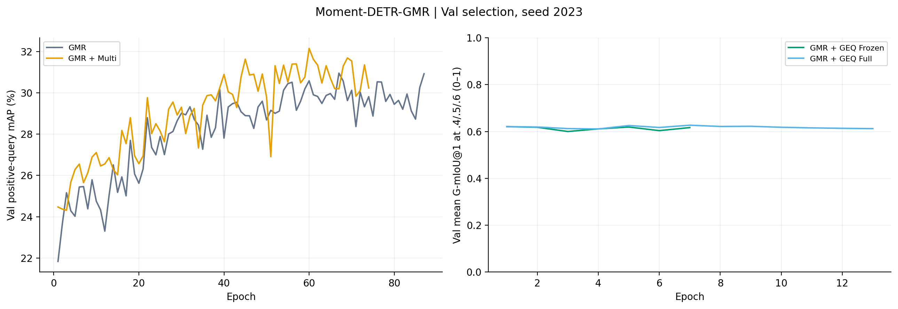
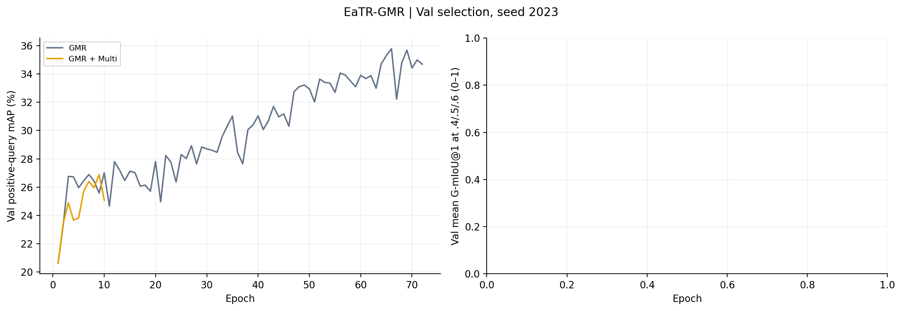
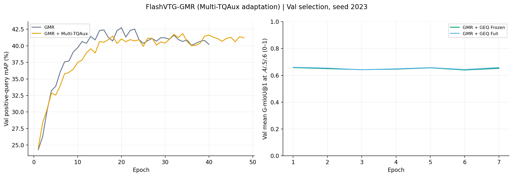

# Charades GMR + Multi + GEQ (seed 2023)

**Actual completion: 6/24 training tasks; 12/48 formal test evaluations.** This release remains incomplete until the full audit and remote verification pass.

Test-ID is the primary result. Test-OOD is supplementary and keeps all 7,440 rows, including 2,170 duplicate extra records. Tests never select checkpoints or thresholds. All local positive examples have one GT: mR+ and multi-GT coverage are N/A. Flash Multi uses the **Multi-TQAux structural adaptation**, not the same native query decoder as the other backbones.

[Reproduction instructions](../../shared/charades_multi_geq/README.md) · [Protocol](protocol.json) · [Completion audit](audit/completion_audit.json)

## Current Val-selected checkpoints

G-mIoU@1 is the mean at presence thresholds 0.4/0.5/0.6, on a 0–1 scale. mAP is ungated, positive-query localization mAP in percent. In-progress rows are provisional and are not final Test results.

| Backbone | Method | Status | Val mAP % | Val G-mIoU@1 mean |
|---|---|---|---:|---:|
| moment_detr | GMR | Val selection finished | 30.96 | 0.6042 |
| moment_detr | GMR + Multi | In progress | 32.16 | 0.6077 |
| moment_detr | GMR + GEQ Frozen | Val selection finished | 30.96 | 0.6206 |
| moment_detr | GMR + GEQ Full | Val selection finished | 30.42 | 0.6268 |
| moment_detr | GMR + Multi + GEQ Frozen | Pending | — | — |
| moment_detr | GMR + Multi + GEQ Full | Pending | — | — |
| eatr | GMR | In progress | 35.78 | 0.6364 |
| eatr | GMR + Multi | In progress | 26.88 | 0.4992 |
| eatr | GMR + GEQ Frozen | Pending | — | — |
| eatr | GMR + GEQ Full | Pending | — | — |
| eatr | GMR + Multi + GEQ Frozen | Pending | — | — |
| eatr | GMR + Multi + GEQ Full | Pending | — | — |
| qd_detr | GMR | Pending | — | — |
| qd_detr | GMR + Multi | Pending | — | — |
| qd_detr | GMR + GEQ Frozen | Pending | — | — |
| qd_detr | GMR + GEQ Full | Pending | — | — |
| qd_detr | GMR + Multi + GEQ Frozen | Pending | — | — |
| qd_detr | GMR + Multi + GEQ Full | Pending | — | — |
| flashvtg | GMR | Val selection finished | 42.73 | 0.6471 |
| flashvtg | GMR + Multi-TQAux | In progress | 41.85 | 0.6515 |
| flashvtg | GMR + GEQ Frozen | Val selection finished | 42.73 | 0.6577 |
| flashvtg | GMR + GEQ Full | Val selection finished | 42.31 | 0.6598 |
| flashvtg | GMR + Multi-TQAux + GEQ Frozen | Pending | — | — |
| flashvtg | GMR + Multi-TQAux + GEQ Full | Pending | — | — |

## moment_detr

[All figures, CSV files and offline snapshots](moment_detr/README.md)

## eatr

[All figures, CSV files and offline snapshots](eatr/README.md)

## qd_detr

[All figures, CSV files and offline snapshots](qd_detr/README.md)

## flashvtg

[All figures, CSV files and offline snapshots](flashvtg/README.md)

