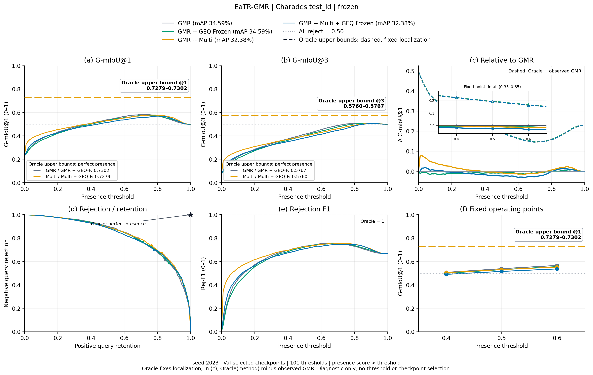
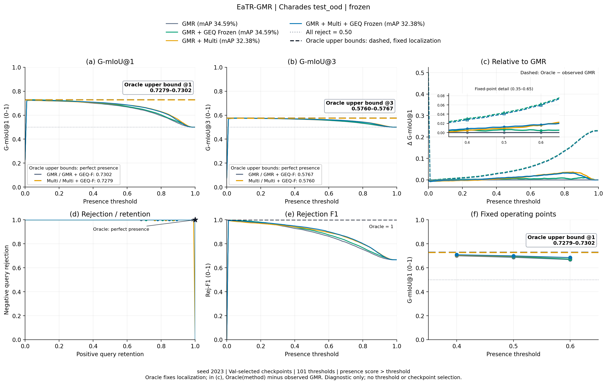
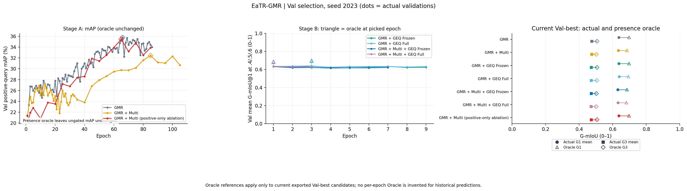

# EaTR-GMR

Status reflects files actually completed.

Dashed colored lines show each model's perfect-presence ceiling with its own localization candidates held fixed. Oracle G-mIoU@k = (negative rows + sum of positive-query set-IoU@k) / all rows. Here each Test split is balanced, so this equals 0.5 + 0.5 times positive-query mean set-IoU@k. It is generally below 1.0; G-mIoU@1 and @3 have separate ceilings under the evaluator's set-IoU definition. These are post-hoc label-based references, not scored threshold curves or model-selection criteria.

## test_id

5/6 methods evaluated. G-mIoU uses 0–1; mAP, mR, R@1 and AUROC use percent.

[Metrics CSV](test_id/summary.csv)

## test_ood

5/6 methods evaluated. G-mIoU uses 0–1; mAP, mR, R@1 and AUROC use percent.

[Metrics CSV](test_ood/summary.csv)

