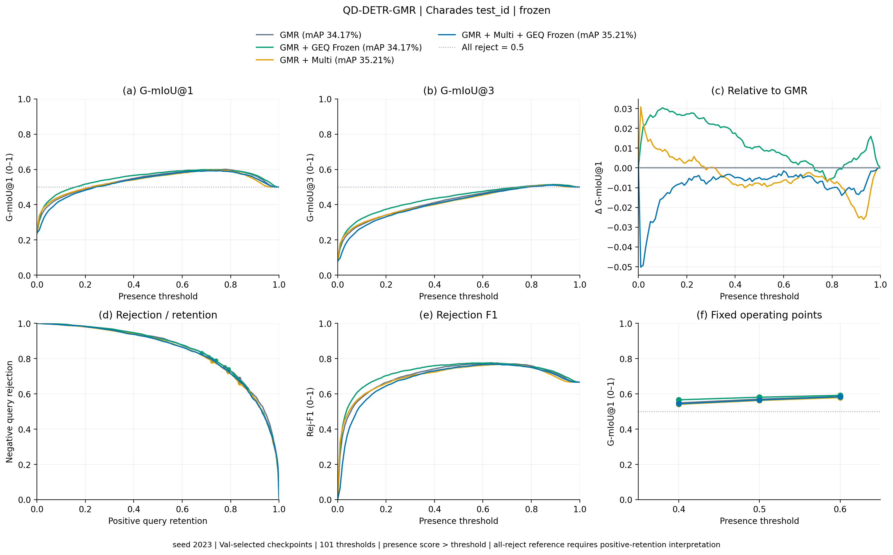
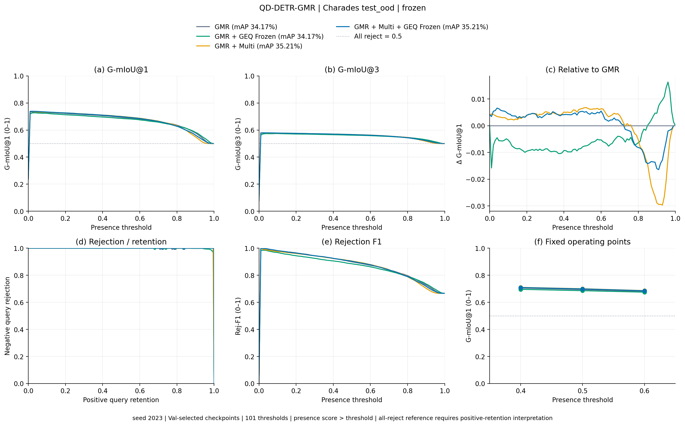
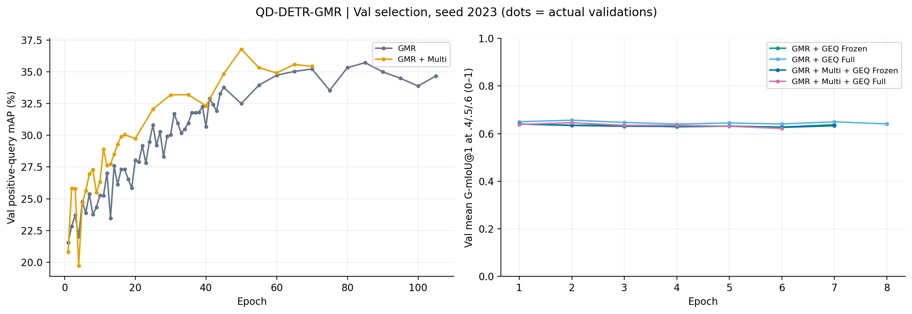

# QD-DETR-GMR

Status reflects files actually completed.

## test_id

5/6 methods evaluated. G-mIoU uses 0–1; mAP, mR, R@1 and AUROC use percent.

[Metrics CSV](test_id/summary.csv)

## test_ood

5/6 methods evaluated. G-mIoU uses 0–1; mAP, mR, R@1 and AUROC use percent.

[Metrics CSV](test_ood/summary.csv)

