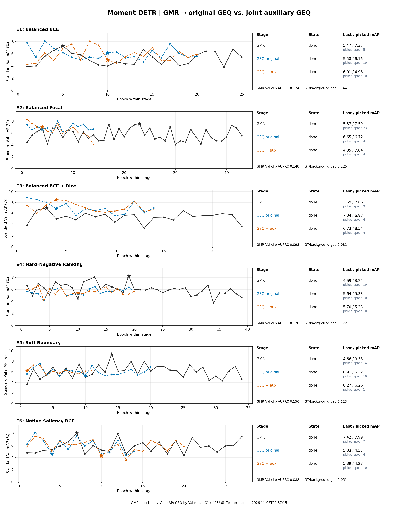

# 当前结果快照：训练已暂停

六组 GEQ＋aux 的训练均已完成并按 Val 选定 best；用户要求暂停时，仅自动评测队列仍在运行。已停止队列，不再派发训练或评测。E3 的专门对比评测由用户另行授权执行。所有 best.pt/last.pt 均保存在本机，未上传模型权重或特征。

| 方法 | 最优轮 | 完成轮 | Val mAP | Val G1 三点均值 |
|---|---:|---:|---:|---:|
| E1 | 10 | 20 | 4.98 | 47.64 |
| E2 | 4 | 14 | 7.04 | 49.16 |
| E3 | 4 | 14 | 8.54 | 49.04 |
| E4 | 10 | 20 | 5.38 | 48.64 |
| E5 | 1 | 11 | 6.26 | 48.39 |
| E6 | 10 | 20 | 4.28 | 48.22 |

黑色：GMR；蓝色：上一轮无辅助 GEQ；橙色：本轮 GEQ＋aux。所有训练已结束，不再自动刷新。

此目录保留已完成的 Test 缓存，未评测的项目不填造数值。E3 的完整对比见 [专门报告](../E3_baseline_comparison/README.md)。上一轮 E1–E6 的完整24组固定 Test 与诊断见 [上一轮报告](../clip_v2/REPORT.md)。

每组父 GMR checkpoint 的源路径、原始哈希、训练源码身份及兼容迁移记录保存在 PARENT_MIGRATION.json；GMR 权重逐张量保持一致，未重训已完成实验。实际训练 commit 与当前仅新增报告的发布 commit 分开记录，原始冻结记录未修改。
