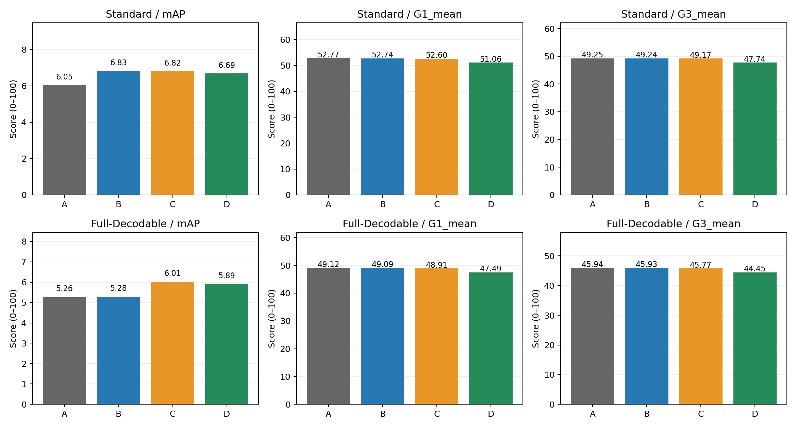
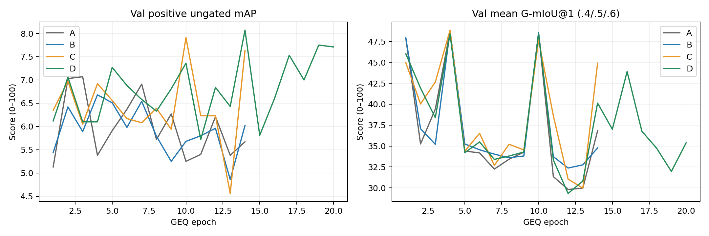

# Moment-DETR query-aware clip experiments

Selected lambda: 0.1 (Standard Val only).

| Split | Group | mAP | ΔmAP | mean G1 | ΔG1 | mean G3 | AUROC |
|---|---|---:|---:|---:|---:|---:|---:|
| test_standard | A | 6.05 | +0.00 | 52.77 | +0.00 | 49.25 | 68.96 |
| test_full | A | 5.26 | +0.00 | 49.12 | +0.00 | 45.94 | 78.37 |
| test_standard | B | 6.83 | +0.78 | 52.74 | -0.03 | 49.24 | 69.16 |
| test_full | B | 5.28 | +0.02 | 49.09 | -0.03 | 45.93 | 78.34 |
| test_standard | C | 6.82 | +0.77 | 52.60 | -0.17 | 49.17 | 69.44 |
| test_full | C | 6.01 | +0.75 | 48.91 | -0.21 | 45.77 | 78.46 |
| test_standard | D | 6.69 | +0.64 | 51.06 | -1.71 | 47.74 | 68.93 |
| test_full | D | 5.89 | +0.63 | 47.49 | -1.63 | 44.45 | 78.21 |

A: off/off; B: off/on; C: on/off (inherited head frozen); D: on/on. A/B share one no-clip GMR best; C/D share one clip GMR best. Same seed 2023, native losses, optimizer rates, max epochs and early stopping protocol. Actual durations are in METRICS.csv and Val curves; a single-seed early-stop comparison cannot isolate all training-duration effects.

Positive mAP is ungated and uses the official evaluator. Three-point G1/G3 means use fixed thresholds .4/.5/.6. Full-Decodable covers 2970/2986 queries; Standard Test covers 1036. Full and Standard Test may overlap. No Test score is used to select lambda, epochs or thresholds.

DETAILS.json retains per-tIoU mAP, short-event (every GT window ≤10 s) and multi-window subsets; METRICS.csv includes retention/false retention and Rej-F1. Val diagnostics and query heatmaps are under runs/clipseg/formal/{B,C,D}_*/diagnostics. A nonzero query swap difference alone does not establish semantic correctness.

B candidates (Val only):

| lambda | best Val mean G1 | Val mAP at chosen checkpoint |
|---:|---:|---:|
| 0.1 | 48.80 | 6.68 |
| 0.3 | 48.58 | 5.33 |
| 1.0 | 48.77 | 6.26 |
