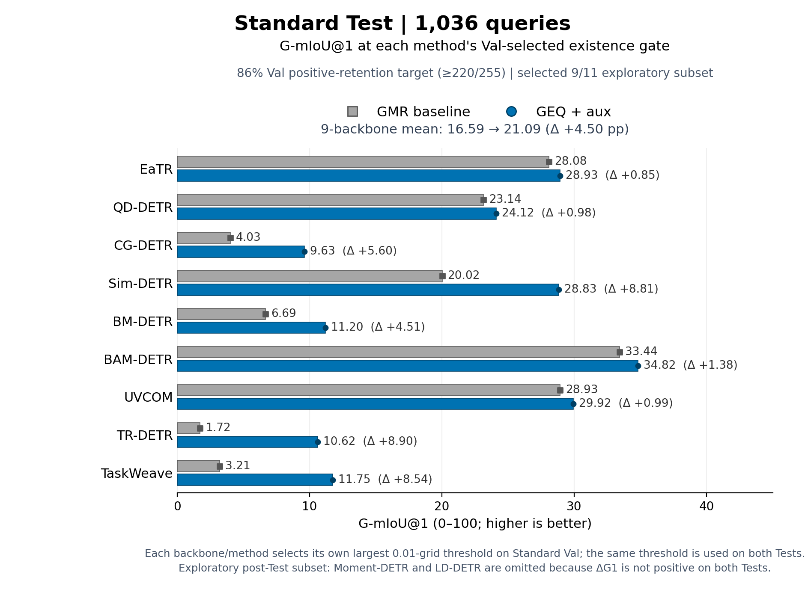
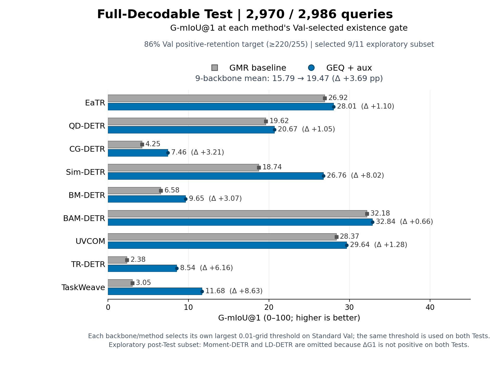
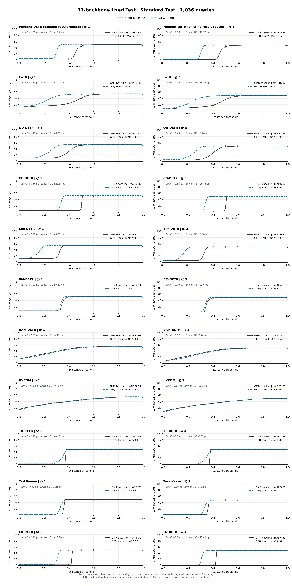
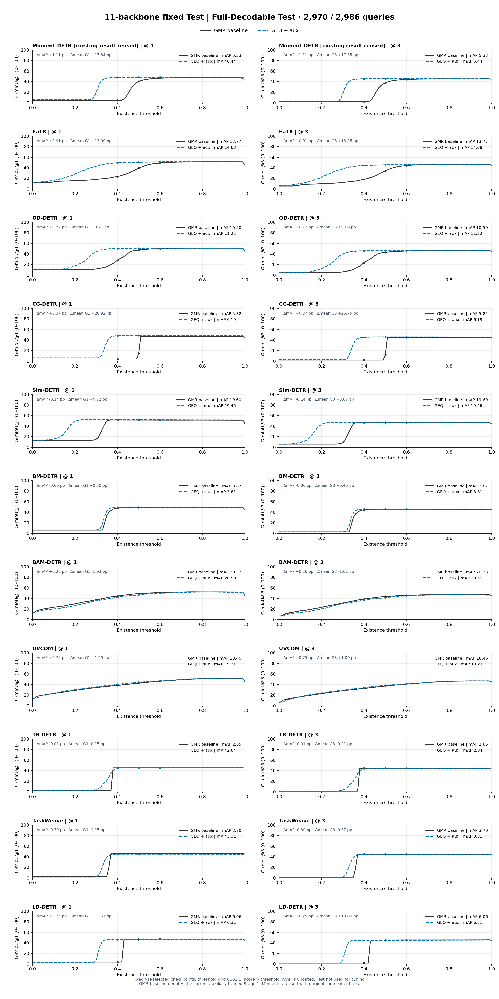

# 11-backbone GMR baseline → GEQ+aux

Shared protocol: Standard Train/Val, seed2023,128 video tokens, GMR Val mAP selection patience20; GEQ Val mean G1(.4/.5/.6) selection patience10; both max200. Balanced BCE+.2 Dice auxiliary coefficient.1 in BOTH stages, inherited unfrozen query-aware head. Native per-backbone losses preserved.

| Backbone | Split | GMR baseline mAP | GEQ+aux mAP | GEQ+aux G1 | GEQ+aux G3 |
|---|---|---:|---:|---:|---:|
| moment_detr | test_standard | 5.49 | 7.47 | 51.80 | 48.93 |
| moment_detr | test_full | 5.33 | 6.44 | 48.46 | 45.57 |
| eatr | test_standard | 16.37 | 17.16 | 53.83 | 48.76 |
| eatr | test_full | 13.77 | 14.68 | 50.44 | 45.43 |
| qd_detr | test_standard | 11.56 | 13.05 | 53.89 | 49.60 |
| qd_detr | test_full | 10.50 | 11.22 | 50.47 | 46.15 |
| cg_detr | test_standard | 6.37 | 6.91 | 52.47 | 49.15 |
| cg_detr | test_full | 5.82 | 6.19 | 48.69 | 45.60 |
| sim_detr | test_standard | 20.29 | 21.00 | 55.20 | 50.06 |
| sim_detr | test_full | 19.60 | 19.46 | 52.36 | 47.21 |
| bm_detr | test_standard | 4.11 | 4.20 | 52.83 | 49.27 |
| bm_detr | test_full | 3.87 | 3.81 | 49.36 | 46.00 |
| bam_detr | test_standard | 22.97 | 23.64 | 49.85 | 44.43 |
| bam_detr | test_full | 20.33 | 20.59 | 46.38 | 41.10 |
| uvcom | test_standard | 22.21 | 21.66 | 45.26 | 39.23 |
| uvcom | test_full | 18.46 | 19.21 | 43.77 | 37.97 |
| tr_detr | test_standard | 2.58 | 2.81 | 48.48 | 47.78 |
| tr_detr | test_full | 2.85 | 2.84 | 45.15 | 44.33 |
| taskweave | test_standard | 3.79 | 3.40 | 48.61 | 47.86 |
| taskweave | test_full | 3.70 | 3.31 | 45.03 | 44.39 |
| ld_detr | test_standard | 6.32 | 6.52 | 49.66 | 48.19 |
| ld_detr | test_full | 6.06 | 6.31 | 46.40 | 44.92 |

Moment-DETR E3 was already complete and is reused with its ORIGINAL source/hash provenance; not retrained under the new source. Ten other families trained under the new frozen source. Comparisons against GMR in METRICS.csv use each method's AUXILIARY-trained Stage1, not the original no-aux baseline. Historical no-aux baseline11 results stay separate under results/test_thresholds_11_backbones and retain old75-token/patience6 versus newer128-token/patience10 differences; do not interpret them as matched-budget controls.

Standard Test1036, Full-Decodable2970/2986. All new Val models fixed before any new formal Test. Fixed thresholds for selection; full101-point sweeps descriptive only. Positive mAP ungated. Short means all GT windows<=10s. Both Test sets overlap; single-seed observations are not proof of robust causal gains.

HISTORICAL_BASELINE_REFERENCE.csv records descriptive increments against the no-aux GMR baseline from the specified 11-backbone branch, including its original protocol group/token limit. These baselines are not retrained or silently replaced.

## 86% Val-retention summary: selected 9/11 exploratory subset

[Two-page PDF](TEST_SUMMARY_BOTH.pdf) · [Summary data audit](SUMMARY_PLOT_AUDIT.json)

For every backbone and method, the largest 0.01-grid Standard-Val threshold retaining at least 220/255 positive queries is fixed and applied unchanged to both Tests. The figures show only the nine backbones whose G1 improves on both Tests: EaTR, QD-DETR, CG-DETR, Sim-DETR, BM-DETR, BAM-DETR, UVCOM, TR-DETR and TaskWeave. This subset was selected after Test inspection and is therefore exploratory. Moment-DETR and LD-DETR remain in [the complete data](RETENTION86_METRICS.csv) and [audit](RETENTION86_AUDIT.json).

## Fixed Test figures

[Standard PDF](STANDARD_TEST.pdf) · [Full PDF](FULL_TEST.pdf) · [Combined PDF](BOTH_TESTS.pdf)

Current GMR baseline is auxiliary-trained Stage1, not the historical no-aux baseline. CSV and original source provenance remain unchanged.
