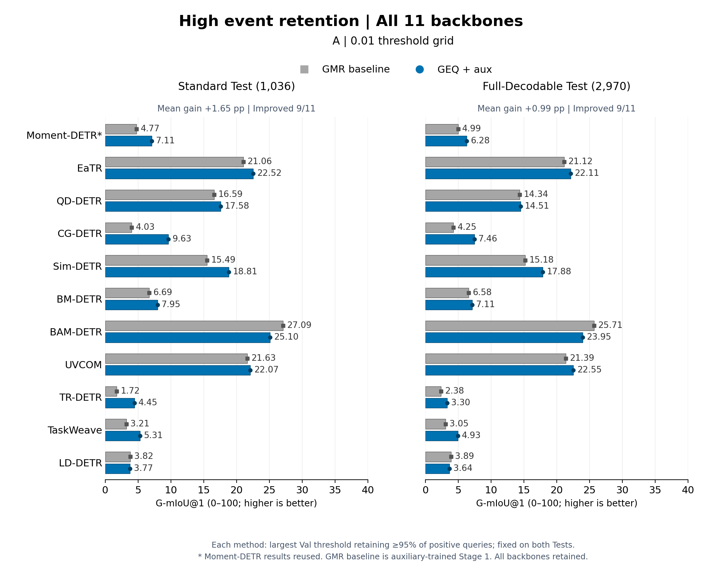
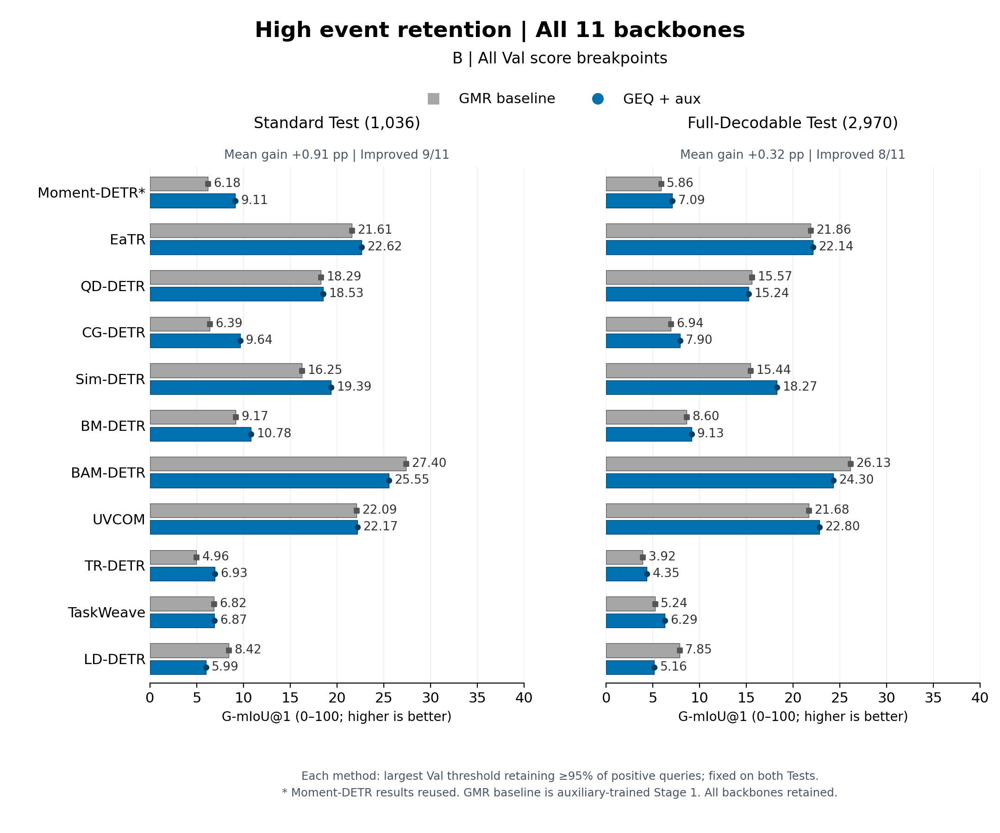

# 高事件保留率场景：全部11骨干配对评测

比较本轮 **GMR baseline → GEQ+aux**。GMR baseline 是带 Balanced BCE + 0.2 Dice 辅助监督的 Stage 1；GEQ+aux 是同一骨干的 Stage 2。Moment-DETR复用已完成实验，全部模型保持既有 Val best，没有重新训练或重选 checkpoint。

本报告包含 Moment-DETR、EaTR、QD-DETR、CG-DETR、Sim-DETR、BM-DETR、BAM-DETR、UVCOM、TR-DETR、TaskWeave、LD-DETR **全部11个骨干**，每个都报告 Standard 和 Full。范围由本轮实验清单确定，保留所有提高和下降结果。早期六骨干版本保留在 Git 历史，当前主结果不再限定该子集。

## 阈值规则与两张图的区别

对每个骨干、每种方法，分别在 Standard Val（465条，255正/210空）选择正查询保留率≥95%的最大候选阈值，再固定用于 Standard / Full Test。严格采用 `score > threshold`。95%只约束 Val，不保证 Test 同样达到95%。

**图 A 与图 B 使用相同模型，每张都是左侧 Standard、右侧 Full；唯一变化是 Val 上允许使用的阈值候选。**

| 项目 | 图 A：0.01网格主结果 | 图 B：Val分数断点复核 |
|---|---|---|
| 候选阈值 | 0.00、0.01、0.02…1.00 | 全部 Val 分数，加0/1 |
| 选阈值目标 | 正查询保留率≥95%的最大候选阈值 | 相同 |
| 用途 | 沿用参考分析的网格规则 | 检查对0.01阈值粒度的敏感性 |

例如 Moment-DETR 的 GMR baseline 在图 A 使用0.42（Val保留率100%），图 B 使用约0.428048（95.29%）。更细的阈值候选会改变保留与拒绝的查询，但不保证 Test G1 更高。精确复核遍历完整 Val 分数断点，并非连续实数域优化。Test 不参与阈值选择。

常规11骨干汇总的 G1 使用固定0.4/0.5/0.6均值，本节使用 Val 选出的高保留率阈值，属于不同评测设置。mAP不使用存在性门控，在图 A、B中相同。

## 图 A：0.01网格主结果

Standard / Full 的11骨干等权平均 G1 分别变化 **+1.654 / +0.986个百分点**，提高骨干数为 **9/11 / 9/11**。



[PDF](PRIMARY.pdf) · [SVG](PRIMARY.svg)

| 骨干 | Standard G1：baseline→GEQ+aux | Δ百分点 | Full G1：baseline→GEQ+aux | Δ百分点 |
|---|---:|---:|---:|---:|
| Moment-DETR | 4.774→7.105 | +2.331 | 4.991→6.278 | +1.286 |
| EaTR | 21.060→22.524 | +1.464 | 21.116→22.108 | +0.992 |
| QD-DETR | 16.586→17.580 | +0.994 | 14.337→14.508 | +0.172 |
| CG-DETR | 4.026→9.626 | +5.600 | 4.253→7.461 | +3.208 |
| Sim-DETR | 15.494→18.810 | +3.316 | 15.180→17.880 | +2.700 |
| BM-DETR | 6.692→7.954 | +1.262 | 6.576→7.106 | +0.530 |
| BAM-DETR | 27.086→25.101 | -1.985 | 25.715→23.948 | -1.767 |
| UVCOM | 21.630→22.074 | +0.444 | 21.393→22.548 | +1.155 |
| TR-DETR | 1.725→4.447 | +2.722 | 2.380→3.300 | +0.920 |
| TaskWeave | 3.211→5.314 | +2.103 | 3.045→4.934 | +1.888 |
| LD-DETR | 3.824→3.771 | -0.053 | 3.887→3.644 | -0.243 |

## 图 B：Val分数断点复核

Standard / Full 的11骨干等权平均 G1 分别变化 **+0.910 / +0.324个百分点**，提高骨干数为 **9/11 / 8/11**。



[PDF](EXACT_THRESHOLDS.pdf) · [SVG](EXACT_THRESHOLDS.svg)

| 骨干 | Standard G1：baseline→GEQ+aux | Δ百分点 | Full G1：baseline→GEQ+aux | Δ百分点 |
|---|---:|---:|---:|---:|
| Moment-DETR | 6.181→9.105 | +2.924 | 5.865→7.092 | +1.227 |
| EaTR | 21.606→22.621 | +1.014 | 21.861→22.142 | +0.281 |
| QD-DETR | 18.287→18.532 | +0.245 | 15.569→15.236 | -0.333 |
| CG-DETR | 6.389→9.645 | +3.256 | 6.940→7.899 | +0.959 |
| Sim-DETR | 16.245→19.389 | +3.143 | 15.445→18.270 | +2.825 |
| BM-DETR | 9.171→10.777 | +1.606 | 8.605→9.130 | +0.526 |
| BAM-DETR | 27.398→25.545 | -1.853 | 26.126→24.298 | -1.827 |
| UVCOM | 22.093→22.170 | +0.077 | 21.677→22.804 | +1.127 |
| TR-DETR | 4.962→6.933 | +1.971 | 3.921→4.351 | +0.430 |
| TaskWeave | 6.817→6.873 | +0.055 | 5.240→6.285 | +1.046 |
| LD-DETR | 8.422→5.993 | -2.429 | 7.855→5.161 | -2.693 |

## 汇总

| 阈值规则 | Test | baseline平均G1 | GEQ+aux平均G1 | Δ百分点 | 相对增益 | 提高骨干数 |
|---|---|---:|---:|---:|---:|---:|
| 0.01网格 | standard | 11.464 | 13.119 | +1.654 | +14.43% | 9/11 |
| 0.01网格 | full | 11.170 | 12.156 | +0.986 | +8.82% | 9/11 |
| Val分数断点 | standard | 13.416 | 14.326 | +0.910 | +6.78% | 9/11 |
| Val分数断点 | full | 12.646 | 12.970 | +0.324 | +2.56% | 8/11 |

先等权平均全部11个骨干的原始 G1，再计算相对增益；没有用 Test 结果筛选骨干。

## 全骨干 mAP / G1 / G3（图 A 的固定阈值）

各项为 GMR baseline → GEQ+aux，单位0–100；mAP在两种阈值规则下相同，图 B 的 G1/G3 完整值见 METRICS.csv。

| 骨干 | Test | mAP | G1 | G3 |
|---|---|---:|---:|---:|
| Moment-DETR | standard | 5.49→7.47 | 4.77→7.11 | 2.53→3.88 |
| Moment-DETR | full | 5.33→6.44 | 4.99→6.28 | 2.54→3.11 |
| EaTR | standard | 16.37→17.16 | 21.06→22.52 | 15.44→16.87 |
| EaTR | full | 13.77→14.68 | 21.12→22.11 | 15.51→16.17 |
| QD-DETR | standard | 11.56→13.05 | 16.59→17.58 | 11.28→12.37 |
| QD-DETR | full | 10.50→11.22 | 14.34→14.51 | 9.09→9.31 |
| CG-DETR | standard | 6.37→6.91 | 4.03→9.63 | 2.10→5.85 |
| CG-DETR | full | 5.82→6.19 | 4.25→7.46 | 2.28→3.97 |
| Sim-DETR | standard | 20.29→21.00 | 15.49→18.81 | 8.54→12.05 |
| Sim-DETR | full | 19.60→19.46 | 15.18→17.88 | 8.53→11.41 |
| BM-DETR | standard | 4.11→4.20 | 6.69→7.95 | 2.83→4.12 |
| BM-DETR | full | 3.87→3.81 | 6.58→7.11 | 3.01→3.44 |
| BAM-DETR | standard | 22.97→23.64 | 27.09→25.10 | 20.03→17.91 |
| BAM-DETR | full | 20.33→20.59 | 25.71→23.95 | 18.91→17.28 |
| UVCOM | standard | 22.21→21.66 | 21.63→22.07 | 14.68→15.03 |
| UVCOM | full | 18.46→19.21 | 21.39→22.55 | 14.93→15.85 |
| TR-DETR | standard | 2.58→2.81 | 1.72→4.45 | 1.06→3.54 |
| TR-DETR | full | 2.85→2.84 | 2.38→3.30 | 1.34→2.35 |
| TaskWeave | standard | 3.79→3.40 | 3.21→5.31 | 1.55→4.44 |
| TaskWeave | full | 3.70→3.31 | 3.05→4.93 | 1.52→4.26 |
| LD-DETR | standard | 6.32→6.52 | 3.82→3.77 | 1.87→2.27 |
| LD-DETR | full | 6.06→6.31 | 3.89→3.64 | 1.94→2.06 |

## 实际保留率与空查询误返回率

以下为图 A 下全部11骨干等权平均；逐骨干、逐方法、两种规则的阈值与实际保留率见 DECISIONS.csv。高保留率不代表低空查询误返回率，也不等于定位正确率。

| Test | baseline正查询保留率 | GEQ+aux正查询保留率 | baseline空查询误返回率 | GEQ+aux空查询误返回率 |
|---|---:|---:|---:|---:|
| standard | 97.76% | 96.37% | 92.39% | 89.50% |
| full | 98.31% | 97.95% | 92.19% | 90.45% |

Standard Test为1036条，Full-Decodable为2970/2986条；两套Test有185个视频ID、186个视频—文本输入重叠。单 seed=2023，不作独立重复验证或多seed稳定性声明。

## 数据与复算

[逐模型指标](METRICS.csv) · [汇总](SUMMARY.csv) · [阈值与保留率](DECISIONS.csv) · [检查点与预测哈希](EVIDENCE.json) · [数值审计](AUDIT.json) · [图中原值](PLOT_DATA.json)

本包包含22份 Val 压缩预测，并引用 ../e3_eleven 中44份 Test 压缩预测，合计66份；同时提供GT快照。无需权重、特征或GPU，即可核验完整查询覆盖、checkpoint绑定及文件哈希。176个G1/G3值与官方实现核验；44个mAP与既有11骨干报告交叉核验。

```bash
PYTHONPATH=src python scripts/report_e3_high_retention.py
PYTHONPATH=src python scripts/report_e3_high_retention.py --verify-only
```
