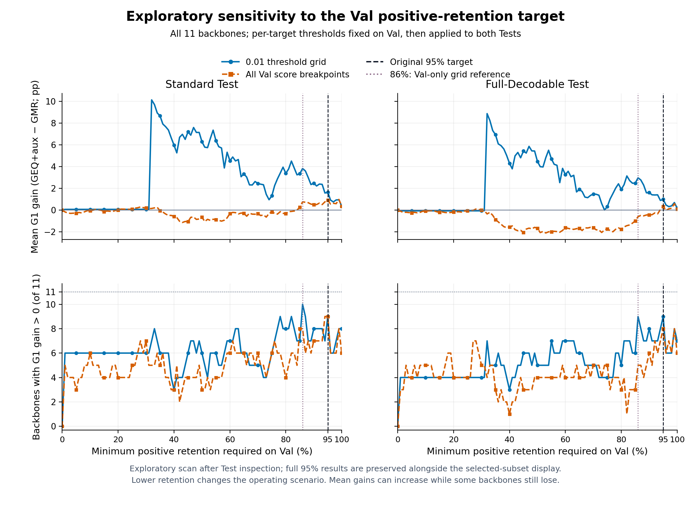
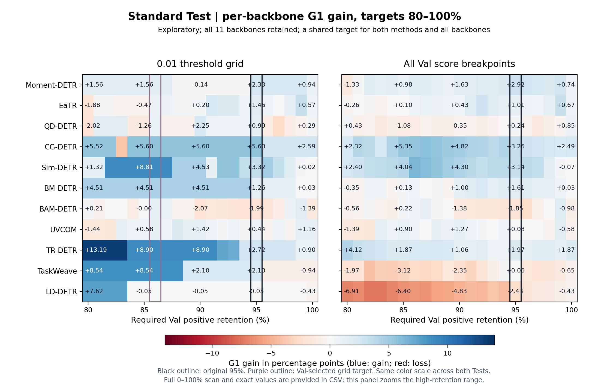
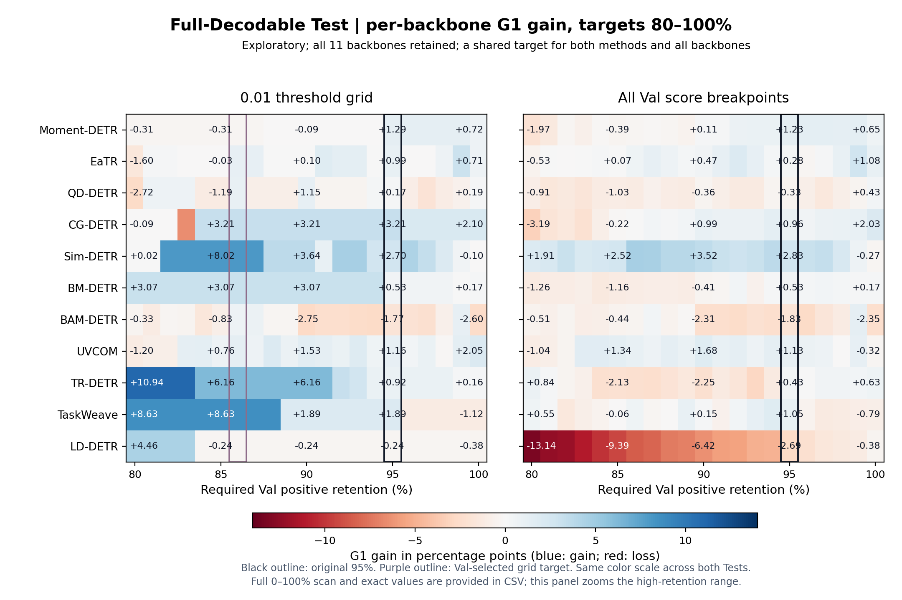

# 保留率目标扫描：探索性分析

**在当前两种 Val 阈值规则下，没有一个统一保留率目标能使全部11骨干在 Standard / Full 的 G1 同时提高。** 0.01网格最多有9/11个骨干在两套都提高；完整Val分数断点最多8/11。单看某一个Test，网格下Standard最多10/11、Full最多9/11。

本扫描在已查看原95% Test结果后按用户要求开展，因此属于探索性敏感性分析。每一个目标下的阈值仍只在Val选择，但根据这次Test扫描挑选目标或删选骨干，不能描述成独立验证或所有骨干普遍改善。

## 覆盖范围与规则

- 固定全部11骨干及各自的GMR baseline / GEQ+aux best，使用同一批已有预测，没有重训。
- 命名目标从0%到100%、步长1%；另穷举Val中255个正查询对应的256种最少保留数量约束，因此覆盖这两套规则下所有可改变阈值的连续目标区间。
- 若目标为r，则至少需要保留 `ceil(r × 255)` 个Val正查询；选择满足条件的最大候选阈值，严格 `score > threshold`。同一阈值固定用于Standard和Full。
- 同时扫描0.01网格与全部Val分数断点；同一目标用于所有骨干与两种方法，保留全部增益与下降。
- mAP使用未门控候选，随保留率目标不变。G1/G3变化反映门控工作点变化，不是重新训练带来的提升。

## 完整目标敏感性



[PDF](TARGET_SWEEP.pdf) · [SVG](TARGET_SWEEP.svg)

上排为11骨干平均G1增益，下排为提高的骨干数；左Standard、右Full。蓝色为0.01网格，橙色为完整Val分数断点。黑线95%为原主设置；紫线86%为本次Val规则选出的网格参考点。

## 86% 与95%的全11骨干比较

| 阈值候选 | 目标 | Standard平均ΔG1 | Full平均ΔG1 | Standard提高数 | Full提高数 | GEQ+aux实际Test保留率 S/F |
|---|---:|---:|---:|---:|---:|---:|
| 0.01网格 | 95% | +1.654 | +0.986 | 9/11 | 9/11 | 96.37% / 97.95% |
| 0.01网格 | 86% | +3.822 | +2.966 | 10/11 | 9/11 | 88.97% / 93.48% |
| Val分数断点 | 95% | +0.910 | +0.324 | 9/11 | 8/11 | 94.79% / 97.22% |
| Val分数断点 | 86% | +0.758 | -0.603 | 8/11 | 5/11 | 86.31% / 91.97% |

86%在粗网格下平均增益较大，但仍有下降骨干；换成完整Val分数断点后，86%的Full平均ΔG1为负，说明较大增益依赖阈值粒度。不能只据粗网格结果声称86%更稳健。降低目标也改变了实际事件保留率，不能把减少保留事件数量的场景与原95%场景混为一谈。

## 哪些骨干未同时提高（0.01网格）

| 骨干 | 95% Standard ΔG1 | 95% Full ΔG1 | 86% Standard ΔG1 | 86% Full ΔG1 |
|---|---:|---:|---:|---:|
| Moment-DETR | +2.331 | +1.286 | +1.561 | -0.313 |
| EaTR | +1.464 | +0.992 | +0.848 | +1.096 |
| QD-DETR | +0.994 | +0.172 | +0.976 | +1.055 |
| CG-DETR | +5.600 | +3.208 | +5.600 | +3.208 |
| Sim-DETR | +3.316 | +2.700 | +8.805 | +8.016 |
| BM-DETR | +1.262 | +0.530 | +4.513 | +3.072 |
| BAM-DETR | -1.985 | -1.767 | +1.377 | +0.663 |
| UVCOM | +0.444 | +1.155 | +0.987 | +1.279 |
| TR-DETR | +2.722 | +0.920 | +8.897 | +6.162 |
| TaskWeave | +2.103 | +1.888 | +8.536 | +8.633 |
| LD-DETR | -0.053 | -0.243 | -0.053 | -0.243 |

95%时，BAM-DETR、LD-DETR在两套均下降。86%时，BAM-DETR转正；LD-DETR仍在两套略降，Moment-DETR在Full略降。因此86%下同时提高的9个骨干为：EaTR、QD-DETR、CG-DETR、Sim-DETR、BM-DETR、BAM-DETR、UVCOM、TR-DETR、TaskWeave。

## 按用户选择展示的9骨干86%子集

该子集依据本次Test双集G1增益选出，剔除Moment-DETR与LD-DETR。首页已用该子集的两张参考样式图替换原95%主图，图题与说明明确标为探索性Test筛选子集。原11骨干95%结果保留在原目录及完整扫描中。

[Standard图](selected_86/STANDARD_TEST.png) · [Full-Decodable图](selected_86/FULL_TEST.png) · [9骨干详细结果与筛选说明](selected_86/README.md) · [两图PDF](selected_86/BOTH_TESTS.pdf)

## 每个骨干的高保留率区间变化





热图仅放大80%–100%目标区间，完整0%–100%见上方扫描图和CSV。所有热图使用同一对称色标，正增益蓝色、负增益红色；黑框95%，紫框为Val选择的86%网格点。

## Val参考点如何固定

在打开本次新目标的Test预测前，先在80%–100%的整数目标中，仅按Val最大化“11骨干中最小G1增益”，并以平均Val增益、较高保留率依次破同分。该规则与结果记录于[VAL_SELECTION_FROZEN.json](VAL_SELECTION_FROZEN.json)。

| 阈值候选 | Val选出的目标 | Val最小骨干ΔG1 | Val平均ΔG1 |
|---|---:|---:|---:|
| 0.01网格 | 86% | -0.075 | +3.554 |
| Val分数断点 | 100% | -0.758 | +0.247 |

这两个Val参考点连Val上的最小骨干增益也没有变为全正。选择规则是在已经看过原95% Test之后新增的，仍属于探索性规则；如用于确认性结论，应先固定规则，再在未参与本次选择的数据上验证。

## 数据与复算

[101个命名目标逐骨干指标](METRICS.csv) · [256种数量约束的完整结果](ALL_REQUIRED_COUNTS.csv) · [Test汇总](TEST_SUMMARY.csv) · [共同目标可行性](COMMON_TARGET_FEASIBILITY.csv) · [结论JSON](FEASIBILITY.json) · [Val汇总](VAL_TARGET_SUMMARY.csv)

数值核验包括 1144 项官方G1/G3检查，以及全部67,584个值的独立前缀和/掩码计算对照；原95%共44行配对结果与已有报告一致。所有66份预测均校验哈希。Standard / Full有样本重叠，单seed，不作独立重复或统计显著性声明。

```bash
OMP_NUM_THREADS=2 PYTHONPATH=src python scripts/scan_e3_retention_targets.py
python scripts/plot_e3_retention_scan.py
PYTHONPATH=src python scripts/plot_e3_selected86_curves.py
```

[扫描审计](AUDIT.json) · [图表审计](PLOT_AUDIT.json) · [9骨干子集审计](selected_86/AUDIT.json) · [原95%完整结果](../e3_high_retention/README.md)
