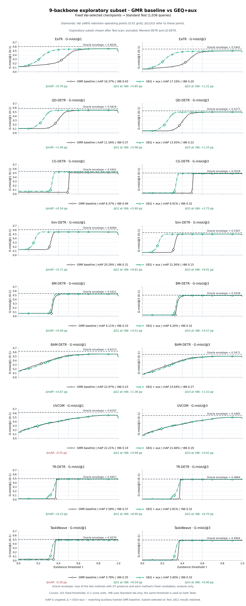
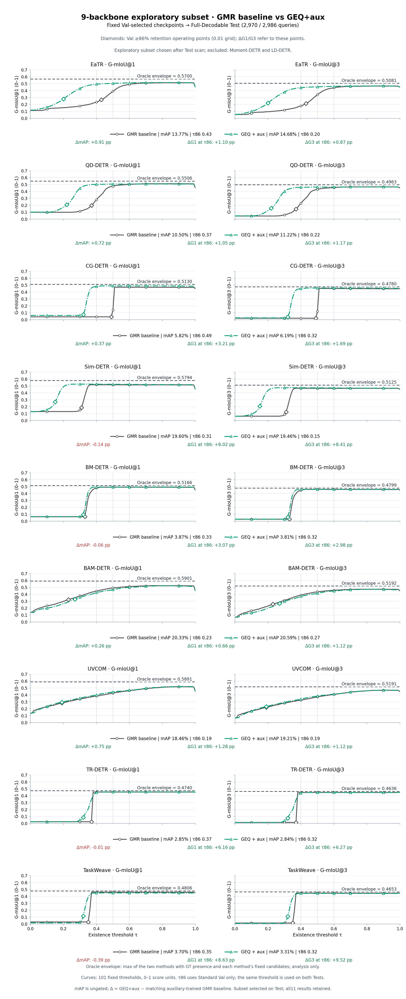

# 86%目标：9骨干探索性展示

**本子集在查看本轮 Standard / Full Test 的86%扫描结果后选出**：保留G1在两套Test都提高的9个骨干，剔除Moment-DETR与LD-DETR。它不是独立验证或全部11骨干均有效的证据。

各骨干、各方法仍只在Standard Val按正查询保留率≥86%选择最大0.01网格阈值，然后固定到两套Test。GMR baseline为带辅助监督的Stage 1。mAP不门控；ΔG1/G3对应所选工作点。

[两图PDF](BOTH_TESTS.pdf) · [Standard单骨干PDF](STANDARD_BY_BACKBONE.pdf) · [Full单骨干PDF](FULL_BY_BACKBONE.pdf)

| 骨干 | Test | ΔmAP | ΔG1 | ΔG3 |
|---|---|---:|---:|---:|
| EaTR | standard | +0.790 | +0.848 | +1.212 |
| EaTR | full | +0.910 | +1.096 | +0.871 |
| QD-DETR | standard | +1.490 | +0.976 | +1.245 |
| QD-DETR | full | +0.720 | +1.055 | +1.168 |
| CG-DETR | standard | +0.540 | +5.600 | +3.750 |
| CG-DETR | full | +0.370 | +3.208 | +1.691 |
| Sim-DETR | standard | +0.710 | +8.805 | +9.007 |
| Sim-DETR | full | -0.140 | +8.016 | +8.410 |
| BM-DETR | standard | +0.090 | +4.513 | +4.567 |
| BM-DETR | full | -0.060 | +3.072 | +2.980 |
| BAM-DETR | standard | +0.670 | +1.377 | +1.524 |
| BAM-DETR | full | +0.260 | +0.663 | +1.122 |
| UVCOM | standard | -0.550 | +0.987 | +0.612 |
| UVCOM | full | +0.750 | +1.279 | +1.116 |
| TR-DETR | standard | +0.230 | +8.897 | +8.701 |
| TR-DETR | full | -0.010 | +6.162 | +6.275 |
| TaskWeave | standard | -0.390 | +8.536 | +9.402 |
| TaskWeave | full | -0.390 | +8.633 | +9.522 |

单位为百分点；全部原始数值见[METRICS.csv](METRICS.csv)，剔除的两骨干见[EXCLUDED.csv](EXCLUDED.csv)。

[完整11骨干扫描](../README.md) · [原11骨干95%结果](../../e3_high_retention/README.md) · [核验](AUDIT.json)
