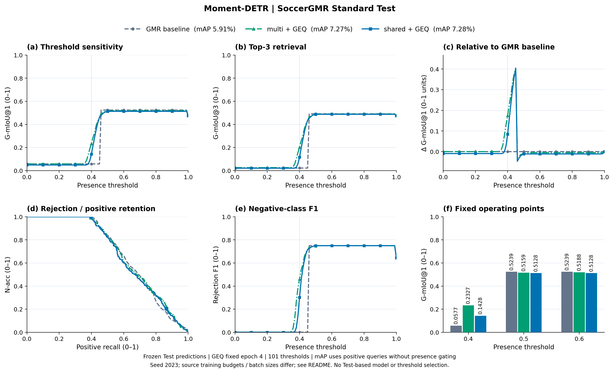
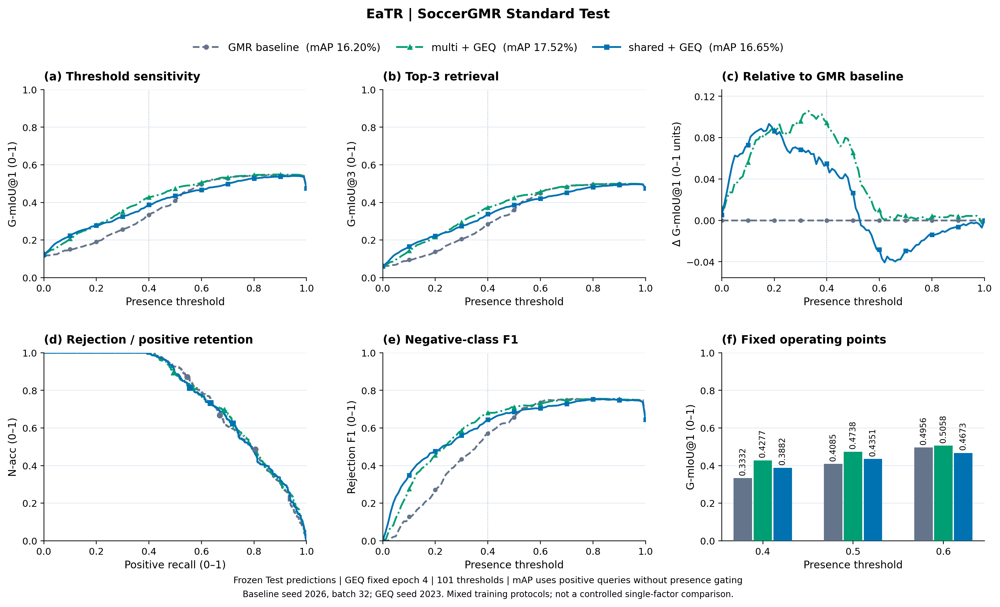
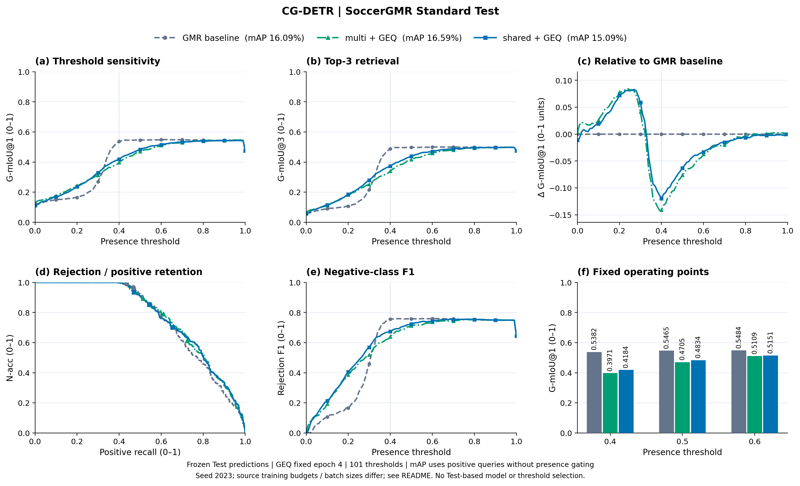
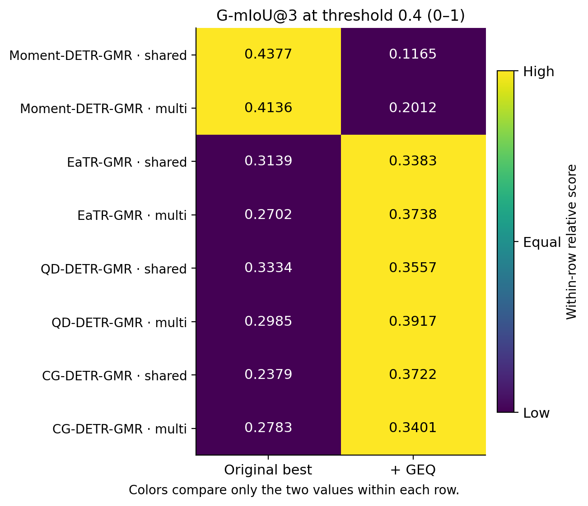
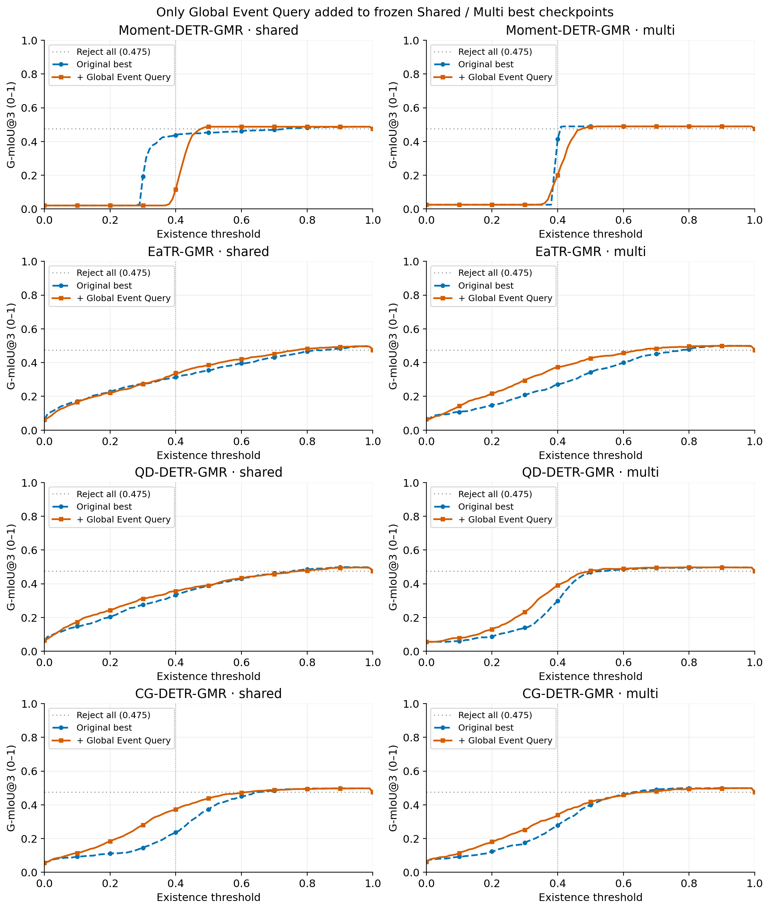

# Shared / Multi + Global Event Query 微调

<!-- THREE_WAY_COMPARISON_START -->
## 三条曲线：GMR baseline、multi + GEQ、shared + GEQ

| Backbone | GMR baseline mAP (%) | multi + GEQ mAP (%) | shared + GEQ mAP (%) |
|---|---:|---:|---:|
| Moment-DETR | 5.91 | 7.27 | 7.28 |
| EaTR | 16.20 | 17.52 | 16.65 |
| QD-DETR | 15.08 | 14.67 | 15.24 |
| CG-DETR | 16.09 | 16.59 | 15.09 |

mAP 单位为百分数，来自相同 SoccerGMR Standard Test 的正查询，不随存在性阈值变化。GMR baseline 是当前六路线实验中的 baseline。EaTR baseline 为历史 seed 2026，其他两组为 seed 2023；各来源的训练预算、batch 也可能不同，完整来源保存在快照中。三曲线反映完整方法的效果；GEQ 的独立影响采用下方各方法与其 +GEQ 的配对结果判断。

六面板沿用[参考图版式](https://github.com/chinagalaxy2002/Improving-Target-Presence-for-Generalized-Moment-Retrieval/tree/main/backbonefolder/figures/complete_comparison)：(a) G-mIoU@1 随阈值；(b) G-mIoU@3 随阈值；(c) 同阈值相对 GMR baseline 的 ΔG-mIoU@1；(d) 负查询拒绝率与正查询保留率；(e) 拒绝 F1；(f) 阈值 0.4/0.5/0.6 的 G-mIoU@1。所有 G-mIoU 图轴均覆盖 0–1，差值图保留负值。三条曲线使用同样的颜色、线型与标记跨骨干对应。

[mAP CSV](three_way_map.csv) · [全部 1,212 行阈值数据](three_way_threshold_sweep.csv) · [固定工作点](three_way_fixed_points.csv) · [离线快照](three_way_comparison_snapshot.json)

### Moment-DETR

[PDF](moment_detr/gmr_multi_shared_geq_complete_comparison.pdf) · [SVG](moment_detr/gmr_multi_shared_geq_complete_comparison.svg)

### EaTR

[PDF](eatr/gmr_multi_shared_geq_complete_comparison.pdf) · [SVG](eatr/gmr_multi_shared_geq_complete_comparison.svg)

### QD-DETR

[PDF](qd_detr/gmr_multi_shared_geq_complete_comparison.pdf) · [SVG](qd_detr/gmr_multi_shared_geq_complete_comparison.svg)

### CG-DETR

[PDF](cg_detr/gmr_multi_shared_geq_complete_comparison.pdf) · [SVG](cg_detr/gmr_multi_shared_geq_complete_comparison.svg)
<!-- THREE_WAY_COMPARISON_END -->

更新时间：2026-10-31T20:46:36+08:00

四个骨干各运行 shared、multi 两组，仅新增 GEQ。冻结原模型，固定微调 4 epoch；seed 2023，AdamW lr=3e-5、wd=1e-4，梯度裁剪 0.1；每任务 num_workers=2，每 GPU 最多两个 CUDA 任务（包含原有任务）。Moment-DETR batch=8，其余骨干 batch=32，均不累积。

范式参考 main 的 Global-only：39ab0eb74427709851476b2bb86b698c8a3f4186。此轮沿用新路线 seed 2023，参考实验使用 seed 2026。无 LoRA、RoI、边界修正、候选融合或合成数据。固定最终 epoch 4，不使用 Test 选模。

Test 对照使用原有 best 的冻结候选文件；GEQ 遍历完整 Test 特征后只替换存在性分数。每个样本的时间窗口、候选分数和顺序逐项保持一致。mAP/mR/mR+ 应完全相同；变化来自存在性判断。G-mIoU 曲线的阈值横轴和指标纵轴均为 0–1，扫描 101 点，阈值 0.4/0.5/0.6 预先固定。

| Backbone | 方法 | 状态 | mAP 前/后 | AUROC 前/后 (%) | Rej-F1 前/后 (%) | G-mIoU@3 前 | 后 | Δ (0–1) |
|---|---|---|---|---|---|---:|---:|---:|
| Moment-DETR-GMR | shared | COMPLETED | 7.28/7.28 | 69.08/68.30 | 72.14/30.28 | 0.4377 | 0.1165 | -0.3212 |
| Moment-DETR-GMR | multi | COMPLETED | 7.27/7.27 | 70.14/69.12 | 69.60/46.02 | 0.4136 | 0.2012 | -0.2124 |
| EaTR-GMR | shared | COMPLETED | 16.65/16.65 | 77.57/76.49 | 61.23/64.50 | 0.3139 | 0.3383 | +0.0244 |
| EaTR-GMR | multi | COMPLETED | 17.52/17.52 | 77.11/76.69 | 55.18/68.13 | 0.2702 | 0.3738 | +0.1036 |
| QD-DETR-GMR | shared | COMPLETED | 15.24/15.24 | 77.13/76.29 | 63.37/65.06 | 0.3334 | 0.3557 | +0.0223 |
| QD-DETR-GMR | multi | COMPLETED | 14.67/14.67 | 75.56/74.92 | 58.37/68.41 | 0.2985 | 0.3917 | +0.0932 |
| CG-DETR-GMR | shared | COMPLETED | 15.09/15.09 | 77.44/77.32 | 50.20/67.32 | 0.2379 | 0.3722 | +0.1343 |
| CG-DETR-GMR | multi | COMPLETED | 16.59/16.59 | 77.40/77.32 | 56.20/63.98 | 0.2783 | 0.3401 | +0.0618 |

## 结果解读

固定阈值 0.4 下，6/8 组 G-mIoU@3 提升，2/8 组下降。定位候选、mAP、mR 与 mR+ 在所有组中保持不变。AUROC 有 8/8 组下降，不能据此声称 GEQ 普遍改善了有无目标的排序能力；结合完整阈值曲线，本轮结果与存在性分数校准发生变化相符，但未隔离证明原因。

[三个预先固定阈值的全部对照 CSV](threshold_comparison.csv)。本轮不依据 Test 再挑选阈值或微调轮数。

## G-mIoU 前后对照

颜色仅按行归一化，比较同一 backbone、同一方法的前后两个值；单元格为 0–1 原始值。灰色表示未完成。

[PDF](cross_backbone_overview/gmiou_before_after.pdf) · [SVG](cross_backbone_overview/gmiou_before_after.svg)

灰色水平线为全部拒绝时的 G-mIoU（负查询占比），用于识别高阈值处由空集判对贡献的分数。阈值扫描只分析冻结预测，不按 Test 曲线选择阈值。

每个 backbone 的图和 README 独立放在其同名文件夹内。未完成实验以状态占位，不填入结果。各方法的下降项原样报告，单 Seed 不提供跨 Seed 方差。
