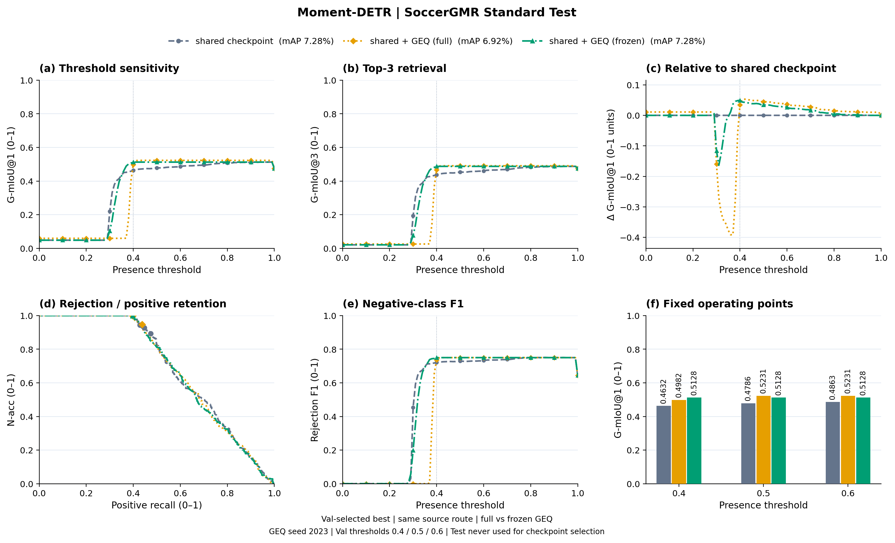
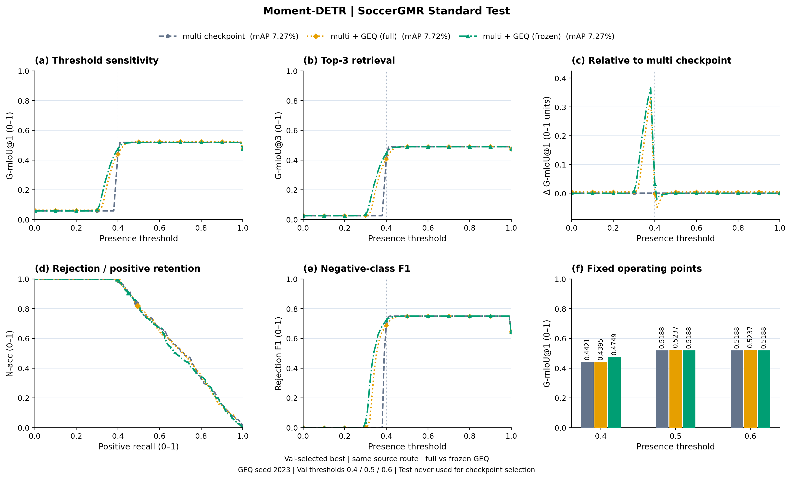
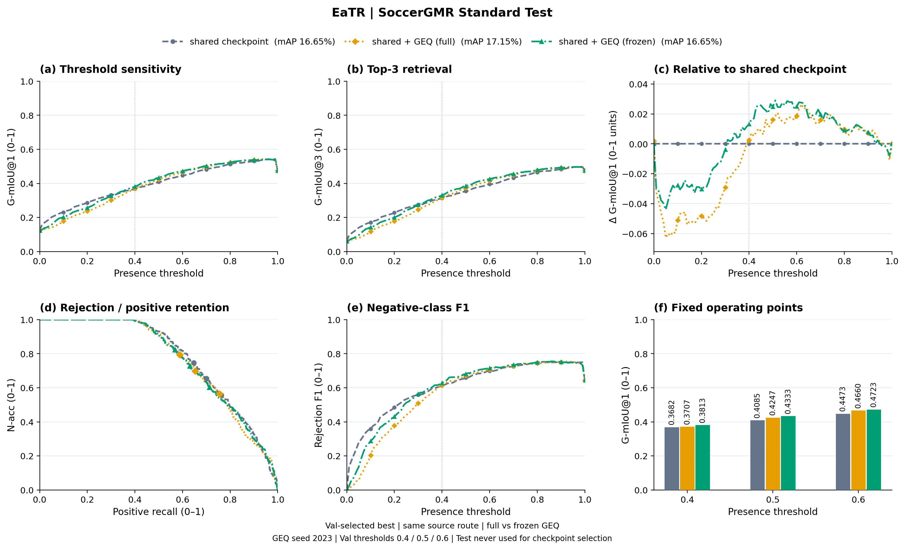
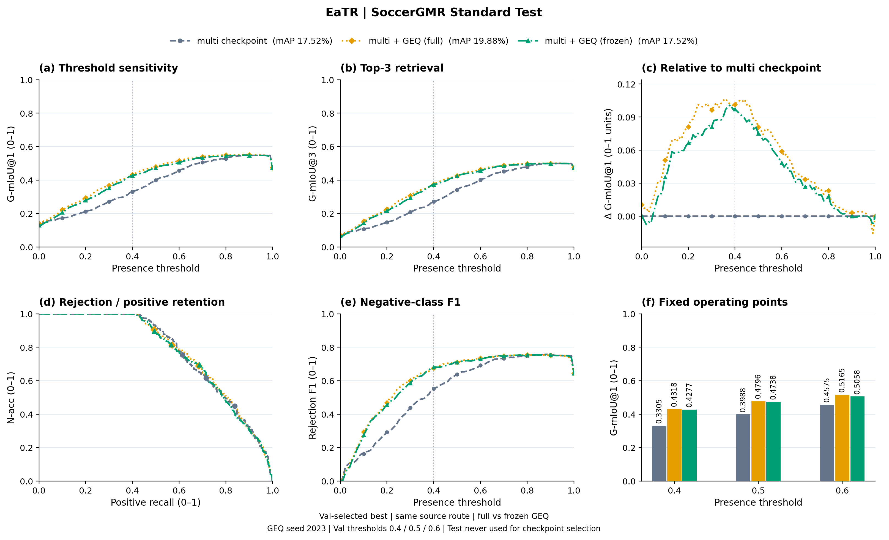
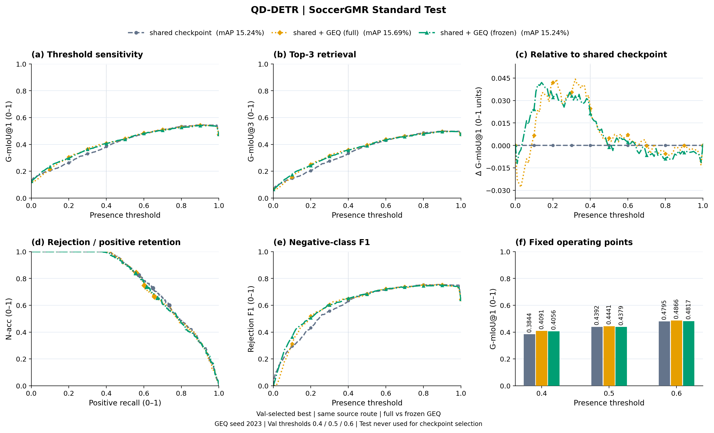
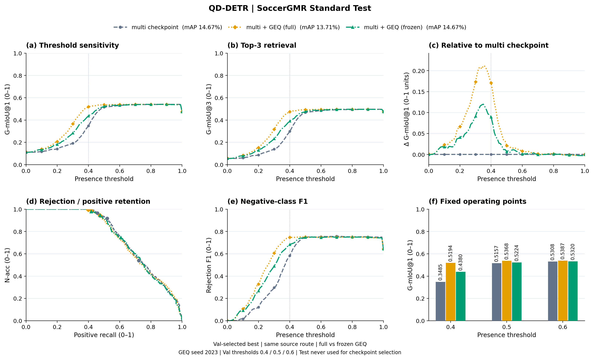
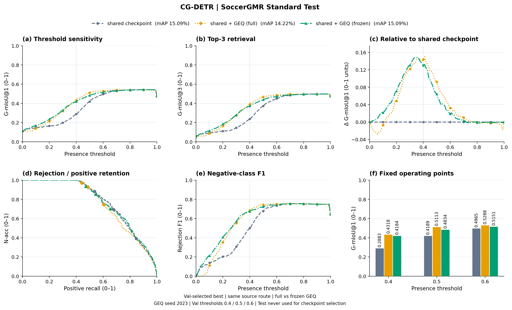

# Baseline / Multi / Shared：统一 Val 选模协议

Multi与Shared各运行全量和冻结两种方案，共16组。另补同源Baseline的两种微调方案8组，合计24组，用于统一四曲线对照。

各方案从对应已完成的原路线best独立初始化，GEQ seed2023。Val G-mIoU@1在0.4/0.5/0.6的均值选best，连续超过5轮（6轮）无提升早停，上限20轮；Test仅评估选定best。full保留原GMR+O2M损失并加GEQ BCE，原模型lr1e-5、GEQ lr3e-5；frozen仅GEQ BCE，原模型保持eval。

每任务num_workers=2，Moment batch8，其余batch32，无梯度累积，AMP关闭。每GPU至多两个CUDA任务，计入已有训练。旧固定4轮结果单独保留，不冒充新选模结果。

全量和冻结成对初始化相同。每骨干四条曲线分别为原GMR、GMR+GEQ、Multi+GEQ、Shared+GEQ；两种训练方式各一套。原GMR与路线的既有预训练预算仍存在差异，完整方法比较不等于单因素因果消融。

更新时间：2026-10-31T23:34:56+08:00

| Backbone | 路线 | 模式 | 状态 | 完成Epoch | Best Epoch | Best Val均值 | Test mAP (%) | Test G1均值 |
|---|---|---|---|---:|---:|---:|---:|---:|
| Moment-DETR | shared | full | COMPLETED | 16 | 10 | 0.4862 | 6.92 | 0.5148 |
| Moment-DETR | shared | frozen | COMPLETED | 9 | 3 | 0.4846 | 7.28 | 0.5128 |
| Moment-DETR | multi | full | COMPLETED | 12 | 6 | 0.4731 | 7.72 | 0.4956 |
| Moment-DETR | multi | frozen | COMPLETED | 9 | 3 | 0.4821 | 7.27 | 0.5042 |
| Moment-DETR | baseline | full | RUNNING | 2 | 1 | 0.4853 | — | — |
| Moment-DETR | baseline | frozen | RUNNING | — | — | — | — | — |

## Moment-DETR · shared · full / frozen

## Moment-DETR · multi · full / frozen

Moment-DETR full：四曲线等待同源Baseline、Multi、Shared全部完成Test。

Moment-DETR frozen：四曲线等待同源Baseline、Multi、Shared全部完成Test。
| EaTR | shared | full | COMPLETED | 9 | 3 | 0.4044 | 17.15 | 0.4205 |
| EaTR | shared | frozen | COMPLETED | 9 | 3 | 0.4226 | 16.65 | 0.4290 |
| EaTR | multi | full | COMPLETED | 10 | 4 | 0.4529 | 19.88 | 0.4760 |
| EaTR | multi | frozen | COMPLETED | 10 | 4 | 0.4539 | 17.52 | 0.4691 |
| EaTR | baseline | full | QUEUED | — | — | — | — | — |
| EaTR | baseline | frozen | QUEUED | — | — | — | — | — |

## EaTR · shared · full / frozen

## EaTR · multi · full / frozen

EaTR full：四曲线等待同源Baseline、Multi、Shared全部完成Test。

EaTR frozen：四曲线等待同源Baseline、Multi、Shared全部完成Test。
| QD-DETR | shared | full | COMPLETED | 9 | 3 | 0.4477 | 15.69 | 0.4466 |
| QD-DETR | shared | frozen | COMPLETED | 10 | 4 | 0.4415 | 15.24 | 0.4417 |
| QD-DETR | multi | full | COMPLETED | 10 | 4 | 0.5021 | 13.71 | 0.5316 |
| QD-DETR | multi | frozen | COMPLETED | 10 | 4 | 0.4714 | 14.67 | 0.4975 |
| QD-DETR | baseline | full | QUEUED | — | — | — | — | — |
| QD-DETR | baseline | frozen | QUEUED | — | — | — | — | — |

## QD-DETR · shared · full / frozen

## QD-DETR · multi · full / frozen

QD-DETR full：四曲线等待同源Baseline、Multi、Shared全部完成Test。

QD-DETR frozen：四曲线等待同源Baseline、Multi、Shared全部完成Test。
| CG-DETR | shared | full | COMPLETED | 7 | 1 | 0.4657 | 14.22 | 0.4906 |
| CG-DETR | shared | frozen | COMPLETED | 10 | 4 | 0.4629 | 15.09 | 0.4723 |
| CG-DETR | multi | full | RUNNING | 2 | 1 | 0.4477 | — | — |
| CG-DETR | multi | frozen | COMPLETED | 7 | 1 | 0.4732 | 16.59 | 0.4815 |
| CG-DETR | baseline | full | QUEUED | — | — | — | — | — |
| CG-DETR | baseline | frozen | QUEUED | — | — | — | — | — |

## CG-DETR · shared · full / frozen

CG-DETR full：四曲线等待同源Baseline、Multi、Shared全部完成Test。

CG-DETR frozen：四曲线等待同源Baseline、Multi、Shared全部完成Test。
