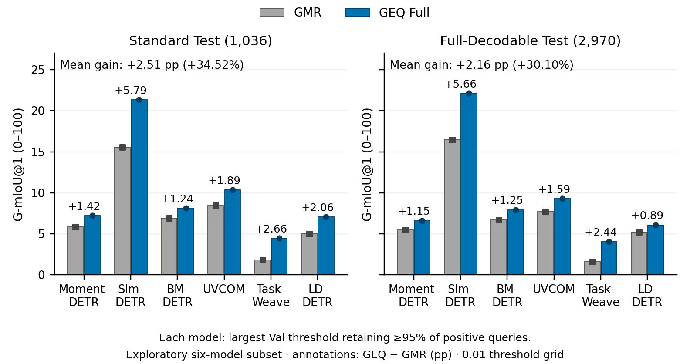
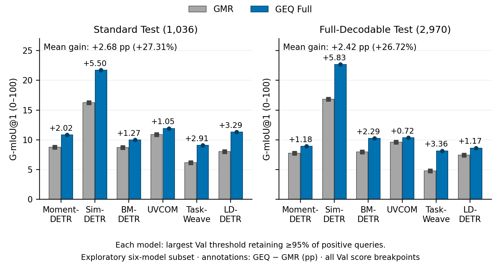

# 高事件保留率场景：六骨干的 GEQ Full 配对分析

**在本次分析识别的六骨干子集中，GEQ Full 的 G-mIoU@1 在 Standard 和 Full 上均提高，且在两种阈值搜索方式下方向一致。** 主分析的骨干等权平均得分在 Standard 上从7.264提高至9.771，在Full上从7.189提高至9.353，相对提升34.52%和30.10%。

本结果包仅报告 Moment-DETR、Sim-DETR、BM-DETR、UVCOM、TaskWeave、LD-DETR，聚焦每次返回一个最佳片段的使用方式。**这是依据已有Test结果及阈值敏感性分析识别的探索性稳定子集，不是事先确定的骨干集合，也不作为所有骨干普适有效的证据。**

## 场景与阈值规则

场景是尽量不因存在性门控而漏掉真实事件，允许用户继续复核返回片段。“正查询保留率”定义为真实存在事件的查询中，通过存在性门控的比例；它不等于定位正确率。

1. 固定已有GMR best及GEQ Full best。GEQ best仍由原训练流程的Val G1(.4/.5/.6)均值选定，没有重新选择epoch。
2. 每个模型分别在Standard Val（465条：255正、210空）上选择满足正查询保留率≥95%的**最大存在性阈值**。这在达到保留率要求的阈值中尽量减少空查询误返回。
3. 主分析搜索0.00–1.00、步长0.01；复核遍历全部Val分数断点及0/1。保留规则均为`p_exist > τ`。
4. 各自阈值原样用于Standard Test和Full Test，指标沿用官方G-mIoU@1；Test不参与阈值优化。两个模型使用相同目标，各自选择适合自身分数尺度的阈值。

## 主结果：0.01网格



图1：六个已识别骨干在两套Test上的G-mIoU@1均提高。灰色左柱为GMR，蓝色右柱为GEQ Full；方形和圆形提供双重编码，柱上标注绝对增益（百分点）。两图使用相同的零起点纵轴，阈值各自在Val上确定。

[PDF矢量图](PRIMARY.pdf) · [SVG矢量图](PRIMARY.svg)

| 骨干 | Standard：GMR→GEQ | Δ百分点 | 相对增益 | Full：GMR→GEQ | Δ百分点 | 相对增益 |
|---|---:|---:|---:|---:|---:|---:|
| Moment-DETR | 5.830→7.246 | +1.415 | +24.28% | 5.474→6.623 | +1.149 | +21.00% |
| Sim-DETR | 15.558→21.346 | +5.788 | +37.20% | 16.455→22.117 | +5.662 | +34.41% |
| BM-DETR | 6.897→8.134 | +1.236 | +17.93% | 6.697→7.949 | +1.252 | +18.70% |
| UVCOM | 8.461→10.348 | +1.887 | +22.30% | 7.691→9.280 | +1.588 | +20.65% |
| TaskWeave | 1.827→4.482 | +2.655 | +145.31% | 1.624→4.064 | +2.440 | +150.31% |
| LD-DETR | 5.009→7.072 | +2.063 | +41.19% | 5.195→6.086 | +0.891 | +17.15% |

相对增益=`100 × (GEQ−GMR)/GMR`。下表汇总先对六骨干的原始得分等权平均，再计算相对增益，不是六个相对百分比的平均。原值和绝对百分点同时报告，避免较低baseline分数造成的比例放大被忽略。

## 精确阈值复核



图2：不采用0.01步长，按完整Val分数断点选阈值后，六个骨干在两套Test上仍均提高。阈值仍只由Val决定；图1和图2各使用自身固定的阈值结果，不能混用。

[PDF矢量图](EXACT_THRESHOLDS.pdf) · [SVG矢量图](EXACT_THRESHOLDS.svg)

| 搜索方式 | 测评集 | GMR平均 | GEQ平均 | Δ百分点 | 相对增益 | 提高骨干数 |
|---|---|---:|---:|---:|---:|---:|
| 0.01网格 | standard | 7.264 | 9.771 | +2.507 | +34.52% | 6/6 |
| 0.01网格 | full | 7.189 | 9.353 | +2.164 | +30.10% | 6/6 |
| 完整Val分数断点 | standard | 9.798 | 12.474 | +2.676 | +27.31% | 6/6 |
| 完整Val分数断点 | full | 9.070 | 11.494 | +2.424 | +26.72% | 6/6 |

## 阈值与实际保留／误返回

95%是Val上的选阈值约束，不保证Test恰好满足同一比例。主分析的Test平均保留率约为Standard GMR99.14%／GEQ97.24%，Full GMR99.48%／GEQ98.59%；平均空查询误返回率分别为97.76%／93.83%、97.82%／94.60%。本场景以保留事件为优先，不能描述为低误返回系统。

`DECISIONS.csv`逐骨干列出两种搜索的阈值、Val保留率、Test保留率与误返回率，均按真实正负标签分组。

## 协议与结论范围

- Moment-DETR、Sim-DETR保留历史六轮早停、75-token协议；BM-DETR、UVCOM、TaskWeave、LD-DETR保留正式十轮早停、128-token协议。只作各骨干内部配对比较，不解释成统一预算的跨骨干排名。
- Standard Test为1036条；Full-Decodable为2970/2986条，已有16条未覆盖。按本包GT快照重算，两套共有185个视频ID、186个相同的视频—文本输入，不能视为独立样本重复验证。
- 使用既有检查点及完整查询预测，没有重新训练。GEQ Full会同时改变定位候选与存在性分数，因此综合增益不能全部归因于GEQ读出结构。
- 本结果比较数值增益，不作统计显著性或多训练种子稳定性声明。
- 候选骨干与主指标在现有结果分析后确定，子集内一致性不替代独立评测或预先确定范围的泛化验证。

可使用的结论：**在高事件保留率这一特定使用方式下，所分析六骨干均观察到Standard和Full的G-mIoU@1提升，并通过精确阈值搜索复核。**

## 数据与复现

[逐骨干指标](METRICS.csv) · [汇总](SUMMARY.csv) · [阈值与错误率](DECISIONS.csv) · [来源与检查点哈希](EVIDENCE.json) · [数值核验](AUDIT.json) · [图表审计](FIGURE_AUDIT.md)

本目录的`evidence/`仅包含上述六骨干的Val及两套Test压缩预测和对应GT快照。所有预测均绑定检查点哈希；模型权重、训练数据特征不在本结果包中。无需GPU或模型权重即可从这些预测重算阈值和指标。

```bash
PYTHONPATH=src python scripts/report_high_retention.py
PYTHONPATH=src python scripts/report_high_retention.py --verify-only
```

重算时逐文件核验压缩与解压预测哈希、qid/vid覆盖、Val/Test查询不重叠和检查点配对。24行指标与既有统计逐字段核验，48个G-mIoU值与官方评测实现逐项匹配。
