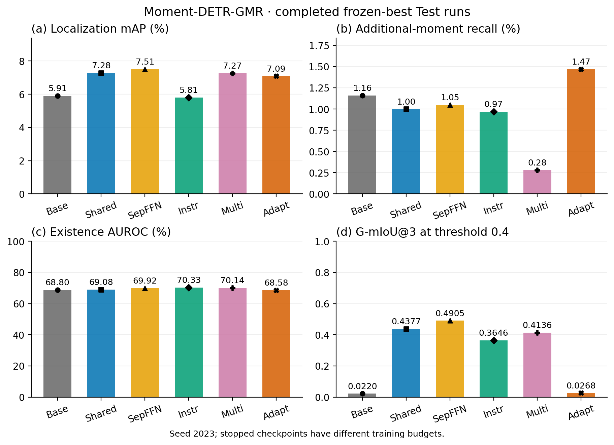
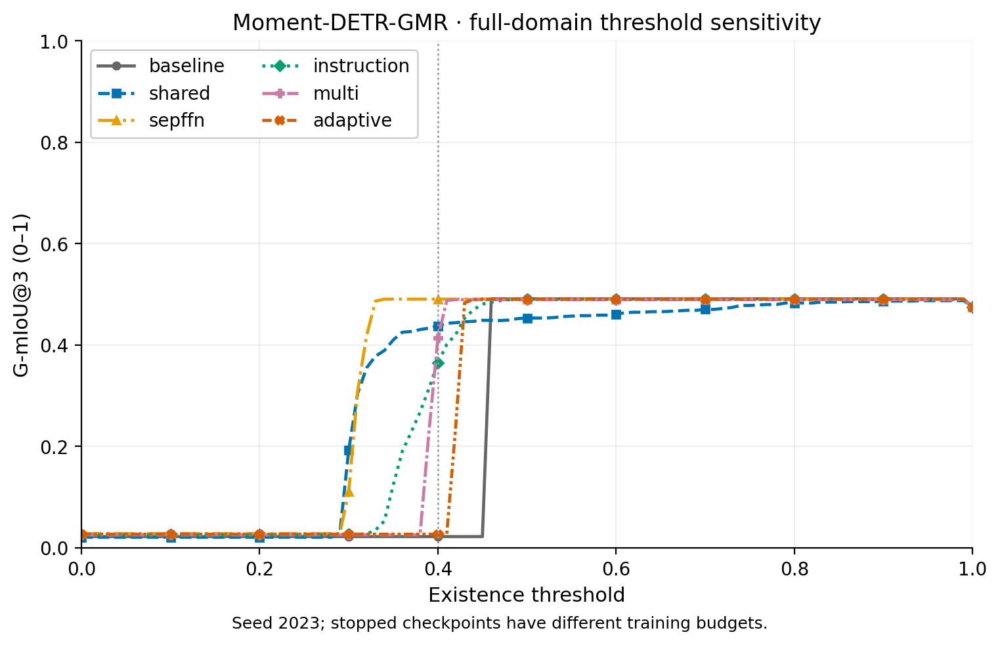

# Moment-DETR-GMR

本目录仅包含该骨干的结果图与数据，更新时间 2026-10-31T18:39:48+08:00。

[完整 24 组结果与协议说明](../README.md)

指标图同时展示定位、额外片段召回、存在性排序与 G-mIoU 的不同变化。数据来自完成的 frozen-best Test，灰色 pending 标签表示尚未测试；统计口径和配置差异见总表。
