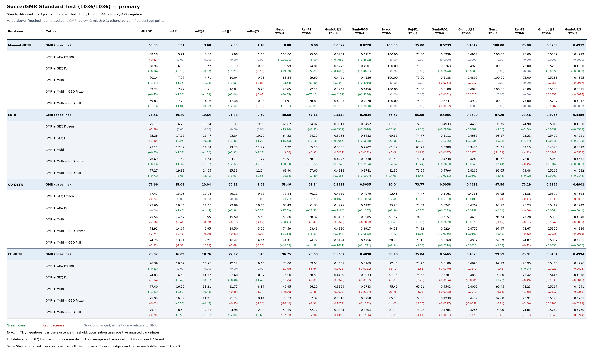
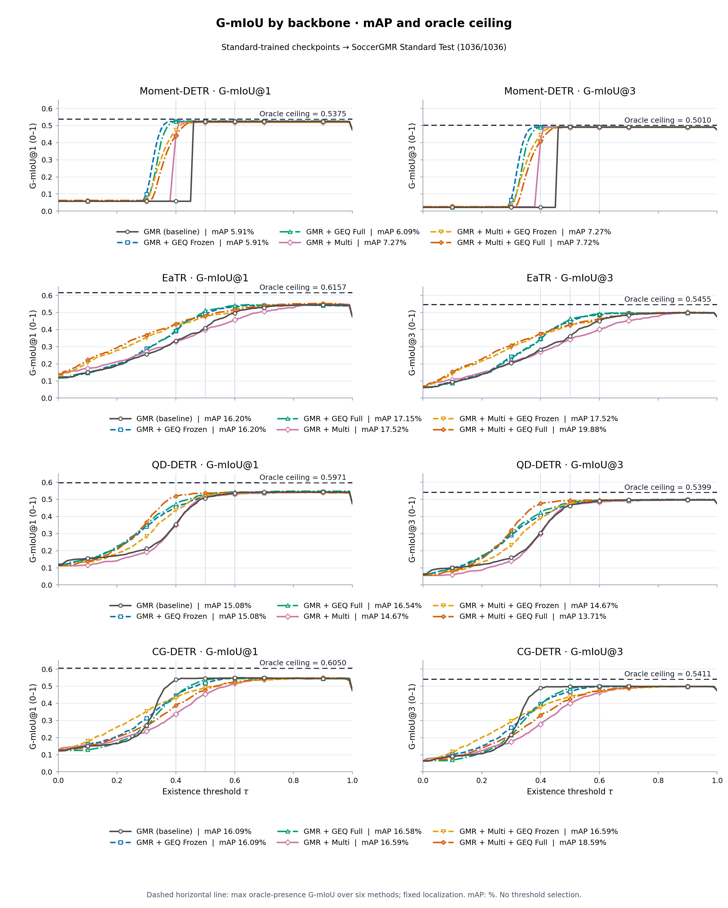
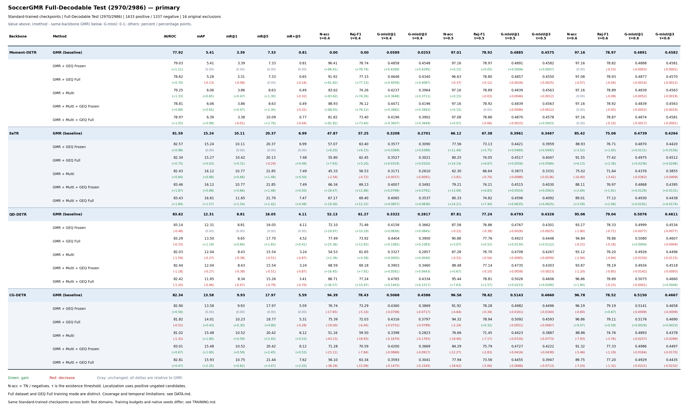
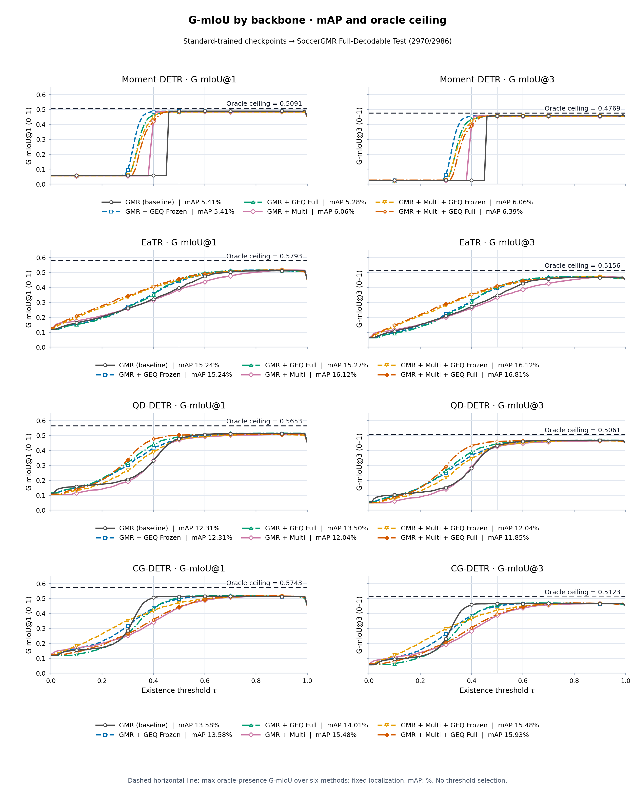

# SoccerGMR两套Test：完整正式主指标

同一批24个Standard训练best在Standard Test及Full-Decodable Test上各24项，共48条。G-mIoU为0–1；其他指标为%，差值为百分点（G-mIoU差值仍为0–1）。括号一律相对同骨干、同Test的GMR。

[全部指标PDF](tables/ALL_TEST_METRICS.pdf) · [CSV](data/RESULTS.csv) · [JSON](data/RESULTS.json) · [全部增减](data/DELTAS_VS_GMR.csv)

| Test | 骨干 | GMR baseline | GEQ Frozen | GEQ Full | Multi | Multi+GEQ Frozen | Multi+GEQ Full |
|---|---|---:|---:|---:|---:|---:|---:|
| Standard Test (1036/1036) | Moment-DETR | **5.91** | 5.91 ⚪ (+0.00) | 6.09 🟢 (+0.18) | 7.27 🟢 (+1.36) | 7.27 🟢 (+1.36) | 7.72 🟢 (+1.81) |
| Standard Test (1036/1036) | EaTR | **16.20** | 16.20 ⚪ (+0.00) | 17.15 🟢 (+0.95) | 17.52 🟢 (+1.32) | 17.52 🟢 (+1.32) | 19.88 🟢 (+3.68) |
| Standard Test (1036/1036) | QD-DETR | **15.08** | 15.08 ⚪ (+0.00) | 16.54 🟢 (+1.46) | 14.67 🔴 (-0.41) | 14.67 🔴 (-0.41) | 13.71 🔴 (-1.37) |
| Standard Test (1036/1036) | CG-DETR | **16.09** | 16.09 ⚪ (+0.00) | 16.58 🟢 (+0.49) | 16.59 🟢 (+0.50) | 16.59 🟢 (+0.50) | 18.59 🟢 (+2.50) |
| Full-Decodable Test (2970/2986) | Moment-DETR | **5.41** | 5.41 ⚪ (+0.00) | 5.28 🔴 (-0.13) | 6.06 🟢 (+0.65) | 6.06 🟢 (+0.65) | 6.39 🟢 (+0.98) |
| Full-Decodable Test (2970/2986) | EaTR | **15.24** | 15.24 ⚪ (+0.00) | 15.27 🟢 (+0.03) | 16.12 🟢 (+0.88) | 16.12 🟢 (+0.88) | 16.81 🟢 (+1.57) |
| Full-Decodable Test (2970/2986) | QD-DETR | **12.31** | 12.31 ⚪ (+0.00) | 13.50 🟢 (+1.19) | 12.04 🔴 (-0.27) | 12.04 🔴 (-0.27) | 11.85 🔴 (-0.46) |
| Full-Decodable Test (2970/2986) | CG-DETR | **13.58** | 13.58 ⚪ (+0.00) | 14.01 🟢 (+0.43) | 15.48 🟢 (+1.90) | 15.48 🟢 (+1.90) | 15.93 🟢 (+2.35) |

## Standard Test (1036/1036)

[主表PDF](tables/STANDARD_PRIMARY.pdf) · [额外定位指标](tables/STANDARD_LOCALIZATION_EXTRA.pdf) · [额外阈值指标](tables/STANDARD_THRESHOLD_EXTRA.pdf)

[曲线总览PDF](figures/standard/ALL_BACKBONES.pdf) · [按骨干分页PDF](figures/standard/BY_BACKBONE.pdf)

## Full-Decodable Test (2970/2986)

[主表PDF](tables/FULL_DECODABLE_PRIMARY.pdf) · [额外定位指标](tables/FULL_DECODABLE_LOCALIZATION_EXTRA.pdf) · [额外阈值指标](tables/FULL_DECODABLE_THRESHOLD_EXTRA.pdf)

[曲线总览PDF](figures/full_decodable/ALL_BACKBONES.pdf) · [按骨干分页PDF](figures/full_decodable/BY_BACKBONE.pdf)
