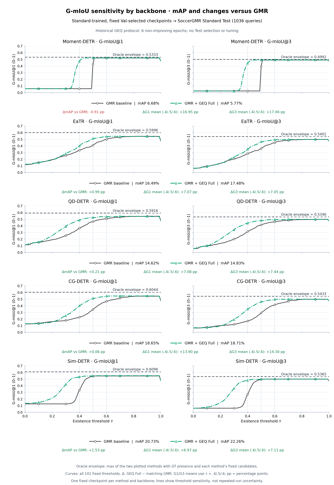
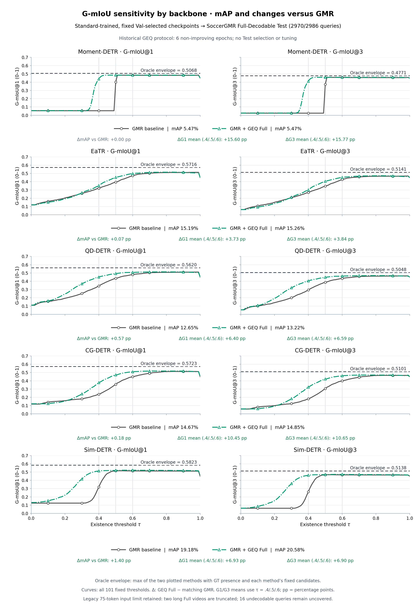

# Five backbones: Standard Test and Full Test

These paired figures compare **GMR baseline** with **GMR + GEQ Full** on the same five backbones. Each method/backbone uses exactly the same immutable checkpoint for Standard Test and Full Test. The four historical main E1 backbones and the Sim-DETR extension retain their own matched GMR initializations.

These are full-coverage Test evaluations of existing **historical six-patience GEQ checkpoints**, not results of retraining the new ten-patience protocol. All checkpoints were already selected on Standard Val. This run performed no training, fine-tuning, Test checkpoint selection or threshold tuning. Five backbone pairs were re-evaluated on Standard first; mAP, mR@1, AUROC and G-mIoU@1/@3 at 0.4/0.5/0.6 reproduce the original formal metrics exactly.

## Standard Test

GEQ Full raises the three-point G-mIoU@1 mean for all five historical Standard Test pairs; localization mAP has both gains and a loss. Curves show the full threshold dependence rather than only positive working points. Standard Test contains 1,036 queries (544 positive, 492 null).



[PDF](STANDARD_TEST.pdf) · [SVG](STANDARD_TEST.svg) · [Individual backbone pages](STANDARD_BY_BACKBONE.pdf)

## Full Test

The same checkpoints are tested on **Full-Decodable 2970/2986**: 2,970 queries (1,633 positive, 1,337 null), retaining the established 16-query exclusion. No additional query is skipped. For these five fixed checkpoint pairs, the three-point G-mIoU@1 mean improves by 3.73–15.60 percentage points, and mAP changes by 0.00 to +1.40 points. Individual thresholds may still show a loss; this does not establish uniform gains across all thresholds or future runs.



[PDF](FULL_TEST.pdf) · [SVG](FULL_TEST.svg) · [Individual backbone pages](FULL_BY_BACKBONE.pdf) · [Both main figures](BOTH_TESTS.pdf)

## Reading the plots

- Left: G-mIoU@1; right: G-mIoU@3. Curves and oracle values use **0–1**. mAP is a percentage. Every row legend reports each method's mAP.
- The additional row annotations report **GEQ Full − the matching GMR**: ΔmAP and the G1/G3 mean at the fixed existence thresholds 0.4, 0.5, 0.6. These deltas are percentage points; positive values are green, negative values red, zero grey. They use the original precision before display rounding.
- Every curve contains the 101 predeclared thresholds 0.00–1.00. The vertical guides locate 0.4/0.5/0.6. These are existence thresholds, not localization IoU thresholds. No threshold is selected on Test.
- The dashed horizontal **oracle envelope** is the maximum oracle-presence G-mIoU of the **two methods actually plotted**, keeping each method's own localization candidates fixed and substituting GT presence. Per-method oracle values are preserved in [ORACLE.csv](ORACLE.csv). This is a GT-assisted diagnostic, not a deployable method or a shared fixed-localization ablation. GEQ Full changes localization, so its oracle can differ from GMR's.
- Oracle presence quantifies recoverable gating loss for fixed candidates. The full GEQ-versus-GMR difference also includes localization changes and must not be attributed entirely to fewer existence errors.

## Protocol and input limits

All models trained on Standard. Full uses its independent video and qid text feature roots. Historical ordering, L2 normalization, text masks and native export are preserved. The legacy maximum video length is 75 two-second tokens, including in Full: the two videos with 94/104 steps are truncated to 75 and their outputs retain duration scaling. The new trainer's 128-token contract is not substituted into these historical evaluations. These plots do not represent training on Full or complete temporal coverage of those two long videos.

The previous four-backbone Full figure used different initial GMR checkpoints. Its numbers must not be spliced into this paired Standard/Full comparison. This evaluation uses the five checkpoint pairs referenced by the current algorithm explanation and recomputes Full for them. Standard and Full Test overlap in 1,036 video-query pairs; they are different evaluation settings rather than independent test samples.

## Reproduction and evidence

Offline figure reproduction, from the repository root:

```bash
pip install -e '.[report]'
python scripts/plot_test_thresholds.py --data results/test_thresholds/PLOT_DATA.json --output results/test_thresholds
```

To re-evaluate the historical checkpoints, supply their exact files and the label/features paths in a local copy of [INPUTS.example.json](INPUTS.example.json). All checkpoint SHA256 values are included. The example paths are relative to the repository root; large weights and features are not distributed here. Restore the published label snapshots if needed: [Standard](ground_truth/standard.jsonl.gz), [Full-Decodable](ground_truth/full.jsonl.gz).

```bash
python scripts/evaluate_historical_geq.py --manifest /path/to/local_inputs.json --backbone moment_detr --output runs/historical_test/moment_detr
PYTHONPATH=src python scripts/collect_test_thresholds.py --inputs /path/to/local_inputs.json --runs runs/historical_test --output runs/historical_test_report
```

Run the inference command once per backbone in independent processes. Each performs Standard and Full Test for both methods, strict state loading, exact original Standard metric verification, full qid coverage and checkpoint immutability checks. Output directory locking and hashed completion records prevent repeated inference on a valid completed run.

[METRICS.csv](METRICS.csv) provides raw values and deltas; [CURVES.csv](CURVES.csv) all threshold points; [PLOT_DATA.json](PLOT_DATA.json) the portable plotting snapshot; [AUDIT.json](AUDIT.json) the 20-run integrity checks; [FIGURE_AUDIT.md](FIGURE_AUDIT.md) the plot design audit. [`runs/`](runs/) contains compressed per-query predictions, official metrics and completion records. Decompressed prediction hashes match the records. The collector independently recomputes official mAP and checks the sweep at endpoints and 0.4/0.5/0.6, plus oracle gating for both k values.
