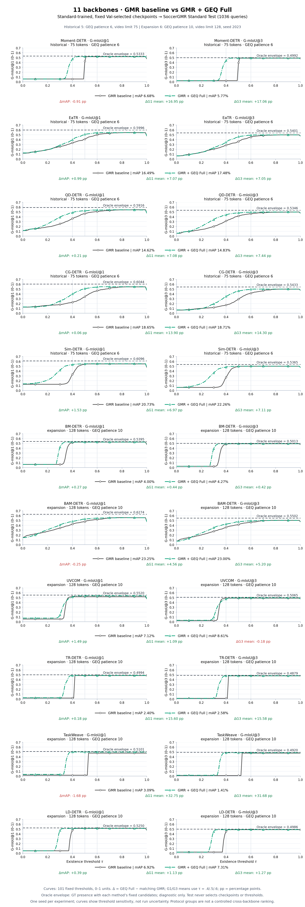
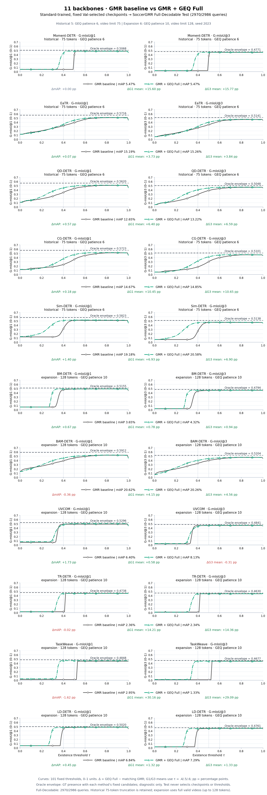

# 11 骨干：Standard 与 Full-Decodable 配对 Test

11 个骨干的 GMR 与 GEQ Full 固定 best 均已完成两套 Test，共 44 组评测。结果包含提高与下降，不按 Test 表现筛选模型。每行只比较本骨干同一 profile 下的配对 GMR；不同协议组不能视为受控的跨骨干排名。

- 历史 5 个：Moment-DETR、EaTR、QD-DETR、CG-DETR、Sim-DETR，沿用原有初始化、GEQ 连续6轮无提升早停（上限20轮）及75-token输入协议。
- 新增 6 个：BM-DETR、BAM-DETR、UVCOM、TR-DETR、TaskWeave、LD-DETR；Standard Train训练、每轮完整 Standard Val；GMR按Val正查询mAP选best（patience20/max200），GEQ按Val G1(.4/.5/.6)均值选best（patience10/max200），128-token输入、真实duration坐标、seed2023。
- Standard Test 1,036 条；Full-Decodable 2,970/2,986 条。两套使用同一个各阶段 best；Full有16条未覆盖，未自动补造预测。历史75-token长视频截断行为保留，新增6个完整读取94/104-token长视频。Standard与Full存在样本重叠，不是两个独立样本群。
- 曲线为101个固定存在性阈值，图中G-mIoU用0–1。下表mAP、G1/G3用0–100，Δ为百分点；G1/G3均值使用τ=.4/.5/.6。保留官方输出精度；CSV中的G和相关Δ为0–1、mAP和ΔmAP为0–100。
- 门控规则p_exist > τ。正查询mAP使用未门控候选；GEQ Full会改变骨干和定位输出，不能把全部增益归因于存在性错误减少。oracle-presence固定各模型候选并使用GT存在性，是诊断值；图中虚线为两方法oracle最大值。单种子无跨运行误差条。

## Standard Test



[PDF](STANDARD_TEST.pdf) · [SVG](STANDARD_TEST.svg) · [逐骨干PDF](STANDARD_BY_BACKBONE.pdf)

| 骨干 | 协议 | GMR mAP | GEQ mAP | ΔmAP | GMR G1均值 | GEQ G1均值 | ΔG1 | GMR G3均值 | GEQ G3均值 | ΔG3 |
|---|---|---:|---:|---:|---:|---:|---:|---:|---:|---:|
| Moment-DETR | 历史6轮/75步 | 6.68 | 5.77 | 🔴 -0.91 | 33.45 | 50.40 | 🟢 +16.95 | 30.27 | 47.34 | 🟢 +17.06 |
| EaTR | 历史6轮/75步 | 16.49 | 17.48 | 🟢 +0.99 | 41.34 | 48.41 | 🟢 +7.07 | 36.43 | 43.49 | 🟢 +7.05 |
| QD-DETR | 历史6轮/75步 | 14.62 | 14.83 | 🟢 +0.21 | 44.56 | 51.64 | 🟢 +7.08 | 39.66 | 47.10 | 🟢 +7.44 |
| CG-DETR | 历史6轮/75步 | 18.65 | 18.71 | 🟢 +0.06 | 34.62 | 48.52 | 🟢 +13.90 | 29.25 | 43.54 | 🟢 +14.30 |
| Sim-DETR | 历史6轮/75步 | 20.73 | 22.26 | 🟢 +1.53 | 47.35 | 54.33 | 🟢 +6.97 | 42.17 | 49.28 | 🟢 +7.11 |
| BM-DETR | 新10轮/128步 | 4.00 | 4.27 | 🟢 +0.27 | 52.16 | 52.60 | 🟢 +0.44 | 48.77 | 49.19 | 🟢 +0.42 |
| BAM-DETR | 新10轮/128步 | 23.25 | 23.00 | 🔴 -0.25 | 47.44 | 52.00 | 🟢 +4.56 | 41.20 | 46.40 | 🟢 +5.20 |
| UVCOM | 新10轮/128步 | 7.12 | 8.61 | 🟢 +1.49 | 51.83 | 52.92 | 🟢 +1.09 | 48.94 | 48.76 | 🔴 -0.18 |
| TR-DETR | 新10轮/128步 | 2.40 | 2.58 | 🟢 +0.18 | 32.81 | 48.41 | 🟢 +15.60 | 32.22 | 47.80 | 🟢 +15.58 |
| TaskWeave | 新10轮/128步 | 3.09 | 1.41 | 🔴 -1.68 | 17.05 | 49.80 | 🟢 +32.75 | 16.58 | 48.26 | 🟢 +31.68 |
| LD-DETR | 新10轮/128步 | 6.92 | 7.31 | 🟢 +0.39 | 50.21 | 51.34 | 🟢 +1.13 | 47.48 | 48.75 | 🟢 +1.27 |

## Full-Decodable Test



[PDF](FULL_TEST.pdf) · [SVG](FULL_TEST.svg) · [逐骨干PDF](FULL_BY_BACKBONE.pdf)

| 骨干 | 协议 | GMR mAP | GEQ mAP | ΔmAP | GMR G1均值 | GEQ G1均值 | ΔG1 | GMR G3均值 | GEQ G3均值 | ΔG3 |
|---|---|---:|---:|---:|---:|---:|---:|---:|---:|---:|
| Moment-DETR | 历史6轮/75步 | 5.47 | 5.47 | ⚪ +0.00 | 31.33 | 46.93 | 🟢 +15.60 | 28.53 | 44.30 | 🟢 +15.77 |
| EaTR | 历史6轮/75步 | 15.19 | 15.26 | 🟢 +0.07 | 39.65 | 43.39 | 🟢 +3.73 | 34.76 | 38.60 | 🟢 +3.84 |
| QD-DETR | 历史6轮/75步 | 12.65 | 13.22 | 🟢 +0.57 | 41.95 | 48.35 | 🟢 +6.40 | 37.22 | 43.80 | 🟢 +6.59 |
| CG-DETR | 历史6轮/75步 | 14.67 | 14.85 | 🟢 +0.18 | 34.77 | 45.22 | 🟢 +10.45 | 29.50 | 40.15 | 🟢 +10.65 |
| Sim-DETR | 历史6轮/75步 | 19.18 | 20.58 | 🟢 +1.40 | 44.94 | 51.87 | 🟢 +6.93 | 39.85 | 46.76 | 🟢 +6.90 |
| BM-DETR | 新10轮/128步 | 3.65 | 4.32 | 🟢 +0.67 | 48.40 | 49.18 | 🟢 +0.78 | 45.08 | 46.02 | 🟢 +0.94 |
| BAM-DETR | 新10轮/128步 | 20.62 | 20.26 | 🔴 -0.36 | 44.81 | 48.96 | 🟢 +4.15 | 38.97 | 43.53 | 🟢 +4.56 |
| UVCOM | 新10轮/128步 | 6.40 | 8.13 | 🟢 +1.73 | 49.11 | 49.69 | 🟢 +0.58 | 45.91 | 45.60 | 🔴 -0.31 |
| TR-DETR | 新10轮/128步 | 2.36 | 2.34 | 🔴 -0.02 | 30.97 | 45.18 | 🟢 +14.21 | 30.08 | 44.44 | 🟢 +14.36 |
| TaskWeave | 新10轮/128步 | 2.95 | 1.33 | 🔴 -1.62 | 16.09 | 46.25 | 🟢 +30.16 | 15.78 | 44.87 | 🟢 +29.09 |
| LD-DETR | 新10轮/128步 | 6.84 | 7.29 | 🟢 +0.45 | 47.19 | 48.51 | 🟢 +1.32 | 44.63 | 45.97 | 🟢 +1.33 |

## 产物、审计与再生成

[两套总图PDF](BOTH_TESTS.pdf) · [44组审计](AUDIT.json) · [完整指标/混淆计数与错误率](METRICS.csv) · [101点曲线](CURVES.csv) · [oracle与全部拒识参考](ORACLE.csv) · [可移植绘图数据](PLOT_DATA.json) · [新增阶段血缘](TRAINING_LINEAGE.json)

`runs/<backbone>/<split>/<method>/`保存新增24组压缩预测、官方metrics、Test完成标记和阶段完成记录；原有20组继续引用[历史预测和审计](../test_thresholds/)。预测gzip不含模型权重。`training/`保存新增六骨干各阶段的Val轨迹、选模指标、完成标记和架构选项。检查点、优化器和数据特征保留本地，不上传大权重。

收集脚本核验：标签/预测/指标哈希、精确qid及vid、正负计数、两套检查点一致、阶段完成且best哈希一致、GEQ与本次GMR的血缘；重算全部44组官方brief、三阈值G1/G3和FP/FN/TN/TP，并核对历史曲线不变。图仅从已审计PLOT_DATA生成，不访问Test选择模型。

```bash
# 已发布数据上离线重绘，不需要GPU/检查点/原始特征
python scripts/plot_eleven_backbones.py --data results/test_thresholds_11_backbones/PLOT_DATA.json --output results/test_thresholds_11_backbones

# 从本地不可变正式产物重新收集（两目录由使用者提供）
PYTHONPATH=src python scripts/collect_eleven_backbones.py --first-root /path/to/first/formal --second-root /path/to/second/formal
```

发布内容仅增加结果、图表、收集和绘图脚本及文档。新六骨干的训练源码有独立source identity，未把另一个工作区的未提交adapter自动打包进本次发布。本结果包不声称当前远程源码已包含全部六个训练adapter；复训代码迁移需另行审查其冻结版本。历史五骨干的原始协议与完整证据保持可访问。
